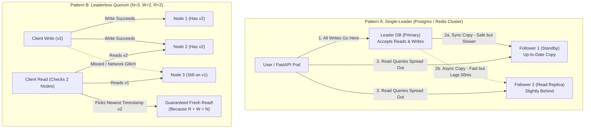

# Replication, Consistency & CAP/PACELC (Plain-English Guide)

> **Quick Summary — What This Is & Why Interviewers Care**
>
> - **What is Replication?** Keeping **multiple copies of the same data** on different computers (servers) so your app doesn't die if one computer catches fire.
> - **Why Interviewers Ask This in AI Design:** Every stateful piece of an AI app—your **Vector Database** (Chroma/Qdrant), your **Agent Memory** (Redis), and your **Audit Database** (Postgres)—keeps copies across multiple servers. Interviewers want to know: *"What happens to a user's live chat or search query if the main database server crashes mid-sentence, or if a backup copy is 2 seconds behind?"*
> - **The Golden Trade-Off:** You can either wait for all copies to agree before replying to the user (**Safe & Accurate, but Slower**) OR reply immediately and copy the data in the background (**Super Fast, but risks showing slightly old data or losing 1 second of work if a server crashes**).

---

## 1. First Principles: Why Do We Copy Data at All?

Imagine you write your entire startup's customer database on **one single notebook**. What could go wrong?
1. If someone spills coffee on that notebook, your business is gone forever.
2. If 1,000 employees try to read that one notebook at the same time, there is a massive line out the door.
3. If your notebook is in Mumbai, an employee in New York has to wait for a flight across the ocean just to read a page.

In distributed systems, we **replicate** (keep copies of data on multiple servers) for **three exact reasons**—in an interview, always state *which one* you are solving:

1. **High Availability (Surviving Crashes):** If Server A dies, Server B immediately takes over so users never see an error page.
2. **Read Scaling (Handling More Traffic):** If 10,000 users are searching your database at once, you can spread those read requests across 5 copies instead of overloading 1 server.
3. **Lower Latency (Putting Data Near Users):** Put a copy in US-East and a copy in Europe so users read from a server close to home (`10ms` instead of `150ms` across the ocean).

---

## 2. The 3 Ways to Organize Your Copies (Replication Topologies)

Once you have 3 servers holding the same data, a big question comes up: **When a user updates their profile or sends a new chat message, which server receives the update first?**

There are 3 classic ways to organize this. Think of it like managing a shared team notebook:

### Pattern 1: Single-Leader (One Boss, Many Assistants)
- **The Analogy:** Only the **Head Teacher (the Leader)** is allowed to write in the master gradebook with a pen. Two **Assistant Teachers (Followers / Read Replicas)** photocopy every change from the Head Teacher's book. Students can ask *any* assistant to read their grades, but if a grade needs to be changed, it *must* go to the Head Teacher.
- **Where you use it:** **PostgreSQL, MySQL, and Redis (Primary + Replicas)**. Almost 90% of standard databases work this way!
- **What can go wrong:**
  - If the Leader crashes, one of the Followers must be promoted to become the new Leader (**Failover**).
  - **Split-Brain:** If the old Leader wasn't actually dead (just had a brief Wi-Fi hiccup) and comes back online while a new Leader is already chosen, you now have *two* servers thinking they are the boss, accepting conflicting writes!

### Pattern 2: Multi-Leader (Multiple Bosses in Different Cities)
- **The Analogy:** Like two editors in **New York** and **London** both allowed to type into their local copy of a document at the same time, and they sync their edits across the ocean every few seconds.
- **Where you use it:** Multi-region apps where users in both the US and Europe need fast local writes, or offline-first apps (like Notion or Google Docs offline mode).
- **What can go wrong (Write Conflicts):** What if at `12:00:01 PM`, New York changes a ticket status to `"Resolved"` while London changes the *exact same ticket* to `"Escalated"`? When they sync, they clash! You must pick a conflict-resolution rule:
  - **Last Write Wins (LWW):** Highest timestamp wins (dangerous because server clocks are never perfectly in sync).
  - **CRDTs (Conflict-Free Replicated Data Types):** Smart data structures (used by Figma/Google Docs) that automatically merge edits without losing either side.

### Pattern 3: Leaderless / Quorum (No Boss — Vote by Majority)
- **The Analogy:** There is no head teacher. Instead, there are **3 bulletin boards (`N = 3`)**. Whenever you post a notice, you personally pin it to at least **2 boards (`W = 2`)**. Whenever someone wants to read the latest notice, they walk up and check at least **2 boards (`R = 2`)** and pick the newest timestamp.
- **Why this works (The Quorum Formula: `R + W > N`):**
  Let's do the simple math with **3 servers (`N = 3`)**:
  - Suppose you write to **2 servers (`W = 2`)** — say, **Server 1** and **Server 2**. (Server 3 missed the update).
  - Later, Alice reads from **any 2 servers (`R = 2`)** — even in the worst case where she picks **Server 2** and **Server 3**, **Server 2** was part of the write!
  - Because `R + W > N` (`2 + 2 > 3`), the servers you read from and the servers you wrote to are **guaranteed to overlap by at least 1 server** that holds the newest data.
  - When Alice sees that Server 2 has version `v2` and Server 3 has old version `v1`, she takes `v2` and quietly fixes Server 3 in the background (**Read Repair**).

---

## 3. Visual Blueprint: How Replication & Failover Work

Follow the two paths below to see the difference between **Single-Leader Replication** (used in your Deloitte Redis/Postgres setup) and **Quorum Replication** (`R + W > N`):



---

## 4. Side-by-Side Comparison: Choosing a Replication Style

| Replication Topology | How Writes Work | Biggest Strength | Biggest Trap to Watch Out For | Best Real-World Use Case |
| :--- | :--- | :--- | :--- | :--- |
| **Single-Leader** | All writes go to 1 Primary; Followers copy its log | Simple; zero write conflicts; easy transactions | If Leader dies before copying to Followers, recent writes are lost | **90% of apps:** Postgres user data, Redis agent checkpoints |
| **Multi-Leader** | Each region has its own Leader that accepts local writes | Fast local writes in multiple countries | **Write conflicts** when two regions edit the same record at once | Multi-region active-active databases, collaborative docs |
| **Leaderless (Quorum)** | Client writes to `W` nodes and reads from `R` nodes (`R + W > N`) | No single point of failure; survives node crashes with zero failover pause | Can still return stale reads if `R + W <= N`; clock skew issues | High-availability key-value/wide-column stores (**Cassandra, DynamoDB**) |

---

## 5. Synchronous vs. Asynchronous Replication (Speed vs. Safety)

When a user sends a write to the **Leader**, when does the Leader say *"Saved! (`200 OK`)"* back to the user?

1. **Synchronous (Wait for Backup Before Replying):**
   - **How it works:** The Leader writes the data, sends it to the Follower, **waits** for the Follower to confirm *"I saved it too!"*, and only then replies to the user.
   - **Pros:** **Zero data loss.** If the Leader explodes 1 millisecond later, the Follower is 100% up to date.
   - **Cons:** **Slower writes** (you wait for network travel), and if the Follower is down or slow, the Leader gets stuck waiting too!
2. **Asynchronous (Reply Immediately, Copy in Background):**
   - **How it works:** The Leader saves the data locally, immediately tells the user *"Saved! (`200 OK`)"* in `<1ms`, and copies the data to Followers in the background a few milliseconds later.
   - **Pros:** **Blazing fast** writes; Leader never slows down even if Followers are lagging.
   - **Cons:** Two classic bugs:
     - **Lost Writes on Crash:** If the Leader crashes 5ms after telling the user *"Saved!"*—before the background copy reached the Follower—that write is lost forever.
     - **Stale Reads:** If Alice updates her profile on the Leader and immediately refreshes the page (which reads from a lagging Follower), she sees her *old* profile!
3. **Semi-Synchronous (The Practical Sweet Spot):**
   - You have 1 Leader and 3 Followers. The Leader waits for **just 1 Follower** synchronously (so at least two machines have the data), and updates the other 2 Followers asynchronously. You get both safety and speed.

---

## 6. Consistency Levels Explained with Everyday Examples

"Consistency" simply answers: **When data is updated, how quickly and reliably does everyone see the new version?** Here are the 4 levels interviewers want you to name, ordered from strictest to loosest:

### 1. Linearizable (Strong Consistency) — "One Single Truth Right Now"
- **What it means:** Even though there are 5 copies of the data, the database acts as if there is **only 1 single copy in the universe**. The instant a write finishes at `12:00:00.001`, every single user on Earth who reads at `12:00:00.002` sees the new value.
- **When you MUST have it:**
  - **Bank balances & Refunds:** Preventing a customer from clicking "Refund" twice and getting double money.
  - **Permissions / Security Revocation:** When an employee is fired or removed from a confidential folder, they must lose access *immediately*.
  - **Distributed Locks / Leader Election:** Making sure only 1 server becomes the Leader.

### 2. Read-Your-Writes (Session Consistency) — "Never Gaslight the User"
- **The Problem:** Imagine you post a comment on YouTube, hit refresh, and **your comment is gone** (because your write went to the Leader, and your refresh read from a Follower that is 2 seconds behind). You panic and post it 3 more times!
- **What Read-Your-Writes means:** Other users around the world might see your comment 2 seconds late (eventual consistency), and that's totally fine—**as long as YOU always see your own updates immediately**.
- **How to build it easily (The Interview Trick):**
  Whenever a user writes data, attach a timestamp (or route that specific user's reads to the **Leader** for the next 5 seconds), while letting everyone else read from cheap Followers.

### 3. Causal / Sequential Consistency — "Keep Cause and Effect in Order"
- **What it means:** Things that are logically related *must* appear in order for everyone.
- **Example:** In a group chat, Alice asks: *"Should we launch today?"* and Bob replies: *"Yes, let's do it!"* It is unacceptable for a third person's screen to show Bob's *"Yes, let's do it!"* **before** Alice's question. Unrelated chats in other rooms can arrive in any order, but cause-and-effect within a thread must stay ordered.

### 4. Eventual Consistency — "Wait a Few Seconds and Everything Matches"
- **What it means:** If you stop making new updates, all copies will *eventually* catch up (usually within a few milliseconds to a few seconds).
- **When it's completely fine:** YouTube view counters, "Likes" on a post, analytics dashboards, or newly uploaded documents appearing in a **Vector Search index** 3 seconds later.

---

## 7. CAP and PACELC Without the Confusing Myths

Interviewers love asking about **CAP** and **PACELC**, and 80% of candidates recite a textbook definition without understanding what it means in real life. Here is the plain-English truth:

### The CAP Theorem (What Happens During a Network Cut)
Imagine you have two database servers—one in **New York (Server A)** and one in **London (Server B)**—and a shark bites the undersea internet cable between them. This broken connection is called a **Network Partition (`P`)**.
Now a user in London tries to check or update their account on Server B. Because the cable is cut, Server B cannot talk to Server A. You are forced to make a hard choice between two options:
- **Choose `C` (Consistency — Safety First):** Server B says: *"Sorry, I can't talk to New York right now to verify the latest data, so I must return an Error (`503 Unavailable`) until the cable is fixed."* (Think: **Banking / Billing**).
- **Choose `A` (Availability — Always Answer):** Server B says: *"I can't talk to New York, so I'll give you the best answer I have right now, even if it might be slightly out of date."* (Think: **Shopping Cart / AI Chatbot Fallback**).

> **The Myth to Bust in Interviews:** People say *"Pick 2 out of C, A, P."* You cannot "avoid" network partitions (`P`)—networks break in real life! So CAP really means: **When a network partition happens, do you return an error (`CP`) or return potentially slightly stale data (`AP`)?**

### The PACELC Theorem (What Happens the Other 99.9% of the Time!)
CAP only talks about when the network is broken. What about **normal everyday operation** when the network is working fine? That's what **PACELC** adds:
- **If there is a Partition (`P`):** Choose **Availability (`A`)** or **Consistency (`C`)**.
- **Else (`E` — normal operation when everything is healthy):** Choose **Latency (`L` — fast replies)** or **Consistency (`C` — waiting for all replicas)**.
- **Why PACELC is way more useful:** Even when nothing is broken, if you want **Strong Consistency (`C`)** across regions, every write has to wait `150ms` for light to travel across the ocean and back. If you want **Low Latency (`L` — `<5ms`)**, you must reply locally and copy asynchronously!

### Bonus: Consensus (Raft & Paxos) in 30 Seconds
How do 5 servers automatically agree on who the Leader is without a human stepping in? They use a **Consensus Algorithm** (**Raft** or **Paxos**).
- **How it works:** It works just like a democratic vote requiring a **strict majority (`> 50%`)**. In a cluster of **3 servers**, at least **2** must agree. In a cluster of **5 servers**, at least **3** must agree.
- **Why we always use odd numbers (3 or 5 servers, never 4):** With 3 servers, you can survive **1 failure** (2 left = majority). With 4 servers, you need 3 for a majority—so you can STILL only survive **1 failure**! A 4th server costs money without adding fault tolerance.
- **Where you use it:** You never code Raft from scratch; it runs inside **etcd** (Kubernetes' brain), **ZooKeeper**, and **Google Cloud Spanner**.

---

## 8. Production AI & Resume Tie-In (Deloitte & Network18)

Here is how you connect Replication & Consistency directly to your production AI systems:

### 1. Deloitte Multi-Agent Support: Surviving a Redis Primary Crash
- **The Scenario:** In your Deloitte customer support system on GKE, an AI agent is on Step 3 of a 4-step workflow (1. Verify user → 2. Check order → 3. Issue refund in ERP → 4. Reply to user). We store the agent's conversation state in **Redis Cluster** (which uses **Single-Leader asynchronous replication** for sub-millisecond speed).
- **The Failure:** Right after Step 3 finishes, the Redis Primary node crashes before copying Step 3's checkpoint to the Redis Replica! The Replica is promoted to Primary, but it still thinks the agent is on **Step 2**.
- **How You Solved It:**
  1. **Dual-Write / Durable Checkpointing on Critical Boundaries:** Normal chat turns checkpoint to Redis (`<2ms`), while side-effecting tool transitions also write to **Cloud SQL (Postgres)** or wait for `WAIT 1` (semi-sync replica ack in Redis).
  2. **Idempotency Keys on Every Tool Call:** Even if the agent wakes up on Step 2 and tries to run `issue_refund()` a second time, it attaches `idempotency_key = hash(thread_id + "issue_refund" + step_2)`. The downstream ERP sees that key was already processed and returns the existing receipt instead of double-refunding the customer!

### 2. Deloitte Slide RAG: Vector Database Replication Lag & RBAC
- **The Scenario:** In your Slide RAG system (Qdrant / Vertex Vector Search), one primary shard accepts new slide embeddings and replicates them **asynchronously** to read replicas to handle high search QPS.
- **The Consistency Decision:**
  - **For new slides (Eventual Consistency is fine):** If a consultant uploads a new pitch deck and it takes **2–3 seconds** to appear in search results across all read replicas, nobody complains. We state a **freshness SLO of `<5 seconds`**.
  - **For Permissions / Access Revocation (Strong Consistency required):** If a partner marks a confidential M&A deck as *"Restricted"*, a junior analyst must not be able to retrieve it for even 1 second. Permission checks verify against the **strongly consistent metadata store / JWT claims**, not a lagging replica.

### 3. Multi-Region Gemini Fallback (Choosing `A` over `C` in CAP)
- When `us-central1` Vertex AI Gemini hits a regional outage or quota spike, your gateway fails over to `europe-west4`. You are explicitly choosing **Availability (`A`)** over strict consistency: the user still gets a `<1.8s` response, even if a slightly different regional cache or minor model patch level serves the reply.

### Code Example: Read-Your-Writes + Semi-Sync Safety in Python (Redis + FastAPI)

```python
import redis.asyncio as redis

async def save_agent_checkpoint(
    redis_leader: redis.Redis,
    session_id: str,
    step_number: int,
    state_json: str,
    is_critical_tool_step: bool = False,
):
    checkpoint_key = f"checkpoint:{session_id}"
    
    # 1. Write the latest agent state to the Redis Leader
    await redis_leader.set(checkpoint_key, state_json, ex=3600)
    
    # 2. If the agent just executed a real-world action (like a refund),
    # use Redis WAIT to block until at least 1 Follower replica confirms
    # it copied the checkpoint (Semi-Synchronous Replication within 50ms timeout).
    if is_critical_tool_step:
        replicas_acked = await redis_leader.execute_command("WAIT", 1, 50)
        if replicas_acked < 1:
            # Fallback: log to durable Postgres outbox if replica didn't ack in time
            await save_backup_to_postgres(session_id, step_number, state_json)


async def read_agent_checkpoint(
    redis_leader: redis.Redis,
    redis_replica: redis.Redis,
    session_id: str,
    user_just_wrote: bool,
) -> str | None:
    checkpoint_key = f"checkpoint:{session_id}"
    
    # 3. READ-YOUR-WRITES TRICK:
    # If the user is actively mid-turn, read from the Leader so we NEVER
    # read a stale checkpoint from a lagging replica.
    # For read-only historical views, spread load across cheap Replicas!
    target_db = redis_leader if user_just_wrote else redis_replica
    return await target_db.get(checkpoint_key)
```

---

## 9. Common Interview Questions (Answered Simply)

### Q1: "Your Redis Primary dies right in the middle of a customer support conversation. What does the user see, and what data can you lose?"
- **What they are really testing:** Do you know that Redis uses **asynchronous replication** by default, and how to protect financial/tool actions from replica lag?
- **How to answer simply:**
  > "Because Redis replicates asynchronously for speed, if the Primary crashes, the Replica takes over in a few seconds, but it might be missing the **last few milliseconds of writes**—meaning the very last agent step could be lost.
  > To make sure the user never sees an error or gets double-charged, we do two things:
  > 1. For critical tool steps like issuing a refund, we use **idempotency keys** (`hash(thread_id + step_id)`) so if the new Redis primary replays the last step, the billing system recognizes the duplicate key and doesn't charge twice.
  > 2. During the brief failover window, our FastAPI pod catches the connection error, retries with a short backoff, and resumes the SSE stream seamlessly from the last saved checkpoint."

### Q2: "When is eventual consistency completely fine in an AI product, and when is it unacceptable?"
- **What they are really testing:** Can you separate parts of an AI system that need speed (`AP/EL`) from parts that need strict safety (`CP/EC`)?
- **How to answer simply:**
  > "Eventual consistency is **great** for **Vector Search indexing and analytics**—if a newly uploaded slide takes 3 seconds to replicate across our Qdrant read replicas before showing up in search, users won't even notice.
  > However, eventual consistency is **unacceptable** in three places:
  > 1. **RBAC & Permission Revocation:** If a confidential document's access is revoked, no replica can serve it even 1 second later.
  > 2. **Token Quota / Billing Counters:** Or a malicious user could fire 100 parallel requests and bypass their spend limit.
  > 3. **Side-Effecting Agent Tool Locks:** Ensuring two agent workers don't execute the same customer refund twice."

### Q3: "Explain the Quorum rule `R + W > N` in plain English, and pick exact numbers for a read-heavy AI workload."
- **What they are really testing:** Do you understand how leaderless databases guarantee fresh reads, and how to tune `R` and `W` for workload shape?
- **How to answer simply:**
  > "`N` is the total number of copies, `W` is how many copies must confirm a write, and `R` is how many copies we check on a read. As long as `R + W > N`, the group of servers we read from is **mathematically guaranteed to overlap** with at least one server that got the latest write.
  > Standard balanced quorum is **`N = 3, W = 2, R = 2`**.
  > However, if our workload is **99% reads and 1% writes** (like reading cached user profiles or prompt templates), we can set **`N = 3, W = 3, R = 1`**. That makes writes slightly slower because all 3 nodes must confirm, but now **reads only need to check 1 single node (`R = 1`)** and are still 100% guaranteed to get the freshest data (`1 + 3 > 3`)!"

### Q4: "What does PACELC add on top of the CAP theorem?"
- **What they are really testing:** Do you realize CAP only applies during rare network outages, while PACELC explains everyday latency trade-offs?
- **How to answer simply:**
  > "CAP only tells you what to do during a **Network Partition (`P`)**—when a cable is cut, you must choose between returning an error (**Consistency**) or returning potentially stale data (**Availability**).
  > **PACELC** adds the **Else (`E`)** case: what happens the other **99.9% of the time when the network is completely healthy**. Even with zero network failures, you still have to choose between **Latency (`L`)** and **Consistency (`C`)**—because waiting for synchronous replication across servers or regions adds network delay, whereas replying immediately gives low latency at the cost of temporary replica lag."
