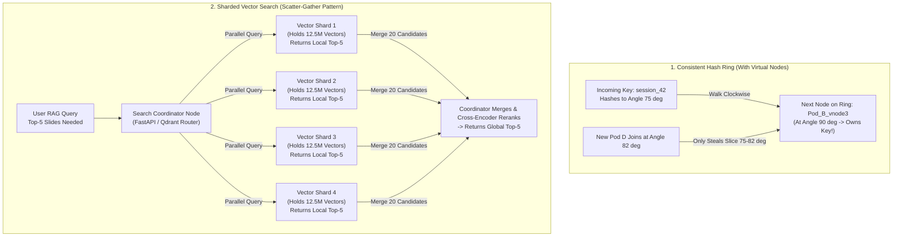

# Partitioning, Sharding & Consistent Hashing (Plain-English Guide)

> **Quick Summary — What This Is & Why Interviewers Care**
>
> - **Replication vs. Sharding (Don't Confuse Them!):**
>   - **Replication (Topic 1)** = Making **identical photocopies** of the whole book so more people can read it and you have a backup.
>   - **Partitioning / Sharding (Topic 2)** = The book has grown to **100,000 pages** and no longer fits on one desk! So you **rip the encyclopedia into separate volumes (`A–F`, `G–M`, `N–Z`)** and put each volume on a different computer.
> - **Why Interviewers Ask This in AI Design:** When your **Deloitte Slide RAG** grows from 25,000 slides to **10 million slides (50M+ vectors = `460 GB` of RAM)**, it physically cannot fit on a single server. Interviewers will ask: *"How do you split 100M vectors across 10 servers? What happens when you add an 11th server? And what if one massive client sends 40% of all search traffic?"*
> - **The Golden Rule:** Never use simple `hash(key) % N` when the number of servers `N` can change—use **Consistent Hashing with Virtual Nodes** so adding a server only moves `~1/N` of your data instead of reshuffling the entire cluster!

---

## 1. First Principles: The 4 Ways to Split Data Across Servers

Imagine you run a massive library with **10 million books** and **4 rooms (Shards 0, 1, 2, 3)**. How do you decide which room holds which book so you can find it again later?

### Strategy 1: Range Partitioning — "The Encyclopedia Volumes (`A–F`, `G–M`)"
- **How it works:** You split keys by continuous ranges—for example, User Last Names `A–F` go to Shard 0, `G–M` go to Shard 1, or dates `Jan–Mar` go to Shard 0, `Apr–Jun` go to Shard 1.
- **The Good:** Super fast if you want to ask a **range question** like *"Give me all news articles published in March 2026"*—you only check 1 shard!
- **The Bad (The Hot-Spot Trap):** What if you shard by **timestamp** (`Today's logs` go to Shard 3)? Then **100% of new writes today hit Shard 3**, while Shards 0, 1, and 2 sit completely idle! Shard 3 melts down.

### Strategy 2: Modulo Hash Partitioning — "`hash(key) mod N`"
- **How it works:** To prevent hot spots, you feed the key (like `user_id = "alice"`) into a hash function that spits out a random-looking number (say `94821`), and divide by the number of servers (`N = 4`). The remainder (`94821 % 4 = 1`) tells you to put Alice on **Shard 1**.
- **The Good:** Spreads data **perfectly evenly** across all 4 shards! Even sequential timestamps get scattered randomly.
- **The Bad (The Reshuffle Disaster when `N` Changes):**
  Look what happens when your traffic grows and you add just **1 more server** (changing `N = 4` to `N = 5`):
  - Before (`N = 4`): `94821 % 4 = 1` (Alice lived on **Shard 1**).
  - After (`N = 5`): `94821 % 5 = 1`, `94822 % 5 = 2`... **Almost 80% of all keys suddenly get a brand-new remainder!**
  - That means adding 1 server forces you to move **80% of your entire database across the network at the exact moment your system is already overloaded!**

### Strategy 3: Consistent Hashing — "The Clock Face Ring"
- **How it works:** Instead of dividing by `N`, we arrange both our **Servers** and our **Data Keys** on a giant circular clock face (a **Hash Ring** from `0` to `2^32`). To find which server owns a key, you hash the key to a spot on the clock and **walk clockwise** until you bump into the first server!
- **Why it is magic:** When you add a 5th server to the ring, it only takes over keys from its **immediate clockwise neighbor**. Instead of moving 80% of all data, you only move **`1/5` (`20%`)** of the keys!

### Strategy 4: Directory / Lookup Service — "The Front Desk Receptionist"
- **How it works:** You keep a small, dedicated lookup table (a directory service) that explicitly stores `{"deloitte_us": "Shard 4", "small_startup_12": "Shard 1"}`.
- **The Good:** Total flexibility! You can move a huge client to their own private server anytime just by updating one row in the directory.
- **The Bad:** Every single request must check the directory first (so the directory must be cached in memory and kept 100% highly available).

---

## 2. Consistent Hashing & Virtual Nodes in 60 Seconds

Interviewers love asking you to draw or explain **Consistent Hashing** and **Virtual Nodes**. Use this simple **"Clock Face"** mental model:

1. **Picture a 12-hour clock face (The Ring):**
   - Suppose we place **Server A** at `12 o'clock`, **Server B** at `4 o'clock`, and **Server C** at `8 o'clock`.
   - When a key arrives (say `session_99`), we hash it and it lands at `2 o'clock`.
   - We walk **clockwise** from `2 o'clock` → the first server we hit is **Server B at `4 o'clock`**. So Server B owns `session_99`!
2. **What happens if Server B (`4 o'clock`) crashes?**
   - Any key between `12` and `4 o'clock` now walks clockwise past the dead `4 o'clock` spot and hits **Server C at `8 o'clock`**.
   - Notice that **Server A (`12 o'clock`) isn't disturbed at all!**
3. **Why We Need "Virtual Nodes" (The Secret Sauce):**
   - If you only put 3 points on the clock, by pure bad luck they might land at `1 o'clock`, `2 o'clock`, and `3 o'clock`—leaving the third server responsible for **75% of the entire clock** (`3 o'clock` all the way to `1 o'clock`)!
   - **The Fix (Virtual Nodes / Vnodes):** Instead of placing each server on the ring *once*, we place **100 labels** for Server A (`A_1..A_100`), **100 labels** for Server B (`B_1..B_100`), and **100 labels** for Server C (`C_1..C_100`) scattered all around the clock.
   - **Bonus:** If Server C is a beefy machine with **2x the RAM**, we give it **200 labels** on the ring so it automatically takes **2x the traffic**!

---

## 3. Visual Blueprint: Consistent Hashing & Scatter-Gather Vector Search



---

## 4. Side-by-Side Comparison: Partitioning Strategies

| Strategy | How Keys Are Placed | What Happens When Adding a Node? | Supports Range Queries? | Biggest Weakness / Trap |
| :--- | :--- | :--- | :--- | :--- |
| **Range Partitioning** | Sorted contiguous ranges (`A–F`, `2026-01` to `2026-03`) | Easy to split a range in half | **Yes (Fast)** | **Hot spots** on timestamp keys (latest shard gets 100% of writes) |
| **Modulo Hash (`hash % N`)** | Remainder of dividing by `N` | **Disaster:** Reshuffles ~80–90% of all keys | No | Never use if `N` changes dynamically |
| **Consistent Hashing (+ Vnodes)** | Keys & virtual nodes placed on a `0..2^32` circle | **Smooth:** Moves only `~1/N` of keys | No | Needs virtual nodes (`100+` per server) for even balance |
| **Directory Lookup** | Explicit mapping table (`tenant_id -> shard_id`) | Zero math; move any tenant anytime | Depends on shard | Lookup table is on the critical path (must be cached) |

---

## 5. Deep-Dive Mechanics: Hot Keys & Secondary Indexes

### Problem 1: The "Justin Bieber" / Whale Tenant Problem (Hot Keys)
Even with consistent hashing, all data with the **exact same key** goes to the **exact same shard**.
- **The Scenario:** What if a viral news story breaks, or a single giant enterprise customer (`tenant_id = "walmart"`) sends **40% of your entire platform's traffic**? The single shard holding `"walmart"` gets crushed while the other 9 shards sit at 5% CPU!
- **The 4 Ways Senior Engineers Fix Hot Keys:**
  1. **Key Salting / Splitting (`key#0` to `key#9`):** For known hot keys, append a random number from `0` to `9` to the end of the key when writing (`walmart#0`, `walmart#1`, ..., `walmart#9`). Now Walmart's data is spread across **10 different shards**! (Trade-off: when reading all of Walmart's data, you must query all 10 salted keys and combine them).
  2. **Put a Read Cache in Front:** If 100,000 users are reading the exact same viral article, cache that article in memory at the edge/gateway (`TTL = 5 seconds`) so it doesn't hit the database shard.
  3. **Dedicated "Whale" Shards (Tiered Multi-Tenancy):** Put 1,000 small tenants together in shared shards, and give your top 5 giant enterprise tenants their **own dedicated physical shard/collection**.
  4. **Rate-Limiting per Tenant:** Ensure one runaway tenant cannot starve other tenants sharing the same shard (**Noisy Neighbor protection**).

### Problem 2: Secondary Indexes (Searching by Something Other Than the Primary Key)
Suppose your database is sharded by `doc_id`, so finding `doc_id = 500` hits just **1 shard**.
Now a user asks: *"Find all documents where `topic = 'AI Safety'`."* Since documents about AI Safety could be on *any* shard, how do you index `topic`?

1. **Local Index (Document-Partitioned = "Scatter-Gather"):**
   - **How it works:** Each shard only keeps an index of the documents stored on *itself*.
   - **Writes are fast:** Adding a document only touches **1 shard**.
   - **Reads are slower (Scatter-Gather):** Searching for `topic = 'AI Safety'` requires the coordinator to ask **ALL shards in parallel**, wait for all of them to reply, and merge the results.
   - **Crucial AI Note:** **All Vector Databases (Qdrant, Milvus, Vertex Vector Search) work this way!** Because vector similarity search (HNSW) has no single "word" to partition by, a 4-shard vector search must ask all 4 shards for their top-K vectors and merge them.
2. **Global Index (Term-Partitioned):**
   - **How it works:** The index itself is stored on separate shards organized by search term (`topic` starting with `A–M` on Index Shard 1, `N–Z` on Index Shard 2).
   - **Reads are fast:** Searching `topic = 'AI Safety'` checks **only 1 index shard**!
   - **Writes are slow & complex:** Inserting 1 document that has 10 tags means updating **10 different index shards** across the network (usually done asynchronously).

### Problem 3: Safe Rebalancing (Fixed Partitions >> Physical Nodes)
In production databases (like Postgres Citus, Elasticsearch, or Kafka), you don't create 4 partitions for 4 servers. Instead, you create **1,024 logical partitions** right from Day 1 and assign **256 partitions to each of your 4 servers**. When a 5th server joins, you simply move ~50 whole pre-made partitions over to the new server!
> **Warning:** Never let a database automatically rebalance giant shards right in the middle of a traffic spike—the network copying will consume all disk/network bandwidth and cause a cascading outage!

---

## 6. Production AI & Resume Tie-In (Deloitte & Network18)

### 1. Deloitte Slide RAG: Sharding 50M Vectors & The "Tail-at-Scale" Problem
- **Why We Sharded:** At **10 million slides** (~50M vectors at 1536 dimensions), the HNSW vector index takes `460 GB` in raw FP32 (or **`115 GB` with INT8 quantization**). Instead of buying one monster machine that is a single point of failure, we shard across **4 Qdrant nodes (~29 GB RAM per shard)**.
- **How Search Works (Scatter-Gather):** When a consultant searches for *"Cloud migration case studies"*, the coordinator sends the query vector to **all 4 shards in parallel**. Each shard returns its top 10 slides (40 candidates total), and our Cross-Encoder reranks them to pick the final Top 5.
- **The P99 Latency Trap ("Tail at Scale"):** Because the coordinator must wait for **all 4 shards** to reply before merging, **overall search latency equals the SLOWEST shard**! If Shard 3 has a brief garbage-collection hiccup (taking `800ms` instead of `25ms`), the whole user query takes `800ms`.
- **The Fix:**
  1. Keep **read replicas** for each shard (`replication_factor = 2`).
  2. Use **Hedged Requests**: If Shard 3 hasn't replied within `40ms` (our P95), immediately fire a duplicate read to **Shard 3's Replica** and take whichever answers first!

### 2. Multi-Tenant RAG Isolation (Small Tenants vs. Whale Tenants)
- **Small Practices / Teams:** Share a common vector collection using a `tenant_id` payload filter (with pre-filtered bitmap indexing).
- **Whale Clients / Highly Regulated Practices (M&A / Defense):** Placed into their **own dedicated shard/collection** via a Directory Lookup so their heavy queries never slow down other teams and their vectors are physically isolated.

### 3. Network18 News Ingestion: Partitioning by `article_id` for Idempotency
- When ingesting 100,000 news articles per minute into Kafka / Pub/Sub, we partition the stream by `hash(canonical_url)`. That guarantees if the same article arrives twice within 5 seconds from a retry, both copies land on the **exact same consumer partition**, making local deduplication trivial.

### Code Example: Consistent Hash Ring with Virtual Nodes in Python

Here is how a Consistent Hash Ring works in ~35 lines of clean Python using `bisect` (binary search on a sorted circle):

```python
import bisect
import hashlib

class ConsistentHashRing:
    def __init__(self, nodes: list[str], virtual_nodes: int = 100):
        self.virtual_nodes = virtual_nodes
        self.ring_keys: list[int] = []          # Sorted positions on the clock (0 .. 2^32)
        self.ring_map: dict[int, str] = {}      # Maps position -> physical server name
        for node in nodes:
            self.add_node(node)

    def _hash(self, key: str) -> int:
        # Convert any string into a 32-bit integer position on the circle
        return int(hashlib.md5(key.encode("utf-8")).hexdigest()[:8], 16)

    def add_node(self, node: str) -> None:
        # Place 100 "virtual labels" for this physical server around the circle
        for i in range(self.virtual_nodes):
            vnode_pos = self._hash(f"{node}#vnode{i}")
            bisect.insort(self.ring_keys, vnode_pos)
            self.ring_map[vnode_pos] = node

    def get_node(self, key: str) -> str:
        # Hash the key (e.g. session_id) and walk clockwise to the next vnode
        pos = self._hash(key)
        idx = bisect.bisect_right(self.ring_keys, pos)
        if idx == len(self.ring_keys):
            idx = 0  # Wrap around 12 o'clock back to the start of the circle!
        return self.ring_map[self.ring_keys[idx]]

# Usage for routing Deloitte Agent Sessions to GKE Pods:
ring = ConsistentHashRing(["gke-pod-1", "gke-pod-2", "gke-pod-3"])
target_pod = ring.get_node("session_deloitte_9812")  # Always routes to the same warm pod!
```

---

## 7. Common Interview Questions (Answered Simply)

### Q1: "Why is `hash(key) mod N` bad when the number of servers `N` changes?"
- **What they are really testing:** Do you understand the fundamental problem that Consistent Hashing was invented to solve?
- **How to answer simply:**
  > "With `hash(key) mod N`, the shard number depends directly on dividing by `N`. If you go from `N = 9` servers to `N = 10` servers, the remainder changes for **~90% of all keys in your database**.
  > If that's a cache cluster, 90% of your cache suddenly misses at the exact same second (a **Cache Stampede** that crashes your database). If it's a storage cluster, you have to copy 90% of your data across the network. **Consistent Hashing** fixes this by placing servers and keys on a fixed `0..2^32` circle so adding a 10th server only moves **`1/10` (`10%`)** of the keys."

### Q2: "How do Virtual Nodes (Vnodes) help in Consistent Hashing?"
- **What they are really testing:** Do you know that basic consistent hashing without virtual nodes creates uneven load?
- **How to answer simply:**
  > "Virtual nodes solve **three problems**:
  > 1. **Even Load Distribution:** With only a few physical points on the circle, random hash spacing leaves some servers with huge arcs and others with tiny arcs. Giving each server 100+ virtual points averages out the gaps to `<5%` variance.
  > 2. **Faster Recovery on Crash:** When one server dies, instead of dumping 100% of its load onto a single unlucky clockwise neighbor, its 100 virtual slices are picked up evenly across *all* remaining servers.
  > 3. **Heterogeneous Hardware:** If a new server has twice the RAM/CPU, we can assign it 200 virtual nodes instead of 100 so it naturally handles twice the keys."

### Q3: "How would you shard 200 million vectors, and what happens to your P99 search latency?"
- **What they are really testing:** Can you combine capacity math, scatter-gather vector search, and tail-latency mitigation?
- **How to answer simply:**
  > "First, let's do the RAM math: 200M vectors at 1536 dimensions in FP32 would take `200M × 1536 × 4 × 1.5 ≈ 1.84 TB` of RAM. By using **INT8 Scalar Quantization**, we cut that 4x to **`~460 GB` of RAM**, which fits cleanly across **8 shards of 64 GB RAM each** (holding 25M vectors per shard).
  > Because vector search uses a **Local HNSW Index per shard**, every search query must **scatter-gather** across all 8 shards in parallel.
  > The catch is **Tail Latency amplification**: since we wait for all 8 shards, our query P99 latency becomes the **slowest of the 8 shards**. We solve that by keeping **2 replicas per shard** and firing **hedged requests** if any shard takes longer than `35ms`."

### Q4: "A single enterprise tenant suddenly sends 40% of all traffic and overloads one shard. What do you do?"
- **What they are really testing:** Do you know how to handle hot keys and multi-tenant skew in production?
- **How to answer simply:**
  > "We handle a 'Whale Tenant' at three levels:
  > 1. **Immediate Mitigation (Rate Limiting + Caching):** Enforce per-tenant token-bucket quotas at the API Gateway so one tenant can never starve others, and cache repeated queries in Redis.
  > 2. **Write/Storage Splitting (Key Salting):** If a single key is hot, append a shard suffix (`tenant_id#0` through `tenant_id#7`) to spread their writes across 8 shards.
  > 3. **Permanent Architectural Fix (Tiered Tenant Sharding):** Move large enterprise tenants out of the shared multi-tenant pool into their **own dedicated shard or vector collection** routed via a cached Directory Lookup."
