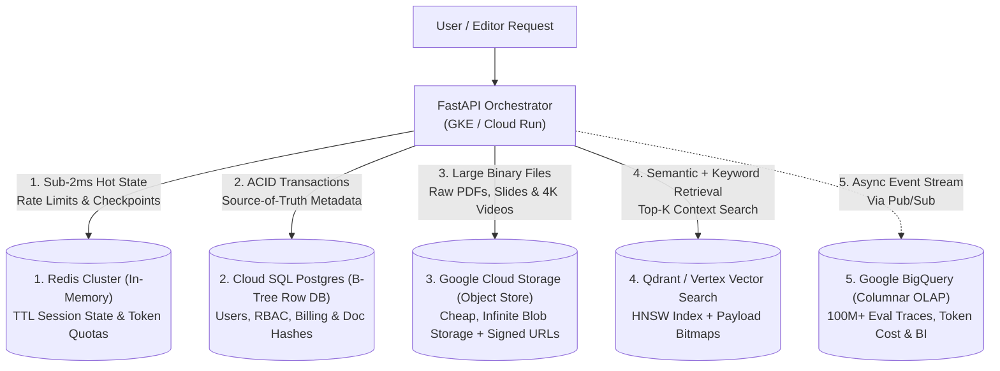

# Storage Engines & Choosing a Database (Plain-English Guide)

> **Quick Summary — What This Is & Why Interviewers Care**
>
> - **Why Interviewers Ask "Which Database and Why?":** In every single AI system design interview, you will draw a database box. If you say *"I'll use Postgres"* or *"I'll use MongoDB"* just because you've used it before, a senior interviewer will immediately push back. You must justify your choice based on **how the data is written and read** (heavy writes vs. fast reads vs. analytics scans vs. vector search).
> - **The 3 Golden Rules for AI Databases:**
>   1. **A Vector Database is an Index, NOT your Source of Truth:** Always keep raw files in **Object Storage (GCS/S3)** and source text/metadata in **Postgres** so you can rebuild your vector index anytime you upgrade your embedding model.
>   2. **B-Tree (Postgres) vs. LSM-Tree (Cassandra/Bigtable):** B-Trees update pages in place (**great for fast reads & transactions**); LSM-Trees only append new lines to the end of a log (**great for massive write storms like 50,000 events/sec**).
>   3. **Row (Postgres) vs. Column (BigQuery):** Use **Row databases** when fetching 1 specific user's chat history; use **Columnar databases (BigQuery)** when scanning 100 million rows to calculate average AI latency or market sentiment.

---

## 1. Under the Hood: How Databases Actually Save Data to Disk (B-Tree vs. LSM-Tree)

When you run `INSERT` or `UPDATE`, how does a database actually put those bytes onto a hard drive? Almost every database on Earth uses one of **two storage engines**. Here is the easiest way to picture them:

### Engine 1: The B-Tree (Used by PostgreSQL, MySQL) — "The Sorted 3-Ring Binder"
- **The Analogy:** Imagine a neatly organized **3-ring binder** sorted alphabetically by Customer Name, where each page holds 20 names.
  - **When you Read (`SELECT`):** You flip right to the `S` tab, find `"Soni, Lakshya"` on Page 42, and read it in **1 step**. Super fast and predictable!
  - **When you Write (`UPDATE`):** Suppose Lakshya changes his phone number. You have to flip to Page 42, **erase the old line, and write the new phone number in that exact spot on disk** (plus write a quick safety note in a recovery log called the **WAL / Write-Ahead Log** in case the power goes out mid-erase).
  - **The Catch:** Flipping to random pages all over the hard drive to update them in place (**Random Disk I/O**) takes time. If 50,000 users try to write at the exact same second, the binder gets locked up!

### Engine 2: The LSM-Tree (Log-Structured Merge-Tree — Used by Cassandra, RocksDB, Google Bigtable) — "The Append-Only Scratchpad"
- **The Analogy:** Imagine you are taking frantic notes during a busy phone call. You don't have time to flip through a 3-ring binder and erase old pages! Instead, you **never erase anything**—you just write every new update on the **very next blank line at the bottom of your scratchpad**.
  - **When you Write (`INSERT / UPDATE`):** If Lakshya updates his phone number, the database simply appends `"Lakshya = 999-1234 (12:05 PM)"` to a fast in-memory buffer (**Memtable**) and a sequential log file. Once the buffer fills up, it dumps that sorted sheet onto disk as an immutable file (**SSTable — Sorted String Table**). Because appending to the end of a file is **Sequential I/O**, writes are **blazingly fast**!
  - **When you Read (`SELECT`):** Here is the trade-off! Because Lakshya's old phone number is on Tuesday's sheet and his new phone number is on Friday's sheet, reading Lakshya's record might require checking **several SSTable files** from newest to oldest until you find him.
  - **How LSM-Trees Speed Up Reads & Clean Up Old Sheets:**
    1. **Compaction (Background Cleanup):** A background worker periodically merges Tuesday's and Friday's sheets together, throwing away overwritten old rows.
    2. **Bloom Filters (The Magic Bouncer):** Before wasting time opening an old SSTable file on disk, the database checks a tiny in-memory mathematical filter (**Bloom Filter**) that can instantly say with **100% certainty**: *"Lakshya is definitely NOT in this file—skip it!"*

### Quick Comparison: B-Tree vs. LSM-Tree

| Feature | B-Tree (PostgreSQL, MySQL) | LSM-Tree (Cassandra, RocksDB, Bigtable) |
| :--- | :--- | :--- |
| **How it writes** | Overwrites fixed-size pages in place (+ WAL) | Appends to memory (`Memtable`) → flushes immutable `SSTables` |
| **Read speed** | **Faster & more predictable** (1 exact lookup) | **Slightly slower** (may check multiple SSTables; Bloom filters help) |
| **Write speed** | Moderate (random disk I/O + page locks) | **Ultra-fast** (pure sequential append) |
| **Best for** | **OLTP:** User accounts, billing, ACID transactions | **Heavy Write Streams:** Chat logs, IoT, clickstreams (`50k+ writes/s`) |

---

## 2. Row-Oriented vs. Column-Oriented Databases (Postgres vs. BigQuery)

Why did you use **PostgreSQL** for your Deloitte audit store, but **Google BigQuery** for your Network18 news analytics and AI evaluation dashboards? It comes down to **Row vs. Column layout on disk**:

Suppose we have a table of AI news articles:

| `id` | `published_at` | `headline` | `full_article_text` (Huge 5 KB string) | `ticker` | `sentiment_score` |
| :--- | :--- | :--- | :--- | :--- | :--- |
| 1 | 2026-11-01 | "Reliance Q3..." | *"Mumbai: Reliance Industries reported..."* | `RELIANCE` | `0.85` |
| 2 | 2026-11-01 | "TCS wins..." | *"Bengaluru: Tata Consultancy Services..."* | `TCS` | `0.92` |

- **Row-Oriented Storage (Postgres, MySQL):**
  - Stores **all columns of Row 1 together**, followed by **all columns of Row 2 together**:
    `[1, 2026-11-01, "Reliance...", "Mumbai: Reliance...", RELIANCE, 0.85] [2, 2026-11-01, ...]`
  - **Great when:** You ask *"Fetch everything about Article #1"* (`SELECT * FROM articles WHERE id = 1`). The disk grabs 1 single block and has the whole article!
  - **Terrible when:** Your Power BI dashboard asks *"What is the average `sentiment_score` across 50 million articles?"* Postgres has to read all **250 GB of `full_article_text`** off the disk just to pluck out the tiny `sentiment_score` number at the end of each row!
- **Column-Oriented Storage (BigQuery, Snowflake, Parquet files):**
  - Stores **each column in its own separate file**:
    - File A (`ticker` column): `[RELIANCE, TCS, RELIANCE, INFY, ...]`
    - File B (`sentiment_score` column): `[0.85, 0.92, 0.78, 0.61, ...]`
    - File C (`full_article_text` column): `[... 250 GB of text we don't touch! ...]`
  - **Why it is 100x faster for analytics:** When Power BI asks for `AVG(sentiment_score) WHERE ticker = 'RELIANCE'`, BigQuery **only reads File A and File B** (a few megabytes!) and completely ignores the 250 GB of article text. Plus, because a column contains identical data types (`[RELIANCE, RELIANCE, RELIANCE]`), it compresses by **90%+**!

---

## 3. Visual Blueprint: Which Database Goes Where in an AI Architecture?

Walk through this blueprint (`1 → 5`) to see why a production AI system uses **multiple specialized stores** instead of forcing one database to do everything:



---

## 4. The Ultimate "Choose Your Database" Decision Cheat Sheet

Memorize this table—it answers 95% of database selection questions in system design interviews:

| What You Need to Store | Best Database Choice | Why This One Wins | What NOT to Use (Common Interview Mistake) |
| :--- | :--- | :--- | :--- |
| **User accounts, billing, permissions, document metadata** | **PostgreSQL (Cloud SQL)** | Strict ACID transactions, relational joins, rock-solid B-Tree lookups | Don't use a Vector DB or NoSQL for billing/permissions |
| **Live AI agent checkpoints, rate-limit counters, semantic cache** | **Redis** | Lives in RAM (`<1ms` latency); built-in atomic counters (`INCR`) and auto-expiry (`TTL`) | Don't hit disk-based Postgres 20 times per second just to check rate limits |
| **Massive write streams (`50k+ writes/s`): chat history, IoT** | **Cassandra / Bigtable / DynamoDB** | LSM-Tree engine + horizontal partitioning handles huge write volume without locking | Single-leader Postgres will bottleneck on write locks at extreme write QPS |
| **Analytics, LLM eval scores, token spend dashboards, news trends** | **BigQuery / Snowflake / Parquet** | Columnar storage scans millions of rows in seconds for pennies | Never run heavy `GROUP BY` analytics queries on your live production Postgres DB! |
| **Uploaded PDFs, PPTX slide images, 4K broadcast videos** | **Object Storage (GCS / AWS S3)** | Pennies per GB, infinite scale, direct browser upload via Signed URLs | **Never store raw PDFs, images, or videos inside Postgres or Redis!** Store only the `gs://` link in the DB |
| **Vector embeddings for RAG (`<2M` vs `10M–500M` vectors)** | **`pgvector`** (up to `~2M` vectors) → **Qdrant / Vertex Vector Search** (`10M+`) | Dedicated HNSW graph sharding, INT8 quantization, fast payload pre-filtering | Don't introduce a separate vector DB for a tiny 50k-doc app (`pgvector` is simpler!); don't stay on single-node Chroma/pgvector past 5M+ vectors |
| **Exact keyword search, SKU codes, legal citations, facets** | **Elasticsearch / OpenSearch** (or Qdrant Sparse BM25) | Inverted index (`word -> list of doc IDs`) finds exact acronyms that embeddings miss | Dense vector embeddings alone struggle with exact serial numbers or rare ticker symbols |

---

## 5. Deep-Dive Mechanics: Transactions, Isolation & Index Costs

### 1. ACID Transactions & Isolation Anomalies (Just Enough for Interviews)
When two requests try to update the same row in Postgres at the exact same millisecond, what stops them from corrupting each other? **ACID Transactions**:
- **A (Atomicity — All or Nothing):** If a bank transfer deducts `$100` from Alice and the server crashes before adding `$100` to Bob, the whole transaction rolls back so `$100` never vanishes into thin air.
- **C (Consistency):** Data always obeys your table rules (like `balance >= 0` or `UNIQUE(email)`).
- **I (Isolation):** Two transactions running at the same time don't step on each other's toes.
- **D (Durability):** Once Postgres says *"Committed!"*, the write is safely on disk (in the WAL) even if the plug is pulled.

**The 2 Concurrency Bugs Interviewers Ask About:**
1. **Lost Update:** Two agent processes both read `ticket_credits = 10`, both subtract 1 in Python, and both write `9` back to the database (instead of `8`).
   - *Fix:* Use an **atomic database update** (`UPDATE quotas SET credits = credits - 1 WHERE tenant_id = 'x' AND credits > 0`) or `SELECT ... FOR UPDATE` row locking!
2. **Distributed Transactions Across Microservices (Why ACID Doesn't Work Across APIs):**
   - You cannot wrap a **Postgres database write**, a **Stripe API refund**, and a **Qdrant vector update** inside one SQL `BEGIN...COMMIT` block!
   - *Fix:* Use the **Outbox Pattern** (save the state change and a "todo event" in the same Postgres transaction, then let a background worker reliably push that event to Pub/Sub/Qdrant) + **Idempotent Retries**.

### 2. The Hidden Cost of Indexes
Beginners think: *"Why not add an index on every single column to make all reads fast?"*
- **Why that backfires:** An index is a separate sorted lookup structure (another B-Tree!). If your table has **5 indexes**, every single `INSERT` or `UPDATE` has to update the main table **PLUS update all 5 B-Trees on disk**—making writes **5x slower** and eating up gigabytes of RAM!
- **Composite Index Order Rule (`Left-to-Right`):**
  - Think of a phonebook sorted by `(Last Name, First Name)`.
  - If you know `Last Name = "Soni"` AND `First Name = "Lakshya"`, the phonebook is super fast.
  - If you *only* know `Last Name = "Soni"`, the phonebook is STILL fast!
  - **Trap:** If you *only* know `First Name = "Lakshya"` (without Last Name), the phonebook is completely useless because `"Lakshya"` is scattered under every letter from `A` to `Z`!
  - **Rule for Multi-Tenant AI Apps:** Always put `tenant_id` FIRST in your composite indexes—e.g., `CREATE INDEX ON chat_messages (tenant_id, created_at DESC)`.

---

## 6. Production AI & Resume Tie-In (Deloitte & Network18)

### 1. Deloitte Slide RAG: Why Our Vector DB is NOT the System of Record
- **What happens if OpenAI or Google releases a better embedding model next month?**
  You cannot transform old vectors (`text-embedding-004`) into a new model's vector space—you must **re-embed the text from scratch**.
- **Our 3-Tier Storage Architecture:**
  1. **Google Cloud Storage (GCS):** Stores the original `.pptx` files and rendered `150 DPI` slide `.png` images.
  2. **Cloud SQL (Postgres):** Stores the source-of-truth slide metadata, SharePoint RBAC permissions, SHA-256 XML hashes (for deduplication), and the structured Markdown extracted by Gemini Flash Vision.
  3. **ChromaDB / Qdrant (Vector DB):** Holds *only* the embeddings + filterable payload fields. If we switch embedding models or a vector shard gets corrupted, we can rebuild the entire vector index from Postgres without paying a single penny to re-run Gemini Vision on the images!

### 2. When Does `pgvector` Stop Being Enough? (The Exact Numbers)
Interviewers love asking: *"Why not just use `pgvector` inside Postgres instead of adding Qdrant or Vertex Vector Search?"*
- **Up to `~1–2 Million` vectors (`pgvector` wins):** Keep it in Postgres! One fewer database to manage, and you get transactional joins between metadata and vectors.
- **Past `5–10+ Million` vectors (Dedicated Vector DB wins):**
  1. **RAM vs. Connections Bottleneck:** HNSW vector graphs must live in **RAM** to stay fast (`50M vectors = 115 GB RAM` even with INT8 quantization). Putting a 115 GB HNSW index on your transactional Postgres primary starves the OS page cache and slows down regular SQL transactions.
  2. **Independent Scaling:** Vector search is CPU/RAM-bound (SIMD distance math), while OLTP metadata is I/O-bound. Separating Qdrant lets you scale vector search shards independently without paying for massive Cloud SQL licenses.

### 3. Network18 Financial News: Optimizing BigQuery Costs with Partitioning & Clustering
- BigQuery charges you based on **how many bytes of data your query scans**.
- In our Network18 pipeline, we **Partitioned** the `financial_news` table by `DATE(published_at)` and **Clustered** it by `(primary_ticker, language_code)`. When a Power BI chart asks for last week's `RELIANCE` news, BigQuery skips 99% of historical files on disk!

### Code Example: Proper Multi-Tenant Schema & Atomic Quota Check in SQL

```sql
-- 1. Proper Composite Index for Multi-Tenant AI Chat History (Deloitte GKE)
-- Putting tenant_id and session_id first lets Postgres jump straight to 1 conversation in <1ms!
CREATE TABLE agent_checkpoints (
    tenant_id       VARCHAR(64) NOT NULL,
    session_id      VARCHAR(64) NOT NULL,
    step_number     INT NOT NULL,
    state_payload   JSONB NOT NULL,
    created_at      TIMESTAMPTZ NOT NULL DEFAULT NOW(),
    PRIMARY KEY (tenant_id, session_id, step_number)
);

-- Partial Index: Only index active/failed sessions that need background retry!
-- Keeps the index 99% smaller in RAM than indexing millions of completed chats.
CREATE INDEX idx_pending_retries
ON agent_checkpoints (created_at)
WHERE (state_payload->>'status') = 'PENDING_RETRY';

-- 2. Atomic Quota Deduction (Prevents the "Lost Update" concurrency bug!)
-- Both checks the balance AND subtracts tokens in a single atomic B-Tree row operation.
UPDATE tenant_token_quotas
SET tokens_remaining = tokens_remaining - 1500
WHERE tenant_id = 'deloitte_audit_us'
  AND tokens_remaining >= 1500
RETURNING tokens_remaining;
```

---

## 7. Common Interview Questions (Answered Simply)

### Q1: "Why shouldn't you store your documents and embeddings ONLY inside your Vector Database?"
- **What they are really testing:** Do you understand that vector embeddings are tied to a specific model version and that vector databases are indexes, not transactional systems of record?
- **How to answer simply:**
  > "Three reasons:
  > 1. **Embedding Model Upgrades:** Vector spaces are incompatible across models. When we upgrade from `text-embedding-004` to a newer model next quarter, we have to re-generate every vector from the original text. If we only stored vectors, we couldn't re-embed!
  > 2. **Cost of Vision/OCR Extraction:** In our Deloitte Slide RAG, extracting structured markdown from slide images with Gemini Vision is the most expensive step. By storing that extracted markdown and slide hash in **Postgres** and raw images in **GCS**, we can rebuild or re-index our Vector DB anytime for pennies.
  > 3. **ACID Guarantees:** Postgres handles strict permissions, audit logs, and relational integrity much better than an ANN vector index."

### Q2: "Would you pick a B-Tree database or an LSM-Tree database for an AI telemetry log receiving 50,000 writes per second?"
- **What they are really testing:** Can you map a high-write, append-heavy access pattern to the right storage engine?
- **How to answer simply:**
  > "Definitely an **LSM-Tree database** (like Google Bigtable, Cassandra, or RocksDB—or streaming directly into BigQuery).
  > At 50,000 writes per second, a **B-Tree** (like standard Postgres) would bottleneck because every insert has to overwrite random pages on disk and update B-Tree pointers in place.
  > An **LSM-Tree** turns all 50,000 writes into fast **sequential appends** to an in-memory `Memtable` and append-only `SSTable` files on disk, easily handling massive write throughput with minimal lock contention."

### Q3: "Pick the exact storage engine for each of these 4 things in an AI app: (1) Chat history, (2) Rate-limit counters, (3) LLM Evaluation results, and (4) Uploaded PDFs."
- **What they are really testing:** Can you quickly match different components of an AI architecture to the right tool without hesitation?
- **How to answer simply:**
  > 1. **Chat History:** **Redis** (with a 24-hour TTL) for the active `<2ms` conversation context, backed by **PostgreSQL** (or **Cassandra/DynamoDB** at massive scale) partitioned by `(user_id, session_id)` for permanent history.
  > 2. **Rate-Limit Counters (RPM / TPM quotas):** **Redis** using in-memory atomic Lua scripts / sliding-window counters—because every single API request checks it and needs sub-millisecond speed.
  > 3. **LLM Evaluation Results & Token Cost Logs:** **Google BigQuery** (columnar OLAP store)—because engineers and dashboards will run aggregations (`AVG(groundedness)`, `SUM(cost)` grouped by model version and date) over millions of rows.
  > 4. **Uploaded PDFs / Videos:** **Google Cloud Storage (GCS)** or **S3** accessed via Signed URLs, storing only the `gs://` file URI and SHA-256 hash in Postgres.

### Q4: "When does `pgvector` in PostgreSQL stop being enough, and why?"
- **What they are really testing:** Do you know the practical scaling threshold between a simpler monolithic stack (`pgvector`) and a dedicated distributed vector database (Qdrant / Vertex Vector Search)?
- **How to answer simply:**
  > "`pgvector` is my default choice up to **1 to 2 million vectors** because keeping metadata and embeddings in one ACID database eliminates dual-write sync bugs.
  > It stops being enough around **5 to 10+ million vectors** (or `>500 QPS` of vector search) for two reasons:
  > 1. **Memory Contention:** An HNSW graph for 50M vectors needs `100+ GB` of RAM just to stay in memory. Running that inside Postgres evicts your transactional SQL tables from RAM and hurts normal database performance.
  > 2. **Distributed Sharding & Quantization:** Dedicated vector databases like **Qdrant** or **Vertex Vector Search** give us native horizontal sharding, on-the-fly **INT8/Binary quantization** (cutting RAM by 4x–32x), and specialized payload bitmap pre-filtering."
