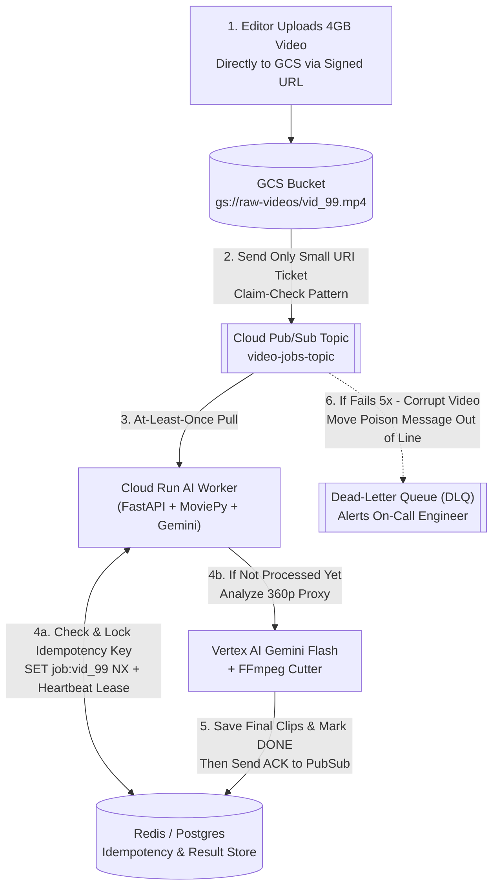

# Queues vs Logs & Delivery Semantics (Plain-English Guide)

> **Quick Summary — What This Is & Why Interviewers Care**
>
> - **Why Every AI System Needs Queues:** Normal database queries take `2 milliseconds`. Calling an LLM, analyzing a slide image with Gemini Vision, or slicing a 1-hour video takes **seconds to minutes**—and fails whenever you hit a `429 Too Many Requests` token quota! If you make the user's browser wait synchronously for heavy AI work, requests time out and servers crash.
> - **The Solution (Asynchronous Messaging):** Put a **Digital To-Do List (Queue or Log)** between your web server and your background AI workers. It acts as a **shock absorber**: if 5,000 editors upload videos at the exact same second, the queue safely holds all 5,000 tasks while your workers process them steadily at a pace your GPUs and Gemini quota can handle.
> - **The #1 Rule to Memorize for Interviews:**
>   **"Effective Exactly-Once = At-Least-Once Delivery + Idempotent Processing."**
>   Every cloud queue (Pub/Sub, SQS, Kafka) can occasionally deliver the **same message twice**. Your worker code *must* check an **Idempotency Key** before calling an expensive LLM or charging a customer so a duplicate message never costs you double!

---

## 1. First Principles: A Message Queue vs. An Append-Only Log

Beginners often treat **RabbitMQ / SQS (Queues)** and **Kafka (Logs/Streams)** as the exact same thing. They are built on two very different mental models:

### Model 1: Traditional Message Queue (AWS SQS, Cloud Tasks, RabbitMQ) — "The Kitchen Order Ticket Spike"
- **The Analogy:** When a waiter takes an order, they stick the paper ticket onto the kitchen wheel. One chef grabs the ticket, cooks the burger, and **throws the paper ticket in the trash (`ACK`)**.
- **Key traits:**
  - **Destructive read:** Once a worker finishes a message and says `"ACK"` (Acknowledged), **the message is deleted forever**.
  - **One worker wins each job:** If you have 10 workers pulling from 1 queue, each message goes to **1 worker** to spread the workload.
  - **The Catch (No Time Machine):** What if next week you train a brand-new AI model and say, *"I wish I could re-run last week's 100,000 events through my new model"*? Too bad—the queue threw all those messages in the trash as soon as they were processed!

### Model 2: Append-Only Log / Event Stream (Apache Kafka, AWS Kinesis) — "The Security VHS Tape / Ledger"
- **The Analogy:** Instead of throwing tickets in the trash, every incoming event is written onto a **permanent, numbered roll of tape** (`Offset #1, Offset #2, Offset #3...`) that is kept on disk for 7 to 30 days.
- **Key traits:**
  - **Non-destructive read (Replayable!):** Reading a message does NOT delete it. Each team's worker simply remembers its own bookmark number (**Consumer Offset**—e.g., *"I am currently on Message #4,502"*).
  - **Multiple Independent Teams (Consumer Groups) Read for Free:**
    - **Team A (NER Model Worker)** reads the tape at Offset #5,000 to extract stock tickers.
    - **Team B (BigQuery Analytics Worker)** reads the *exact same tape* at Offset #4,800 to build dashboards.
    - **Team C (New Embedding Model Backfill)** can **rewind their bookmark back to Offset #0** and replay the last 7 days of articles without bothering Team A or Team B!

### Where Does Google Cloud Pub/Sub Fit? (The Best of Both Worlds!)
In your **Deloitte** and **Network18** projects, you use **Google Cloud Pub/Sub**. Pub/Sub is a hybrid that gives you both:
- You publish a message to a **Topic**.
- You attach one or more **Subscriptions** to that Topic (e.g., `sub-ner-extraction` and `sub-bigquery-audit`). Every subscription gets its own copy of every message!
- Within one subscription, messages act like a **Queue** (spread across your Cloud Run/GKE workers and removed once `ACK`ed)—**AND** you can turn on **Message Retention + `Seek` (Replay)** to rewind a subscription back in time just like Kafka!

---

## 2. Side-by-Side Comparison: Message Queue vs. Log Stream vs. Pub/Sub

| Feature / Question | Message Queue (SQS, Cloud Tasks) | Log / Stream (Apache Kafka) | Google Cloud Pub/Sub |
| :--- | :--- | :--- | :--- |
| **What happens after `ACK`?** | Message is **deleted** immediately | Message **stays on disk** until retention expires (e.g., 7 days) | Deleted from subscription, **unless** message retention/replay is enabled |
| **Can I rewind & replay old data?** | **No** (once acked, it's gone) | **Yes!** Reset consumer offset to any timestamp | **Yes!** Use `gcloud pubsub subscriptions seek` to rewind to a timestamp |
| **Can 3 different services read the same event?** | Need to wire 3 separate queues (SNS + 3 SQS) | **Yes natively** (3 Consumer Groups on 1 Topic) | **Yes natively** (3 Subscriptions on 1 Topic) |
| **Message Ordering** | Best-effort (or strict FIFO at low QPS) | Strictly ordered **within each Partition** | Ordered **per `ordering_key`** (optional) |
| **Best AI Use Case** | Background video cutting jobs, delayed task retries | High-speed news firehose (`100k/min`), event sourcing, model replay | General-purpose GCP async backbone (Deloitte & Network18) |

---

## 3. Delivery Semantics: The Truth About "Exactly-Once"

When a message travels from a queue to your AI worker, there are 3 theoretical guarantees:

1. **At-Most-Once ("Fire and Forget"):**
   - The broker sends the message once and deletes it immediately before waiting to hear if your worker crashed.
   - *Result:* **Zero duplicates, but you WILL lose messages** when servers restart. (Almost never acceptable except for noisy debug metrics).
2. **At-Least-Once (The Universal Production Default):**
   - The broker keeps a copy of the message until your worker explicitly replies `"ACK (I finished saving the result!)"`. If your worker crashes—or takes too long—the broker **sends the message again** to another worker.
   - *Result:* **Zero lost messages, but you WILL occasionally get duplicate messages!**
3. **Exactly-Once (What Interviewers Love to Probe):**
   - **The Trap:** If an interviewer asks *"Can we just turn on Exactly-Once delivery so our worker never calls the Gemini API or Stripe Refund API twice?"*, the answer is **NO!**
   - **Why?** Because no message broker on Earth can reach inside an external HTTP API (like OpenAI, Vertex AI Gemini, or Stripe) and "undo" an HTTP call if your worker crashes 1 millisecond *after* Gemini finishes generating tokens but 1 millisecond *before* your worker sends the `ACK` back to Pub/Sub!
   - **How Senior Engineers Achieve "Effective Exactly-Once":**
     $$\text{Effective Exactly-Once} = \text{At-Least-Once Delivery} + \text{Idempotent Consumer}$$

---

## 4. Visual Blueprint: Full-Lifecycle Resilient Async AI Pipeline

Follow the numbered steps (`1 → 6`) below to see how **Claim-Check**, **Pub/Sub**, **Idempotency Locks**, **Heartbeats**, and **Dead-Letter Queues (DLQs)** work together in your **Network18 Video Engine**:



---

## 5. Deep-Dive Mechanics: The 5 Failure Modes & Architecture Patterns

### Trap 1: The Ack Deadline / Visibility Timeout Bug (Why Long AI Jobs Run Twice!)
This is a classic AI interview question:
- **The Scenario:** When a worker pulls a message from Pub/Sub (or SQS), the queue starts a countdown timer called the **Ack Deadline / Visibility Timeout**—say, **10 minutes**. The queue says: *"I will hide this message from other workers for 10 minutes. If Worker A hasn't said `ACK` after 10 minutes, I will assume Worker A died and hand the exact same message to Worker B!"*
- **What Breaks:** Suppose Worker A gets an extra-long 2-hour video that takes **20 minutes** to process. Worker A is NOT dead—it's working hard!
  - At **Minute 10:00**, the 10-minute Ack Deadline expires!
  - Pub/Sub hands the exact same video job to **Worker B** (so now *two* servers are burning Gemini tokens on the same video!).
  - At **Minute 18:00**, if Worker B also passes 10 minutes, Pub/Sub hands it to **Worker C**! Soon your entire cluster is processing the same job in an infinite loop!
- **The 2 Fixes:**
  1. **Lease Renewal / Heartbeats (`modifyAckDeadline`):** Have a background loop in Worker A ping Pub/Sub every 60 seconds saying *"I'm still alive and working on `job_99`—please reset my timer for another 5 minutes!"* (The Python `google-cloud-pubsub` client library does this automatically via streaming pull lease management, up to 60 minutes).
  2. **Chop Big Jobs into Small Pieces (Fan-Out):** Instead of one 20-minute job, split the video into twelve 5-minute chunks so each message finishes in `<90 seconds`!

### Trap 2: Poison-Pill Messages & Dead-Letter Queues (DLQs)
- **The Scenario:** Someone uploads a corrupted, zero-byte `.mp4` file (or a malformed JSON payload) that causes `ffmpeg` to crash with an unhandled exception every single time.
- **Without a DLQ:** The worker crashes → Pub/Sub redelivers the corrupt message → the next worker crashes → it loops forever, blocking valid customer jobs behind it!
- **With a Dead-Letter Queue (DLQ):** You configure `max_delivery_attempts = 5` (with **exponential backoff + random jitter**: wait `2s`, `4s`, `8s`, `16s`, `32s`). On the 5th failure, Pub/Sub automatically moves the poison message out of the main queue into a separate **Dead-Letter Queue (`video-jobs-dlq`)** and triggers a Slack/PagerDuty alert so an engineer can inspect it and replay it once fixed.

### Trap 3: Autoscaling on the Wrong Metric (Backpressure)
- **Never autoscale async AI workers on CPU % alone!** If your workers spend 90% of their time waiting on Vertex AI Gemini HTTP responses, their CPU sits at `15%` even when 50,000 messages are backed up waiting in the queue!
- **What to scale on instead:** Configure **KEDA (on GKE)** or Cloud Run scaling based on:
  1. **Queue Depth (`num_undelivered_messages` per worker)** — e.g., target `5 messages per worker pod`.
  2. **Oldest Unacked Message Age (`oldest_unacked_message_age_seconds`)** — e.g., if the oldest job in line has been waiting `>30 seconds`, spin up more workers immediately!

### The 4 Named Patterns Interviewers Love to Hear
1. **Claim-Check Pattern (Coat-Check Ticket):** Pub/Sub and Kafka are built for small messages (`<1 MB`, max `10 MB`). Never stuff a `4 GB` video or `50 MB` PDF inside a queue message! Upload the big file to **GCS**, and pass only the lightweight `gs://bucket/file.mp4` link (the "claim-check ticket") inside the Pub/Sub message.
2. **Transactional Outbox Pattern (No Dual-Write Bugs):**
   - *The Bug:* Your code saves an order to **Postgres** and then tries to publish an event to **Pub/Sub**—but the server crashes right between those two lines! Now Postgres says the order exists, but Pub/Sub never heard about it.
   - *The Fix:* Inside the **exact same Postgres ACID transaction**, insert the order into the `orders` table AND insert the event into a Postgres `outbox_events` table. A tiny background relay reads `outbox_events`, publishes to Pub/Sub, and marks the row as sent!
3. **Fan-Out / Fan-In (Scatter-Gather Jobs):** One splitter job breaks a 100-slide deck into 100 individual slide messages on Pub/Sub (**Fan-Out**). 50 workers process them in parallel, incrementing an atomic counter in Redis (`INCR deck_99:completed_slides`). Whichever worker sees the counter hit `100` triggers the final summary step (**Fan-In**)!
4. **Priority Lanes (VIP Fast Lane vs. Bulk Backfill Lane):** Never dump a 500,000-document historical re-indexing job into the same queue that handles live customer uploads! Create two separate topics (`ingest-high-priority` and `ingest-bulk-backfill`) so a live user never waits behind a 6-hour batch job.

---

## 6. Production AI & Resume Tie-In (Deloitte & Network18)

### 1. Network18 AI Video Repurposing Engine: Claim-Check + Fan-Out + DLQ
- Editor uploads a 1-hour broadcast directly to **GCS via a v4 Signed URL** (**Claim-Check**).
- GCS automatically emits an `OBJECT_FINALIZE` event into **Pub/Sub**.
- A splitter worker cuts the video at keyframes into twelve 5-minute chunks (`<2s` with `ffmpeg -c copy`) and fans them out to `chunk-analysis-topic` (**Fan-Out**).
- Corrupt uploads fail 5 times and land in `video-dlq-topic` without blocking the newsroom.

### 2. Network18 Financial News Pipeline: Kafka/PubSub Consumer Groups + Replay
- At `100,000 articles/min`, crawlers publish normalized article events to a partitioned stream keyed by `domain` / `canonical_url`.
- **Two independent subscriptions/consumer groups** read the same stream without slowing each other down:
  1. **Fast Path (`sub-ner-triton`):** Runs our ONNX Multilingual Transformer NER in `3.8ms` and pushes breaking market signals.
  2. **Slow Path (`sub-llm-deep-summary`):** Runs slower Gemini Flash synthesis on high-impact articles.
- When we improved our Indic NER model from `78%` to `86.4%` F1, we used **Stream Replay (Seek)** to re-process the past 7 days of news articles without re-crawling a single website!

### 3. Deloitte GKE Support Agents: The Queue as a Gemini Quota Shock Absorber
- Live customer chats get priority on our Vertex AI Gemini TPM quota. All non-urgent tasks—CRM ticket syncing, automated RAG Triad LLM-as-a-Judge evaluations, and conversation summarization—are pushed to **Pub/Sub** where background workers pull at a rate-limited pace so background jobs can **never** trigger a `429 Quota Exceeded` error for a live customer!

### Code Example: A 100% Idempotent AI Worker in Python (Redis + Postgres + Pub/Sub)

Here is the exact 4-step pattern for writing an **Idempotent AI Worker** that will never double-call Gemini even if Pub/Sub delivers the same message 5 times:

```python
import hashlib
import json
import redis.asyncio as redis

async def process_video_chunk_idempotently(
    redis_client: redis.Redis,
    video_id: str,
    chunk_index: int,
    prompt_version: str = "v2.1",
) -> dict:
    # STEP 1: Derive a deterministic Idempotency Key from the work inputs
    # Same video + same chunk + same prompt version = ALWAYS the exact same key!
    raw_id = f"{video_id}:chunk_{chunk_index}:{prompt_version}"
    idempotency_key = f"job_lock:{hashlib.sha256(raw_id.encode()).hexdigest()}"
    result_cache_key = f"job_result:{idempotency_key}"

    # STEP 2: Fast Check — Did a previous worker already finish this exact job?
    # If yes, return the saved result in <1ms and spend $0 on Gemini tokens!
    cached_result = await redis_client.get(result_cache_key)
    if cached_result:
        return json.loads(cached_result)

    # STEP 3: Atomic Check-and-Set Lock (SET ... NX = Only set if Not Exists)
    # Prevents two workers from processing the same duplicate message at the same time.
    # Lease expires in 600s (10 min) in case this worker crashes mid-flight.
    acquired_lock = await redis_client.set(idempotency_key, "IN_PROGRESS", nx=True, ex=600)
    if not acquired_lock:
        raise RuntimeError("Job is already being processed by another worker; retry later.")

    try:
        # STEP 4: Call the expensive AI model & persist the result BEFORE acking Pub/Sub!
        highlights = await call_gemini_multimodal_on_chunk(video_id, chunk_index)
        
        # Save the completed output for 7 days so future duplicates return immediately
        await redis_client.set(result_cache_key, json.dumps(highlights), ex=86400 * 7)
        
        # Also upsert into Postgres using ON CONFLICT DO NOTHING / DO UPDATE
        await upsert_highlights_to_postgres(video_id, chunk_index, highlights)
        return highlights
    except Exception:
        # Release lock on failure so Pub/Sub retry can try again cleanly
        await redis_client.delete(idempotency_key)
        raise
```

---

## 7. Common Interview Questions (Answered Simply)

### Q1: "Is 'Exactly-Once' delivery really possible in distributed AI systems? What do you do instead?"
- **What they are really testing:** Do you fall for marketing buzzwords, or do you know how real engineers prevent duplicate LLM calls and double billing?
- **How to answer simply:**
  > "Across external APIs like Vertex AI Gemini or Stripe, pure network-level 'exactly-once delivery' is impossible—because a worker can always crash 1 millisecond *after* the external API succeeds but *before* it acknowledges the message back to the queue.
  > Instead, in production we build **Effective Exactly-Once** by combining **At-Least-Once Delivery** from Pub/Sub with an **Idempotent Consumer**:
  > 1. We generate a deterministic **Idempotency Key** (`sha256(job_id + chunk_id + model_version)`).
  > 2. Before calling Gemini, the worker checks Redis/Postgres to see if that key already has a saved result.
  > 3. When saving to Postgres, we use `INSERT ... ON CONFLICT (idempotency_key) DO NOTHING`.
  > That way, even if Pub/Sub delivers the message 3 times, the LLM is only called once and the database is only updated once."

### Q2: "Your AI video worker takes 20 minutes to finish a job, but the Pub/Sub Ack Deadline is set to 10 minutes. What breaks, and how do you fix it?"
- **What they are really testing:** Have you actually operated queues with long-running AI/video jobs in production?
- **How to answer simply:**
  > "At the 10-minute mark, while Worker 1 is still halfway through rendering the video, Pub/Sub assumes Worker 1 died because the Ack Deadline expired. So Pub/Sub makes the message visible again and hands it to **Worker 2**! Now two workers are burning CPU and Gemini tokens on the exact same video—and at minute 20, Worker 3 joins in, causing a runaway duplicate storm.
  > We fix this in two ways:
  > 1. **Architecture Fix (Chunking):** Split the 1-hour video at keyframes into twelve 5-minute chunks before queuing, so each worker job takes under **90 seconds**—well below the 10-minute deadline.
  > 2. **Lease Heartbeats:** Have the worker run a background heartbeat thread that calls `modifyAckDeadline` every 60 seconds to extend its lease as long as the process is still healthy."

### Q3: "Would you choose a traditional Message Queue (like SQS/Cloud Tasks) or an Append-Only Log (like Kafka / Pub/Sub with Retention) when ingesting documents that might need to be re-embedded with a new model later?"
- **What they are really testing:** Do you understand the difference between destructive queues and replayable event logs?
- **How to answer simply:**
  > "An **Append-Only Log (Kafka or Pub/Sub with message retention/seek)**—paired with storing the canonical documents in Postgres/GCS.
  > A traditional queue deletes each message the moment it is acknowledged. With a Log/Stream, multiple independent **Consumer Groups** can read the same document stream simultaneously (for example, one group indexing into our current production Qdrant collection, and a second shadow group testing a new embedding model like `text-embedding-005`), and we can **rewind the offset (`seek`)** to replay the stream without touching the upstream ingestion crawlers."

### Q4: "What metric should drive Autoscaling for asynchronous AI workers—and why is scaling on CPU % a trap?"
- **What they are really testing:** Do you know the "Lazy CPU Trap" for I/O-bound LLM workers and how to prevent queue backlogs?
- **How to answer simply:**
  > "Scaling async AI workers on **CPU percentage is a classic trap** because workers calling Gemini or OpenAI spend 90%+ of their time waiting on network I/O—so CPU sits at `15%` even while 100,000 jobs are piling up in the queue!
  > Instead, we autoscale (using **KEDA on GKE** or Cloud Run scaling metrics) on two queue metrics:
  > 1. **Backlog per Worker (`num_undelivered_messages / active_workers`)** — keeping roughly 5 to 10 messages per worker.
  > 2. **Oldest Unacked Message Age (`oldest_unacked_message_age_seconds`)** — which directly measures how long the oldest job has been waiting in line, ensuring we always meet our end-to-end processing SLA."
