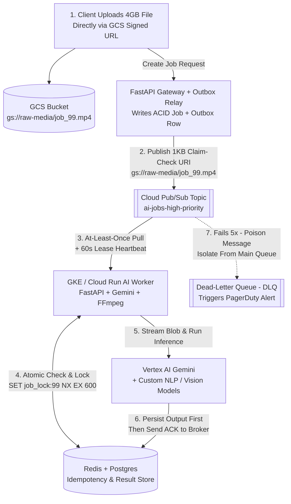

# Queues vs Logs & Delivery Semantics (Plain-English Guide)

> **Quick Summary — What This Is & Why Interviewers Care**
>
> - **Prerequisites:**
>   - **Synchronous vs. Asynchronous I/O:** Waiting on the phone on hold (`sync`) vs. leaving a callback number so your thread is free (`async`).
>   - **Partitioning / Sharding (`fund-02`):** Splitting data across multiple servers by hashing a key (`hash(key) % N`) so workloads scale horizontally.
>   - **ACID Transactions (`fund-03`):** All-or-nothing database writes (`BEGIN ... COMMIT`) in PostgreSQL.
> - **Plain-English Core:** Asynchronous queues and event logs decouple fast user-facing APIs (`<50ms`) from slow, failure-prone AI workers (`5s–10m`), absorbing traffic spikes without dropping a single job.
> - **Why Interviewers Care:** Every production AI system—from RAG document ingestion to video clipping and multi-agent tool execution—relies on queues or streams; interviewers test whether you know the difference between a destructive queue (SQS) and a replayable log (Kafka/Pub/Sub) and why "Exactly-Once" delivery requires application-level idempotency.
> - **The 10-Second Mental Model:** **"Effective Exactly-Once = At-Least-Once Delivery + Idempotent Consumer (`SET job_key NX`)."** Never pass multi-megabyte blobs through a broker (use the **Claim-Check Pattern**), and never autoscale I/O-bound AI workers on CPU percentage (scale on **Queue Backlog per Worker** and **Oldest Unacked Message Age**).

---

## 1. First Principles, Analogies & Capacity Math

Why can't your FastAPI server just call Vertex AI Gemini or `ffmpeg` directly inside an HTTP request? Because standard database queries take `2ms`, while generating 2,000 tokens or slicing a 1-hour video takes **10 seconds to 15 minutes**—and frequently hits `429 Too Many Requests` quota limits. Putting a message broker between your API and your workers turns a fragile synchronous call into a resilient asynchronous pipeline.

### 1. Traditional Message Queue (AWS SQS, Cloud Tasks, RabbitMQ) — "The Hospital Triage Ticket Dispenser"
- **The Analogy:** When patients arrive at an urgent care clinic, a kiosk prints a numbered paper slip and drops it into the triage basket. The next available nurse grabs **one slip**, treats the patient, and **shreds the paper slip (`ACK`)**.
- **Key Mechanics:**
  - **Destructive Read:** The moment a worker finishes a job and sends `ACK` (Acknowledged), the broker **deletes the message forever**.
  - **Competing Consumers:** If 20 worker pods pull from the same queue, each message is handed to **1 worker** to balance load evenly.
  - **The Catch (No Time Machine):** If next month you upgrade your embedding model from `text-embedding-004` to `text-embedding-005` and want to re-process last week's 500,000 documents, the queue cannot help you—those messages were shredded the second they were `ACK`ed.

### 2. Append-Only Log / Event Stream (Apache Kafka, AWS Kinesis) — "The Court Stenographer's Numbered Transcript Roll"
- **The Analogy:** A court stenographer never erases or tears out pages. Every spoken sentence is typed sequentially onto an **immutable, numbered paper roll** (`Offset #101, Offset #102, Offset #103...`) stored in the archive for 7 to 30 days.
- **Key Mechanics:**
  - **Non-Destructive Read (Replayable):** Reading a message does **not** delete it. Each reader simply tracks its own bookmark number (**Consumer Offset**—e.g., *"I am currently at `Offset #48,210`"*).
  - **Multiple Independent Consumer Groups Read for Free:**
    - **Consumer Group A (Real-Time NER Worker)** reads the roll at `Offset #50,000` to extract stock tickers in `<10ms`.
    - **Consumer Group B (BigQuery Archiver)** reads the *exact same roll* at `Offset #49,500` to bulk-load analytics every 60 seconds.
    - **Consumer Group C (New Model Backfill)** can **rewind its bookmark (`seek`) back to `Offset #0`** and replay 7 days of events without slowing down Group A or Group B.
  - **Partition Ordering Rule:** Kafka guarantees strict `FIFO` ordering **only within a single Partition**. By hashing `tenant_id` or `session_id` to pick the partition, all events for the same conversation land on the same partition in exact chronological order.

### 3. Google Cloud Pub/Sub — "The Hybrid Broadcast & Work-Queue Switchboard"
- **The Analogy:** Imagine a radio dispatcher connected to multiple department tape recorders. Every event published to a **Topic** is automatically copied to every attached **Subscription** (`sub-ner-fast`, `sub-bigquery-audit`). Inside a single subscription, workers pull jobs just like a queue, **and** if you enable **Message Retention + `Seek`**, you can rewind that subscription to any timestamp over the past 7–31 days just like Kafka.

### 4. Delivery Semantics & The Timestamped "Alice & Bob" Duplicate Trap
When a broker delivers a message to an AI worker, there are 3 theoretical modes:
1. **At-Most-Once ("Fire and Forget"):** Broker deletes the message before the worker processes it. Zero duplicates, but **messages are lost** whenever a pod restarts.
2. **At-Least-Once (Universal Production Standard):** Broker holds the message and starts a countdown timer (**Visibility Timeout / Ack Deadline**). If the worker doesn't send `ACK` before the timer expires, the broker redelivers the message to another worker. **Zero lost messages, but duplicates WILL happen.**
3. **Why Pure "Exactly-Once" Across External AI APIs Is Impossible (Walkthrough):**
   - `12:00:01.000 PM` — **Alice** clicks *"Summarize 50-Page Contract"*. FastAPI publishes `job_id: "doc_88"` to Pub/Sub with a `30-second` Ack Deadline.
   - `12:00:01.050 PM` — **Worker Pod 1** pulls `doc_88` and sends `40,000` input tokens to Vertex AI Gemini (`$0.05` cost).
   - `12:00:08.400 PM` — Vertex AI finishes generating the summary and returns HTTP `200 OK` to Worker Pod 1.
   - `12:00:08.405 PM` — **CRASH!** An out-of-memory (`OOMKilled`) spike kills Worker Pod 1 **5 milliseconds before** it can send `ACK` to Pub/Sub.
   - `12:00:31.050 PM` — The `30-second` Ack Deadline expires. Pub/Sub assumes `doc_88` failed and hands `doc_88` to **Worker Pod 2**.
   - `12:00:31.100 PM` — Without an **Idempotency Check**, Worker Pod 2 calls Vertex AI Gemini *a second time*, charging **Bob's** department double (`$0.10`) and inserting a duplicate summary row!
   - **The Engineering Fix:**
     $$\text{Effective Exactly-Once} = \text{At-Least-Once Delivery} + \text{Idempotent Consumer}$$

### Back-of-the-Envelope Rule of Thumb (15-Second Queue & Log Math)
- **Worker Count Needed (`Little's Law`):**
  $$\text{Workers} = \frac{\text{Arrival Rate } (\lambda \text{ jobs/sec}) \times \text{Processing Time } (W \text{ sec/job})}{\text{Concurrency per Worker}}$$
  - *Example:* Ingesting `200 PDFs/sec`, each taking `3 seconds` to embed, with `10 async coroutines` per worker pod = `(200 × 3) / 10 = 60 worker pods`.
- **Spike Buffer Sizing:** If traffic jumps `10x` to `2,000 PDFs/sec` for `15 minutes` (`900s`), the queue accumulates `(2,000 - 200) × 900 = 1.62M messages`. Because you use the **Claim-Check Pattern** (`1 KB` JSON pointer per message instead of a `10 MB` PDF), the entire 1.62M-job backlog takes only **`1.62 GB` of broker disk** instead of `16.2 TB`!
- **Kafka Log Retention Disk Math:**
  $$\text{Disk} = \text{Messages/sec} \times \text{Avg Payload Bytes} \times 86,400 \times \text{Retention Days} \times \text{Replication Factor (3)}$$
  - *Example:* `5,000 events/sec` × `2 KB` × `86,400s` × `7 days` × `3 replicas` ≈ **`18.1 TB` total cluster SSD** (or `~6 TB` with LZ4 compression).

---

## 2. Visual Architecture Blueprint

Follow the numbered steps (`1 → 7`) below to trace a production-grade asynchronous AI pipeline combining the **Transactional Outbox**, **Claim-Check Pattern**, **Pub/Sub Fan-Out**, **Redis Idempotency Locks**, **Lease Heartbeats**, and a **Dead-Letter Queue (DLQ)**:

1. **Step 1 (Direct Upload):** Client uploads raw media (`4 GB` video or `50 MB` PDF) directly to **GCS** via a v4 Signed URL so multi-megabyte blobs never touch your API pods or message broker.
2. **Step 2 (Transactional Outbox):** API writes job metadata + a `gs://` Claim-Check URI to **PostgreSQL** (`jobs` + `outbox_events` in one ACID commit) and relays the lightweight `1 KB` ticket to **Pub/Sub**.
3. **Step 3 (At-Least-Once Pull):** GKE / Cloud Run worker pulls the ticket and starts a background **Lease Heartbeat** thread (`modifyAckDeadline` every `60s`).
4. **Step 4 (Atomic Idempotency Gate):** Worker checks Redis (`GET job_result:{hash}`) and acquires an atomic lock (`SET job_lock:{hash} NX EX 600`).
5. **Step 5 (AI Execution):** Only if not yet processed, the worker streams the file from GCS, calls **Vertex AI Gemini**, and writes the output to Postgres (`ON CONFLICT DO NOTHING`) and Redis.
6. **Step 6 (Safe ACK):** Worker sends `ACK` to Pub/Sub **only after** Postgres and Redis writes succeed.
7. **Step 7 (Poison-Pill Isolation):** If a corrupted file crashes 5 times (`max_delivery_attempts = 5`), Pub/Sub routes it to the **Dead-Letter Queue (DLQ)** and alerts on-call without blocking healthy jobs.



---

## 3. Side-by-Side Comparison & Trade-Off Table

| Architecture Option | How Reads & Retention Work | Ordering & Consumer Scaling | When to Pick / Winner | Watch Out For (The Trap) |
| :--- | :--- | :--- | :--- | :--- |
| **Traditional Queue** *(AWS SQS, Cloud Tasks, RabbitMQ)* | **Destructive Read:** Message is permanently deleted the moment a worker sends `ACK`. | Best-effort ordering (or strict FIFO at lower throughput); scales to thousands of competing workers easily. | **Winner for Task Dispatch:** Point-to-point background jobs (video slicing, webhook retries, email/CRM sync) where each task only needs one worker and never needs replay. | **No Time Machine:** Once `ACK`ed, events are gone forever—you cannot replay last week's stream into a new embedding model unless you also archived payloads to S3/GCS. |
| **Append-Only Log Stream** *(Apache Kafka, Redpanda, Kinesis)* | **Non-Destructive Read:** Events stay on disk for `7–30 days` (or tiered storage). Readers track a numeric `Offset`. | Strictly ordered **within each Partition** (`hash(key) % P`). Multiple **Consumer Groups** read the same stream independently. | **Winner for High-Throughput Event Spine:** Ingesting `50k+ events/sec`, multi-consumer pipelines (NER + BigQuery + Vector Indexer reading one topic), and model backfill via offset replay. | **Partition Cap on Parallelism:** Within one Consumer Group, **max active workers = number of partitions (`P`)**. If a topic has `8` partitions and you spin up `50` pods during an AI spike, `42` pods sit completely idle! |
| **Hybrid Cloud Pub/Sub** *(Google Cloud Pub/Sub)* | Topic fans out to multiple **Subscriptions**. Each subscription acts like a queue, **plus** optional `7–31 day` retention & `Seek` replay. | Scales dynamically without pre-sizing partition counts; supports optional per-key ordering (`ordering_key`). | **Winner for Cloud-Native AI on GCP:** Zero-ops fan-out + work queue + timestamp/snapshot `seek` replay (used in our **Deloitte** and **Network18** pipelines). | **Ordering Key Head-of-Line Blocking:** If you enable `ordering_key = tenant_id` and 1 message for `tenant_A` stalls or retries, *all subsequent messages* for `tenant_A` wait behind it. |

---

## 4. Deep-Dive Mechanics & Production Failure Analysis

### Under-the-Hood Tricks (What Separates Junior from Senior Answers)

1. **The Partition Parallelism Ceiling vs. Dynamic Worker Pools:**
   - In **Apache Kafka**, a single partition can only be assigned to **one consumer thread per Consumer Group** so that partition ordering isn't scrambled.
   - *The Senior Pattern:* If your Kafka topic has `12 partitions` because network I/O is tiny, but each message triggers a `5-second` LLM call, 12 synchronous consumers can only process `12 / 5s = 2.4 jobs/sec`! To fix this without creating 1,000 Kafka partitions, either use **async coroutine pools (`asyncio.Semaphore(50)`) inside each consumer** with out-of-order offset tracking, or let Kafka feed a fast router that fans work out to a partitionless work queue (**Pub/Sub / SQS**).
2. **The Transactional Outbox Pattern (Solving the Dual-Write Bug):**
   - *The Junior Bug:* Writing `db.save(job)` and then `pubsub.publish(job)` in an API handler. If the pod restarts between line 1 and line 2, the database says `"Job status: QUEUED"` forever, while Pub/Sub never received the message.
   - *The Senior Fix:* Write both the `jobs` row and an `outbox_events` row inside the **exact same PostgreSQL ACID transaction (`COMMIT`)**. A lightweight Change-Data-Capture (CDC / Debezium) or polling relay reads `outbox_events WHERE published = false`, publishes to Pub/Sub, and marks `published = true`. Because Pub/Sub delivery is at-least-once and consumers are idempotent, zero events are ever lost or duplicated.
3. **Priority Lanes (Isolating Interactive Traffic from Bulk Backfills):**
   - Never push a `500,000-document` historical re-embedding backfill into the same queue that processes live user file uploads! Always provision separate queues (`ai-ingest-realtime-p0` vs. `ai-ingest-backfill-p2`) with dedicated worker minimums and separate token-bucket quotas.

### What Breaks in Production at 2 AM (Real Failure Modes)

#### Failure Mode 1: The Ack Deadline / Visibility Timeout Runaway Duplicate Storm
- **How It Happens at 2 AM:** Your Pub/Sub subscription has `ack_deadline_seconds = 600` (10 minutes). At `02:00 AM`, a customer uploads a dense 90-minute town-hall video that takes **16 minutes** for `ffmpeg` and Gemini Multimodal to process on **Worker Pod A**.
  - At `02:10 AM`, Worker Pod A is still healthy at `65%` completion—but the 10-minute Ack Deadline expires!
  - Pub/Sub assumes Worker Pod A died and redelivers the exact same job to **Worker Pod B**.
  - At `02:20 AM`, Worker Pod B hits 10 minutes, so Pub/Sub hands a 3rd copy to **Worker Pod C**. Soon 20 pods are burning Gemini tokens and RAM on the same large jobs until the cluster OOMs!
- **How to Detect It in Metrics:**
  - `pubsub.googleapis.com/subscription/ack_latencies` approaches `ack_deadline_seconds`.
  - Spike in `expired_ack_deadlines_count` alongside a rising `duplicate_idempotency_lock_hits` counter in Redis.
- **Exact Mitigation:**
  1. **Streaming Lease Renewal (Heartbeats):** Run a background heartbeat task inside the worker that calls `modify_ack_deadline(ack_id, 120)` every `30 seconds` for as long as the worker thread is alive and making progress (with a hard wall-clock ceiling of `30 minutes`).
  2. **Chop Large Jobs Before Queuing (Fan-Out):** Have a fast splitter service slice any video into `5-minute` keyframe chunks (`ffmpeg -c copy` takes `<2s`) so every individual queue message finishes in `<60 seconds`.

#### Failure Mode 2: Poison-Pill Loop + The "Lazy CPU" Autoscaling Trap
- **How It Happens at 2 AM:** Two things go wrong during a midnight traffic surge:
  1. A crawler ingests a malformed PDF with a circular font table that causes the C++ PDF parser (`poppler` / `pdfium`) to segfault (`SIGSEGV`) immediately. Because the pod crashes before sending `ACK` or `NACK`, Pub/Sub immediately redelivers the poison PDF to the next pod, crashing pods in a tight loop.
  2. Meanwhile, 80,000 valid jobs back up in the queue—but your Kubernetes Horizontal Pod Autoscaler (`HPA`) stays stuck at `3 pods` because it is configured to scale on **`CPU Utilization > 70%`**, and your LLM workers spend `92%` of their time waiting on Vertex AI network I/O at **`12% CPU`**!
- **How to Detect It in Metrics:**
  - `oldest_unacked_message_age_seconds` climbs past your `120s` SLO while GKE pod CPU stays flat at `<15%`.
  - Pod `CrashLoopBackOff` / `delivery_attempt > 3` spikes on specific message IDs.
- **Exact Mitigation:**
  1. **Dead-Letter Queue (`max_delivery_attempts = 5`):** Attach a DLQ topic to every subscription with broker-enforced exponential backoff (`min_backoff = 10s`, `max_backoff = 300s`). Before calling native C++ parsers, increment a Redis crash counter (`INCR delivery_attempts:{msg_id}`); if `>3`, route directly to quarantine before parsing.
  2. **Autoscale on Queue Backlog with KEDA:** Replace CPU-based HPA with **KEDA (Kubernetes Event-driven Autoscaling)** driven by `num_undelivered_messages / active_pods` (target: `5 jobs/pod`) and `oldest_unacked_message_age_seconds < 60s`.

---

## 5. Production AI & Resume Tie-In

### 1. Network18 AI Video Repurposing Engine (Claim-Check + Fan-Out + Idempotent Workers)
- **The Challenge:** Broadcast editors uploaded raw 1-hour studio recordings (`2–4 GB` each) to extract high-value short-form clips using **Gemini API**, **FastAPI**, and **moviepy** on **Google Cloud Run**. Passing video bytes through HTTP or Pub/Sub (`10 MB` message limit) was impossible, and long Gemini multimodal calls risked duplicate execution on Cloud Run retries.
- **How We Architected It:**
  1. **Claim-Check Upload:** The Streamlit portal uploads the raw `.mp4` directly to **Google Cloud Storage (GCS)** via a v4 Signed URL.
  2. **Key-Frame Fan-Out:** GCS emits an `OBJECT_FINALIZE` event to **Pub/Sub** carrying only the `gs://` URI (`<1 KB`). A lightweight splitter slices the broadcast at keyframes into 5-minute segments and fans out chunk tasks.
  3. **Idempotent Execution:** Each Cloud Run worker hashes `sha256(video_id + chunk_id + prompt_version)` in Redis before invoking Gemini Vision/Audio analysis and `moviepy`, cutting manual editing effort by `~85%` (`~84%` segment precision) with zero duplicate token spend.

### 2. Deloitte Multi-Agent Orchestration for Customer Support (Pub/Sub Quota Shock Absorber)
- **The Challenge:** On **GKE** with **Google ADK** and **FastAPI**, interactive customer support queries needed near-instantaneous responses, while heavy side-tasks (CRM ticket write-backs, long attachment OCR, and asynchronous **LLM-as-a-Judge** RAG Triad evaluations) competed for the same regional Vertex AI Gemini TPM quota.
- **How We Architected It:**
  - Synchronous GKE sub-agents handle the live customer turn on a reserved high-priority quota lane, while all post-turn side effects and eval jobs are published via an outbox relay to **Google Cloud Pub/Sub**. Rate-limited background consumers drain the evaluation and CRM queues steadily, protecting live chats from `429 Quota Exceeded` spikes and helping cut customer resolution times from `24–48 hours` to seconds (`$1.3M+` annual savings).

### Production Code: Idempotent Pub/Sub AI Worker with Lease Heartbeat (Python + Redis)

Below is a complete, production-ready async worker pattern showing **deterministic idempotency keys**, **atomic Redis `SET NX` locking**, **concurrent lease renewal heartbeats**, and **safe ack-after-persist**:

```python
import asyncio
import hashlib
import json
from typing import Any, Callable, Awaitable
import redis.asyncio as redis

async def run_idempotent_ai_job(
    redis_client: redis.Redis,
    ack_id: str,
    extend_lease_fn: Callable[[str, int], Awaitable[None]],
    job_payload: dict[str, Any],
    invoke_gemini_fn: Callable[[dict[str, Any]], Awaitable[dict[str, Any]]],
) -> dict[str, Any]:
    # 1. Deterministic Idempotency Key: same document + chunk + model/prompt = exact same hash
    canonical_id = f"{job_payload['doc_id']}:{job_payload['chunk_id']}:{job_payload['prompt_ver']}"
    digest = hashlib.sha256(canonical_id.encode("utf-8")).hexdigest()
    lock_key = f"idemp:lock:{digest}"
    result_key = f"idemp:result:{digest}"

    # 2. Fast Path (<1ms): If a previous delivery already completed this job, return cached result
    existing_result = await redis_client.get(result_key)
    if existing_result is not None:
        return json.loads(existing_result)

    # 3. Atomic Check-and-Set Lock (SET NX EX 180): prevents 2 workers from running duplicate deliveries
    acquired = await redis_client.set(lock_key, "IN_FLIGHT", nx=True, ex=180)
    if not acquired:
        raise RuntimeError(f"Duplicate in-flight delivery for {canonical_id}; deferring to active worker.")

    # 4. Background Heartbeat Task: renews Pub/Sub Ack Deadline + Redis lock every 30s while alive
    stop_heartbeat = asyncio.Event()

    async def _lease_heartbeat() -> None:
        while not stop_heartbeat.is_set():
            await asyncio.sleep(30)
            if not stop_heartbeat.is_set():
                await extend_lease_fn(ack_id, 120)          # Extend Pub/Sub visibility by 120s
                await redis_client.expire(lock_key, 180)    # Extend Redis lock TTL by 180s

    heartbeat_task = asyncio.create_task(_lease_heartbeat())
    try:
        # 5. Execute expensive Vertex AI Gemini call & persist result BEFORE acknowledging Pub/Sub
        ai_output = await invoke_gemini_fn(job_payload)
        await redis_client.set(result_key, json.dumps(ai_output), ex=86400 * 7)
        return ai_output
    except Exception:
        # Release in-flight lock immediately on error so broker backoff retry can re-run cleanly
        await redis_client.delete(lock_key)
        raise
    finally:
        stop_heartbeat.set()
        heartbeat_task.cancel()
```

---

## 6. Common Interview Questions, Follow-Up Probes & Quick Recall

### Q1: "Can we just turn on 'Exactly-Once Delivery' in Kafka or Pub/Sub so our worker never calls the Gemini API or charges a customer twice?"
- **What they are really testing:** Do you understand why broker-level "exactly-once" only applies inside the broker's own storage ecosystem, and cannot undo an external HTTP side effect?
- **How to answer simply:**
  > "No—across an external HTTP API like Vertex AI Gemini or Stripe, pure network-level 'exactly-once delivery' is physically impossible. A worker pod can always crash 1 millisecond *after* Gemini finishes generating tokens and bills our account, but 1 millisecond *before* the pod sends the `ACK` packet back to Pub/Sub.
  > Instead, we achieve **Effective Exactly-Once** by combining **At-Least-Once Delivery** with an **Idempotent Consumer**:
  > 1. We compute a deterministic **Idempotency Key** (`sha256(doc_id + chunk_index + model_version)`).
  > 2. Before calling Gemini, the worker checks Redis (`GET idemp:result:{key}`) and acquires an atomic lock (`SET idemp:lock:{key} NX EX 180`).
  > 3. We persist the LLM output to Postgres (`INSERT ... ON CONFLICT DO NOTHING`) and Redis *before* sending `ACK` to the queue."
- **Likely Follow-Up Probe ("The Double-Click"):**
  - *Interviewer:* "What if the worker acquires the Redis `SET NX` lock, calls Gemini, and then the worker pod is `OOMKilled` before writing the result or deleting the lock?"
  - *Your Answer:* "That is why every `SET NX` lock must carry a bounded TTL (e.g., `EX 180`) refreshed by a `30-second` in-process heartbeat. When the pod is `OOMKilled`, the heartbeat stops, the Redis lock automatically expires after `180 seconds`, and the next Pub/Sub redelivery cleanly acquires the lock and finishes the job."

### Q2: "When ingesting 10 million enterprise documents into a RAG vector database, would you use a Message Queue (SQS) or an Append-Only Log (Kafka / Pub/Sub with Retention)?"
- **What they are really testing:** Can you connect destructive vs. non-destructive reads to real-world ML lifecycle needs like shadow testing and embedding backfills?
- **How to answer simply:**
  > "I would choose an **Append-Only Log (Kafka or Cloud Pub/Sub with 7-to-30-day message retention and `Seek` enabled)**, paired with storing the canonical extracted markdown in Postgres/GCS.
  > A destructive queue like SQS deletes every message the instant it is acknowledged. With a replayable log, multiple **Consumer Groups** can read the same document stream simultaneously—for example, `group-prod-qdrant` indexing into our live vector collection while `group-shadow-eval` tests a new embedding model (`text-embedding-005`) on the exact same live traffic. Even better, if a bad chunking bug ships on Tuesday, we can deploy the fix on Wednesday and **rewind the consumer offset (`seek`)** back 24 hours to re-index without re-scraping a single source."
- **Likely Follow-Up Probe ("The Double-Click"):**
  - *Interviewer:* "If your Kafka topic has 12 partitions, and a sudden burst of 500,000 PDFs arrives, what happens when Kubernetes scales your embedding Consumer Group from 12 pods up to 60 pods?"
  - *Your Answer:* "In Kafka, a partition can only be consumed by **one pod per Consumer Group**, so `48 of those 60 pods` will sit completely idle! To scale past 12 pods during bursty AI workloads, we either over-partition the topic up front (e.g., `64–128 partitions`), run bounded async concurrency (`asyncio.Semaphore(20)`) inside each pod, or use Cloud Pub/Sub which distributes messages across any number of workers without a hard partition ceiling."

### Q3: "Your AI video worker takes 18 minutes to process a broadcast, but the queue Visibility Timeout / Ack Deadline is 10 minutes. Walk through what happens and how to fix it."
- **What they are really testing:** Operational experience with long-running multimodal or agentic jobs that exceed default broker lease times.
- **How to answer simply:**
  > "At minute `10:00`, while Worker 1 is 60% done processing the video, the broker's Ack Deadline expires. Because Worker 1 hasn't sent `ACK` yet, the broker assumes Worker 1 died, makes the message visible again, and hands a duplicate copy to **Worker 2**. At minute `20:00`, Worker 3 gets a copy too—creating a runaway duplicate storm that exhausts our GPU/Gemini quota and OOMs the cluster.
  > We prevent this in two ways:
  > 1. **Architectural Decomposition (Fan-Out):** Split the 60-minute broadcast at keyframes into twelve 5-minute chunks before queuing so every worker task finishes in `<60 seconds`.
  > 2. **Lease Heartbeats:** Run a background heartbeat coroutine inside the worker that calls `modifyAckDeadline` every `30–60 seconds` to extend the lease for as long as the worker process is healthy."
- **Likely Follow-Up Probe ("The Double-Click"):**
  - *Interviewer:* "What if the worker's Python thread deadlocks on a C-extension call while the background heartbeat coroutine keeps extending the lease forever?"
  - *Your Answer:* "Never let a heartbeat renew blindly! The worker must update a `last_progress_timestamp` monotonic clock after each completed step (e.g., each processed video frame or LLM chunk), and the heartbeat coroutine should stop renewing if `now - last_progress_timestamp > 120s` or if total job duration exceeds a hard `30-minute` max lease."

### Q4: "What metric should drive Kubernetes autoscaling for async LLM workers, and why does CPU-based scaling fail?"
- **What they are really testing:** Do you know the "Lazy CPU Trap" for network/I/O-bound AI workers and how to calculate backlog-driven scaling?
- **How to answer simply:**
  > "Autoscaling async LLM workers on **CPU percentage is a classic production trap**. Because workers calling Vertex AI Gemini or OpenAI spend `90%+` of their wall-clock time waiting on network HTTP responses, pod CPU sits at `10–15%` even when `100,000 messages` are backed up in the queue!
  > Instead, we use **KEDA on GKE** (or Cloud Run custom metrics) to autoscale on two queue signals:
  > 1. **Backlog per Worker (`num_undelivered_messages / active_pods`):** Target `5–10 messages` per pod.
  > 2. **Oldest Unacked Message Age (`oldest_unacked_message_age_seconds`):** Scale up aggressively whenever the oldest message in line approaches `50%` of our end-to-end SLA."
- **Likely Follow-Up Probe ("The Double-Click"):**
  - *Interviewer:* "If KEDA sees 50,000 messages in Pub/Sub and tries to spin up 1,000 worker pods immediately, what breaks downstream?"
  - *Your Answer:* "All 1,000 pods will simultaneously fire requests at Vertex AI Gemini and PostgreSQL, immediately triggering `429 Quota Exceeded` storms and exhausting Postgres connection pools (`max_connections`). We prevent this by setting a hard `maxReplicaCount` in KEDA matched to our downstream TPM quota and PgBouncer pool size."

### 60-Second Rapid Fire (Self-Check)
- **Q: What is the formula for Effective Exactly-Once in distributed AI pipelines?**
  - **A:** `At-Least-Once Broker Delivery + Deterministic Idempotency Key + Atomic Lock/Upsert (Redis SET NX / Postgres ON CONFLICT)`.
- **Q: How do you pass a `4 GB` video or `50 MB` PDF through Kafka or Pub/Sub?**
  - **A:** Never put raw blobs in the broker; upload to **GCS/S3 via a Signed URL** and publish only the `1 KB` `gs://` URI (**Claim-Check Pattern**).
- **Q: How do you ensure a database write and a Pub/Sub publish never get out of sync if the server crashes mid-request?**
  - **A:** Use the **Transactional Outbox Pattern**—write both the business row and an `outbox_events` row in the same Postgres ACID transaction, and have a background relay publish to Pub/Sub.
