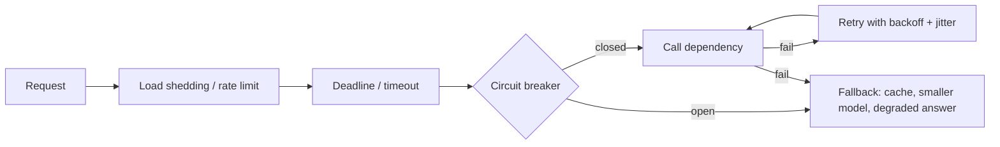

# Reliability Patterns: Timeouts, Retries, Circuit Breakers, Backpressure

> **Why this matters for AI systems:** LLM APIs return 429s and time out; tools fail halfway through agent plans. Reliability patterns decide whether that is a blip or an outage.

## 1. The failure-handling stack (outer → inner)

## 2. Timeouts and deadlines

- Every network call needs a timeout; the default (infinite) will eventually take you down.
- Propagate a **deadline** (remaining budget) through the call chain so downstream work stops when the caller has given up.
- For streaming LLM calls set separate **time-to-first-token** and **total** timeouts.

## 3. Retries — done safely

- Retry only **idempotent** or key-protected operations, and only on transient errors (429, 503, timeouts) — not 400s.
- **Exponential backoff with jitter** (e.g. full jitter: `sleep = random(0, min(cap, base * 2^n))`) prevents synchronized retry storms.
- **Retry budgets:** cap retries at, say, 10% of traffic; otherwise retries multiply load during an outage (retry amplification across layers: 3 layers × 3 retries = 27×).
- Respect `Retry-After` headers.

## 4. Circuit breaker

- States: **closed** (normal) → **open** (fail fast after error threshold) → **half-open** (probe a few requests).
- Protects the dependency and your threads; pair with a fallback.

## 5. Bulkheads, load shedding, backpressure

- **Bulkhead:** separate pools/queues per dependency or tenant so one slow tool cannot exhaust all workers.
- **Load shedding:** reject early (429/503) when saturated; prefer dropping low-priority work.
- **Backpressure:** propagate "slow down" upstream (bounded queues, pull-based consumers) instead of buffering unbounded memory.

## 6. Graceful degradation ladder for an LLM feature

1. Serve from cache (exact → semantic).
2. Route to a cheaper/faster model or another region/provider.
3. Reduce scope (fewer retrieved chunks, no reranker, shorter output).
4. Return a deterministic template / "try again" with status — never hang.

## 7. Idempotency and sagas

- Idempotency keys on every side-effecting tool call (create ticket, send email).
- Multi-step agent workflows need **compensating actions** (saga) for steps already done when a later step fails — covered in Session 12.

## 8. AI tie-in numbers worth stating

- Set a **token/step budget** per agent run and a max-iterations cap as a circuit breaker against loops.
- A 30s default LLM timeout with 3 retries can hold a request for 90s+ — budget retries inside the *user-facing* deadline.

## 9. Interview check

1. Gemini returns 429 for 10% of calls. Walk through what happens in your system.
2. Why can retries make an outage worse? How do you prevent it?
3. Circuit breaker vs rate limiter vs bulkhead — one sentence each.
4. Design the fallback ladder for your Deloitte support bot.
