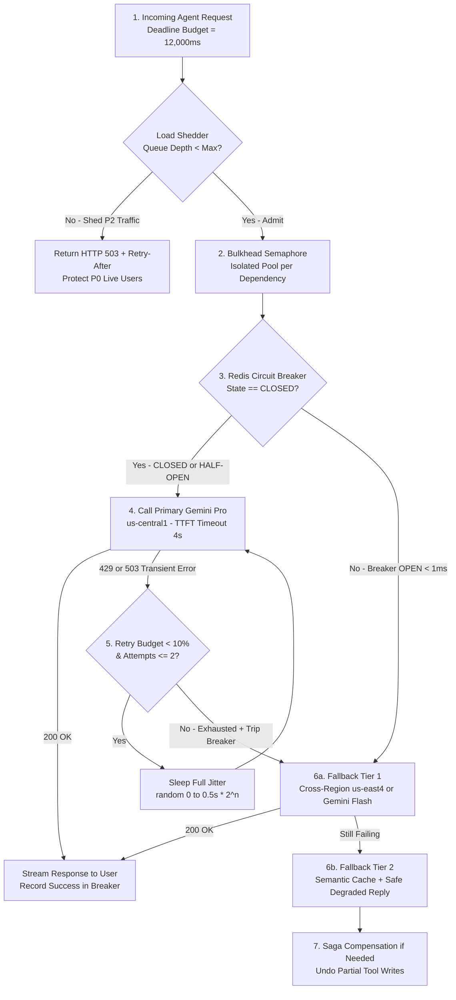

# Reliability Patterns: Timeouts, Retries, Circuit Breakers, Backpressure (Plain-English Guide)

> **Quick Summary — What This Is & Why Interviewers Care**
>
> - **Prerequisites:**
>   - **Tail Latency (`P95 / P99`):** The slowest `5%` or `1%` of requests—in multi-step AI agents, a single slow tool call makes the entire user experience slow.
>   - **Idempotency (`fund-04`):** Ensuring a retried request (`idempotency_key`) never executes a side effect or bills a customer twice.
>   - **Async Event Loops (`asyncio` / Thread Pools):** How a single FastAPI pod handles hundreds of concurrent network calls using bounded worker/connection pools.
> - **Plain-English Core:** Reliability patterns stop a temporary hiccup in one downstream dependency (like a Vertex AI `429` rate limit or a slow CRM API) from cascading into a full-cluster outage that takes down your entire application.
> - **Why Interviewers Care:** External LLM APIs are **100x slower and 10x flakier** than local databases (`P99` latencies of `5–15 seconds`, frequent regional `429 RESOURCE_EXHAUSTED` and `503 Overloaded` errors). Interviewers test whether your agent orchestrator fails gracefully or triggers a self-inflicted **Retry Storm**.
> - **The 10-Second Mental Model:** **"Never wait forever (`Timeouts`), never retry simultaneously (`Exponential Backoff + Jitter`), stop hammering a dead service (`Circuit Breaker`), isolate noisy neighbors (`Bulkheads`), and degrade gracefully (`Gemini Pro → Gemini Flash → Cached/Deterministic Fallback`)."**

---

## 1. First Principles, Analogies & Capacity Math

In a traditional microservice, a database query takes `2ms` and fails `0.001%` of the time. In a production AI system, a single multi-agent turn might call an embedding model (`30ms`), a vector DB (`15ms`), two external enterprise REST tools (`300ms`), and an LLM (`3,500ms`). Without strict reliability guardrails at every hop, one stalled downstream API will freeze every worker thread in your cluster within seconds.

### 1. Timeouts (`Connect`, `Read / TTFT`, and `Total Deadline`) — "The Elevator Door Sensor"
- **The Analogy:** An elevator holds its doors open for `5 seconds` for late passengers. If a broken sensor held the doors open *forever* (`timeout=None`) whenever someone dropped a box in the hallway, nobody in the entire 50-story building could use that elevator shaft for the rest of the day.
- **Key Mechanics for AI Systems:**
  - Never use a single generic timeout! For streaming LLMs (Vertex AI Gemini, OpenAI, vLLM), split timeouts into three distinct numbers:
    1. **Connect Timeout (`1.0s – 2.0s`):** Max time to complete the TCP + TLS handshake.
    2. **Time-to-First-Token (`TTFT`) / Inter-Chunk Read Timeout (`3.0s – 5.0s`):** If the LLM hasn't emitted its first token within `4s` (or pauses `>3s` between streamed tokens), abort early.
    3. **End-to-End Deadline Propagation (`15.0s – 30.0s`):** Pass an absolute deadline header (`X-Request-Deadline-Ms`) down the call chain. If the user's browser gives up at `15s`, and retrieval took `12s`, the downstream LLM only has **`3s` of remaining budget**—don't let it burn tokens for 20 seconds after the user already disconnected!

### 2. Retries with Exponential Backoff & Full Jitter — "The Staggered Fire-Drill Exit"
- **The Analogy:** Suppose the fire alarm rings for 2 seconds and then stops, and 500 employees all try to squeeze back through the revolving door at the **exact same second** (`12:00:02.000`). They jam the door! If everyone waits **exactly 4 seconds** and pushes again at `12:00:06.000`, they jam it again! **Jitter** tells each person to pick a **random wait time** between `0` and `8 seconds` so people trickle back through smoothly.
- **The Math (AWS "Full Jitter" Standard):**
  $$\text{sleep\_seconds} = \text{random\_uniform}\left(0,\ \min\left(\text{cap},\ \text{base} \times 2^{\text{attempt}}\right)\right)$$
  - *Example (`base = 0.5s`, `cap = 16s`):*
    - Attempt 1 fails → sleep random value in `[0s, 1.0s]` (e.g., `0.37s`).
    - Attempt 2 fails → sleep random value in `[0s, 2.0s]` (e.g., `1.62s`).
    - Attempt 3 fails → sleep random value in `[0s, 4.0s]` (e.g., `2.89s`).
  - **Golden Rule:** Only retry **transient, idempotent errors** (`429 Too Many Requests`, `502/503/504`, network timeout). **Never** retry `400 Bad Request`, `401 Unauthorized`, or `ContextWindowExceededError`!

### 3. Circuit Breakers (`Closed → Open → Half-Open`) — "The Electrical Breaker Panel in Your House"
- **The Analogy:** When your toaster short-circuits and draws dangerous current, the magnetic switch in your garage breaker box **snaps OPEN (`0.1ms`)**, cutting electricity to that kitchen outlet immediately so your house wiring doesn't catch fire. After you unplug the broken toaster, you flip the switch halfway (**Half-Open**) to test with 1 appliance before restoring full power (**Closed**).
- **The 3 States in Software (e.g., Redis-backed or Envoy Proxy):**
  1. **`CLOSED` (Normal Operation):** Traffic flows normally to Vertex AI `us-central1`. A sliding window tracks the failure rate over the last `60 seconds`.
  2. **`OPEN` (Tripped — Fast Fail in `<1ms`):** If the error/timeout rate exceeds **`50%` over at least `20 requests`**, the breaker trips `OPEN` for `30 seconds`. Every new request **fails immediately in `<1ms` without touching the network**, routing straight to your fallback (`us-east4` or `Gemini Flash`).
  3. **`HALF-OPEN` (Canary Probe):** After `30 seconds` cool-down, the breaker lets **1 to 3 test requests** through. If they succeed, the breaker resets to `CLOSED`; if they fail, it snaps right back to `OPEN` for another `30 seconds`.

### 4. Bulkheads, Backpressure & Load Shedding — "Watertight Ship Compartments & Highway On-Ramp Lights"
- **Bulkhead Pattern (Watertight Compartments on the Titanic):** If the hull punctures in Compartment 1, watertight steel doors seal it off so the other 15 compartments stay afloat. In code, give each downstream tool or tenant its own **isolated connection/semaphore pool** (e.g., `Pool A: 30 connections for Billing CRM`, `Pool B: 50 connections for Vector Search`). If the Billing CRM hangs, it can only exhaust its own 30 slots—users asking FAQ questions via Vector Search aren't affected at all!
- **Backpressure (Highway On-Ramp Metering Lights):** When the freeway is bumper-to-bumper, red/green lights on the entrance ramp slow down incoming cars (`HTTP 429 + Retry-After: 5` or blocking producer writes when an internal queue hits `max_size = 1,000`) so the highway keeps moving at 50 mph instead of gridlocking at 0 mph.
- **Load Shedding (VIP Lifeboats):** When your server is at `95%` capacity, proactively drop low-priority work first (e.g., reject free-tier or background summarization requests with `503 Server Busy`) to guarantee `100%` uptime for P0 live customer checkout/support traffic.

### 5. Timestamped Story ("Alice & Bob"): How Missing Guardrails Cause a Total Outage
Watch how a single slow third-party tool call takes down an unprotected FastAPI cluster in **5 seconds**:
- `12:00:00.000 PM` — Your GKE FastAPI orchestrator has **`200` worker slots** handling `50 req/sec`. `10%` of requests (`5 req/sec`) ask an AI agent to check order status via an external `ShippingAPI`, and `90%` (`45 req/sec`) are simple RAG policy questions.
- `12:00:01.000 PM` — `ShippingAPI` suffers a database deadlock and stops responding, hanging silently. Your developers forgot to set an HTTP timeout (`requests.get(url)` defaults to **`timeout=None`**!).
- `12:00:02.000 PM` — **Alice** asks *"Where is my package?"* Worker Slot #1 calls `ShippingAPI` and hangs forever.
- `12:00:10.000 PM` — Because `5 shipping requests/sec` arrive and never finish, `50` of your `200` worker slots are now permanently frozen waiting on `ShippingAPI`.
- `12:00:30.000 PM` — Worse, the frontend has a naive `3-second retry loop` without jitter! Frustrated users and retries multiply arrival rate by `3x` (`15 shipping req/sec`). All **`200` out of `200` worker slots** are now frozen on `ShippingAPI`!
- `12:00:31.000 PM` — **Bob** opens the chat and asks a simple HR policy question that **doesn't even use `ShippingAPI`**. Bob gets **`502 Bad Gateway`** because zero worker slots are left! A failure in a `10%` side-feature caused a **100% total system outage**.
- **How Reliability Patterns Prevent This:** A **Bulkhead (`max_concurrent=20`)** caps `ShippingAPI` at 20 slots (leaving 180 slots free for Bob), a **`3.0s` Timeout** frees hung requests quickly, and a **Circuit Breaker** trips `OPEN` after 10 timeouts so Alice immediately gets a polite degraded answer: *"Live shipping tracking is temporarily unavailable, but your last recorded scan was in Chicago."*

### Back-of-the-Envelope Rule of Thumb (15-Second Reliability Math)
- **Little's Law for Concurrency Pool Sizing (`L = λ × W`):**
  $$\text{Concurrent Slots } (L) = \text{Throughput } (\lambda \text{ req/s}) \times \text{Avg Latency } (W \text{ sec})$$
  - *The Math:* At `100 req/s` with normal latency `W = 0.2s`, you only hold `100 × 0.2 = 20` active connections. If a downstream LLM slows down `25x` to `W = 5.0s`, active connections explode to `100 × 5.0 = 500`—instantly exhausting a `250-connection` pool!
- **Multi-Layer Retry Amplification Trap:**
  If Browser retries `3x` → API Gateway retries `3x` → Orchestrator retries `3x` → Tool Client retries `3x`:
  $$\text{Total Downstream Calls per User Click} = 3 \times 3 \times 3 \times 3 = \mathbf{81\text{x traffic explosion!}}$$
  - **Rule:** Retry at **ONLY ONE layer** (the innermost caller that understands idempotency and rate-limit headers), or enforce a shared **cluster-wide retry budget (`max 10%` of total requests may be retries)**.
- **Tail Latency & Hedged Requests Math:**
  If a single tool call has a `P99` of `5 seconds` (`1%` slow), and an AI agent calls `10` tools in parallel:
  $$P(\text{at least 1 slow tool}) = 1 - (0.99)^{10} \approx \mathbf{9.6\%\text{ of users wait 5 seconds!}}$$
  - **Hedged Request Fix:** If a read-only call hasn't returned by the **`P95` latency (`400ms`)**, fire a second parallel request to another replica and take whichever finishes first—Wait time drops from `5,000ms` to `<500ms` at the cost of just `5%` extra load!

---

## 2. Visual Architecture Blueprint

Follow the numbered steps (`1 → 7`) below to trace how an enterprise AI request passes through a **5-layer defense-in-depth reliability pipeline**:

1. **Step 1 (Admission & Load Shedding):** Gateway checks cluster queue depth and remaining deadline budget; if overloaded (`>90%` saturation), sheds low-priority background traffic (`HTTP 503 + Retry-After`) while admitting P0 interactive users.
2. **Step 2 (Bulkhead Isolation):** Request acquires a slot from the isolated **Semaphore Pool** dedicated to that specific dependency (`max 40 concurrent calls`), protecting the rest of the pod.
3. **Step 3 (Circuit Breaker Check):** Orchestrator checks the shared **Redis Circuit Breaker**. If `OPEN`, it skips the primary LLM in `<1ms` and jumps straight to the **Fallback Ladder (Step 6)**.
4. **Step 4 (Bounded Call + Hedging):** Calls Primary **Vertex AI Gemini Pro (`us-central1`)** with strict `TTFT = 4.0s` and `Total = 15.0s` timeouts.
5. **Step 5 (Full-Jitter Backoff):** On a transient `429 / 503`, sleeps `random(0, min(8s, 0.5s * 2^attempt))` up to `max 2 retries` (only if the global retry budget `<10%` allows it).
6. **Step 6 (Graceful Degradation Ladder):** If retries fail or the Circuit Breaker is `OPEN`, falls back seamlessly: **Tier 1:** Cross-region `Gemini Pro (us-east4)` → **Tier 2:** Faster/cheaper `Gemini Flash` → **Tier 3:** Semantic Cache / Deterministic Template + Queue for async follow-up.
7. **Step 7 (Saga Compensation for Side Effects):** If a multi-step agent write workflow fails mid-flight (e.g., Step A booked a calendar slot, Step B failed to create the CRM ticket), executes the **Compensating Action** (`cancel_calendar_slot`) so state stays clean.



---

## 3. Side-by-Side Comparison & Trade-Off Table

| Reliability Pattern | What Problem It Solves | Typical Production Numbers | When to Pick / Winner | Watch Out For (The Trap) |
| :--- | :--- | :--- | :--- | :--- |
| **Granular Timeouts** *(`Connect` / `TTFT` / `Deadline`)* | Stops hung network sockets from tying up worker threads forever. | `Connect: 1.5s`, `TTFT: 4.0s`, `Total: 15.0s` | **Mandatory on Every Network Call:** Always set explicit timeouts on HTTP, gRPC, Redis, and LLM SDK clients. | **Orphaned GPU Work:** Canceling a client HTTP request after `15s` doesn't stop an upstream LLM from burning tokens unless you propagate context cancellation (`AbortSignal` / gRPC deadline). |
| **Exponential Backoff + Full Jitter** | Prevents synchronized retry waves ("Thundering Herd") after a brief blip. | `base = 0.5s`, `cap = 10s`, `max_retries = 2` | **Winner for Transient `429 / 503` Errors:** Always pair with reading the provider's `Retry-After` HTTP header if present. | **Multi-Layer Retry Amplification:** Retrying at 3 architectural layers turns 1 failure into `3^3 = 27` calls. Enforce a `10%` global retry budget! |
| **Circuit Breaker** *(`Closed / Open / Half-Open`)* | Stops wasting `4-second` timeouts on a dependency that is already known to be down. | Trip at `>50% errors` over `20 reqs`; cool-down `30s` | **Winner for Flaky External APIs & Regional LLM Failover:** Fails fast in `<1ms` and shifts traffic to a healthy region or smaller model. | **False Tripping on Client `4xx` Errors:** Never count `400 Bad Request` or `404 Not Found` toward tripping the circuit breaker—only count `429`, `5xx`, and timeouts! |
| **Bulkhead Isolation** *(Per-Tool Semaphore Pools)* | Prevents 1 slow tool/tenant from starving threads needed by healthy tools/tenants. | `20–50 max concurrent calls` per external tool | **Winner for Multi-Tool AI Agents:** Isolate CRM, ERP, Search, and Vector DB into separate async semaphores/thread pools. | **Over-Fragmentation:** Making pools too tiny (`max=2`) causes false rejections during normal micro-bursts. Size pools using Little's Law (`λ × P99_latency × 1.5`). |
| **Backpressure & Load Shedding** | Keeps server memory and latency stable when arrival rate exceeds max capacity. | Bounded queue (`max 500`), shed P2 at `85%` load | **Winner for Traffic Spikes:** Reject excess bulk/free-tier requests (`HTTP 429/503`) at the edge before spending CPU or embeddings. | **Dropping High-Value Requests:** Always classify traffic by priority tier (`P0 Live User`, `P1 Webhook`, `P2 Batch Eval`) so you only shed `P2` first. |
| **Hedged Requests** *(Speculative Backup Call)* | Cuts `P99` tail latency when a small fraction of storage/search nodes experience GC pauses. | Fire hedge at `P95` latency (`5%` extra traffic) | **Winner for Read-Only Vector Search & Fast Rerankers:** Dramatically tightens `P99` latency across sharded Qdrant/Redis clusters. | **Never Hedge Expensive LLM Generations Without Need:** Firing duplicate `4,000-token` Gemini Pro calls doubles token cost; reserve hedging for retrieval, KV lookups, or cheap classifiers. |

---

## 4. Deep-Dive Mechanics & Production Failure Analysis

### Under-the-Hood Tricks (What Separates Junior from Senior Answers)

1. **The Graceful Degradation Ladder for AI Systems (4 Tiers):**
   When an interviewer asks *"What happens when Vertex AI Gemini 1.5 Pro returns `503 Service Unavailable` or hits a regional quota wall?"*, never say *"We return an error page."* Walk down this 4-rung **Degradation Ladder**:
   - **Rung 1 (Same Model, Secondary Region / Provider):** Route in `<2ms` via your AI Gateway from `Vertex AI us-central1` to `Vertex AI us-east4` (or `Azure OpenAI / Anthropic` via unified schema).
   - **Rung 2 (Model Downgrade — Smaller, Faster Tier):** Fall back from `Gemini 1.5 Pro` to `Gemini 1.5 Flash` with a condensed system prompt (95% of customer support intents still succeed at `3x` speed and `1/10th` the cost).
   - **Rung 3 (Retrieval-Only / Semantic Cache Answer):** If all generative LLMs are unreachable, return the top-3 reranked knowledge-base snippets directly (`"Here are the exact policy sections matching your question..."`) or serve a verified hit from the **Semantic Cache**.
   - **Rung 4 (Async Queue Handoff):** For complex action requests, accept the user's message into **Pub/Sub**, guarantee processing as soon as the API recovers, and notify the user via email/webhook.
2. **The Saga Pattern for Multi-Step Tool-Calling Agents (Backward Compensation vs. Forward Recovery):**
   - Suppose an AI Support Agent executes a 3-tool chain: `Tool 1: Issue $50 Stripe Refund` → `Tool 2: Cancel Warehouse Shipment` → `Tool 3: Update Salesforce Ticket`.
   - You **cannot wrap external REST APIs in a single SQL `ROLLBACK` transaction**. Instead, use a **Saga Orchestrator**:
     - Before executing `Tool 1`, record a durable checkpoint in Postgres (`step=1, idempotency_key="ref_99"`) along with its **Compensating Action** (`reverse_refund("ref_99")`).
     - If `Tool 2` fails permanently because the warehouse already shipped the box (**Pivot Transaction**), the Saga runs **Backward Compensation** (`Tool 1_undo`) to cancel the refund credit and alerts a human agent.
     - Once the Pivot step succeeds, `Tool 3` (updating Salesforce) uses **Forward Recovery** (retry via Pub/Sub until it succeeds).

### What Breaks in Production at 2 AM (Real Failure Modes)

#### Failure Mode 1: The Multi-Layer Retry Storm ("Metastable Failure State")
- **How It Happens at 2 AM:** A transient 10-second network blip causes Vertex AI latency to spike from `1.5s` to `6.0s`.
  - The React frontend times out at `5s` and retries `3x`.
  - The API Gateway retries `3x`.
  - The LangGraph/ADK agent node retries `3x`.
  - Suddenly, `100 req/s` of real user traffic turns into **`2,700 req/s`** hammering your orchestrator and Vertex AI quota!
  - Even after the 10-second network blip heals at `02:00:10 AM`, the system **never recovers on its own** (a **Metastable Failure**): the massive queue of 2,700 retried requests keeps the servers 100% saturated, causing every *new* request to time out and spawn even more retries!
- **How to Detect It in Metrics:**
  - `retry_requests_total / incoming_user_requests_total` jumps above `0.15` (`15%`).
  - Downstream QPS (`vertex_ai_requests_per_sec`) is `5x–10x` higher than ingress QPS (`nginx_ingress_requests_per_sec`).
- **Exact Mitigation:**
  1. **Single-Layer Retries:** Disable automatic retries in the browser, CDN, and API Gateway for slow AI POST endpoints; perform jittered retries **only inside the AI Gateway client**.
  2. **Token-Bucket Retry Budget:** Maintain an in-memory counter per pod where every normal request adds `0.1` token and every retry consumes `1.0` token. If the bucket hits `0` (meaning retries exceed `10%` of traffic), **all retries are immediately disabled** and requests fail fast to the fallback model until health returns!

#### Failure Mode 2: Half-Open Circuit Breaker Stampede & Zombie Context Leaks
- **How It Happens at 2 AM:**
  1. Your Circuit Breaker has been `OPEN` for `30 seconds` while a downstream Vector DB recovers from a restart. At `02:05:30.000 AM`, the `30s` timer expires across all `40 GKE pods` simultaneously. Because `HALF-OPEN` wasn't guarded by an atomic distributed lock, all 40 pods let `10` requests through at the exact same millisecond (`400 concurrent requests`), immediately crashing the warming-up Vector DB back into `OPEN`!
  2. Furthermore, when timeouts fired earlier via `asyncio.wait_for(call_tool(), timeout=3.0)`, the underlying HTTP connection pool wasn't properly closed or bounded, leaving hundreds of half-closed `CLOSE_WAIT` sockets until the Linux kernel throws `OSError: [Errno 24] Too many open files`.
- **How to Detect It in Metrics:**
  - Circuit breaker state oscillates rapidly (`OPEN → HALF_OPEN → OPEN` every `30.1s`).
  - Pod metric `process_open_fds` climbs toward `ulimit -n` while `http_pool_active_connections` stays pinned at `100%`.
- **Exact Mitigation:**
  1. **Atomic Single-Probe `HALF-OPEN` Gate (`SET breaker:probe NX EX 10`):** Only the **single pod** that wins the Redis `SET NX` lock is allowed to send **1 canary probe request** during `HALF-OPEN`; all other pods continue routing to the fallback until that 1 probe succeeds and transitions the Redis state back to `CLOSED`.
  2. **Reuse a Singleton `httpx.AsyncClient` with Strict Pool Limits:** Never instantiate `httpx.AsyncClient()` inside a request handler! Share one client per pod configured with `httpx.Limits(max_connections=100, max_keepalive_connections=20)`.

---

## 5. Production AI & Resume Tie-In

### 1. Deloitte Multi-Agent Orchestration for Customer Support (Circuit Breakers, Bulkheads & Saga Tool Guards)
- **The Challenge:** Our production multi-agent system on **GKE** (**Google ADK + FastAPI + Vertex AI Agent Engine**) routes customer requests across specialized sub-agents (Billing, Order Tracking, Technical Triage) and enterprise REST tools. During peak morning hours, bursts of complex tickets could trigger regional **Vertex AI Gemini `429 RESOURCE_EXHAUSTED`** responses or encounter slow enterprise CRM endpoints—threatening our near-instantaneous response SLA.
- **How We Architected It:**
  1. **Per-Tool Bulkhead Semaphores:** Each sub-agent tool connector runs inside its own `asyncio.Semaphore` bulkhead so a slow CRM API never blocks Technical FAQ retrieval on **Vertex AI RAG Engine**.
  2. **Redis Circuit Breaker + Model Degradation Ladder:** If regional Gemini Pro latency or `429/503` rates breach threshold, the FastAPI orchestrator trips a Redis circuit breaker and seamlessly routes to secondary regional endpoints or **Gemini Flash**, keeping end-to-end resolution time near-instantaneous (`$1.3M+` annual savings).
  3. **Idempotent Saga Checkpoints:** Multi-step write tools log state transitions before execution so partial tool failures trigger clean compensating rollbacks or **Pub/Sub** forward recovery.

### 2. Network18 Sales Intelligence RAG Platform (Deadline Budgets & Scraper Circuit Breakers)
- **The Challenge:** Pre-call sales briefs combined live web scraping of competitor news with internal PDF RAG and **Gemini** financial summarization on **Google Cloud Run**. Live third-party websites frequently timed out or throttled scrapers, which would stall the entire brief generation if waited on synchronously.
- **How We Architected It:**
  - Enforced a strict **`4.0-second` scraper deadline budget** with per-domain circuit breakers and hedged retrieval against our cached BigQuery/RAG index—if a live publisher site hung past `4.0s`, the aggregator immediately synthesized the brief using cached filings + PDF RAG, cutting research time from hours to minutes with `99.9%` reliability.

### Production Code: Distributed Circuit Breaker + Full-Jitter Retry + LLM Fallback Ladder (Python)

Below is a complete, zero-placeholder implementation combining **Bulkhead isolation**, **atomic Redis Circuit Breaking**, **Full-Jitter Exponential Backoff**, **Retry Budget enforcement**, and **Graceful Model Fallback (`Gemini Pro → Gemini Flash`)**:

```python
import asyncio
import random
import time
from typing import Callable, Awaitable
import redis.asyncio as redis

class ResilientLLMGateway:
    def __init__(self, redis_client: redis.Redis, max_concurrency: int = 40) -> None:
        self.redis = redis_client
        self.bulkhead = asyncio.Semaphore(max_concurrency)   # Bulkhead: cap in-flight calls
        self.retry_tokens = 20.0                             # Local Retry Budget token bucket

    async def generate_with_fallback(
        self,
        prompt: str,
        call_primary_pro: Callable[[str], Awaitable[str]],
        call_fallback_flash: Callable[[str], Awaitable[str]],
    ) -> dict[str, str]:
        self.retry_tokens = min(20.0, self.retry_tokens + 0.1)  # Replenish 10% retry budget
        breaker_state = await self.redis.get("cb:gemini_pro:state")

        # 1. Circuit Breaker Fast-Fail (<1ms): if OPEN, skip primary unless winning HALF-OPEN probe
        if breaker_state == b"OPEN":
            won_probe = await self.redis.set("cb:gemini_pro:probe_lock", "1", nx=True, ex=10)
            if not won_probe:
                text = await asyncio.wait_for(call_fallback_flash(prompt), timeout=6.0)
                return {"model": "gemini-1.5-flash-fallback", "text": text}

        # 2. Bulkhead + Full-Jitter Retry Loop on Primary Model
        async with self.bulkhead:
            for attempt in range(3):
                try:
                    text = await asyncio.wait_for(call_primary_pro(prompt), timeout=8.0)
                    await self.redis.delete("cb:gemini_pro:state", "cb:gemini_pro:failures")
                    return {"model": "gemini-1.5-pro-primary", "text": text}
                except ( asyncio.TimeoutError, RuntimeError ) as err:
                    # Increment sliding 60s failure counter in Redis; trip OPEN if >= 10 failures
                    fails = await self.redis.incr("cb:gemini_pro:failures")
                    if fails == 1:
                        await self.redis.expire("cb:gemini_pro:failures", 60)
                    if fails >= 10:
                        await self.redis.set("cb:gemini_pro:state", "OPEN", ex=30)
                        break

                    # Check 10% Retry Budget before sleeping with AWS Full Jitter
                    if attempt < 2 and self.retry_tokens >= 1.0:
                        self.retry_tokens -= 1.0
                        cap_sleep = min(8.0, 0.5 * (2 ** attempt))
                        await asyncio.sleep(random.uniform(0.0, cap_sleep))
                    else:
                        break

        # 3. Graceful Degradation Rung: Fall back to faster/cheaper Gemini Flash
        text = await asyncio.wait_for(call_fallback_flash(prompt), timeout=6.0)
        return {"model": "gemini-1.5-flash-fallback", "text": text}
```

---

## 6. Common Interview Questions, Follow-Up Probes & Quick Recall

### Q1: "Why is Exponential Backoff alone NOT enough when a Vertex AI Gemini endpoint returns `429 Too Many Requests` to 500 concurrent worker pods?"
- **What they are really testing:** Do you understand synchronized retry waves (Thundering Herd) and the mathematical formula for Full Jitter?
- **How to answer simply:**
  > "Pure exponential backoff (`1s, 2s, 4s, 8s`) is deterministic—so if 500 worker pods all hit a `429` rate-limit wall at `12:00:00`, all 500 pods will sleep for exactly `1.0 second` and slam Vertex AI again at `12:00:01` in lockstep! Then they all sleep `2.0 seconds` and slam it again at `12:00:03`.
  > To break synchronization, we add **Full Jitter**: `sleep = random_uniform(0, min(cap, base * 2^attempt))` (and always honor the provider's `Retry-After` header first). That spreads the 500 retries smoothly across the entire time window instead of firing in synchronized spikes."
- **Likely Follow-Up Probe ("The Double-Click"):**
  - *Interviewer:* "Even with Full Jitter, what if the downstream service is completely down for 10 minutes—won't retries still triple the load on your cluster?"
  - *Your Answer:* "Yes! That is why Jittered Retries must always be paired with two things: a **Circuit Breaker** (which trips `OPEN` after `>50%` failures in 60s so we stop retrying a dead endpoint) and a **10% Retry Budget** (a token bucket that disables retries entirely if more than 10% of cluster requests are retries)."

### Q2: "Walk through how a Circuit Breaker works and how you would design a Graceful Degradation Ladder when your primary LLM fails."
- **What they are really testing:** Can you keep an AI product useful for customers during an OpenAI / Vertex AI regional outage?
- **How to answer simply:**
  > "A Circuit Breaker is a 3-state machine (`CLOSED`, `OPEN`, `HALF-OPEN`) backed by Redis so all orchestrator pods share state:
  > - In **`CLOSED`**, requests go to our primary model (`Gemini 1.5 Pro` in `us-central1`).
  > - If timeouts or `5xx/429` errors exceed **`50%` across 20+ calls in a 60s window**, the breaker trips **`OPEN`** for `30 seconds`. Instead of making users wait `8 seconds` for a timeout, new requests fail over in `<1ms` down our **4-Rung Degradation Ladder**:
  >   1. **Rung 1:** Cross-region failover (`Vertex AI us-east4`).
  >   2. **Rung 2:** Model tier downgrade (`Gemini 1.5 Flash` with a compact prompt).
  >   3. **Rung 3:** Semantic Cache hit or returning the top-3 reranked RAG source snippets directly.
  >   4. **Rung 4:** Queue the request in Pub/Sub and notify the user asynchronously.
  > - After `30 seconds`, a `SET NX` lock lets **1 canary probe** through (`HALF-OPEN`); if it succeeds, the breaker closes."
- **Likely Follow-Up Probe ("The Double-Click"):**
  - *Interviewer:* "If you automatically fall back from `Gemini 1.5 Pro` to `Gemini 1.5 Flash`, what could break in an AI agent that outputs structured JSON tool calls?"
  - *Your Answer:* "Smaller models have shorter context windows and are slightly more prone to schema drift on deeply nested JSON schemas. When dropping down to `Gemini Flash` on the fallback rung, we (1) trim retrieved RAG context from `top-10` to `top-5` chunks, (2) enforce strict **Constrained Decoding (`response_schema`)**, and (3) tag the response telemetry with `degraded_mode=true` so online evals monitor quality."

### Q3: "One of the 8 external tools your AI Agent calls (say, a legacy ERP API) starts taking 25 seconds to respond instead of 200ms. How do you stop it from freezing your entire agent service?"
- **What they are really testing:** Do you know the **Bulkhead Pattern** and Little's Law (`L = λ × W`)?
- **How to answer simply:**
  > "By Little's Law (`Concurrency = Arrival Rate × Latency`), a `125x` jump in latency from `200ms` to `25s` will multiply the number of active connections held by that ERP tool by `125x`, quickly exhausting a shared worker pool and starving completely unrelated user requests.
  > We isolate that dependency with three layers:
  > 1. **Bulkhead Isolation:** Wrap the ERP client in its own dedicated `asyncio.Semaphore(20)` and separate HTTP connection pool so it can never consume more than 20 slots out of our 500 cluster slots.
  > 2. **Strict Tool Timeout (`3.0s`):** Abort ERP calls after `3.0 seconds` and return a structured tool observation to the LLM (`'ERP_TIMEOUT: proceed with cached account summary'`).
  > 3. **Per-Tool Circuit Breaker:** Trip the ERP tool breaker `OPEN` after 5 consecutive timeouts so subsequent agent turns skip the dead tool in `<1ms`."
- **Likely Follow-Up Probe ("The Double-Click"):**
  - *Interviewer:* "What if your AI agent is halfway through a multi-tool workflow—it already charged the customer's card in Tool 1, and then Tool 2 (the ERP order creation) fails even after retries?"
  - *Your Answer:* "Because we cannot run a distributed two-phase commit (`2PC`) across external REST APIs, we use the **Saga Pattern**. Every side-effecting tool uses an `idempotency_key` and registers a **Compensating Action** (`refund_charge`) in our Postgres state checkpoint; if Tool 2 is non-recoverable, the orchestrator runs backward compensation or queues Tool 2 for guaranteed forward completion via Pub/Sub."

### Q4: "When would you use Hedged Requests in an AI system, and when would hedging be a disaster?"
- **What they are really testing:** Do you understand tail-latency amplification (`P99`) versus token/compute cost amplification?
- **How to answer simply:**
  > "Hedged requests solve **tail-latency amplification**. If a scatter-gather RAG query hits 10 vector shards where each shard has a `P99` of `800ms` (due to GC pauses or noisy neighbors), almost `10%` of user queries will wait `800ms`. By firing a backup read to a replica whenever a shard hasn't responded by its **`P95` latency (`80ms`)**, we slash `P99` down to `<100ms` while increasing total cluster load by only **`5%`**.
  > However, hedging is a **disaster** if applied blindly to (1) **non-idempotent write tools** (causing duplicate side effects) or (2) **heavy LLM generation calls** when the provider is already near `429` TPM quota saturation, where duplicate prompts burn double tokens and accelerate a quota outage."
- **Likely Follow-Up Probe ("The Double-Click"):**
  - *Interviewer:* "How do you prevent the second (slower) hedged request from wasting compute once the first request wins?"
  - *Your Answer:* "As soon as the winning task returns, we immediately send an explicit cancellation signal (`task.cancel()` / HTTP stream close / gRPC `CancelContext`) to the losing replica so it aborts in-flight work."

### 60-Second Rapid Fire (Self-Check)
- **Q: What are the 3 separate timeouts every streaming LLM client must configure?**
  - **A:** `Connect Timeout (~1.5s)`, `TTFT / Inter-Token Read Timeout (~4.0s)`, and `End-to-End Deadline Budget (~15s)`.
- **Q: What is the formula for AWS Full Jitter backoff?**
  - **A:** `sleep = random_uniform(0, min(cap, base * 2^attempt))`.
- **Q: Why must retries only exist at ONE layer (or share a 10% retry budget)?**
  - **A:** Because `3 retries` across `4 layers` multiplies traffic by `3^4 = 81x` during an outage, causing a self-inflicted retry storm.
