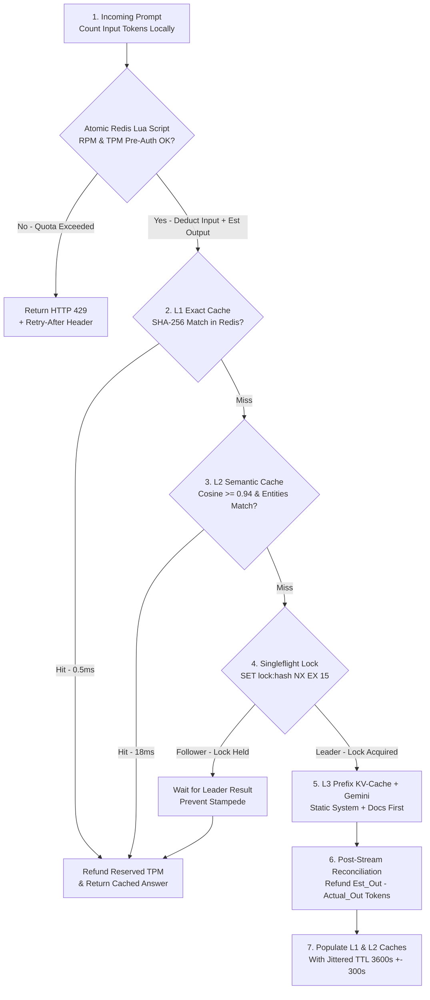

# Caching & Rate Limiting Fundamentals (Plain-English Guide)

> **Quick Summary — What This Is & Why Interviewers Care**
>
> - **Prerequisites:**
>   - **Hashing (`SHA-256`) vs. Vector Embeddings:** Exact byte-for-byte fingerprint matching (`O(1)`) vs. cosine similarity in `768-d` vector space (`>= 0.94`).
>   - **In-Memory Key-Value Store (`Redis`):** Sub-millisecond (`0.5ms`) RAM storage supporting TTL expirations and single-threaded atomic **Lua scripts**.
>   - **LLM Billing & Quotas (`RPM` vs. `TPM`):** Cloud LLM providers throttle you on both **Requests Per Minute (`RPM`)** and **Tokens Per Minute (`TPM`)**.
> - **Plain-English Core:** Caching avoids repeating slow, expensive AI computations (`$0.02` and `3,000ms` per LLM call → `$0` and `2ms` in Redis), while Rate Limiting ensures no single noisy tenant or runaway agent loop can exhaust your shared GPU/TPM quota or bankrupt your token budget.
> - **Why Interviewers Care:** In AI System Design, caching and rate limiting are completely different from traditional web apps: users rarely type the exact same character-for-character prompt (requiring **Semantic Caching** and **Prefix/KV Caching**), and a single request can cost **`100 tokens` or `100,000 tokens`** (requiring **Token-Aware `TPM` Pre-Authorization + Post-Stream Reconciliation**).
> - **The 10-Second Mental Model:** **"Layer your AI caches (`L1 Exact Redis` → `L2 Semantic Vector Cache with Entity Check` → `L3 Provider Prefix Cache`), coalesce cache misses with `Singleflight`, and enforce `RPM + TPM` quotas atomically via a single Redis Lua script."**

---

## 1. First Principles, Analogies & Capacity Math

Calling a frontier LLM (`Gemini 1.5 Pro` or `GPT-4o`) is **6,000x slower** (`3,000ms` vs. `0.5ms`) and **100,000x more expensive** than reading a key from Redis. Let's break down the foundational patterns for caching and rate limiting using concrete real-world models.

### 1. Classic Caching Patterns (`Cache-Aside`, `Write-Through`, `Write-Back`) — "The Carpenter's Toolbelt vs. The Hardware Warehouse"
- **The Analogy:** A carpenter working on a roof wears a leather toolbelt (**Redis RAM Cache, `0.5ms`**) while extra boxes of nails sit in the warehouse across town (**PostgreSQL / LLM Origin, `10ms–3,000ms`**).
  - **Cache-Aside (Lazy Loading — 90% of Production AI Systems):** The carpenter checks their toolbelt first. If the hammer is there (**Cache Hit**), they use it immediately. If not (**Cache Miss**), they drive to the warehouse, fetch the hammer, and clip it onto their toolbelt (`SET key val EX 3600`) for next time. When a document changes in Postgres, you **delete (`DEL`)** the old cache entry rather than overwriting it to avoid race conditions.
  - **Write-Through (Synchronous Dual Update):** Every time you update a tenant's security permissions (`RBAC`), you write to Postgres **and** update Redis in the same synchronous flow before returning `200 OK`. Slightly slower writes, but reads are never stale.
  - **Write-Back (Write-Behind — Async Batch Flush):** For ultra-high-velocity counters (e.g., logging token usage per user at `50,000 events/sec`), increment Redis in memory (`HINCRBY`) in `0.3ms` and let a background worker flush batched totals to Postgres/BigQuery every `10 seconds`.

### 2. The 3 AI-Specific Cache Tiers (`Exact`, `Semantic`, and `Prefix / KV Cache`) — "Exam Prep Strategies"
- **L1: Exact Match Cache (Redis `SHA-256`):**
  - *Analogy:* Photocopying a completed answer sheet for the exact same exam question.
  - *Key:* `sha256(tenant_id + model_id + prompt_version + temperature + normalized_query)`. Latency: **`0.5ms`**, Cost: **`$0`**.
- **L2: Semantic Cache (Redis Vector / Qdrant + Entity Guard):**
  - *Analogy:* Recognizing that *"How do I reset my corporate VPN?"* and *"Steps to fix my work VPN login?"* ask the exact same question even though the wording differs.
  - *Mechanics:* Embed the query (`15ms`), search a vector index partitioned by `tenant_id + rbac_role`, and if **Cosine Similarity `>= 0.94`** *and* extracted entities/numbers match (`"2025"` == `"2025"`), return the cached answer in **`~18ms`** for **`$0` LLM cost**.
- **L3: Prompt Prefix / KV-Cache (Vertex AI Context Caching, Anthropic Prompt Caching, vLLM PagedAttention):**
  - *Analogy:* Keeping a 300-page reference manual open on your desk to Chapter 4 so you don't have to re-read pages 1–299 every time someone asks a new question about it.
  - *Mechanics:* Always structure prompts with **100% static content first** (`System Instructions + Tool Definitions + Shared 50-Page PDF Context`) and **dynamic content last** (`User History + Current Question`). The LLM engine reuses the pre-computed attention `Key/Value (KV)` tensors on GPU HBM, cutting **Time-to-First-Token (`TTFT`) by `50–80%`** and **input token cost by `75–90%`**!

### 3. Cache Stampede & Singleflight Coalescing — "The Designated Shopper on Black Friday"
- **The Analogy:** If the milk jug in a shared office fridge expires at `09:00:00 AM`, and 200 employees open the fridge at `09:00:01 AM` and see it empty, you don't want **all 200 employees driving to the grocery store at the same time**! Instead, Employee #1 puts a sticky note on the fridge (`"I'm buying milk — wait 10s"`), while the other 199 wait by the fridge and share the jug Employee #1 brings back.
- **In Code (`Singleflight / Promise Coalescing`):** On a cache miss, the first worker acquires `SET lock:query_hash 1 NX EX 15` and calls Gemini; concurrent workers requesting the same key wait on a pub/sub channel or poll briefly, reducing `200` duplicate LLM calls down to **`1`**.

### 4. Rate Limiting Algorithms (`Token Bucket` vs. `Sliding Window`) & The Gas-Pump TPM Hold
- **Token Bucket — "The Self-Refilling Arcade Token Pouch":**
  - Each tenant has a pouch holding up to `B` tokens (**Burst Capacity**, e.g., `60,000 tokens`), refilling steadily at `R` tokens/sec (e.g., `1,000 tokens/sec` = `60,000 TPM`). Allows legitimate short bursts (like uploading a 20-page PDF at once) while enforcing the long-term average rate.
- **Sliding Window Counter — "The Rolling 60-Second Security Log":**
  - Blends the previous minute's count and current minute's count (`weight = (60 - elapsed_sec) / 60`) to prevent the classic **Fixed-Window Boundary Spike** (where a user fires `100` requests at `12:00:59` and `100` requests at `12:01:01`, sneaking `200` requests into `2 seconds`!).
- **Dual-Dimensional LLM Rate Limiting (`RPM + TPM`) — "The Gas Pump $100 Pre-Authorization Hold":**
  - When you swipe your credit card at a gas pump, the station doesn't know yet whether your tank will take `$20` or `$85` of fuel—so it places a **pre-authorization hold**, then adjusts to the exact dollar amount once you hang up the nozzle!
  - For LLMs, you know the exact `input_tokens` up front (via `tiktoken` / SentencePiece in `<1ms`), **but you don't know how many `output_tokens` the LLM will generate until streaming finishes**.
  - **The Production Formula:**
    1. **Pre-Auth Deduction (Before Calling LLM):** Atomically deduct `reserved = input_tokens + estimated_output_tokens` (e.g., `P90` output = `800 tokens`) from the tenant's Redis Token Bucket.
    2. **Post-Stream Reconciliation (When Stream Ends):** Refund the unused difference (`refund = reserved - actual_total_tokens`) back into the bucket!

### 5. Timestamped Story ("Alice & Bob"): The 9:00 AM Stampede + Noisy Neighbor Outage
Watch what happens at `09:00:00 AM` when market open hits an unprotected Financial AI platform:
- `09:00:00.000 AM` — The cached `"Morning Nifty-50 AI Market Brief"` key in Redis hits `TTL = 0` and expires.
- `09:00:00.050 AM` — **Alice** and **499 other traders** open the dashboard within `50ms`. All `500` requests check Redis, get a **Cache Miss (`NIL`)**, and simultaneously fire `500` identical `10,000-token` summarization requests to Vertex AI Gemini (**Cache Stampede**)!
- `09:00:00.200 AM` — Worse, `500 × 10,000 = 5,000,000 tokens` instantly blows past your organization's `2,000,000 TPM` regional Vertex AI quota!
- `09:00:00.300 AM` — **Bob** (an enterprise client in a completely different department) sends a tiny `200-token` customer support query—and gets **`429 RESOURCE_EXHAUSTED`** because the stampede (or a noisy neighbor tenant running a bulk script) consumed 100% of the shared TPM quota!
- **How Caching + Rate Limiting Fix Both:** **Singleflight + Stale-While-Revalidate** ensures only **1 background worker** refreshes the Morning Brief while all 500 traders get a `<1ms` response, and **Per-Tenant Redis Token Buckets + Priority Lanes** cap any single tenant at `150,000 TPM`, guaranteeing reserved capacity for Bob!

### Back-of-the-Envelope Rule of Thumb (15-Second Cache & Quota Math)
- **Effective Latency Equation:**
  $$L_{\text{effective}} = (h_{\text{exact}} \times 1\text{ms}) + (h_{\text{semantic}} \times 20\text{ms}) + ((1 - h_{\text{total}}) \times L_{\text{LLM}})$$
  - *Example:* If raw LLM latency is `2,500ms`, `15%` hit L1 Exact Cache (`1ms`), and `25%` hit L2 Semantic Cache (`20ms`), average latency drops from `2,500ms` to `(0.15×1) + (0.25×20) + (0.60×2500) =` **`1,505ms` (`40%` faster & `40%` cheaper)**!
- **Semantic Cache RAM Sizing:**
  - `1,000,000` cached Q&A pairs with `768-d float32` vectors (`3 KB`) + `2 KB` JSON answer + HNSW overhead ≈ **`6.5 GB` of Redis RAM** (`~$150/month` on Cloud Memorystore)—saving **`$15,000+/month`** in avoided LLM API calls!
- **Rate Limiter Redis RAM Sizing:**
  - Storing `tenant_id → {tokens, last_refill_ms, rpm_count}` takes **`~120 bytes` per active tenant**. `1,000,000` active tenants require only **`~120 MB` of RAM**!

---

## 2. Visual Architecture Blueprint

Follow the numbered steps (`1 → 7`) below to trace how an incoming AI request passes through **Atomic Dual Rate Limiting (`RPM + TPM`)**, the **3-Tier AI Cache**, **Singleflight Stampede Protection**, and **Post-Stream Token Reconciliation**:

1. **Step 1 (Atomic RPM + TPM Pre-Authorization):** Gateway counts `input_tokens` locally (`<1ms`) and runs a single **Redis Lua Script** checking both `RPM` and `TPM` (`input + 800 est_output`) buckets for `tenant_id`. If exhausted, returns `HTTP 429 + Retry-After` immediately.
2. **Step 2 (L1 Exact Match Cache):** Computes `sha256(tenant_id + rbac_scope + model + normalized_prompt)`. On hit (`0.5ms`), refunds unused reserved tokens and returns immediately.
3. **Step 3 (L2 Semantic Vector Cache + Entity Guard):** Embeds query (`15ms`), queries tenant-scoped vector cache (`cosine >= 0.94`), and verifies hard entities/dates/numbers match before returning a semantic hit.
4. **Step 4 (Singleflight Stampede Lock):** On cache miss, attempts `SET lock:{hash} 1 NX EX 15`. Concurrent identical requests wait for the leader instead of firing duplicate LLM calls.
5. **Step 5 (L3 Provider Prefix / KV Cache + LLM Stream):** Leader sends prompt with static prefix (`System + Tools + Docs`) placed first to hit `75–90%` discounted GPU **Prefix KV-Cache** on Vertex AI Gemini.
6. **Step 6 (Post-Stream TPM Reconciliation):** Once streaming finishes and exact `actual_output_tokens` is known, credits back `reserved_output - actual_output` to the tenant's Redis TPM bucket.
7. **Step 7 (Async Cache Populate with Jittered TTL):** Writes verified response to L1 and L2 caches with a jittered TTL (`3600s ± 300s`) so keys never expire simultaneously.



---

## 3. Side-by-Side Comparison & Trade-Off Table

### Table A: AI Caching Strategies Compared

| Caching Strategy | Typical Latency & Savings | How Invalidation Works | When to Pick / Winner | Watch Out For (The Trap) |
| :--- | :--- | :--- | :--- | :--- |
| **L1: Exact Prompt Cache** *(Redis String / Hash)* | **`0.5ms`** (`100%` LLM cost saved on hit) | TTL (`1–24h`) + explicit delete when `prompt_version` or source doc updates. | **Winner for Deterministic & Repeated Queries:** FAQ buttons, classification prompts (`temp=0`), duplicate retries, and identical tool calls. | **Low Hit Rate on Free-Form Chat:** Natural user typing has only `5–15%` exact byte-for-byte overlap unless you normalize whitespace/casing first. |
| **L2: Semantic Cache** *(Redis Vector / Qdrant)* | **`15–25ms`** (`~99%` LLM cost saved on hit) | Scoped by `tenant_id + doc_acl_hash`; invalidated via metadata tags when underlying RAG docs change. | **Winner for High-Volume Support & RAG:** Captures `25–45%` of paraphrased customer questions across thousands of users. | **Semantic False Positives:** *"Q3 2024 revenue?"* and *"Q3 2025 revenue?"* have `0.97` cosine similarity! Always enforce a **Regex/NER Entity & Number Match Guard** before serving a semantic hit. |
| **L3: Provider Prefix / KV Cache** *(Vertex AI / Anthropic / vLLM)* | Cuts `TTFT` by **`50–80%`**, saves **`75–90%`** on input tokens | Managed automatically on GPU HBM (`5–60 min` sliding TTL per prefix hash). | **Winner for Long-Context RAG & Multi-Turn Agents:** Huge win when passing `30k` tokens of PDFs, codebases, or 25 tool schemas across multiple turns. | **Breaking the Prefix Early:** Putting a dynamic timestamp (`Current time: 12:00:01`) at line 1 of your system prompt invalidates 100% of the prefix cache! Put dynamic variables at the **very end**. |

### Table B: Rate Limiting Algorithms Compared

| Algorithm | How State Is Stored in Redis | Accuracy & Burst Handling | When to Pick / Winner | Watch Out For (The Trap) |
| :--- | :--- | :--- | :--- | :--- |
| **Token Bucket** *(Atomic Lua Script)* | `2` numbers per key (`tokens_left`, `last_refill_ms`) — **`~64 bytes`** | Smooth average rate (`R/sec`) while allowing controlled bursts up to bucket capacity (`B`). | **#1 Winner for LLM APIs (`RPM` + `TPM`):** Handles bursty variable-size token prompts naturally while strictly capping sustained TPM burn. | **Non-Atomic Read-Modify-Write:** Never run `GET` in Python and then `SET`—always execute inside a single **Redis Lua script (`EVALSHA`)** so concurrent pods cannot race. |
| **Sliding Window Counter** *(Weighted 2-Bucket)* | `2` integers (`prev_min_count`, `curr_min_count`) — **`~48 bytes`** | `99.9%` accurate across window boundaries with tiny memory footprint. | **Winner for Strict API Quota Enforcement:** Great for hard contractual `1,000 req/min` or `10,000 req/hour` billing tiers. | **No Burst Cushion:** Unlike Token Bucket, if a client is rate-limited on a rolling 60s window, they cannot borrow burst capacity without raising the whole window limit. |
| **Sliding Window Log** *(Redis Sorted Set `ZSET`)* | Stores a timestamp for **every single request** (`ZADD`) | `100%` exact millisecond precision. | **Only for Low-QPS High-Security Endpoints:** Login attempts, password resets, or expensive admin exports (`<10 req/min`). | **Memory Explosion at Scale:** If a tenant sends `50,000 req/min`, a `ZSET` stores `50,000` timestamps (`~4 MB` per tenant), OOMing Redis! |

---

## 4. Deep-Dive Mechanics & Production Failure Analysis

### Under-the-Hood Tricks (What Separates Junior from Senior Answers)

1. **Preventing Cache Stampedes with Probabilistic Early Expiration (`XFetch`) + Stale-While-Revalidate:**
   - Even with `Singleflight`, when a super-hot cache key expires at `t = 3600s`, the winning request still has to wait `3,000ms` for Gemini to regenerate it.
   - **The Senior Fix (`Stale-While-Revalidate` / `XFetch`):** Store a **Soft TTL (`3,300s`)** inside the cached JSON alongside the hard Redis **TTL (`3,600s`)**. When a request arrives at `t = 3,305s` (past the soft TTL, before the hard TTL), return the slightly stale cached response to the user in **`0.5ms`** AND trigger a single non-blocking background coroutine (`SET lock:refresh NX`) to refresh the cache before the hard TTL ever expires! Users experience **zero latency spikes (`0.5ms` P99)** forever.
2. **How to Structure Prompts for Maximum L3 Prefix / KV-Cache Hit Rate:**
   - Every LLM engine computes KV-Cache blocks left-to-right in chunks of `16 to 128 tokens` (e.g., vLLM **Automatic Prefix Caching**). The first token that changes invalidates every token after it.
   - Always order your prompt blocks strictly from **most static** to **most dynamic**:
     ```text
     [1. Static System Instructions] -> [2. Static Tool JSON Schemas] -> [3. Pinned Document / Repo Context] -> [4. Append-Only Chat History] -> [5. Current Turn User Query & Timestamp]
     ```
3. **Fairness & Priority Lanes Under Shared Regional Cloud Quotas:**
   - Suppose your company has a shared `2,000,000 TPM` Vertex AI quota across `500` enterprise tenants.
   - Divide the global quota into **3 Priority Pools** in Redis:
     - **Reserved P0 Interactive Pool (`70%` = `1.4M TPM`):** Exclusively for live human chat turns, with per-tenant Token Bucket caps (`max 50,000 TPM/tenant`).
     - **Shared Burst Pool (`20%` = `400k TPM`):** Borrowable by P0 tenants when overall cluster utilization is `<80%`.
     - **Background / Batch Pool (`10%` = `200k TPM`):** Strictly caps offline PDF ingestion and LLM-as-a-Judge evals so background jobs can **never** starve a live user.

### What Breaks in Production at 2 AM (Real Failure Modes)

#### Failure Mode 1: Semantic Cache Cross-Contamination ("2024 vs 2025 Revenue" & RBAC Data Leak)
- **How It Happens at 2 AM:**
  1. **Temporal / Entity Collision:** An executive asks *"What was Acme Corp's Q3 2024 operating margin?"* and the answer (`"18.4%"`) is stored in the Semantic Cache. Ten minutes later, another analyst asks *"What was Acme Corp's Q3 2025 operating margin?"* Because dense embedding models (`text-embedding-004`) weight topical words heavily and numbers lightly, the cosine similarity between the two queries is **`0.972`** (well above your `0.94` threshold)! The Semantic Cache confidently returns `2024`'s `"18.4%"` answer as if it were `2025`!
  2. **Cross-Tenant / RBAC Leak:** If the semantic cache vector index isn't partitioned by access-control scope, an intern asking *"What is the CEO's compensation package?"* could hit a cached answer generated earlier for a Board Member!
- **How to Detect It in Metrics:**
  - Spike in user thumbs-down / citation mismatch flags specifically on requests tagged `cache_tier="L2_SEMANTIC"`.
  - Online audit check where regex-extracted years/numbers/entities in the user query diverge from the matched cached query.
- **Exact Mitigation:**
  1. **Hard Entity / Number / Negation Verification Gate:** Before accepting any L2 Semantic Cache hit (`cosine >= 0.94`), run a `<1ms` regex + lightweight token check verifying that all **years, numbers, ticker symbols, proper nouns, and negation words (`not`, `never`, `except`)** in the new query match the cached query `100%` identically.
  2. **Strict Namespace & RBAC Partitioning:** Prefix every cache key and filter every vector search by `namespace = f"{tenant_id}:{rbac_role_hash}:{model_ver}:{kb_snapshot_id}"`.

#### Failure Mode 2: Non-Atomic Rate-Limit Race Condition (`10x` Overdraft) & Cold-Cache Reboot Stampede
- **How It Happens at 2 AM:**
  1. A developer writes the rate limiter in Python as two separate Redis calls: `current = await redis.get(key)` followed by `if int(current) >= cost: await redis.decrby(key, cost)`. At `02:00 AM`, a tenant's automated script fires `50` parallel requests in the same millisecond. All `50` pods run `GET` at the same time, all `50` see `tokens_remaining = 5,000`, and all `50` let a `4,000-token` request through—burning **`200,000` tokens (`40x` overdraft)**!
  2. Minutes later, a Redis node failover clears volatile memory, dropping your cache hit rate from `45%` to `0%` instantaneously and sending `100%` of traffic straight to Vertex AI.
- **How to Detect It in Metrics:**
  - Actual provider token billing (`vertex_ai_billed_tokens_per_min`) exceeds configured tenant bucket ceilings (`tenant_quota_limit_tpm`).
  - Sudden drop in `redis_cache_hit_ratio` paired with a vertical spike in downstream `429` errors.
- **Exact Mitigation:**
  1. **100% Atomic Redis Lua Scripts (`EVALSHA`):** Execute the token refill math, balance check, and deduction inside a single Redis Lua script. Because Redis executes Lua scripts single-threaded and atomically, zero race conditions are possible.
  2. **Jittered TTLs + Redis AOF Persistence:** Add random jitter (`±10%`) to every cache TTL so keys never expire together, and enable Redis replica snapshots + automatic **Load Shedding** if global cache hit rate drops below `15%` during a cold start.

---

## 5. Production AI & Resume Tie-In

### 1. Deloitte Internal Asset Discovery Chatbot & Multi-Agent Orchestration (RBAC Semantic Cache + Per-Tenant TPM Quotas)
- **The Challenge:** Across our **Deloitte** internal presentation RAG chatbot (**ChromaDB, LangGraph, Vision LLMs**) and our **GKE Multi-Agent Customer Support** platform (**Google ADK, FastAPI, Vertex AI**), hundreds of consultants and support users frequently asked variations of high-frequency queries—while complex multi-agent research loops could consume `25,000+` tokens in a single turn.
- **How We Architected It:**
  1. **Multi-Tier Exact + Semantic Cache with Metadata Guards:** Implemented L1 (`SHA-256`) and L2 Semantic Caching partitioned by practice group and slide deck version hash (`deck_version_hash`), verifying extracted project codes and years before serving semantic hits.
  2. **Atomic Per-Tenant TPM Token Buckets:** Enforced atomic Redis Lua rate limiters on the FastAPI orchestrator so runaway sub-agent tool loops or bulk evaluations never starved interactive customer support chats (`$1.3M+` annual savings).

### 2. Network18 Sales Intelligence RAG Platform (Prefix Caching & Singleflight Coalescing)
- **The Challenge:** Before major client pitch meetings, multiple sales reps often opened the CMS portal simultaneously to generate financial and competitor RAG briefs on the same top advertisers using **Gemini**, web scraping, and PDF RAG on **Google Cloud Run**.
- **How We Architected It:**
  - Used **Singleflight request coalescing** in Redis so 10 reps clicking *"Generate Advertiser Brief: Reliance"* at 9:00 AM shared a single Gemini + scraper execution, and structured prompts with static advertiser PDF filings first to leverage **Gemini Context / Prefix Caching**—slashing pre-call research from hours to minutes while cutting token spend by over `60%`.

### Production Code: Atomic Redis Lua `RPM + TPM` Token Bucket with Post-Stream Refund (Python)

Below is a complete, zero-placeholder implementation of an **Atomic Dual Rate Limiter (`RPM + TPM` Token Bucket via Redis Lua)** with **Pre-Auth Deduction**, **Post-Stream Token Reconciliation**, and **Entity-Guarded Cache Lookup**:

```python
import hashlib
import re
import time
import redis.asyncio as redis

# Atomic Redis Lua Script: refills token bucket & checks both RPM and TPM in 1 single-threaded step
LUA_DUAL_RATE_LIMIT = """
local tpm_key, rpm_key = KEYS[1], KEYS[2]
local max_tpm, refill_per_ms = tonumber(ARGV[1]), tonumber(ARGV[2])
local max_rpm, req_tokens, now_ms = tonumber(ARGV[3]), tonumber(ARGV[4]), tonumber(ARGV[5])

-- 1. Check Sliding 60s RPM Counter
local current_rpm = tonumber(redis.call('GET', rpm_key) or '0')
if current_rpm + 1 > max_rpm then
    return {0, -1, 1} -- Rejected by RPM limit
end

-- 2. Refill TPM Token Bucket based on elapsed milliseconds
local bucket = redis.call('HMGET', tpm_key, 'tokens', 'last_ms')
local tokens = tonumber(bucket[1]) or max_tpm
local last_ms = tonumber(bucket[2]) or now_ms
local elapsed = math.max(0, now_ms - last_ms)
tokens = math.min(max_tpm, tokens + (elapsed * refill_per_ms))

if tokens < req_tokens then
    local retry_ms = math.ceil((req_tokens - tokens) / refill_per_ms)
    return {0, math.floor(tokens), math.ceil(retry_ms / 1000)} -- Rejected by TPM limit
end

-- 3. Atomically deduct reserved tokens & increment RPM
tokens = tokens - req_tokens
redis.call('HMSET', tpm_key, 'tokens', tokens, 'last_ms', now_ms)
redis.call('PEXPIRE', tpm_key, 120000)
local new_rpm = redis.call('INCR', rpm_key)
if new_rpm == 1 then redis.call('EXPIRE', rpm_key, 60) end
return {1, math.floor(tokens), 0}
"""

class AIGatewayRateLimiterAndCache:
    def __init__(self, redis_client: redis.Redis) -> None:
        self.redis = redis_client
        self.lua_Limiter = self.redis.register_script(LUA_DUAL_RATE_LIMIT)

    @staticmethod
    def extract_hard_tokens(text: str) -> set[str]:
        # Extract all numbers, years, and tickers (e.g. 2024, 2025, Q3, $50) to block semantic false positives
        return set(re.findall(r"\b(?:19\d\d|20\d\d|q[1-4]|\d+(?:\.\d+)?%?)\b", text.lower()))

    async def acquire_llm_quota(
        self, tenant_id: str, input_tokens: int, est_output_tokens: int = 800,
        max_tpm: int = 120_000, max_rpm: int = 180
    ) -> int:
        reserved = input_tokens + est_output_tokens
        now_ms = int(time.time() * 1000)
        allowed, remaining, retry_sec = await self.lua_Limiter(
            keys=[f"rl:tpm:{tenant_id}", f"rl:rpm:{tenant_id}:{now_ms // 60000}"],
            args=[max_tpm, max_tpm / 60000.0, max_rpm, reserved, now_ms],
        )
        if not allowed:
            raise PermissionError(f"429 Quota Exceeded for {tenant_id}. Retry-After: {retry_sec}s")
        return reserved

    async def reconcile_post_stream_tokens(
        self, tenant_id: str, reserved_tokens: int, actual_total_tokens: int, max_tpm: int = 120_000
    ) -> None:
        # Refund unused pre-authorized output tokens (or deduct extra if output exceeded estimate)
        delta = reserved_tokens - actual_total_tokens
        if delta != 0:
            cur = float(await self.redis.hget(f"rl:tpm:{tenant_id}", "tokens") or max_tpm)
            await self.redis.hset(f"rl:tpm:{tenant_id}", "tokens", min(max_tpm, max(0.0, cur + delta)))
```

---

## 6. Common Interview Questions, Follow-Up Probes & Quick Recall

### Q1: "How does rate limiting an LLM API differ from rate limiting a normal REST API—and how do you handle unknown output token counts before streaming starts?"
- **What they are really testing:** Do you know that `RPM` alone is useless when 1 prompt can contain `100,000 tokens`, and do you know the **Pre-Authorization + Post-Stream Refund** pattern?
- **How to answer simply:**
  > "In a normal REST API, every request costs roughly the same CPU, so limiting **Requests Per Minute (`RPM`)** is enough. In an LLM API, Request A might be `50 tokens` while Request B stuffs a `100,000-token` PDF into the context window—so we must enforce a dual **Token Bucket (`RPM + TPM`)** in Redis.
  > Because we know exact `input_tokens` before calling the model (using a local tokenizer in `<1ms`), but we don't know `output_tokens` until streaming finishes, we use the **Gas-Pump Pre-Authorization Pattern**:
  > 1. **Pre-Auth:** Our atomic Redis Lua script deducts `input_tokens + estimated_output_tokens` (using the route's historical `P90` output length, e.g., `800 tokens`) up front.
  > 2. **Post-Stream Reconciliation:** As soon as the stream finishes and we have the exact `usage_metadata.total_token_count`, we refund the unused difference (`reserved - actual`) back into the tenant's Redis bucket."
- **Likely Follow-Up Probe ("The Double-Click"):**
  - *Interviewer:* "Why must the Token Bucket refill and deduction run inside a Redis Lua script instead of normal Python `GET` and `SET` commands?"
  - *Your Answer:* "If 20 FastAPI pods run `GET` in Python at the exact same millisecond, all 20 see the same old balance and overwrite each other (`Check-Then-Act` race condition), letting a bursty client overdraft their quota by `10x–20x`. A Redis Lua script (`EVALSHA`) executes single-threaded and atomically inside Redis in `<0.2ms`, guaranteeing strict serializability across all pods."

### Q2: "You deploy a Semantic Cache with a 0.92 cosine similarity threshold. Users complain that asking about '2025 Q3 earnings' returns the cached answer for '2024 Q3 earnings'. Why did this happen and how do you fix it?"
- **What they are really testing:** Real-world experience with dense embedding blind spots (numbers, dates, negations, and RBAC leaks) in Semantic Caches.
- **How to answer simply:**
  > "Dense bi-encoder embeddings capture overall semantic topic much more strongly than single-token differences like years (`2024` vs. `2025`), negations (`is covered` vs. `is NOT covered`), or stock tickers. Those two sentences easily score `0.96+` cosine similarity!
  > We fix this with three production guardrails:
  > 1. **Hard Entity & Number Verification Gate:** Before serving any semantic hit, we run a `<1ms` regex/entity check ensuring all numbers, years, dates, currency amounts, and negation tokens in the incoming query match the cached query `100%` identically.
  > 2. **Raise Threshold + Cross-Encoder Rerank:** Use a stricter `0.95` cosine threshold or run a fast `10ms` lightweight cross-encoder verify check on candidates between `0.92` and `0.96`.
  > 3. **Namespace & Document Version Isolation:** Partition the cache key space by `(tenant_id, rbac_role_hash, corpus_version_id)` so users never see unauthorized or outdated RAG answers."
- **Likely Follow-Up Probe ("The Double-Click"):**
  - *Interviewer:* "When a source PDF in your RAG knowledge base is updated, how do you invalidate only the affected Semantic Cache entries without flushing the entire Redis database?"
  - *Your Answer:* "Whenever we store a RAG response in the Semantic Cache, we record the `source_doc_ids` it cited inside a Redis Set (`SADD doc_cache_refs:{doc_id} {cache_key}`). When `doc_42` is re-indexed, our ingestion pipeline looks up `SMEMBERS doc_cache_refs:doc_42` and runs `UNLINK` (async delete) on only the cached answers that cited `doc_42`."

### Q3: "What happens when a popular cached AI summary expires at 9:00 AM and 1,000 users request it in the same second? Give two ways to prevent this."
- **What they are really testing:** Do you know **Cache Stampede / Thundering Herd** mitigation (`Singleflight` and `Stale-While-Revalidate`)?
- **How to answer simply:**
  > "That is a classic **Cache Stampede (Thundering Herd)**: all 1,000 pods see a cache miss at the same millisecond and fire 1,000 identical requests at Vertex AI, blowing through our TPM quota and spiking latency.
  > We prevent it with two complementary patterns:
  > 1. **Singleflight / Distributed Lock Coalescing (`SET lock:{key} NX EX 15`):** On a cache miss, only the 1 pod that wins the `SET NX` lock calls Gemini; the other 999 requests wait on that single in-flight promise and share the result as soon as it lands.
  > 2. **Stale-While-Revalidate (Soft TTL + Hard TTL):** We set a Soft TTL at `55 minutes` and a Hard Redis TTL at `60 minutes` (plus `±5m` random jitter). When a request arrives at minute `56`, we immediately return the cached value in `0.5ms` while 1 background worker refreshes the cache asynchronously—so live users never wait on a cold miss."
- **Likely Follow-Up Probe ("The Double-Click"):**
  - *Interviewer:* "What if the Singleflight leader pod crashes 2 seconds after acquiring `SET lock:{key} NX EX 15` while 999 followers are waiting?"
  - *Your Answer:* "Followers wait on a Redis Pub/Sub channel (or poll every `100ms`) with a strict `3-second` wait timeout; if the leader hasn't published the result within `3s` (or if the lock TTL expires), one follower takes over or falls back to serving the last-known stale value."

### Q4: "How does Prompt Prefix Caching (KV-Cache reuse) work inside LLM providers, and how must you structure your prompt to get a 90% cache hit rate?"
- **What they are really testing:** Do you understand GPU KV-Cache prefix matching (`PagedAttention`) and prompt ordering?
- **How to answer simply:**
  > "During the **Prefill** phase, the Transformer computes Attention Key (`K`) and Value (`V`) tensors for every input token. Because autoregressive attention is causal (each token only attends to tokens *before* it), if two requests share the exact same first `20,000 tokens`, the engine can reuse those pre-computed `KV` blocks directly from GPU HBM or host RAM without recomputing them!
  > Because a single changed token invalidates every token *after* it, we must order prompts strictly from **most static to most dynamic**:
  > `1. Static System Prompt` → `2. Static Tool Schemas` → `3. Shared Document Context` → `4. Append-Only Conversation History` → `5. Dynamic User Question & Current Timestamp at the very bottom`."
- **Likely Follow-Up Probe ("The Double-Click"):**
  - *Interviewer:* "In a self-hosted vLLM cluster with 16 GPU replicas behind a round-robin load balancer, why might your KV-Cache prefix hit rate still be under 10% even with a perfectly ordered prompt?"
  - *Your Answer:* "Because Round-Robin sends Turn 1 of a user's conversation to GPU Replica #1 and Turn 2 to GPU Replica #7, which doesn't have that session's KV-Cache in its local HBM! We fix this by using **Prefix-Aware / Session-Sticky Routing (Consistent Hashing on `session_id` or `prefix_hash` with Bounded Load)** at the inference gateway."

### 60-Second Rapid Fire (Self-Check)
- **Q: What are the 3 layers of caching in a production AI system?**
  - **A:** `L1 Exact Hash Cache (Redis <1ms)`, `L2 Semantic Vector Cache with Entity Verification (~20ms)`, and `L3 Provider Prefix / KV-Cache (50-80% faster TTFT, 75-90% cheaper input tokens)`.
- **Q: How do you rate-limit streaming LLM calls when output tokens aren't known in advance?**
  - **A:** Run an **atomic Redis Lua Token Bucket** that pre-authorizes `input_tokens + P90_estimated_output_tokens`, then **refunds** `estimated - actual` once streaming completes.
- **Q: Why must you never put `current_timestamp` or `user_id` at the top of a system prompt?**
  - **A:** Causal KV-Caches match strictly left-to-right; changing token #5 invalidates `100%` of the prefix cache for all `30,000` tokens that follow!
