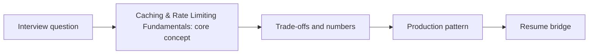

# Caching & Rate Limiting Fundamentals

> **Status: SKELETON** (content to be written; follow `CONTENT_GUIDELINES.md`)
> - **Phase 0** | **Week 1**
> - **AI tie-in:** Prompt/semantic caches, TPM quotas, per-tenant fairness

---

## Part 1: Quick Summary

> TODO (3-4 bullets): plain-English meaning, why interviewers care, 10-second mental model.

## Part 2: Topics to Cover (Study Checklist)

- [ ] Cache-aside, write-through, write-back
- [ ] Invalidation, TTL, stampede protection
- [ ] Rate limiting algorithms (token bucket, sliding window)
- [ ] Distributed rate limiting with Redis
- [ ] Per-tenant fairness and priority lanes
- [ ] Token-aware (TPM) limits for LLM APIs

## Part 3: First Principles & Analogies

TODO

## Part 4: Concept Blueprint

## Part 5: Trade-Off Table

| Option | Strength | Weakness | When to Pick / Watch Out For |
| :--- | :--- | :--- | :--- |
| TODO | TODO | TODO | TODO |

## Part 6: Deep-Dive Mechanics

TODO

## Part 7: Production AI & Resume Tie-In

TODO: Prompt/semantic caches, TPM quotas, per-tenant fairness.

## Part 8: Interview Questions (Answered Simply)

TODO
