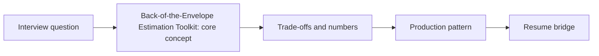

# Back-of-the-Envelope Estimation Toolkit

> **Status: SKELETON** (content to be written; follow `CONTENT_GUIDELINES.md`)
> - **Phase 0** | **Week 1**
> - **AI tie-in:** Tokens/sec, GPU RAM, vector index size, cost per 1k requests and cost per resolved task

---

## Part 1: Quick Summary

> TODO (3-4 bullets): plain-English meaning, why interviewers care, 10-second mental model.

## Part 2: Topics to Cover (Study Checklist)

- [ ] Latency numbers every engineer should know
- [ ] QPS, storage, bandwidth estimation method
- [ ] LLM estimation: tokens/sec, concurrent streams, KV cache, GPU count
- [ ] Vector index size and RAM estimation
- [ ] Cost per 1k requests / per user / per resolved task
- [ ] Sanity-checking numbers and stating assumptions

## Part 3: First Principles & Analogies

TODO

## Part 4: Concept Blueprint

## Part 5: Trade-Off Table

| Option | Strength | Weakness | When to Pick / Watch Out For |
| :--- | :--- | :--- | :--- |
| TODO | TODO | TODO | TODO |

## Part 6: Deep-Dive Mechanics

TODO

## Part 7: Production AI & Resume Tie-In

TODO: Tokens/sec, GPU RAM, vector index size, cost per 1k requests and cost per resolved task.

## Part 8: Interview Questions (Answered Simply)

TODO
