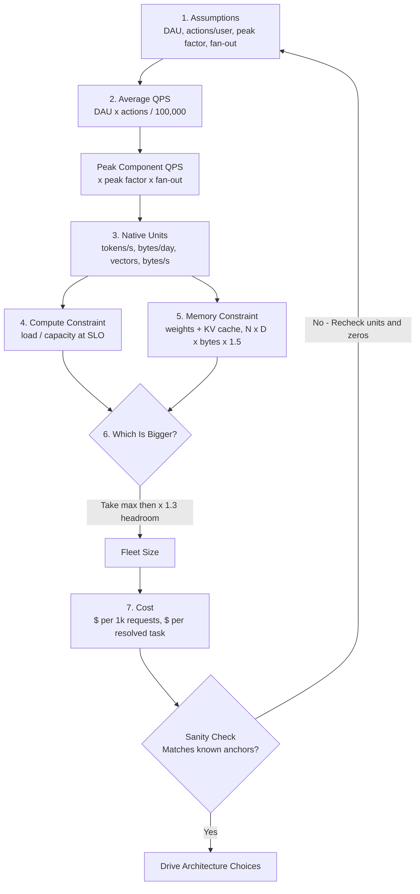

# Back-of-the-Envelope Estimation Toolkit (Plain-English Guide)

> **Prerequisites & Plain-English Summary**
>
> - **Prerequisites:**
>   - **Throughput vs. Latency:** Throughput is *how many* things you finish per second (cars through a toll booth per minute); latency is *how long one thing takes* (how long one car waits).
>   - **Tokens:** LLMs read and write text in small pieces called tokens. A useful rule: `1 token ≈ 4 English characters ≈ 0.75 words`.
>   - **Peak vs. Average:** Traffic is never flat. The busiest hour is usually `2–5×` the daily average.
> - **Plain-English Core:** Before building anything, use simple multiplication with rounded numbers to find out roughly how many machines, how much memory, and how much money a system needs—so you design for the right size instead of guessing.

---

## 1. Build It From Zero (Basics + Socratic Walkthrough)

### The Naive World (Before This Concept Exists)
An interviewer says: *"Design an AI support assistant for a bank with 50,000 employees."* You immediately start drawing boxes: a load balancer, a FastAPI service, a vector database, a Kubernetes cluster with autoscaling, Kafka for events, and a multi-region Redis cluster.

Five minutes in, the interviewer asks: *"How many GPUs? How much RAM does your vector DB need? What does this cost per month?"* You have no idea. Maybe your design needs one machine; maybe it needs two hundred. Every box you drew might be wildly oversized—or fall over on day one.

### The Socratic Ladder: Discovering Estimation

**🤔 Question 1: You don't know the real traffic. Is it hopeless to guess the size of the system?**
No. You know *some* things: 50,000 employees, maybe a third use it daily, each asks a handful of questions. Multiply those and you get **requests per day**. Divide by the number of seconds in a day (`86,400`, call it `~100,000`) and you get **requests per second**.
→ `17,000 users × 6 questions = ~100,000 requests/day ÷ 100,000 seconds ≈ 1 request/second on average`.

**🤔 Question 2: One request per second sounds tiny. Is the system tiny?**
Not necessarily—two traps hide here. First, nobody uses the assistant at 3 AM; most traffic lands between 9 AM and noon, so the **busiest hour is 3× the average**. Second, one "question" from a user might trigger **4 LLM calls** behind the scenes (safety check, router, retrieval answer, summarizer).
→ `1 req/s × 3 (peak) × 4 (calls) = 12 LLM calls/second` at peak. Twelve times what the naive number suggested.

**🤔 Question 3: Twelve LLM calls per second—how many GPUs is that?**
Don't count requests—count **work**. Each call generates, say, 300 words-pieces (tokens). That's `12 × 300 = 3,600 tokens/second` the GPUs must produce. If one GPU can produce `~1,500 tokens/second` while still feeling fast to users, you need about `3` GPUs, plus spare room for spikes and a machine dying.
→ Measure the system in its **real unit of work** (tokens/sec, bytes, vectors), not in "requests."

**🤔 Question 4: What else could run out besides GPU speed?**
Memory. Each in-progress conversation holds its "working notes" (the KV cache) in GPU memory. And your vector database must hold every document embedding in RAM. A system can have plenty of compute and still crash because it runs out of memory.
→ For each component, ask: **what runs out first—compute, memory, disk, network, or money?**

**🤔 Question 5: Your answer is "about 4 GPUs and 115 GB of RAM." How do you know you didn't make a 1,000× arithmetic mistake?**
Compare against things you know: "One Redis node handles ~100,000 operations/sec—am I claiming I need 50 Redis nodes for 1,000 QPS? That's wrong." Also say your assumptions out loud, so the interviewer can correct them.
→ **Sanity-check against known anchors** and **state assumptions explicitly**.

### Naming What You Just Invented
1. Turning users into requests per second is **QPS Estimation** (with a **Peak Factor**).
2. Counting behind-the-scenes calls is accounting for **Fan-Out / Amplification**.
3. Measuring in tokens/sec and dividing by per-GPU capacity is **Throughput-Based Capacity Planning**.
4. Asking "what runs out first?" is finding the **Binding Constraint** (compute-bound vs. memory-bound).
5. Comparing against known numbers is **Order-of-Magnitude Sanity Checking**.

Together, this is **Back-of-the-Envelope Estimation**.

### Explain It in Layers
- **One Line (Explain to a 12-Year-Old):** Before baking cookies for a party, count the guests and how many cookies each eats, so you buy the right amount of flour.
- **One Paragraph (Explain to a Non-Backend Engineer):** Systems cost money and break when they're too small. By multiplying a few rough numbers—how many users, how often they act, how much work each action creates—we can predict how many servers, how much memory, and how many dollars we need, accurate to within about 2×. That's enough to choose the right design (one database or fifty?) before writing any code.
- **Engineer Version:** Back-of-the-envelope estimation derives average and peak load (`QPS = DAU × actions / 86,400 × peak_factor × fan_out`), converts it into the component's native unit of work (tokens/sec, bytes/sec, vectors, IOPS), divides by a realistic per-unit capacity *measured under the latency SLO*, takes the **maximum across binding constraints** (compute, HBM/RAM, storage, network, budget), applies `~1.3×` headroom, and sanity-checks the result against known reference numbers.

---

## 2. First Principles, Analogies, Interview Framing & Capacity Math

> **Why Interviewers Care & The 10-Second Mental Model**
>
> - **Why Interviewers Care:** Numbers drive architecture. `10 QPS` fits on one pod with Postgres + pgvector; `10,000 QPS` needs sharding, caching, and a GPU fleet. Interviewers use estimation to see whether your design decisions are *justified* or just *decorated*—and AI systems add new units (tokens, KV cache, GPU-hours) that most candidates fumble.
> - **The 10-Second Mental Model:** **"Users → requests/day → ÷ `10^5` → × peak → × fan-out → convert to the real unit of work (tokens/sec, GB) → ÷ capacity at SLO → take the max constraint → × `1.3` headroom → sanity-check."**

### 1. Latency Numbers Every Engineer Should Know — "The Commute Map"
- **The Analogy:** If reading from CPU cache is walking to your desk drawer (`1 second`), then reading RAM is walking to the kitchen (`~2 minutes`), an SSD read is driving across town (`~1 day`), a cross-region network call is a trip to another continent (`~4 years`), and waiting for an LLM to write a full answer is like waiting **a century**. You never "just make one more call" to an LLM casually.
- **The Numbers to Memorize (order of magnitude, not exact):**

| Operation | Typical Latency | Mental Anchor |
| :--- | :--- | :--- |
| CPU L1 cache reference | `~1 ns` | Desk drawer |
| Main memory (RAM) read | `~100 ns` | 100× L1 |
| Read 1 MB sequentially from RAM | `~10 µs` | |
| NVMe SSD random 4 KB read | `~20–100 µs` | ~1,000× RAM |
| Network round trip, same zone | `~0.5 ms` | |
| Redis `GET` over the network | `~0.3–1 ms` | Mostly network time |
| Postgres indexed point lookup | `~1–5 ms` | |
| HNSW vector search, 1M–10M vectors | `~2–15 ms` | Depends on `efSearch` |
| Embedding API call (one query) | `~20–50 ms` | |
| Cross-region round trip (US ↔ EU) | `~80–150 ms` | Speed of light in fiber |
| US ↔ India round trip | `~200–250 ms` | |
| LLM Time-to-First-Token (short prompt) | `~300–800 ms` | |
| LLM decode, per token per stream | `~15–50 ms` | `20–60 tokens/sec` |
| Full LLM answer (300 tokens) | `~3–10 s` | Dominates everything |

- **The Lesson:** In an AI request, the LLM is usually `>90%` of the latency. Shaving `2ms` off a Redis call is pointless if you make one extra sequential LLM call (`+3s`).

### 2. QPS, Storage & Bandwidth — "The Toll Booth Count"
- **The Analogy:** A highway engineer doesn't count every car. They estimate: *"A town of 100,000 people, 40% commute, 2 trips each → 80,000 trips/day, with 30% in the 2-hour rush."* That tells them how many toll booths to build.
- **The Method:**
  - **Seconds per day:** `86,400 ≈ 10^5`. So `1M requests/day ≈ 12 QPS`, and `100M/day ≈ 1,200 QPS`.
  - **Peak QPS:** `avg_QPS × 2–5` (use `3×` by default for business-hours tools; up to `10×` for event-driven spikes like market open or a product launch).
  - **Storage:** `items/day × bytes/item × retention_days × replication_factor (usually 3)`.
  - **Bandwidth:** `peak_QPS × bytes/response`. LLM text streaming is tiny (`~1 KB` per answer); video and images are what move bandwidth.
- **Data Size Anchors:** a token `~4 bytes` of text; a short chat turn `~1–2 KB`; a 20-page PDF `~1–5 MB` raw, `~10,000–15,000 tokens` of text; a 768-d `float32` embedding `3 KB`; a 1536-d embedding `6 KB`; one hour of 1080p video `~2–4 GB`.

### 3. LLM Estimation: Tokens/sec, Concurrent Streams, KV Cache & GPU Count — "The Restaurant Kitchen"
- **The Analogy:** A kitchen has two limits. **Stove speed** (how many dishes the chefs can cook per hour) and **counter space** (how many half-finished dishes can sit out at once). You can have fast chefs and still be stuck because the counter is full. GPUs work the same way: **decode throughput** is stove speed; **KV cache memory** is counter space.
- **Constraint 1 — Throughput (stove speed):**
  - **Formula:** `GPUs = (peak_LLM_QPS × avg_output_tokens) / (tokens/sec per GPU at your latency SLO) × 1.3`
  - *Example:* `20 QPS × 300 tokens = 6,000 tok/s ÷ 1,500 tok/s per GPU = 4 GPUs × 1.3 = 5.2 → 6 GPUs`.
  - **Use the SLO-constrained number**, not the vendor's max-batch benchmark. A GPU that does `8,000 tok/s` at batch size 256 may only do `1,500 tok/s` while keeping each user above `~40 tok/s`.
- **Constraint 2 — Memory (counter space):**
  - **Model weights:** `parameters × bytes_per_param`. A `70B` model in FP16 (`2 bytes`) is `140 GB`; in FP8 it's `70 GB`. An `8B` model in FP16 is `16 GB`.
  - **KV cache per token:** `2 (K and V) × layers × kv_heads × head_dim × bytes`.
    - *Llama-3-8B* (`32` layers, `8` KV heads, `128` head dim, FP16): `2 × 32 × 8 × 128 × 2 = 131,072 bytes ≈ 128 KB/token`. An 8K-token conversation ≈ **`1 GB`** of HBM.
    - *Llama-3-70B* (`80` layers, same heads/dim): `≈ 320 KB/token`. An 8K-token conversation ≈ **`2.5 GB`**.
  - **Concurrent streams (Little's Law):** `concurrent = QPS × seconds_per_stream`. At `20 QPS` with `~8s` per streamed answer, you have `~160` streams alive at once, each holding its KV cache.
- **Why both matter:** `70B` FP16 on `2 × H100 (80 GB)` = `160 GB` total − `140 GB` weights leaves `~20 GB` for KV cache → only `~8` concurrent 8K-token conversations, no matter how fast the GPU is. Quantize weights to FP8 (`70 GB`) and you free `~90 GB` → `~35` concurrent 8K-token conversations on the same hardware.

### 4. Vector Index Size & RAM — "The Library Card Catalog"
- **The Analogy:** A library must keep its card catalog in the front hall (RAM) so lookups are instant, even if the books themselves live in the basement (object storage). The catalog's size is: number of cards × size of each card × extra space for the cross-reference strings tying cards together.
- **Formula:** `RAM ≈ N × D × bytes_per_dim × 1.5` (the `1.5×` covers HNSW graph links at `M = 16–32` plus metadata).
  - `50M × 1536 × 4 bytes (FP32) × 1.5 ≈ 461 GB`.
  - Same index in **INT8** (`1 byte`): `≈ 115 GB` (4× smaller, `<1–2%` recall loss with rescoring).
  - `1M × 768 × 4 × 1.5 ≈ 4.6 GB`—fits on a laptop. Under `~5M` vectors, **pgvector inside your existing Postgres is often enough**.
- **Chunk count from documents:** `documents × pages × chunks_per_page`. `100,000 PDFs × 20 pages × 3 chunks/page = 6M vectors`.

### 5. Cost per 1k Requests / per User / per Resolved Task — "The Taxi Meter"
- **The Analogy:** A taxi charges a flag-drop fee plus a per-kilometer rate. An LLM charges per input token (reading) and per output token (writing, usually `4–8×` more expensive per token). Your monthly bill is just the meter running across all rides.
- **Formula (illustrative prices—always check the current price sheet):** assume `$1.25 / 1M input tokens` and `$10 / 1M output tokens`.
  - **Per call:** `4,000 input × $1.25/1M + 500 output × $10/1M = $0.005 + $0.005 = $0.01`.
  - **Per 1k user requests** (4 LLM calls each): `$0.01 × 4 × 1,000 = $40`.
  - **Per user per month:** `6 requests/day × 22 workdays × $0.04 = ~$5.30`.
  - **Per resolved task** (the number the business cares about): if a support conversation averages `3` turns (`$0.12`) and the agent fully resolves `60%` of them, cost per resolved ticket = `$0.12 ÷ 0.60 = $0.20`. Compare that to a human-handled ticket costing several dollars—*that's* the ROI story.
- **Key Insight:** Input tokens often dominate cost in RAG (big contexts, short answers), which is why **prefix caching** and **smaller retrieved contexts** move the bill more than shorter answers do.

### 6. Timestamped Story ("Alice & Bob"): The Estimate Nobody Did
- `Mon 09:00 AM` — **Alice**'s team launches an internal RAG assistant on a single replica—a `70B` FP16 model split across `2 × H100`—sized from a load test of `5` users.
- `Mon 09:15 AM` — The launch email goes out. `3,000` employees try it in 15 minutes: `~3 QPS`, each with a `6,000-token` prompt (retrieved chunks + chat history).
- `Mon 09:16 AM` — Concurrency hits `3 QPS × 10s = 30` streams. KV cache needed: `30 × 6,500 tokens × 320 KB ≈ 62 GB`. Available after weights: `~20 GB`. vLLM starts **preempting** requests, re-computing their prompts over and over.
- `Mon 09:20 AM` — TTFT jumps from `0.6s` to `25s`. **Bob** in Finance gives up and files a ticket: "AI tool broken."
- **The 30-Second Estimate That Would Have Prevented It:** "Peak `~3 QPS`, `~10s` streams → `30` concurrent; `30 × 6.5K tokens × 320 KB ≈ 62 GB` KV → we're **memory-bound**, not compute-bound. Use FP8 weights, cap context at `8K`, and start with `2` replicas."

### Back-of-the-Envelope Rule of Thumb (15-Second Toolkit)
- `1 day ≈ 10^5 s` → `1M/day ≈ 12 QPS`; peak = `3×`.
- `1 token ≈ 4 chars ≈ 0.75 words`; `1 page ≈ 500–700 tokens`.
- GPUs (throughput) = `QPS × out_tokens ÷ tok/s_per_GPU × 1.3`.
- Concurrent streams = `QPS × stream_seconds` (Little's Law).
- KV cache ≈ `128 KB/token` (8B class) or `~320 KB/token` (70B class) in FP16.
- Weights = `params × bytes` (`70B × 2 = 140 GB`).
- Vector RAM = `N × D × bytes × 1.5`.
- Cache break-even: hit rate must exceed `lookup_overhead ÷ origin_latency`.

---

## 3. Visual Architecture Blueprint

Follow the numbered steps (`1 → 7`) to turn a vague prompt ("design X for Y users") into concrete sizing:

1. **Step 1 (State Assumptions):** DAU, actions per user per day, peak factor, and fan-out (LLM calls per user action). Say them out loud.
2. **Step 2 (Average → Peak QPS):** `DAU × actions ÷ 10^5`, then `× peak factor`, then `× fan-out` for per-component QPS.
3. **Step 3 (Convert to Native Units):** tokens/sec for LLMs, bytes/day for storage, vector count for indexes, bytes/sec for bandwidth.
4. **Step 4 (Compute Constraint):** divide native load by per-unit capacity **measured at your latency SLO**.
5. **Step 5 (Memory Constraint):** weights + KV cache (via Little's Law concurrency) for GPUs; `N × D × bytes × 1.5` for vector RAM.
6. **Step 6 (Take the Max + Headroom):** the binding constraint wins; multiply by `1.3`.
7. **Step 7 (Cost & Sanity Check):** compute `$ per 1k requests` and `$ per resolved task`; compare every number to a known anchor.



---

## 4. Side-by-Side Comparison & Trade-Off Table

| Estimation Choice | What It Means | When to Pick / Winner | Watch Out For (The Trap) |
| :--- | :--- | :--- | :--- |
| **Top-Down** *(users → QPS)* | Start from DAU and behavior, derive load. | **Winner for greenfield interviews:** fast, easy to state assumptions, gets you to "roughly how big" in 60 seconds. | Forgetting **fan-out** (1 user action = 4 LLM calls) and **peak factor**—underestimates by `10×` or more. |
| **Bottom-Up** *(per-unit capacity → fleet)* | Measure one GPU/pod/node and scale linearly. | **Winner for production capacity planning:** grounded in real load tests at your SLO. | Linear scaling breaks at shared bottlenecks (one Postgres primary, one regional LLM quota). |
| **Throughput-Based GPU Sizing** | `QPS × out_tokens ÷ tok/s per GPU`. | Short prompts, long answers, small models where HBM is plentiful. | Ignoring KV memory—long-context RAG on big models runs out of memory first. |
| **Memory-Based GPU Sizing** | Weights + `concurrent × context × KV bytes/token`. | Long contexts (`>8K`), large models (`70B+`), many concurrent streams. | Forgetting that quantization (FP8 weights, FP8 KV cache) changes the answer by `2×`. |
| **Vendor Peak Benchmarks** | "This GPU does 8,000 tok/s." | Only as an upper bound for **offline batch** jobs (evals, backfills). | Max-batch numbers violate interactive TPOT SLOs; real interactive throughput may be `3–5×` lower. |
| **Powers-of-10 Rounding** | `86,400 → 10^5`, `1536 → ~1,500`. | **Always in interviews:** keeps math fast and readable; `±2×` accuracy is fine. | Rounding the *same direction* repeatedly compounds error—balance up and down. |
| **Cost per Request** | `$ per 1k requests`. | Comparing models or providers for the same workload. | Hides retries, agent loops, and failed answers—looks cheap while outcomes are expensive. |
| **Cost per Resolved Task** | `total spend ÷ successful outcomes`. | **Winner for business conversations** and agent ROI. | Needs a reliable definition of "resolved" (no reopen within 7 days, no human escalation). |

---

## 5. Deep-Dive Mechanics & Production Failure Analysis

### Under-the-Hood Tricks (What Separates Junior from Senior Answers)

1. **Prefill and Decode Cost Differently:**
   - **Prefill** (reading the prompt) processes all input tokens in parallel—a modern GPU can prefill **thousands to tens of thousands of tokens/sec**. It mainly drives **TTFT**.
   - **Decode** (writing the answer) produces one token per step per stream, limited by how fast the GPU can read weights + KV cache from HBM. It drives **TPOT** and is usually what you size GPUs on.
   - *Interview line:* "A 4,000-token prompt with a 200-token answer is prefill-heavy—I'd worry about TTFT and use prefix caching. A 200-token prompt with a 2,000-token answer is decode-heavy—I'd size on output tokens/sec."
2. **Amplification Multipliers Stack Multiplicatively:**
   - `user action × agent steps × retries × hedged requests`. A `4`-step agent with a `10%` retry rate and `5%` hedging → `4 × 1.1 × 1.05 ≈ 4.6` LLM calls per action.
   - Agent loops are the dangerous one: a ReAct agent with `max_steps = 15` has a *worst case* of `15×`, not `4×`. Estimate with the **P95 step count**, not the average.
3. **Headroom Is Not Arbitrary:**
   - `1.3×` covers: one node failing out of `N` (`N+1` redundancy), rolling deploys taking replicas offline, and short spikes above your "peak hour" average.
   - For small fleets, headroom must be at least **one whole node**: a calculated `2.2 GPUs` means `4`, not `3` (ceil to 3, plus 1 for a failure).
4. **Order-of-Magnitude Anchors for Sanity Checks:**
   - Single Redis shard: `~100,000` simple ops/sec. Single Postgres primary: `~5,000–20,000` simple indexed QPS. One Kafka partition: `~10 MB/s`. One async FastAPI pod doing I/O-bound work: `~hundreds to low thousands` req/s.
   - If your math says you need `40` Redis shards for `2,000 QPS`, you dropped or added a zero somewhere.

### What Breaks in Production at 2 AM (Real Failure Modes)

#### Failure Mode 1: Sized for Compute, Died on KV Cache Memory
- **How It Happens at 2 AM:**
  1. The team sized a vLLM fleet with the throughput formula only (`6 GPUs` for `6,000 tok/s`) using an average context of `2K` tokens.
  2. A nightly batch job (or a new "upload a contract" feature) starts sending `30K`-token prompts. Each stream now needs `30K × 128 KB ≈ 3.8 GB` of KV cache instead of `~256 MB`.
  3. The KV cache fills up, vLLM **preempts** running sequences (pausing them and later recomputing their prompts), throughput collapses, and TTFT for interactive users goes from `0.5s` to `20s+`.
- **How to Detect It in Metrics:**
  - `vllm:gpu_cache_usage_perc` pinned near `100%`, rising `vllm:num_requests_waiting`, and a climbing `vllm:num_preemptions_total` counter.
  - P99 TTFT spikes while tokens/sec per GPU *drops* (the GPU is busy recomputing, not generating).
- **Exact Mitigation:**
  1. Size with **both** constraints and the **P95 context length**, not the average; cap `max_model_len` per route.
  2. Admit requests by **token budget** rather than request count, and route long-context or batch jobs to a **separate pool** so they can't evict interactive streams.

#### Failure Mode 2: The Cost Estimate Was Per Request—The Bill Was Per Agent Loop
- **How It Happens at 2 AM:**
  1. Finance approved a budget based on `$0.01 per request × 100,000 requests/day = $1,000/day`.
  2. A prompt change makes the agent's tool-calling less decisive. The average loop goes from `4` steps to `11`, and each step re-sends the growing conversation history (input tokens grow every step).
  3. Overnight, a retry bug on a flaky tool adds another `3×`. By morning, the daily spend is `~$12,000`, and the regional TPM quota is exhausted for everyone.
- **How to Detect It in Metrics:**
  - Track `tokens_per_conversation` and `llm_calls_per_user_action` as **P50/P95 distributions**, not just totals; alert on a `2×` shift in P95.
  - Daily `cost_per_resolved_task` jumping while `resolution_rate` stays flat or drops.
- **Exact Mitigation:**
  1. Enforce a **hard per-task budget** (`max_steps`, `max_total_tokens`) in the orchestrator and fail gracefully with a handoff when exceeded.
  2. Budget alerts at `50% / 80% / 100%` of daily spend, and estimate from **P95 steps × growing context**, not the happy path.

---

## 6. Production AI & Resume Tie-In

### 1. Network18 Real-Time Financial News Intelligence Pipeline (Throughput & Worker Sizing)
- **The Challenge:** The pipeline ingested **600+ articles daily from 12+ sources on an hourly schedule** and ran a multilingual Transformer NER model before writing to **BigQuery**. Hourly scheduling means load isn't `600 ÷ 24 = 25` articles spread evenly—it arrives as a **burst at the top of each hour**, and market hours are much heavier than overnight.
- **The Estimate:**
  - Peak hour ≈ `3×` average → `~75` articles in one run. At `~1,000` tokens per article and a CPU NER model doing (say) `~2` articles/sec per worker, one worker clears the burst in `~40s`—so **parallel workers mattered for freshness, not raw capacity**.
  - At `100×` scale (`60,000` articles/day): peak run ≈ `7,500` articles → at `2` articles/sec/worker, finishing within `5` minutes needs `7,500 ÷ (2 × 300) ≈ 13` workers (→ `~17` with headroom). Storage stays small: `60,000 × 5 KB ≈ 300 MB/day` of text, `~110 GB/year`.
- **Interview line:** "I sized for the hourly burst and freshness deadline, not the daily average—the average said one worker; the burst said thirteen at 100× scale."

### 2. Deloitte Multi-Agent Customer Support (Cost per Resolved Task)
- **The Challenge:** The **Google ADK** multi-agent system on **GKE** (intent classification → routing → specialized sub-agents → response synthesis) turned 24–48 hour responses into near-instant ones, with **$1.3M+ in annual savings**. The right metric for an agent system isn't cost per LLM call—it's **cost per resolved ticket** versus the cost of a human-handled ticket.
- **The Estimate:** Each turn fans out to `~4` Gemini calls; context grows each turn; only resolved conversations count as value. So cost per resolved task = `(calls/turn × turns × $/call) ÷ resolution_rate`—and the biggest levers are **resolution rate** and **context size**, not model price alone.

### Production Code: Dual-Constraint LLM Capacity & Cost Estimator (Python)

A complete, runnable estimator that sizes a GPU fleet on **both** decode throughput and KV-cache memory, then computes cost per 1k requests and per resolved task:

```python
import math
from dataclasses import dataclass

SECONDS_PER_DAY = 86_400

@dataclass
class Workload:
    dau: int                      # daily active users
    requests_per_user: float      # user actions (chat turns) per user per day
    llm_calls_per_request: float  # fan-out: guardrail + router + RAG answer + synthesis
    input_tokens: int             # avg prompt tokens per call (system + retrieved chunks + history)
    output_tokens: int            # avg generated tokens per call
    resolution_rate: float = 0.6  # share of conversations fully resolved without a human
    peak_factor: float = 3.0      # busiest hour vs daily average
    headroom: float = 1.3         # spikes, rolling deploys, one node failing

def estimate(w: Workload, gpu_tok_s=1_500, kv_kb_per_token=128, gpu_kv_gb=40,
             ttft_s=0.5, tpot_s=0.025, price_in_per_m=1.25, price_out_per_m=10.0):
    avg_qps = w.dau * w.requests_per_user / SECONDS_PER_DAY
    peak_llm_qps = avg_qps * w.peak_factor * w.llm_calls_per_request
    # Constraint 1 - decode throughput, using tok/s measured AT the TPOT SLO (not max batch)
    gpus_compute = peak_llm_qps * w.output_tokens / gpu_tok_s
    # Constraint 2 - KV memory: Little's Law -> concurrent streams, each holding its context in HBM
    stream_seconds = ttft_s + w.output_tokens * tpot_s
    concurrent_streams = peak_llm_qps * stream_seconds
    kv_gb = concurrent_streams * (w.input_tokens + w.output_tokens) * kv_kb_per_token / 1e6
    gpus_memory = kv_gb / gpu_kv_gb            # gpu_kv_gb = HBM left after weights + activations
    binding = "compute" if gpus_compute >= gpus_memory else "memory"
    gpus = math.ceil(max(gpus_compute, gpus_memory) * w.headroom)
    # Cost scales with total daily tokens (average), not with the peak
    cost_per_call = (w.input_tokens * price_in_per_m + w.output_tokens * price_out_per_m) / 1e6
    cost_per_request = cost_per_call * w.llm_calls_per_request
    return {
        "avg_qps": round(avg_qps, 2), "peak_llm_qps": round(peak_llm_qps, 1),
        "concurrent_streams": round(concurrent_streams), "kv_cache_gb": round(kv_gb, 1),
        "binding_constraint": binding, "gpus_needed": gpus,
        "cost_per_1k_requests_usd": round(cost_per_request * 1_000, 2),
        "cost_per_resolved_task_usd": round(cost_per_request / w.resolution_rate, 4),
        "api_cost_per_day_usd": round(cost_per_request * avg_qps * SECONDS_PER_DAY, 2),
    }

if __name__ == "__main__":
    # 50k DAU, 6 turns/day, 4 calls/turn, 3k-token prompts, 250-token answers
    print(estimate(Workload(50_000, 6, 4, 3_000, 250)))
    # -> ~3.5 avg QPS, ~42 peak LLM QPS, ~281 streams, ~117 GB KV, compute-bound, 10 GPUs
```

> **Note:** `gpus_needed` assumes self-hosting an 8B-class model (`128 KB/token` KV). `api_cost_per_day_usd` is the alternative if you call a managed frontier model instead. Only compare the two if the models deliver similar quality on your evals.

---

## 7. Common Interview Questions, Follow-Up Probes & Quick Recall

### Q1: "Walk me through estimating QPS and storage for a RAG assistant serving 10 million monthly users."
- **What they are really testing:** Can you produce a structured, assumption-driven estimate quickly without getting lost in arithmetic?
- **How to answer simply:**
  > "I'll state assumptions first. 10 million monthly users, roughly 20% daily active, so 2 million DAU. Each asks about 5 questions a day: 10 million questions per day. Divide by about 100,000 seconds: around 100 QPS on average. Peak is about 3×, so 300 QPS. Each question fans out to about 3 LLM calls—embedding, a rerank, and the answer—so the LLM layer sees about 900 calls per second at peak.
  > For storage, chat logs are about 2 KB per turn: 10 million times 2 KB is 20 GB a day, roughly 7 TB a year, times 3 for replication. For the vector index, if we have 1 million documents at 10 chunks each with 768-dimension embeddings, that's 10 million times 768 times 4 bytes times 1.5—about 46 GB of RAM. That's a small sharded cluster, or even a couple of large nodes."
- **Likely Follow-Up Probe ("The Double-Click"):**
  - *Interviewer:* "Why did you multiply by 3 for peak instead of using the average?"
  - *Your Answer:* "Because capacity has to survive the busiest hour, not the average hour—business tools concentrate traffic in working hours, so peak is typically 2–5× average. If I sized on the average, we'd be overloaded every morning."

### Q2: "You sized your GPU fleet on tokens/sec, and it fell over in production even though GPU compute was only at 40%. What happened?"
- **What they are really testing:** Do you understand the second constraint—KV cache memory—and preemption?
- **How to answer simply:**
  > "That's the classic memory-bound failure. Throughput math says how fast the GPUs can generate, but every live conversation also holds its KV cache in GPU memory. For an 8B-class model, that's about 128 KB per token, so a 16K-token prompt holds about 2 GB by itself. If many long-context requests arrive at once, the KV cache fills up, the server starts preempting and recomputing requests, and latency explodes while compute looks idle.
  > The fix is to size on both constraints—use Little's Law to get concurrent streams, multiply by P95 context length and KV bytes per token—then cap max context per route, quantize weights or KV cache to FP8, and move long-context batch jobs to a separate pool."
- **Likely Follow-Up Probe ("The Double-Click"):**
  - *Interviewer:* "How do you calculate KV cache bytes per token for a model?"
  - *Your Answer:* "It's 2 for keys and values, times number of layers, times number of KV heads, times head dimension, times bytes per value. For Llama-3-8B with grouped-query attention—32 layers, 8 KV heads, 128 head dimension in FP16—that's about 128 KB per token."

### Q3: "Your CFO asks: 'Is the AI support agent worth it?' How do you estimate cost, and what metric do you give them?"
- **What they are really testing:** Can you connect token math to business outcomes, and do you avoid the misleading "cost per request" metric?
- **How to answer simply:**
  > "I'd give them cost per resolved ticket, not cost per API call. First, cost per call: input tokens times the input price plus output tokens times the output price. Say 4,000 input and 500 output tokens comes to about a cent. Each user turn fans out to about 4 calls, and a conversation averages 3 turns, so about 12 cents per conversation. If the agent fully resolves 60% of conversations, cost per resolved ticket is 12 cents divided by 0.6—about 20 cents.
  > Then I compare it to the fully loaded cost of a human-handled ticket and include the failed conversations that still go to humans. That gives a real ROI number, and it shows the biggest lever is resolution rate, not just a cheaper model."
- **Likely Follow-Up Probe ("The Double-Click"):**
  - *Interviewer:* "Where would you look first to cut that cost in half?"
  - *Your Answer:* "In RAG, input tokens usually dominate, so I'd start with prefix caching for the static system prompt and tool schemas, then reduce retrieved context with a reranker sending 5 chunks instead of 20. After that, I'd route easy intents to a smaller, cheaper model and keep the big model for hard cases."

### Q4: "How do you sanity-check an estimate in an interview?"
- **What they are really testing:** Whether you catch your own order-of-magnitude errors and communicate assumptions.
- **How to answer simply:**
  > "Three checks. First, units: I write them on every number so tokens per second never get mixed with requests per second. Second, anchors: one Redis shard does about 100,000 ops per second, a Postgres primary does thousands of simple queries per second, and a single GPU does roughly a thousand to a few thousand interactive tokens per second—if my answer disagrees with those by 100×, I recheck. Third, I say my assumptions out loud so the interviewer can correct a bad one before I build on it."
- **Likely Follow-Up Probe ("The Double-Click"):**
  - *Interviewer:* "What if the interviewer gives you no numbers at all?"
  - *Your Answer:* "I propose reasonable ones and ask if they're in the right range—like 'let's say 1 million DAU and 5 actions each; does that sound right?' A clearly stated guess beats waiting for perfect information."

### 60-Second Rapid Fire (Self-Check)
- **Q: How many QPS is 1 million requests per day?**
  - **A:** `~12 QPS` (`10^6 ÷ ~10^5`), and `~35 QPS` at a `3×` peak.
- **Q: What are the two constraints when sizing an LLM GPU fleet?**
  - **A:** Decode throughput (`QPS × output tokens ÷ tok/s per GPU at SLO`) and memory (`weights + concurrent streams × context × KV bytes/token`)—take the max.
- **Q: How much RAM does a 10M-vector, 768-d FP32 HNSW index need?**
  - **A:** `10M × 768 × 4 × 1.5 ≈ 46 GB`.
