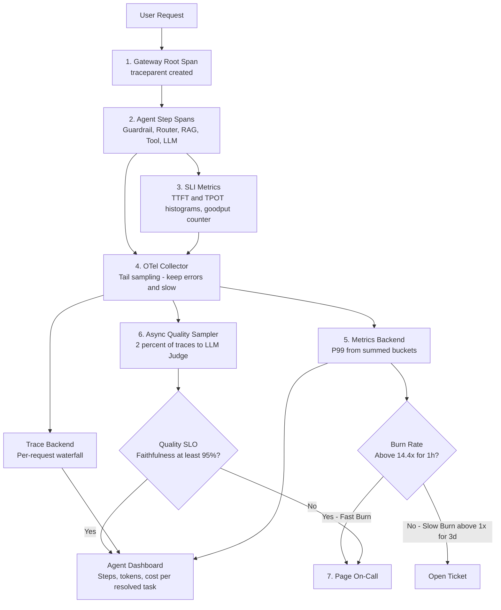

# Observability, SLOs & Percentile Thinking (Plain-English Guide)

> **Prerequisites & Plain-English Summary**
>
> - **Prerequisites:**
>   - **Latency Distribution:** If you time 1,000 requests, they don't all take the same time—most are quick, a few are very slow. The *shape* of those times matters more than any single number.
>   - **Prefill vs. Decode (`fund-07`):** An LLM first reads the whole prompt (prefill, sets how long until the first word appears) and then writes one token at a time (decode, sets how fast the words flow).
>   - **Multi-Step Agents:** One user question can trigger a chain of steps—guardrail, router, retrieval, tool call, answer—each of which can be slow or fail.
> - **Plain-English Core:** Observability is how you find out what your users are actually experiencing—how slow, how broken, how wrong—and SLOs are the written promise of "good enough" that tells you when to act and when to relax.

---

## 1. Build It From Zero (Basics + Socratic Walkthrough)

### The Naive World (Before This Concept Exists)
You've launched an AI support assistant. Your manager asks, *"Is it fast?"* You open the dashboard: **average response time 400ms**. "Yes, it's fast!" Meanwhile, the support channel is full of complaints: *"The bot takes forever to start typing,"* *"It froze on me twice,"* and—worst—*"It told me I could get a refund on a non-refundable fare."*

Your dashboard is all green. Your users are unhappy. Something about how you're measuring is wrong.

### The Socratic Ladder: Discovering Observability

**🤔 Question 1: The average is 400ms, yet users say it's slow. How can both be true?**
Suppose 90 out of 100 requests hit a cache and return in `50ms`, and 10 go to the LLM and take `3.5s`. The average is `(90 × 50 + 10 × 3,500) ÷ 100 = 395ms`. It *looks* fast, but **one in ten users waits 3.5 seconds**. The average blended two completely different experiences into one number that describes nobody.
→ Instead, sort all request times and ask: *"How slow is the request that's slower than 99% of the others?"* That's the **99th percentile (P99)**.

**🤔 Question 2: OK, P99 is 6 seconds. Is that bad? What number should it be?**
"Fast" means nothing until you write down a target that users actually care about. For a chatbot, users care most about *when the first word appears*. So you agree: *"99% of chat requests should show their first token in under 1.5 seconds, measured over 30 days."*
→ A measurement (time to first token) is an **SLI**; the target (99% under 1.5s) is an **SLO**.

**🤔 Question 3: If the target is 99%, that means 1% can fail. Is that 1% something to fear—or something to spend?**
Spend it! With 10 million requests a month, 1% is `100,000` slow requests you're *allowed*. If you've used very little of it, ship features faster and take risks. If you've burned most of it by mid-month, freeze risky deploys and fix reliability.
→ That allowance is an **Error Budget**.

**🤔 Question 4: P99 got worse. But a single question goes through six steps—guardrail, router, embedding, vector search, tool call, LLM. Which step is slow?**
Averages per service won't tell you, because a slow step for *one* request might look normal overall. You need to follow **one specific request** through every step and see exactly how long each step took—like a package tracking history.
→ Give each request an ID that every step carries, and record start/end times per step. That's **Distributed Tracing** (standardized by **OpenTelemetry**).

**🤔 Question 5: Everything is fast and nothing errors—but the bot told a customer something false. Which of your metrics caught it?**
None. A request can return `200 OK` in `400ms` and be completely wrong. For AI systems, "working" includes "correct."
→ Automatically grade a sample of real answers (is it grounded in the retrieved documents? did it cite sources? did the user escalate?) and set a target for that too: a **Quality SLO**.

**🤔 Question 6: Now you have 200 metrics. If you alert on all of them, your phone buzzes 40 times a night. How do you only get woken up for things that matter?**
Alert on **what users feel** (SLOs), and only when you're burning error budget *fast enough to matter*—not on every CPU blip.
→ That's **SLO burn-rate alerting**.

### Naming What You Just Invented
1. Looking at the slowest 1% instead of the average is **Percentile (P99) Thinking**.
2. The measurement and the target are the **SLI** (Service Level Indicator) and **SLO** (Service Level Objective).
3. The allowed failures you can "spend" is the **Error Budget**.
4. Following one request across every step is **Distributed Tracing** with **OpenTelemetry**.
5. LLM-specific measurements—time to first token, time per token, and the share of requests meeting all targets—are **TTFT, TPOT, and Goodput**.
6. Grading sampled answers for correctness is a **Quality SLO**.
7. Paging only when the budget is draining fast is **Multi-Window Burn-Rate Alerting**.

### Explain It in Layers
- **One Line (Explain to a 12-Year-Old):** Don't judge a school bus by its average arrival time—check how late it is on its worst days, write down what "on time" means, and track each kid's ride to see where the delay happened.
- **One Paragraph (Explain to a Non-Backend Engineer):** Averages hide the bad experiences, so we measure percentiles—how slow the slowest 1% or 5% of requests are. We pick a few user-facing measurements (like "time until the first word appears") and set targets for them. Missing the target a little is fine and budgeted; missing it fast triggers an alert. We record a step-by-step timeline for each request so we can pinpoint the slow step, and because AI can be fast but wrong, we also grade a sample of real answers for correctness.
- **Engineer Version:** Observability for AI systems combines **metrics** (histogram-based latency SLIs aggregated before computing quantiles), **distributed traces** (OpenTelemetry spans with W3C `traceparent` propagation and GenAI semantic conventions for model, tokens, and tool calls), and **logs/events**. Reliability is governed by **SLOs and error budgets** on user-facing SLIs—**TTFT**, **TPOT**, availability, and **goodput** (requests meeting all latency SLOs)—alongside **Quality SLOs** from asynchronously sampled LLM-as-a-judge evaluations and implicit feedback. Alerting uses **multi-window, multi-burn-rate** rules rather than static thresholds.

---

## 2. First Principles, Analogies, Interview Framing & Capacity Math

> **Why Interviewers Care & The 10-Second Mental Model**
>
> - **Why Interviewers Care:** Senior candidates are expected to say *how they'll know the system works* once it's live. In AI systems, the classic answer ("uptime and average latency") misses the two most common failures: **tail latency across multi-step agents** and **silent quality regressions** that return `200 OK`.
> - **The 10-Second Mental Model:** **"Measure percentiles from histograms, not averages. Set SLOs on what users feel (TTFT, TPOT, availability, answer quality). Spend error budgets deliberately. Trace every agent step with OpenTelemetry. Page on burn rate, not on noise."**

### 1. SLI / SLO / SLA & Error Budgets — "The Airline On-Time Promise"
- **The Analogy:** An airline measures *"minutes late at the gate"* for every flight (**SLI**). Internally, it targets *"95% of flights arrive within 15 minutes of schedule"* (**SLO**). In its contract with a corporate client, it promises *"90% on time or we refund 10%"* (**SLA**)—deliberately looser than the internal target so there's a safety margin. If the airline is already at 99% on-time this month, it can afford to try a new boarding process (**spend the error budget**).
- **The Math:**
  - **Error budget** = `1 − SLO`. A `99.9%` SLO allows `0.1%` bad events.
  - **Downtime equivalents per 30 days:** `99%` → `7.2 hours`; `99.9%` → `43.2 minutes`; `99.95%` → `21.6 minutes`; `99.99%` → `4.3 minutes`.
  - **Request-based budget:** `10M requests/month × 0.1% = 10,000` allowed bad requests.
  - **Composition:** a chain of dependencies multiplies availability. Five dependencies at `99.9%` each, called in sequence, give at most `0.999^5 ≈ 99.5%`. If your LLM provider is `99.5%`, your product cannot promise `99.9%` without fallbacks.
- **Good SLIs are user-centric:** "share of chat requests with TTFT `< 1.5s`," not "CPU `< 70%."

### 2. Percentiles vs. Averages & P99 Thinking — "The Pizza Delivery Times"
- **The Analogy:** A pizza chain says "average delivery: 25 minutes." But you don't care about the average—you care about whether *your* pizza arrives cold. If 1 in 20 orders takes 90 minutes, the average barely moves, yet 5% of customers stop ordering.
- **Key Mechanics:**
  - **P50** = median (typical experience). **P95 / P99** = the slow tail (where complaints come from). Averages are pulled by both cheap fast requests and rare huge outliers, so they describe nobody.
  - **Tail amplification in fan-out:** if each of `N` parallel calls has a `1%` chance of being slow, `P(at least one slow) = 1 − 0.99^N`. With `N = 10`: `~9.6%`; with `N = 100`: `~63%`. The *request's* P50 becomes the *component's* P99.
  - **Sequential chains:** `4` sequential steps each with a `5%` slow tail → `1 − 0.95^4 ≈ 18.5%` of requests hit at least one slow step.
  - **Never average percentiles.** The mean of each pod's P99 is *not* the fleet's P99. Record latency as **histograms** (bucket counts), **sum the buckets across pods**, then compute the quantile (e.g., Prometheus `histogram_quantile(0.99, sum by (le) (rate(llm_ttft_seconds_bucket[5m])))`).
  - **Split by route and tier.** Mixing `/healthz` (`1ms`) and `/chat` (`3s`), or cache hits and misses, hides regressions. Slice by `route`, `model`, and `cache_tier`.

### 3. Distributed Tracing & OpenTelemetry — "The Package Tracking History"
- **The Analogy:** A courier package gets a tracking number at pickup. Every facility scans it: *"Arrived Memphis 02:10, departed 03:45, out for delivery 08:12."* If it's late, you see exactly which hub held it for six hours. A **trace** is that tracking number; each scan is a **span**.
- **Key Mechanics:**
  - A **trace** is a tree of **spans**, each with a name, start/end time, parent, status, and attributes. The trace ID travels between services in the W3C `traceparent` HTTP header (and in Pub/Sub message attributes for async hops).
  - **OpenTelemetry (OTel)** is the vendor-neutral standard: SDKs create spans and metrics, the **OTel Collector** batches, samples, and exports them to backends (Cloud Trace, Jaeger, Grafana Tempo, Datadog, Arize/Langfuse for LLM traces).
  - **GenAI semantic conventions** give standard attribute names for LLM spans, such as `gen_ai.operation.name`, `gen_ai.request.model`, `gen_ai.usage.input_tokens`, and `gen_ai.usage.output_tokens`, so dashboards work across providers.
  - **Sampling:** at `1,000` requests/sec with `~10` spans each, storing 100% of traces is `~860M` spans/day. **Head sampling** (decide at the start, e.g., keep 5%) is cheap but randomly drops the interesting failures. **Tail sampling** in the Collector (decide after the trace finishes) keeps **100% of errors and slow traces** plus a small percentage of normal ones.

### 4. LLM-Specific Metrics: TTFT, TPOT, Goodput & Token Cost — "The Restaurant Service Clock"
- **The Analogy:** In a restaurant, you notice two things: how long until the first dish arrives (did they forget us?) and how steadily the rest of the courses come. A fast appetizer followed by 20-minute gaps between courses still feels like bad service.
- **The Metrics:**
  - **TTFT (Time to First Token):** request sent → first token received. Driven by queueing + **prefill** (prompt length, prefix cache hits). Typical interactive target: `P99 < 1–2s`.
  - **TPOT (Time Per Output Token)** / ITL (inter-token latency): `TPOT = (end-to-end time − TTFT) ÷ (output_tokens − 1)`. Driven by **decode** (memory bandwidth, batch size). Humans read `~4–5 words/sec`, so `< 50ms/token` (`> 20 tok/s`) feels smooth.
  - **End-to-end latency** ≈ `TTFT + TPOT × output_tokens`. A 500-token answer at `40ms/token` takes `~20s` even with perfect TTFT—so stream it.
  - **Goodput:** the rate of requests that meet **all** SLOs at once (e.g., TTFT `< 1s` *and* TPOT `< 50ms`). A server can raise raw throughput by batching harder while goodput *falls* because every stream got slower.
  - **Token cost:** `input_tokens × price_in + output_tokens × price_out`, tracked per route, tenant, and **per resolved task** (`fund-07`).

### 5. Quality SLOs Alongside Latency SLOs — "The Restaurant Health Inspector"
- **The Analogy:** A restaurant can serve food fast and never close, yet still make people sick. The health inspector checks a sample of dishes and the kitchen's practices—not every plate, but enough to catch problems.
- **Key Mechanics:**
  - **Online sampled evaluation:** asynchronously send `~1–5%` of production traces (the question, retrieved context, and answer) to an **LLM-as-a-judge** rubric: faithfulness/groundedness, citation coverage, policy compliance. Never block the live user on the judge.
  - **Implicit signals (100% coverage, free):** thumbs-down rate, human-escalation rate, conversation abandonment, "rephrase and ask again" rate, ticket reopen within 7 days.
  - **Example Quality SLO:** *"≥ 95% of sampled answers are judged faithful to retrieved sources over a rolling 7 days"* and *"human-escalation rate ≤ 20% per day."*
  - **Calibrate the judge:** compare it with human labels on a golden set (`~200–500` examples) and track agreement, or your quality SLO is measuring the judge's mood.

### 6. Alerting Without Noise & Dashboards for Agents — "The Smoke Detector vs. the Toaster"
- **The Analogy:** A smoke detector that shrieks every time you make toast gets its battery pulled—and then the real fire goes unnoticed. Good alerts fire for real fires, fast; minor smoke gets a note for tomorrow.
- **Multi-Window Burn-Rate Alerts (from the Google SRE Workbook):**
  - **Burn rate** = `observed error rate ÷ (1 − SLO)`. Burn rate `1` uses exactly the whole budget in 30 days.
  - **Page** if burn rate `> 14.4` over **1 hour** (and over 5 minutes, to confirm it's still happening): that pace spends `2%` of the monthly budget in one hour.
  - **Page** if burn rate `> 6` over **6 hours** (and 30 minutes): `5%` of budget.
  - **Ticket** (not page) if burn rate `> 1` over **3 days**: a slow leak worth fixing during working hours.
- **Agent dashboards (the "golden signals" for agents):** per-route TTFT/TPOT P50/P95/P99, goodput, error rate by step (guardrail, router, tool, LLM), **steps per task** distribution, **tokens per task**, tool-call failure rate per tool, fallback/degradation rate, cache hit rate, quality SLO trend, and cost per resolved task.

### 7. Timestamped Story ("Alice & Bob"): The Green Dashboard Outage
- `Tue 10:00 AM` — A teammate upgrades the router prompt. Dashboard: availability `99.97%`, average latency `410ms`. All green.
- `Tue 10:05 AM` — The new prompt sends `12%` of billing questions to the "Refund Policy" sub-agent, which now calls a slow CRM tool twice. Those requests take `7s` to show their first token.
- `Tue 10:30 AM` — **Alice** waits 7 seconds, refreshes, asks again (double load). The average barely moves because `80%` of traffic is fast cached FAQ answers.
- `Tue 11:15 AM` — **Bob** gets a confident answer: *"Your fare is refundable."* It isn't—the sub-agent skipped retrieval when the CRM timed out and answered from the model's memory. HTTP `200 OK` in `6.8s`.
- **With Proper Observability:** P99 TTFT for `route=billing` crosses `1.5s` → the 1-hour burn rate hits `20×` → a page fires at `10:12 AM`. The trace view shows two `crm.lookup` spans of `3s` each under the new router decision. The sampled faithfulness score for `route=billing` drops from `96%` to `81%` by `11:00 AM`, catching Bob's class of error. Rollback at `10:20 AM`.

### Back-of-the-Envelope Rule of Thumb (15-Second Observability Math)
- `99.9%` over 30 days = `43 minutes` of budget; over 10M requests = `10,000` bad requests.
- Fan-out tail: `P(slow) = 1 − (1 − p)^N`.
- Burn rate = `error_rate ÷ (1 − SLO)`; page at `14.4×` over 1h.
- TPOT = `(E2E − TTFT) ÷ (output_tokens − 1)`; smooth streaming ≈ `< 50ms/token`.
- Trace volume = `QPS × spans/request × 86,400`; `1,000 QPS × 10 spans ≈ 860M spans/day` → tail-sample.
- Metric cardinality = product of label values: `3 models × 20 routes × 5 statuses × 12 histogram buckets = 3,600` series—fine. Add `user_id` with 1M users and it's `3.6 billion`—not fine.

---

## 3. Visual Architecture Blueprint

Follow the numbered steps (`1 → 7`) to see how one agent request becomes traces, SLIs, alerts, and quality scores:

1. **Step 1 (Trace Context Starts):** The gateway creates a root span and passes `traceparent` to every downstream call, including Pub/Sub message attributes.
2. **Step 2 (Child Spans per Step):** Guardrail, router, retrieval, tool calls, and LLM calls each create spans with GenAI attributes (model, input/output tokens, tool name, cache tier).
3. **Step 3 (SLI Metrics):** The LLM wrapper records TTFT and TPOT **histograms** and a goodput counter labeled only by low-cardinality dimensions (`route`, `model`, `outcome`).
4. **Step 4 (OTel Collector):** Batches telemetry, applies **tail sampling** (keep 100% of errors and slow traces, ~5% of the rest), and exports.
5. **Step 5 (Metrics → SLOs):** The metrics backend computes P99 from summed histogram buckets and evaluates multi-window burn rates.
6. **Step 6 (Async Quality Sampling):** ~2% of completed traces go to an LLM-as-a-judge worker; scores and implicit signals feed the Quality SLO.
7. **Step 7 (Alerting & Dashboards):** Fast burn pages on-call; slow burn opens a ticket; dashboards show per-step latency, steps per task, tokens per task, and quality trends.



---

## 4. Side-by-Side Comparison & Trade-Off Table

### Table A: How to Measure Latency

| Measurement | What It Tells You | When to Pick / Winner | Watch Out For (The Trap) |
| :--- | :--- | :--- | :--- |
| **Average (Mean)** | Total time ÷ count. | Capacity math (Little's Law uses mean latency) and cost totals. | Hides bimodal distributions (cache hit vs. miss) and tails; describes no actual user. |
| **Median (P50)** | The typical request. | Tracking everyday experience and regressions in the common path. | Ignores everything slower than half your traffic—tails can triple without moving P50. |
| **P95 / P99 from Histograms** | How slow the slow tail is. | **Winner for SLOs and alerting**; aggregate buckets across pods, then compute. | Averaging per-pod percentiles is mathematically wrong; bucket boundaries must bracket your SLO threshold. |
| **Max** | The single worst request. | Debugging one-off pathologies. | Dominated by a single outlier (a GC pause, a client on hotel Wi-Fi); too noisy to alert on. |

### Table B: Observability Design Choices

| Choice | Strength | When to Pick / Winner | Watch Out For (The Trap) |
| :--- | :--- | :--- | :--- |
| **Head Sampling** *(decide at request start)* | Cheap, simple, consistent across services. | Very high volume with uniform traffic. | Randomly discards the rare errors and slow requests you actually need. |
| **Tail Sampling** *(decide in Collector after the trace ends)* | Keeps 100% of errors and slow traces. | **Winner for AI agents**, where the interesting traces are rare and expensive. | Collector must buffer whole traces in memory; needs trace-ID-aware load balancing across Collector instances. |
| **Static Threshold Alerts** *(P99 > 2s for 5m)* | Easy to write. | Infrastructure saturation signals (disk 90% full). | Fires on brief blips and misses slow leaks; causes alert fatigue. |
| **Multi-Window Burn-Rate Alerts** | Pages only when the error budget is truly at risk. | **Winner for user-facing SLOs.** | Needs enough traffic for stable rates; low-volume routes may need longer windows or synthetic probes. |
| **Infra SLOs Only** *(availability, latency)* | Standard tooling, objective. | Classic CRUD services. | AI answers can be fast, `200 OK`, and wrong. |
| **Infra + Quality SLOs** *(sampled judge + implicit signals)* | Catches silent hallucination and retrieval regressions. | **Winner for RAG and agents.** | Judge needs calibration against human labels; never run it inline on the hot path. |

---

## 5. Deep-Dive Mechanics & Production Failure Analysis

### Under-the-Hood Tricks (What Separates Junior from Senior Answers)

1. **Histogram Bucket Design Determines Percentile Accuracy:**
   - Prometheus-style histograms estimate quantiles by interpolating within a bucket. If your TTFT SLO is `1.5s` but your buckets are `[1s, 5s]`, you can't tell `1.4s` from `4.9s`.
   - Put bucket boundaries tightly around SLO thresholds (`0.25, 0.5, 0.75, 1.0, 1.5, 2, 3, 5, 10s`), or use **exponential/native histograms** that adapt automatically.
   - Better still, SLIs can be computed as **ratios of good events**: `count(ttft <= 1.5s) ÷ count(all)`, which matches the SLO definition exactly.
2. **Measure Latency Where the User Is:**
   - Server-side TTFT excludes the load balancer, TLS, and client network. For streaming UIs, also capture **client-side "first token rendered"** via real-user monitoring.
   - Beware **coordinated omission**: a load-testing tool that waits for each response before sending the next under-reports tail latency during stalls. Use open-loop load generators that send at a fixed rate.
3. **Propagate Context Across Async Boundaries:**
   - HTTP gets `traceparent` automatically with OTel instrumentation, but **Pub/Sub, Celery, and background tasks** need explicit injection into message attributes and extraction in the consumer—or each async step starts a new disconnected trace.
   - For long agent sessions, use **span links** to connect a turn's trace to the session, rather than one giant trace spanning 30 minutes.
4. **Keep Metric Cardinality Low and Push Detail into Traces:**
   - Metrics labels: `route`, `model`, `status`, `cache_tier`, `tenant_tier`. Never `user_id`, `session_id`, or raw prompt text.
   - High-cardinality detail (`tenant_id`, `session_id`, prompt hash, retrieved doc IDs) belongs on **span attributes** and logs, where it's indexed per event instead of creating a new time series.
5. **Redact Before Export:**
   - Prompts and completions often contain PII. Capture them only on sampled traces, run redaction in the Collector (or SDK), and restrict access—observability data is a common accidental data leak.

### What Breaks in Production at 2 AM (Real Failure Modes)

#### Failure Mode 1: Metric Cardinality Explosion Takes Down Monitoring
- **How It Happens at 2 AM:**
  1. A developer adds `session_id` as a label on the `llm_ttft_seconds` histogram "to debug one customer."
  2. Each new session creates a fresh set of `~12` bucket series. At `50,000` sessions/hour, the metrics backend gains `600,000` new series per hour.
  3. By 2 AM, the Prometheus server runs out of memory and restarts in a loop. **Every dashboard and every alert goes blind**—right when a real Gemini regional latency incident begins.
- **How to Detect It in Metrics:**
  - `prometheus_tsdb_head_series` growing steadily instead of staying flat; scrape duration and memory climbing.
  - Alert on the series count itself and on "no data" for critical SLO metrics (a silent alert is a failure).
- **Exact Mitigation:**
  1. Enforce label allow-lists (OTel Collector `attributes`/`transform` processors or metric relabeling) and drop unknown high-cardinality labels.
  2. Move per-session detail into **trace attributes** and use **exemplars** (a trace ID attached to a histogram bucket) to jump from a slow bucket to an example trace.

#### Failure Mode 2: Green Infra Dashboards, Broken Answers (Silent Quality Regression)
- **How It Happens at 2 AM:**
  1. An embedding model version changes during a nightly re-index, but the query path still uses the old model. Vectors now live in slightly different spaces.
  2. Retrieval returns plausible-looking but wrong chunks. The LLM writes fluent, confident answers from them.
  3. Availability `99.98%`, TTFT P99 `0.9s`, zero `5xx`. Nothing pages. By morning, thousands of users have received wrong policy answers.
- **How to Detect It in Metrics:**
  - Sampled **faithfulness / groundedness** score and **retrieval relevance** (judge-rated or reranker score of the top-k) dropping on the quality dashboard.
  - Implicit signals: thumbs-down rate, escalation rate, and "user rephrased the same question" rate rising per route; retrieval **empty-result** or **low-similarity** rate shifting.
- **Exact Mitigation:**
  1. Define **Quality SLOs** with burn-rate alerting just like latency: e.g., page if sampled faithfulness drops below `90%` over 1 hour with enough samples.
  2. Tag every span with `embedding_model_version` and `index_version`, block query/index version mismatches at startup, and gate re-index and prompt changes behind an **offline eval run** plus a canary with quality comparison.

---

## 6. Production AI & Resume Tie-In

### 1. Deloitte Multi-Agent Customer Support (Agent Traces, TTFT, and Quality SLOs)
- **The Challenge:** The **Google ADK** multi-agent system on **GKE** routes each request through intent classification, specialized sub-agents, tools, and response synthesis on **Vertex AI**. When latency or answer quality regresses, the question is always *which step*—and an average across the orchestrator hides it.
- **How the Pattern Applies:**
  1. **One trace per turn:** a root span in the **FastAPI** orchestrator with child spans for classification, routing decision, each sub-agent, each tool call, and each Gemini call (model, input/output tokens), with context propagated through **Pub/Sub** attributes for async hops.
  2. **User-facing SLIs:** TTFT and TPOT per route, goodput, fallback rate, and steps per task—paired with **LLMOps evals** that sample production traces for faithfulness and policy compliance, so a "fast but wrong" regression is caught like an outage.

### 2. Network18 AI Video Repurposing Engine (SLOs for Long-Running Async Jobs)
- **The Challenge:** On **Cloud Run**, the engine analyzes long-form video with **Gemini** and cuts clips (~84% segment precision). Users don't wait on one HTTP response—they wait for a *job*. Request latency SLOs don't fit.
- **How the Pattern Applies:** The right SLIs are **job completion time** (e.g., "95% of 1-hour videos processed within 15 minutes"), **job success rate**, **queue age of the oldest pending job**, and a **quality SLI** (sampled human or judge review of clip relevance, tracking that 84% precision over time). A trace per job links upload → analysis → clip-cutting spans, so slow jobs show whether time went to the Gemini call, the moviepy render, or a cold start.

### Production Code: OpenTelemetry-Instrumented LLM Stream with TTFT/TPOT, Goodput & Burn Rate (Python)

A complete wrapper that works with any async token stream, records SLI histograms and GenAI span attributes, and computes the burn rate used for alerting:

```python
import time
from opentelemetry import metrics, trace
from opentelemetry.trace import Status, StatusCode

tracer = trace.get_tracer("agent.gateway")
meter = metrics.get_meter("agent.gateway")
# Histograms, not averages: buckets are summed across pods BEFORE computing P99
ttft_hist = meter.create_histogram("llm.ttft", unit="s", description="Time to first token")
tpot_hist = meter.create_histogram("llm.tpot", unit="s", description="Time per output token")
tokens_ctr = meter.create_counter("llm.tokens", unit="{token}", description="Tokens by direction")
requests_ctr = meter.create_counter("llm.requests", unit="{request}", description="Outcome per request")
TTFT_SLO_S, TPOT_SLO_S = 1.5, 0.05

async def traced_llm_stream(stream_fn, prompt: str, model: str, route: str):
    """Yields chunks from stream_fn(prompt) unchanged while recording SLIs and a span."""
    labels = {"model": model, "route": route}  # low-cardinality metric labels only
    with tracer.start_as_current_span(f"chat {model}") as span:
        span.set_attribute("gen_ai.operation.name", "chat")
        span.set_attribute("gen_ai.request.model", model)
        start, first_at, n_out, usage = time.perf_counter(), None, 0, {}
        try:
            async for chunk in stream_fn(prompt):
                if first_at is None and chunk.get("text"):
                    first_at = time.perf_counter()
                    span.add_event("first_token")  # visible as a marker in the trace waterfall
                n_out += chunk.get("n_tokens", 0)
                usage = chunk.get("usage") or usage  # providers send usage on the final chunk
                yield chunk
        except Exception as exc:
            span.record_exception(exc)
            span.set_status(Status(StatusCode.ERROR))
            requests_ctr.add(1, {**labels, "outcome": "error"})
            raise
        end = time.perf_counter()
        ttft = (first_at or end) - start
        tpot = (end - first_at) / max(n_out - 1, 1) if first_at else 0.0
        ttft_hist.record(ttft, labels)
        tpot_hist.record(tpot, labels)
        tokens_ctr.add(usage.get("input_tokens", 0), {**labels, "direction": "input"})
        tokens_ctr.add(usage.get("output_tokens", n_out), {**labels, "direction": "output"})
        span.set_attribute("gen_ai.usage.input_tokens", usage.get("input_tokens", 0))
        span.set_attribute("gen_ai.usage.output_tokens", usage.get("output_tokens", n_out))
        # Goodput: the request counts as "good" only if it met BOTH latency SLOs
        good = ttft <= TTFT_SLO_S and tpot <= TPOT_SLO_S
        requests_ctr.add(1, {**labels, "outcome": "good" if good else "slow"})

def burn_rate(bad_events: int, total_events: int, slo: float = 0.999) -> float:
    """1.0 = spending budget exactly over 30 days; > 14.4 over 1h means page now."""
    return 0.0 if total_events == 0 else (bad_events / total_events) / (1 - slo)
```

---

## 7. Common Interview Questions, Follow-Up Probes & Quick Recall

### Q1: "Your average latency is 400ms, but users complain the chatbot is slow. What's going on, and what would you measure instead?"
- **What they are really testing:** Do you understand why averages lie and how to measure tail latency correctly?
- **How to answer simply:**
  > "The average is blending two different populations—probably fast cache hits or simple routes and slow LLM calls. If 90% of requests take 50 milliseconds and 10% take 3.5 seconds, the average is about 400 milliseconds, but one in ten users waits 3.5 seconds.
  > I'd switch to percentiles—P50, P95, P99—computed from histograms, and slice them by route, model, and cache tier. For a chatbot specifically, I'd measure time to first token rather than total time, because that's what makes it feel slow. And I'd remember that multi-step agents amplify the tail: four sequential steps with a 5% slow tail each means almost one in five requests hits a slow step."
- **Likely Follow-Up Probe ("The Double-Click"):**
  - *Interviewer:* "You have 20 pods each reporting their own P99. How do you get the fleet's P99?"
  - *Your Answer:* "You can't average them—that's mathematically wrong. Each pod should export histogram bucket counts; you sum the buckets across all pods first and then compute the 99th percentile from the combined histogram."

### Q2: "Define SLOs for an LLM-powered support assistant. What do you alert on?"
- **What they are really testing:** Can you choose user-centric SLIs for AI systems, including quality, and design non-noisy alerting?
- **How to answer simply:**
  > "I'd pick four SLIs that users actually feel. One, availability: 99.9% of chat requests succeed without a server error, over 30 days. Two, responsiveness: 99% of requests show the first token within 1.5 seconds. Three, streaming smoothness: 95% of requests stream faster than 50 milliseconds per token. Four, quality: at least 95% of sampled answers are judged faithful to the retrieved sources over a rolling 7 days, plus an escalation-rate target.
  > For alerting, I'd use multi-window burn-rate alerts. Page if we're burning error budget more than 14.4 times faster than sustainable over an hour—that's 2% of the monthly budget gone in an hour. Open a ticket for slow burns over a few days. I wouldn't page on CPU or individual pod errors."
- **Likely Follow-Up Probe ("The Double-Click"):**
  - *Interviewer:* "Your LLM provider only promises 99.5% availability. Can you offer 99.9%?"
  - *Your Answer:* "Not if every request depends on that provider alone—serial dependencies multiply, so my ceiling would be 99.5%. To promise 99.9%, I need a fallback path: a second region or model behind a circuit breaker, or a cached or degraded answer, so a provider failure doesn't count as a user-facing failure."

### Q3: "A user says the agent was slow and gave a wrong answer yesterday. How do you debug that specific request?"
- **What they are really testing:** Practical distributed tracing for multi-step agents and understanding of sampling.
- **How to answer simply:**
  > "I'd find the trace for that request—by request ID, or by searching span attributes like tenant and timestamp. The trace waterfall shows every step: guardrail, router decision, retrieval with the document IDs it returned, each tool call, and each LLM call with its model, token counts, and time to first token. That tells me both *where the time went* and *why the answer was wrong*—for example, a tool timed out and the agent answered without retrieved context.
  > To make sure that trace exists at all, I'd use tail sampling in the OpenTelemetry Collector, which keeps 100% of error and slow traces and only a small share of normal ones, and I'd propagate trace context through Pub/Sub so async steps stay in the same trace."
- **Likely Follow-Up Probe ("The Double-Click"):**
  - *Interviewer:* "Why not just add `session_id` as a metric label so you can filter dashboards by session?"
  - *Your Answer:* "Every unique label value creates a new time series, so session or user IDs explode cardinality and can take down the metrics backend. Per-session detail belongs on trace attributes and logs; metrics keep low-cardinality labels like route and model, with exemplars linking a slow bucket to an example trace."

### Q4: "What's the difference between TTFT, TPOT, throughput, and goodput—and why does goodput matter?"
- **What they are really testing:** LLM-serving-specific observability and the throughput-vs-latency trade-off.
- **How to answer simply:**
  > "TTFT is how long until the first token appears—driven by queueing and prefill. TPOT is the average gap between tokens after that—driven by decode. Throughput is total tokens or requests per second the server produces. Goodput is the rate of requests that met *all* the latency SLOs.
  > Goodput matters because you can raise throughput by batching more requests together, but each stream then gets slower. Your throughput chart goes up while users get a worse experience. Goodput captures that trade-off, so it's the number I'd tune batch size and autoscaling against."
- **Likely Follow-Up Probe ("The Double-Click"):**
  - *Interviewer:* "TTFT is fine but TPOT is terrible. Will prefix caching help?"
  - *Your Answer:* "No—prefix caching speeds up prefill, which is TTFT. High TPOT is a decode problem, so I'd look at batch size, weight quantization, speculative decoding, or more tensor parallelism."

### 60-Second Rapid Fire (Self-Check)
- **Q: How much downtime does a 99.9% monthly SLO allow?**
  - **A:** `~43 minutes` per 30 days (or `0.1%` of requests).
- **Q: Why can't you average P99s across pods?**
  - **A:** Percentiles don't compose; sum histogram buckets across pods, then compute the quantile.
- **Q: What catches a fast, `200 OK`, wrong answer?**
  - **A:** A Quality SLO from async sampled LLM-as-a-judge evaluations plus implicit signals like escalation and thumbs-down rates.
