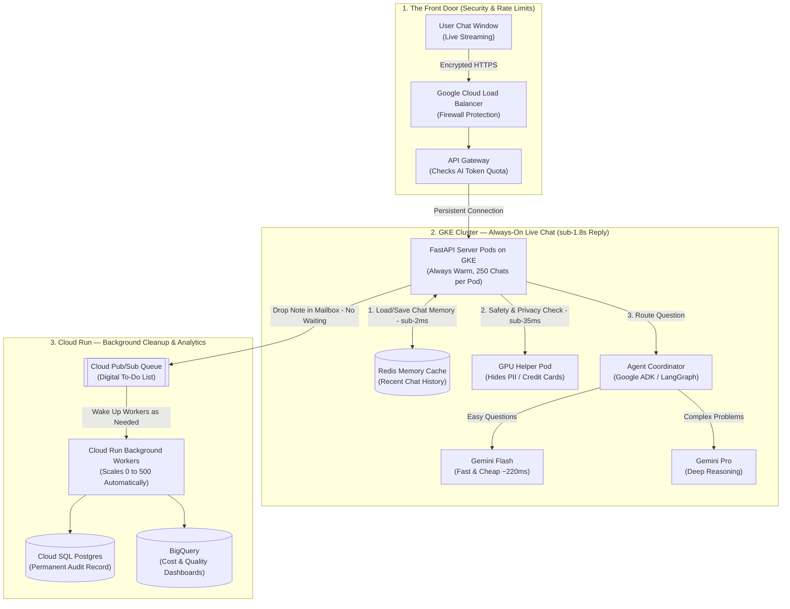

# Session 01: GKE vs. Cloud Run — Concurrency, Cold Starts & Autoscaling (Plain-English Guide)

> **Quick Summary — The Story & Numbers in Plain English**
>
> In interviews, you will be asked: *"Why did you use **GKE** for your Deloitte project, but **Cloud Run** for your Network18 project?"*
>
> - **Deloitte AI Customer Support (Built on GKE):**
>   - **What it is:** A live chat system where AI agents answer customer support tickets 24/7.
>   - **Why GKE:** Needs **0-second startup wait (`0ms` cold start)** so customers get their first reply in under **1.8 seconds (`<1.8s` TTFT)**. Because the server mostly waits on Google's Gemini AI to reply, a single small server pod (2 CPU cores, 4 GB RAM) can juggle **250 live chats at the same time**. Saved **$1.3M+ per year**.
> - **Network18 AI Video Editor (Built on Cloud Run):**
>   - **What it is:** An internal tool that cuts 1-hour TV broadcasts into short social media clips after prime-time news.
>   - **Why Cloud Run:** Almost nobody uses it at 3 AM. Cloud Run automatically turns completely off when idle (**`$0` overnight cost**). Because video cutting uses 100% of a computer's brain and memory, each server handles strictly **1 video at a time (`concurrency = 1`)** on a beefy machine (4 CPU cores, 8 GB RAM). Cut manual video editing work by **~85%**.
> - **The Cost Rule of Thumb:** If your servers are busy **more than ~40% of the day (steady 24/7 traffic)**, renting always-on **GKE** servers is **40–60% cheaper** than paying Cloud Run's pay-per-second convenience rates.

---

## Section A — First Principles: The Jargon Translated into Plain English

Before diving into architecture, let's translate the 5 buzzwords interviewers love to use into everyday analogies.

### 1. Container & Pod — "The Shipping Container"
When you write a Python app (using **FastAPI**), it works on your laptop, but might break on another computer. So we pack your Python code, libraries, and settings inside a **Docker Container**—like a standardized shipping container. In Kubernetes (**GKE**), the smallest unit that runs your container is called a **Pod**.

### 2. Cloud Run vs. GKE — "Calling an Uber vs. Leasing a Bus Fleet"
Both Cloud Run and GKE run your Docker containers on Google Cloud, but they work very differently:
- **Cloud Run (Serverless) = Calling an Uber:**
  You give Google your container and say, *"Only run this when a user clicks a button."* When nobody is using your app, Google shuts all copies down to zero (**Scale-to-Zero**) and you pay **$0**. If 100 users show up at once, Google automatically spins up more copies in seconds. You don't manage any servers.
- **GKE (Google Kubernetes Engine) = Leasing Your Own Fleet of Buses:**
  You rent virtual computers (called **Nodes**) that stay turned on **24/7**. Your app containers (Pods) are always awake, connected to your databases, and ready to go instantly. You get full control over the hardware (like attaching **GPUs** or background helper tools), and you get a big bulk discount for renting 24/7.

### 3. Cold Start vs. Warm Start — "Waking Up a Sleeping Computer"
- **Cold Start (The Cloud Run problem):** When Cloud Run has 0 servers running and a user suddenly sends a message, Google has to:
  1. Find a computer,
  2. Download and boot your container,
  3. Load heavy Python AI libraries (`langgraph`, `vertexai`), and
  4. Connect to your database.
  This takes **3 to 5 seconds** before your code even starts reading the user's message!
- **Warm Start (The GKE advantage):** Because GKE pods stay running 24/7, all libraries and database connections are already loaded in memory. The startup wait is **0 milliseconds (`0ms`)**.

### 4. TTFT (Time-To-First-Token) — "How Long Until the AI Starts Typing?"
When you ask ChatGPT a question, you don't wait 15 seconds for the whole essay to appear at once—you see the first word appear in ~1 second, and then it streams word-by-word.
- **TTFT** is the time from when the user hits "Send" to when the **very first word (token)** appears on their screen.
- For live customer support, our target is **under 2 seconds (`<2.0s` TTFT)**. If Cloud Run wastes 4 seconds just waking up (a cold start), you have already failed the 2-second goal!

### 5. I/O-Bound vs. CPU-Bound — "The Waiter vs. The Video Chef"
This is the **single most important concept** in Session 1. Why can one Deloitte server handle **250 users at once**, while one Network18 server can only handle **1 user at a time**?

- **I/O-Bound (Input/Output-Bound) = The Restaurant Waiter (Deloitte Chatbot):**
  - *What happens:* A user asks a question. Your FastAPI server sends that question over the internet to Gemini (the chef in another building) or looks up user data in a database (Redis), and then **sits there waiting** for 1–2 seconds for the reply.
  - *How much work the server does:* Almost zero! **92% of the time**, your server is just waiting on the network.
  - *Why high concurrency works:* Just like one waiter doesn't stand frozen by the kitchen door waiting for Table 1's food—they go take orders from Tables 2, 3, and 4—Python's `async/await` lets **1 server process juggle 250 waiting chats at the exact same time**.
- **CPU/RAM-Bound = The Chef Chopping Vegetables Non-Stop (Network18 Video Editor):**
  - *What happens:* A user uploads a 1-hour HD video to be sliced up using `moviepy` and `ffmpeg`. Decoding thousands of video frames uses **100% of the computer's processor (CPU)** and fills up **gigabytes of memory (RAM)**.
  - *Why concurrency = 1 is mandatory:* There is no "waiting time." The computer is sweating at 100% capacity. If a second video arrives on that same server at the same time, the two videos fight over CPU and run out of RAM, causing the operating system to emergency-crash your server (**`OOM-Kill` / Out Of Memory, Exit Code 137**).

---

## Section B — The 3 Key Differences Between Cloud Run and GKE

If an interviewer asks how Cloud Run and GKE differ under the hood, walk through these three simple points:

### 1. What Happens After You Send a Reply? (Server Lifespan)
- **Cloud Run freezes your CPU immediately:** By default, Cloud Run charges you only while an HTTP request is active. The millisecond your FastAPI server sends an answer back to the user, Cloud Run **throttles your container's CPU down to ~0%**. If your code tries to do cleanup work in the background *after* replying (like saving chat history to a database or logging analytics), that background task gets frozen mid-air!
- **GKE gives you full CPU 24/7:** Even after your server replies to the user, your GKE pod has its full CPU available to finish saving checkpoints, updating caches, and keeping live WebSocket/streaming connections open for hours.

### 2. Extra Helper Tools & GPUs (Sidecars & Node Pools)
- **What is a Sidecar?** Imagine attaching a sidecar to a motorcycle. Your main container runs your FastAPI app, while a second small helper container right next to it (sharing the same network) handles security checks, logging (OpenTelemetry), or traffic routing (Envoy).
- **GKE** lets you attach sidecars easily and lets you add specialized computers with **NVIDIA GPUs** (for example, running a small, super-fast AI safety model right inside your own network to redact credit card numbers in `<35ms`).
- **Cloud Run** is designed for simple, standalone containers—you don't manage underlying computers or cluster-wide helper services.

### 3. How They Decide When to Add More Servers (Autoscaling)
- **Cloud Run** only knows how to scale based on **one thing**: how many web requests are coming in right now.
- **GKE (with KEDA)** can scale based on **anything**: CPU, RAM, how many live chat streams are open, or how many unprocessed jobs are waiting in a background to-do list (Pub/Sub queue).

---

## Section C — Visual Architecture Blueprint (How It All Fits Together)

Don't be intimidated by the boxes below! Follow the numbered flow (`1 → 2 → 3`) to see how a customer message travels through our system:

1. **Step 1 (The Front Door / Edge):** The user's browser connects through a Load Balancer (which blocks hackers) and an API Gateway (which makes sure no single user abuses the AI quota).
2. **Step 2 (The Live Brain on GKE):** Our always-warm **FastAPI Pods on GKE** receive the chat. To be super fast (`<1.8s`), FastAPI does two things *at the exact same time*: checks if the message is safe (Guardrail) and loads the user's chat history from **Redis** (ultra-fast memory database). Then it routes simple questions to **Gemini Flash** (fast & cheap) and hard questions to **Gemini Pro** (smart & thorough).
3. **Step 3 (The Background Workers on Cloud Run):** Once the user gets their answer, we don't make them wait while we save long audit logs or update Salesforce CRM. FastAPI drops a quick note into **Cloud Pub/Sub** (a digital mailbox), and **Cloud Run Workers** wake up in the background to save the data to Postgres and BigQuery.



---

## Section D — Side-by-Side Comparison Cheat Sheet

Use this simple table to pick the right tool in any system design discussion:

| Feature / Question | GKE (Kubernetes) | Cloud Run Services (Web Apps) | Cloud Run Jobs (Batch Scripts) | Which One Wins & Why? |
| :--- | :--- | :--- | :--- | :--- |
| **Startup Wait (Cold Start)** | **0 seconds** (Servers stay warm 24/7) | **1.5 to 6 seconds** (When waking up from 0) | **5 to 15 seconds** (Fine for background jobs) | **GKE** wins whenever users need instant `<2s` chat replies |
| **Maximum Time Limit per Request** | **Unlimited** (Great for long live chats) | **60 minutes max** | **24 hours max** | **GKE** for live chat; **Cloud Run Jobs** for long video processing |
| **How Many Users per Server?** | **200–500 chats** per pod (for waiting/I/O tasks) | **1 to 1,000 requests** (configurable) | **1 job** per container | **GKE** when you want fine control over CPU & memory |
| **Can It Do Background Work After Replying?** | **Yes, 100% CPU stays on** | **No, CPU freezes** (unless you pay extra) | Runs until the script finishes | **GKE** wins for saving chat state in the background |
| **Custom GPUs & Helper Containers** | **Full support** (Any GPU, logging & security sidecars) | Basic support (Limited GPUs, simple setup) | Batch GPUs only | **GKE** wins for mixing custom AI models with web servers |
| **How Does It Auto-Scale?** | Scales on **anything** (CPU, RAM, queue length, open chats) | Scales **only** on incoming web requests | Runs exact number of tasks you ask for | **GKE** wins for smart scaling |
| **Cost Comparison** | **40–60% cheaper** if traffic is steady all day | **Cheapest (`$0` when idle)** if traffic comes in bursts | Pay only for the exact seconds the job runs | **GKE** for 24/7 enterprise apps; **Cloud Run** for spiky apps |

---

## Section E — Your Two Resume Stories (How It Works & How to Scale 100x)

### Story 1: Deloitte Customer Support Chatbot (Why We Used GKE)
- **The Problem We Solved:** Customers used to wait 24–48 hours for a human to reply to support tickets. We built a multi-agent AI system (using FastAPI, Google ADK, and LangGraph) that answers customers in real time, saving **$1.3M+ per year**.
- **Why GKE Was the Right Choice:**
  1. Customers expect a live chat to start replying in **under 2 seconds**. GKE keeps pods warm (`0ms` cold start) with database connections already open.
  2. Our servers keep live streaming connections (**Server-Sent Events / SSE**) open to the user's browser while saving conversation progress to Redis in the background.
- **What Breaks at 100x Traffic (And How You Fix It):**
  1. **Trap #1 — "Blocking the Waiter" (Event Loop Starvation):**
     Remember how 1 FastAPI worker acts like a waiter serving 250 tables at once? That only works if the waiter never stops moving. If a programmer accidentally writes *synchronous* (blocking) code—like making the waiter stand still and manually read a huge 50-page PDF for half a second—**all 250 customers freeze for half a second**!
     - **The Fix:** Make sure all network calls use non-blocking `async/await` (`httpx.AsyncClient`), and hand off any heavy CPU reading/parsing to a separate background thread (`asyncio.to_thread()`).
  2. **Trap #2 — Autoscaling on the Wrong Signal (The Lazy CPU Trap):**
     Normally, Kubernetes adds more servers when **CPU hits 70%**. But because our FastAPI server spends 92% of its time *waiting* on Gemini over the internet, the server's CPU might only be at **18%** even when it's maxed out with 250 open chats and running out of memory! So the autoscaler never adds new servers, and the app crashes.
     - **The Fix:** Use **KEDA** (an event-driven autoscaler for Kubernetes) to add more pods based on **number of active chats (`>180 chats per pod`)** instead of CPU percentage.

---

### Story 2: Network18 AI Video Repurposing Engine (Why We Used Cloud Run)
- **The Problem We Solved:** After TV news broadcasts, human editors spent hours manually finding highlights and cutting 1-hour shows into short vertical clips for YouTube/Instagram. We built an AI tool using **FastAPI + `moviepy` + Gemini Multimodal** that automatically finds highlights and cuts the video, reducing manual editing work by **~85%**.
- **Why Cloud Run Was the Right Choice:**
  News editors only upload videos right after shows air, and **nobody uses the tool between 1 AM and 7 AM**. With Cloud Run, our servers automatically drop to **0 instances overnight (`$0` cost)** and spin up on demand when shows finish.
- **What Breaks at 100x Scale (Imagine 5,000 Editors Uploading 1-Hour Videos at the Exact Same Time):**
  1. **Crash #1 — Upload Size Limit & RAM Crash:** Cloud Run web requests have a strict **32 MB file size limit**, and trying to hold a 4 GB video file inside FastAPI's memory instantly crashes the server.
  2. **Crash #2 — CPU Traffic Jam:** By default, Cloud Run sends up to 80 user requests to the same server container. If 80 video-cutting jobs hit 1 server at once, the CPU grinds to a halt and times out after 60 minutes.
- **The 3-Step 100x Redesign (How to Explain It in an Interview):**
  - **Step 1 — Bypass the Server for Uploads (Signed URLs):** When an editor clicks "Upload," FastAPI doesn't take the video file itself. Instead, in `<30ms`, FastAPI hands the browser a special temporary VIP pass (**Google Cloud Storage Signed URL**). The browser uploads the huge 4 GB video directly into Cloud Storage.
  - **Step 2 — Use a To-Do List Queue (Cloud Pub/Sub):** As soon as the video finishes uploading to Cloud Storage, storage automatically drops a message into **Cloud Pub/Sub** (our digital to-do list). The editor sees *"Processing started!"* right away.
  - **Step 3 — Chop into Small Pieces & Process 1-by-1 (Cloud Run Jobs):** A lightweight worker grabs the 1-hour video and splits it into twelve **5-minute chunks** (taking only 2 seconds without re-encoding). Then, 12 separate Cloud Run workers—each set to **`concurrency = 1`** so it never shares its CPU—process all twelve 5-minute chunks **at the exact same time**! A 1-hour video finishes in under 3 minutes.

---

### Annotated Code Blueprint: How a FastAPI Pod Handles 250 Chats at Once

Here is a clean, beginner-friendly look at the actual Python code running inside our GKE pod. Notice the two smart tricks in the comments:

```python
import asyncio
from contextlib import asynccontextmanager
from fastapi import FastAPI, Request
import httpx
import redis.asyncio as redis

# TRICK 1: Connect to databases ONCE when the GKE pod starts up (Warm Start),
# NOT on every single user message! This saves ~300ms on every chat turn.
@asynccontextmanager
async def lifespan(app: FastAPI):
    # Open a reusable pool of internet connections for calling Gemini & tools
    app.state.http_client = httpx.AsyncClient(
        http2=True,
        timeout=httpx.Timeout(30.0, connect=2.0),
        limits=httpx.Limits(max_connections=500, max_keepalive_connections=100),
    )
    # Open a reusable pool of connections to Redis (our fast chat memory)
    app.state.redis = redis.from_url(
        "redis://redis-cluster.internal:6379",
        max_connections=200,
        decode_responses=True,
    )
    yield
    # Cleanly close connections when the server shuts down
    await app.state.http_client.aclose()
    await app.state.redis.aclose()

app = FastAPI(lifespan=lifespan)

@app.post("/v1/agent/stream")
async def orchestrate_support_turn(request: Request, session_id: str, query: str):
    # TRICK 2: Do independent tasks AT THE SAME TIME (Parallel Execution).
    # Instead of waiting 30ms for safety check + 15ms for Redis = 45ms total,
    # asyncio.gather() runs both together so we only wait for the slowest one (~30ms)!
    guard_task = check_input_guardrail(app.state.http_client, query)
    state_task = app.state.redis.get(f"checkpoint:{session_id}")
    
    is_safe, checkpoint_json = await asyncio.gather(guard_task, state_task)
    if not is_safe:
        return {"status": "blocked", "reason": "policy_violation"}
    
    # TRICK 3: Never block the waiter!
    # If parsing a huge JSON file takes heavy CPU work, move it to a helper thread
    # so the main event loop can keep serving the other 249 customers.
    state = await asyncio.to_thread(parse_checkpoint, checkpoint_json)
    return {"status": "streaming", "session_id": session_id, "step": state.step}
```

---

## Section F — Common Interview Questions (Explained Simply)

### Q1: "Cloud Run has settings to keep servers warm (`min-instances`) and keep the CPU turned on (`CPU Always Allocated`). Why didn't you just flip those switches instead of using GKE?"
- **What they are really testing:** Do you know that turning off Cloud Run's "serverless" features makes it super expensive while still missing Kubernetes features?
- **How to answer simply:**
  > "Great question! The catch is **cost and control**. The moment you force Cloud Run to stay on 24/7 with full CPU allocated, you lose the 'pay-only-when-used' benefit and end up paying **more than 2x the price** of GKE servers with a 1-year discount. Plus, even if you pay extra on Cloud Run, you still can't attach custom GPU node pools in the same local network or autoscale based on custom metrics like open chat streams. Since our Deloitte support system had steady 24/7 traffic, GKE was both half the cost and much more flexible."

### Q2: "When you run FastAPI on a GKE Pod with 2 CPU cores, how many worker processes (`Uvicorn workers`) do you run inside that Pod?"
- **What they are really testing:** Do you understand that in Kubernetes, you scale by adding more Pods rather than stuffing 20 processes inside one container?
- **How to answer simply:**
  > "We keep it simple: **1 Uvicorn worker per CPU core**—so on a **2-vCPU, 4 GB RAM** pod, we run **2 Uvicorn workers**. Each worker gets its own CPU core so they never fight each other, and because our code uses non-blocking `async/await`, those 2 workers easily handle **250 to 400 live chats at once**. When traffic grows, we let Kubernetes add more Pods rather than cramming more processes into a single container."

### Q3: "What happens when you deploy a code update on GKE and an old Pod needs to shut down, but 200 customers are in the middle of a live chat on that Pod?"
- **What they are really testing:** How do you update servers without disconnecting users mid-sentence (**Graceful Shutdown**)?
- **How to answer simply:**
  > "We use a **Graceful Drain (`terminationGracePeriodSeconds: 90`)**. When Kubernetes wants to shut down an old pod, three things happen in order:
  > 1. **Stop new users from entering:** The pod immediately tells the Load Balancer *'I am closing soon'*, so all *new* chats go to the fresh pods.
  > 2. **Finish current sentences:** We give the pod up to 60 seconds to finish generating whatever AI reply is currently in progress and save the exact chat state into **Redis**.
  > 3. **Seamless handoff:** The pod sends a tiny `reconnect` signal to the user's browser, which instantly reconnects to a new pod and picks up the conversation from Redis without losing a single word."
