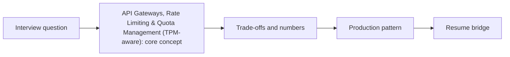

# Session 03: API Gateways, Rate Limiting & Quota Management (TPM-aware)

> **Status: SKELETON** (content to be written; follow `CONTENT_GUIDELINES.md`)
> - **Phase 2: Production Optimization** | **Week 6** | **Priority:** solid | **Session type:** existing (upgraded scope)
> - **Module:** Module 1: Backend, Caching & Capacity Planning
> - **Resume anchor:** Deloitte Multi-Agent Orchestrator

---

## Part 1: Quick Summary

> TODO (3-4 bullets): what this is in plain English, why interviewers care, the 10-second mental model.

## Part 2: Topics to Cover (Study Checklist)

- [ ] Token bucket vs leaky bucket vs sliding window
- [ ] Token-based (TPM) limits vs request-based limits; estimating tokens before the call
- [ ] Fairness across tenants: weighted fair queuing, priority lanes
- [ ] Backoff with jitter and 429 handling
- [ ] Circuit breakers and load shedding under overload

## Part 3: First Principles & Analogies

TODO: one everyday analogy per concept above, plus a concrete failure scenario.

## Part 4: Concept Blueprint

TODO: replace with the real architecture / decision-tree diagram.

## Part 5: Trade-Off Decision Matrix

| Option / Pattern | Latency | Cost | Complexity | When to Pick / Watch Out For |
| :--- | :--- | :--- | :--- | :--- |
| TODO option A | TODO | TODO | TODO | TODO |
| TODO option B | TODO | TODO | TODO | TODO |
| TODO option C | TODO | TODO | TODO | TODO |

## Part 6: Deep-Dive Mechanics & Numbers

TODO: the math, edge cases and "tricks" that separate a senior answer from a mid-level one.

## Part 7: Production AI & Resume Tie-In

TODO: how this applies to production AI systems and to **Deloitte Multi-Agent Orchestrator**; include a short annotated code or design snippet.

## Part 8: Interview Questions (Answered Simply)

TODO: 4-6 questions, each with **What they are really testing** and **How to answer simply** (spoken-English blockquote).

## Canonical Problems Unlocked

- [llm-gateway](/problems?id=llm-gateway)
- [chat-assistant](/problems?id=chat-assistant)

## Deliverable (Do This Before Moving On)

- [ ] Rate-limit design for 10 teams sharing one TPM quota.

## Socratic Study Prompt

> *"Explain Token Bucket vs. Leaky Bucket rate limiting, circuit breakers, and exponential backoff with jitter. Show me how to design an API Gateway in front of Gemini API that manages token-per-minute (TPM) quotas across 10 internal teams."*
