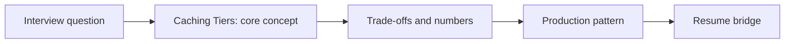

# Session 04: Caching Tiers: Exact, Provider Prompt Caching & Semantic Caching

> **Status: SKELETON** (content to be written; follow `CONTENT_GUIDELINES.md`)
> - **Phase 2: Production Optimization** | **Week 6** | **Priority:** core | **Session type:** existing (upgraded scope)
> - **Module:** Module 1: Backend, Caching & Capacity Planning
> - **Resume anchor:** Deloitte Customer Support & Sales RAG

---

## Part 1: Quick Summary

> TODO (3-4 bullets): what this is in plain English, why interviewers care, the 10-second mental model.

## Part 2: Topics to Cover (Study Checklist)

- [ ] Exact-match response caching and key design (model, prompt, params, tenant)
- [ ] Provider prompt caching: layout rules (stable prefix first), discounts, TTL
- [ ] Semantic cache: similarity threshold, false-hit risk, verification, per-tenant isolation
- [ ] Retrieval / embedding / tool-result caches and invalidation
- [ ] Hit-rate x savings math and when caching is NOT worth it
- [ ] Cache stampede, TTL and freshness for time-sensitive answers

## Part 3: First Principles & Analogies

TODO: one everyday analogy per concept above, plus a concrete failure scenario.

## Part 4: Concept Blueprint

TODO: replace with the real architecture / decision-tree diagram.

## Part 5: Trade-Off Decision Matrix

| Option / Pattern | Latency | Cost | Complexity | When to Pick / Watch Out For |
| :--- | :--- | :--- | :--- | :--- |
| TODO option A | TODO | TODO | TODO | TODO |
| TODO option B | TODO | TODO | TODO | TODO |
| TODO option C | TODO | TODO | TODO | TODO |

## Part 6: Deep-Dive Mechanics & Numbers

TODO: the math, edge cases and "tricks" that separate a senior answer from a mid-level one.

## Part 7: Production AI & Resume Tie-In

TODO: how this applies to production AI systems and to **Deloitte Customer Support & Sales RAG**; include a short annotated code or design snippet.

## Part 8: Interview Questions (Answered Simply)

TODO: 4-6 questions, each with **What they are really testing** and **How to answer simply** (spoken-English blockquote).

## Canonical Problems Unlocked

- [chat-assistant](/problems?id=chat-assistant)
- [llm-gateway](/problems?id=llm-gateway)
- [support-agent](/problems?id=support-agent)

## Deliverable (Do This Before Moving On)

- [ ] Cache hierarchy diagram with expected hit rates and $ saved.

## Socratic Study Prompt

> *"Teach me every caching layer for LLM apps: exact-match, provider prompt caching, KV prefix caching, semantic caching (and its false-hit risk), retrieval and embedding caches. Give me hit-rate x cost math and ask me how to make a semantic cache safe for multi-tenant data."*
