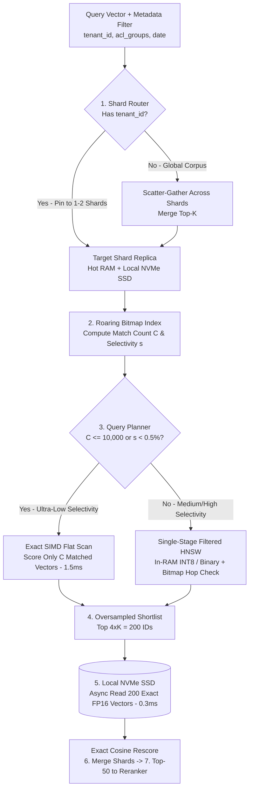

# Session 05: Vector Index Internals — HNSW, IVF-PQ, Quantization & Filtered Search

> **Prerequisites & Plain-English Summary**
>
> - **Prerequisites:**
>   - **Embeddings (`session-24`):** Every document chunk and user query is an array of `D` numbers (`e.g., 768` or `1536` floats) where nearby points mean similar ideas.
>   - **Partitioning & Tail Amplification (`fund-02`):** Splitting data across `20` shards and querying all `20` (`scatter-gather`) makes your `P99` latency equal the slowest shard unless you route by tenant/partition key.
>   - **RAM vs. NVMe SSD Speed (`fund-03`, `fund-07`):** RAM reads take `~100 ns` while random NVMe SSD reads take `~20–100 µs` (`~500×` slower)—so graph pointer-chasing loves RAM while sequential block reads fit SSDs.
> - **Plain-English Core:** Comparing a user's question against 100 million vectors one by one takes way too long, so a vector index organizes those points into a smart multi-layer highway map or clustered neighborhoods—letting you find the 98% best matches in 5 milliseconds while compressing numbers to slash RAM bills by 4× to 32×.

---

## 1. Build It From Zero (Basics + Socratic Walkthrough)

### What Are We Actually Building, and Why Is It Hard?
Suppose your enterprise search index holds `100 million` chunks, each embedded at `1,536` dimensions (`float32` = `4 bytes` per number). Alone, the raw vectors occupy `100M × 1,536 × 4 bytes = 614.4 GB`.

When a user asks a question, the exact textbook way to find the `10` closest vectors (**k-Nearest Neighbors / exact `k-NN`**) is to compute `1,536` multiplications against **every single one of the `100,000,000` vectors**. Even with fast SIMD CPU instructions, scanning `614 GB` from memory takes **`1.5 to 4 seconds` per single query**—at `100 QPS`, your cluster melts immediately!

### The Socratic Ladder: Discovering Approximate Nearest Neighbor (`ANN`) Indexes

**🤔 Question 1: Why check all 100 million points when `99.9%` of them are on the opposite side of the map? What's the simplest shortcut?**
Group the `100M` points into `10,000` regional neighborhoods ahead of time, each represented by one center pin. When a query arrives, compare it against only the `10,000` center pins (`10,000×` less work!), pick the `20` closest neighborhoods, and scan only the points inside those `20` neighborhoods!
→ You traded tiny borderline misses (when a true match sits just across a neighborhood border) for a **`500×` speedup**.

**🤔 Question 2: Clustering cut compute, but `614 GB` of raw vectors STILL sits in expensive RAM! Can we shrink each `6,144-byte` vector without losing our place?**
Instead of storing `32-bit` decimals (`0.1849204...`), round each coordinate to an `8-bit` integer (`-128..127` → **`4×` smaller**), a `1-bit` sign (`+` or `-` → **`32×` smaller**), or chop the `1,536` numbers into `96` mini-groups of `16` numbers and replace each mini-group with a `1-byte` ID from a `256`-entry codebook (**`64×` smaller**)! Keep those tiny compressed sketches in RAM to shortlist `200` candidates, then read the exact `6,144-byte` originals from cheap SSD for just those `200` finalists!

**🤔 Question 3: What if you want `3-millisecond` searches without scanning whole neighborhoods? How do humans cross a country fast?**
You don't walk house-to-house from Mumbai to Delhi. You fly an express route with `5` giant hubs (Top Layer), take regional rail with `500` stops (Middle Layer), and walk local streets where every house is connected to `16` nearby houses (Bottom Layer). Starting at the top layer and greedily stepping toward closer hubs lands you in the exact street in `~150` hops instead of `100,000,000` checks!

**🤔 Question 4: Uh-oh—now we add a security rule: `"Only return chunks where department = 'Legal'"` (`0.5%` of the `100M` chunks). What breaks if we find the top-20 on the highway first and check `'Legal'` afterward—OR if we delete `99.5%` of houses from the highway before starting?**
1. **Check after (`Post-Filter`):** Out of `20` global matches, `20 × 0.005 = 0.1` belong to `'Legal'`—the user gets **`0` results** even though `500,000` Legal chunks exist!
2. **Delete `99.5%` of nodes first (`Naive Pre-Filter`):** You just blew up `99.5%` of the bridges on your street graph—the graph disconnects into isolated islands!
→ You must either evaluate a **filter bitmap *during* graph hops** (bridging across filtered-out nodes when needed) or switch dynamically to a **direct scan over the Legal inverted-index list** when Legal has only a few thousand items!

### Naming What You Just Invented
1. Trading `1–2%` accuracy for `100–1,000×` speed is **Approximate Nearest Neighbor (`ANN`)** search.
2. Clustering into `nlist` Voronoi centroids and scanning `nprobe` cells is **IVF (`Inverted File Index`)**, paired with codebook sub-vector compression as **IVF-PQ (`Product Quantization`)**.
3. The multi-layer skip-list proximity graph is **HNSW (`Hierarchical Navigable Small World`)**—and its SSD-resident cousin is **DiskANN (`Vamana` graph)**.
4. `FP32 -> INT8 / 1-bit / PQ` with SSD rescoring is **Scalar, Binary & Product Quantization with Oversampling**.
5. Checking metadata bitmaps inside graph traversal is **Single-Stage Filtered HNSW (`ACORN` / Filterable HNSW)** with **Selectivity-Based Query Planning**.

### Explain It in Layers
- **One Line (Explain to a 12-Year-Old):** Instead of checking every book in a 100-million-book city, take an express train to the right neighborhood, walk a few connected streets to the closest matches, and keep pocket-sized summaries in memory while full books sit on cheap shelves.
- **One Paragraph (Explain to a Non-Backend Engineer):** Exact vector search scans every vector and gets slow past ~100,000 items. Production vector databases use index structures like **HNSW** (a layered network of links that hops to the right neighborhood in milliseconds, fast in RAM) or **IVF-PQ / DiskANN** (clustered/compressed indexes that slash memory costs). To cut cloud RAM bills by 4× to 32×, we compress vectors from 32-bit floats down to 8-bit or 1-bit codes and rescore the top 200 matches from SSD, while integrating metadata filters directly into graph hops so permission checks never return empty results.
- **Engineer Version:** Production `ANN` engines balance the **Recall–Latency–Memory** triangle across **graph indexes (`HNSW`, `Vamana`/`DiskANN`)** and **partition-quantization indexes (`IVF-PQ`, `ScaNN` anisotropic PQ)**. Capacity math follows `HNSW RAM ≈ N × (D × bytes + M × 2 × 4..8 B) ≈ N × D × bytes × 1.5`. Sub-linear filtered search requires **cost-based selectivity optimization**: brute-force SIMD over inverted bitmap IDs when filter selectivity `s < ~0.5%–1%`, and **predicate-aware graph traversal** (`filterable HNSW` / `ACORN` two-hop neighbor expansion) at medium selectivity, sharded by `tenant_id` (or consistent hash with scatter-gather) across replicated hot/cold tiers.

---

## 2. First Principles, Analogies, Interview Framing & Capacity Math

> **Why Interviewers Care & The 10-Second Mental Model**
>
> - **Why Interviewers Care:** Almost every RAG interview includes a scaling probe: *"Your prototype uses ChromaDB/pgvector—what happens at 100M vectors? How much RAM does it take, which HNSW knobs do you tune when recall drops, and how do metadata filters interact with ANN?"* Hand-waving *"we just put it in Pinecone"* fails Senior/Staff loops.
> - **The 10-Second Mental Model:** **"Size HNSW RAM with `N × D × bytes × 1.5`. Tune `efSearch` at query time to trade latency for recall without rebuilding. Use `INT8` (`4×` cut) or `Binary/PQ + SSD rescore` (`16–32×` cut) at scale. Enforce filters *during* graph traversal (switching to bitmap flat-scan below `~1%` selectivity), and shard by `tenant_id` whenever possible to avoid 20-shard scatter-gather P99 tax."**

### 1. HNSW Internals & Its 3 Knobs — "Express Bullet Trains → Local Streets"
- **How HNSW Builds & Searches:** Layer `0` contains all `N` vectors, each wired to up to `2 × M` bidirectional neighbors. Each vector is promoted to Layer `1, 2, ... L` with exponentially decaying probability (`e^{-l / m_L}`), just like a probabilistic skip-list. Search enters at the single top-layer entry point, greedily hops to the closest neighbor (`ef = 1`) down to Layer `1`, and at Layer `0` maintains a dynamic priority queue of **`efSearch`** best candidates before returning `top-K`.
- **The 3 Knobs Interviewers Grill You On:**
  1. **`M` (Max edges per node, typical `16–32`, Layer 0 uses `2M`):**
     - *Build-time & permanent:* Higher `M` boosts recall on high-intrinsic-dimension data and resists graph disconnection under filters, **but directly increases RAM** (`~8–16 bytes × M` per vector: at `M=32`, graph links alone add `~256–512 B/vector`!) and slows traversal per hop (`more neighbors to score`). Changing `M` requires a **full index rebuild**.
  2. **`efConstruction` (Candidate beam width during insert, typical `100–400`):**
     - *Build-time only:* Higher `efConstruction` builds higher-quality shortcut edges and raises the recall ceiling **with `0` extra bytes of RAM** and **`0` query latency penalty**—it only makes **index build time slower**!
  3. **`efSearch` (Candidate beam width at query time, typical `64–256`, must be `>= K`):**
     - *Runtime tunable per query!* Raising `efSearch` from `64` to `192` boosts `Recall@10` from `~84%` to `~96%+` immediately with **zero rebuild and zero extra RAM**, trading linear query CPU/latency (`e.g., 4ms -> 11ms`).

### 2. IVF, IVF-PQ, ScaNN & DiskANN — "Postal ZIP Codes & Paint-Swatch Codebooks"
- **`IVF-Flat` (Inverted File):** Runs `k-means` to learn `nlist` centroids (`rule of thumb: nlist ≈ √N to 4√N`, so `~10,000–32,000` centroids for `100M` vectors). At query time, checks `nprobe` (`e.g., 32–128`) nearest centroids. Lower RAM than HNSW (no graph edges!), slower than HNSW at high `95%+` recall unless `nprobe` is large.
- **`PQ` (Product Quantization) & Asymmetric Distance Computation (`ADC`):**
  - Splits a `1536-d` vector (`6,144 B`) into `m = 96` sub-vectors of `16` dims each. Runs `k-means` (`k = 256` centroids = `1 byte` index `0..255`!) independently on each subspace → **`96 bytes` total (`64×` compression!)**.
  - **The Speed Trick (`ADC` Lookup Table):** At query time, precompute exact distances between the *uncompressed* query's `96` slices and all `256` centroids (`96 × 256` tiny dot products once!). Now scoring each database vector is just **`96` table lookups + additions (`0` multiplications!)**!
  - **Vertex AI `ScaNN` (Anisotropic PQ):** Penalizes parallel quantization error (along the vector direction, which distorts high dot-products most!) more heavily than orthogonal error—giving noticeably higher top-K recall at equal compression than classic symmetric PQ.
- **`DiskANN` (`Vamana` Graph on NVMe SSD — Milvus / Azure / Turbopuffer / LanceDB):**
  - Keeps tiny `PQ` codes (`~64–96 B/vec`) in RAM to guide hops while storing `[full FP16 vector + Vamana neighbor ID list]` contiguously inside **one single `4 KB` NVMe SSD block**! Each Beam-Search hop issues `4–8` parallel async `io_uring` SSD reads (`~80 µs/hop × 6 hops ≈ 2–5 ms` total!), serving **`1 Billion` vectors on `<96 GB` RAM** at `~3–8 ms` latency!

### 3. Quantization Ladder + Oversample-and-Rescore
- **`FP16` (`2 B/dim`):** **`2×` RAM cut**, **`0.0%` recall loss** — literally free; never store `FP32` in HNSW!
- **`INT8` Scalar Quantization (`SQ8`, `1 B/dim`):** Maps `[min_d, max_d]` (`P99.9` clipped) to `[-127, 127]`. **`4×` RAM cut** vs `FP32`, `<0.5–1.5%` recall delta, fast `AVX-512 VNNI` / ARM `SDOT` integer dot products.
- **Binary Quantization (`BQ`, `1 bit/dim = 0.125 B/dim`):** `bit = 1 if x > 0 else 0`, scored with `XOR + POPCNT` CPU instructions (**`32×` smaller, `10–30×` faster scan!**). Alone on `768d` it drops `5–10%` recall, **BUT** on high-dim (`1024–3072d`) embeddings with **`4×–8×` oversampling + SSD `FP16` rescoring** (`fetch top-200 binary -> rescore 200 full vectors -> top-20`), it recovers **`98–99%` recall**!

### 4. Filtered Metadata Search — "Exit-Door Check vs. Blown Bridges vs. Guided Detours"
Let selectivity `s = matching_vectors / total_vectors` (`0 < s <= 1`):
1. **High Selectivity (`s > 20%`, e.g., `lang = 'en'`):** Even post-filtering or standard bitmap check during HNSW works cleanly (`efSearch / s` adds minimal hops).
2. **Medium-Low Selectivity (`1% <= s <= 20%`, e.g., `dept = 'Finance'`):** Naive post-filter starves; naive pre-filter breaks HNSW edges. Modern engines do **Single-Stage Filtered HNSW**:
   - **Qdrant Filterable HNSW:** Builds miniature intra-subgraph HNSW links *inside* indexed payload values (`m_payload`) so every frequent filter group stays connected!
   - **ACORN-1:** Traverses two-hop neighbors (`neighbors of neighbors`) on the fly whenever direct neighbors fail the filter predicate bitmap, keeping graph navigation alive without extra per-tag edges.
3. **Ultra-Low Selectivity (`s < 0.5%–1%`, e.g., `doc_id IN (...)` matching `4,000` vectors out of `100M`):** Graph traversal wastes thousands of hops hunting rare nodes! A **Cost-Based Query Planner** flips automatically to **Inverted Bitmap → Exact Flat SIMD Scan** (`4,000` SIMD dot products take `<1.2 ms` with **`100%` exact recall**!).

### Timestamped Story ("Alice & Bob"): The `100M`-Vector OOM & Filter Starvation Double-Whammy
- `Mon 08:30 AM` — **Alice** migrates `100M` chunks (`1536-d` `FP32`) into a `4`-node self-hosted vector cluster (`128 GB` RAM/node = `512 GB` total), forgetting HNSW link + OS page-cache overhead.
- `Mon 09:05 AM` — At `62M` inserted vectors (`~571 GB` footprint), Linux `OOM-Killer` starts terminating nodes during background HNSW segment compaction (`2×` temporary merge spike!).
- `Mon 10:00 AM` — After emergency scaling to `1.2 TB` RAM (`$9,000/mo`), **Bob** (an M&A analyst authorized for `12,000` deal chunks = `0.012%` selectivity) runs a search. Because the client code runs `search(top_k=25)` *then* filters `acl` in Python (`post-filter`), all `25` hits belong to public HR docs—Bob gets **`0` results** on `100%` of queries!
- **The Senior Fix:** (1) Enable `INT8` scalar quantization + on-disk `FP16` payload/vectors (`1.2 TB -> ~230 GB` HNSW RAM across shards, leaving `30%` compaction headroom); (2) move `acl` into an **indexed payload filter** inside the DB so Bob's `12,000`-vector slice triggers the planner's **exact bitmap SIMD scan** in `1.8 ms` with `100%` recall!

### Functional & Non-Functional Requirements + Back-of-the-Envelope Sizing Sheet (`100M × 1536-d`)
Here is the exact **Deliverable Sizing Sheet** for **`100,000,000` vectors × `1,536` dimensions** (`M = 16`, replication factor `RF = 2` for HA + read QPS, `30%` segment-compaction RAM headroom):

| Storage / Quantization Config | Raw Vector Bytes (`100M`) | HNSW Graph + Metadata (`M=16`) | Total RAM (`RF=1`, incl. `1.3×` headroom) | HA Cluster RAM (`RF=2`) | NVMe SSD Required (`RF=2`) | Recall@10 (with `4×` Rescore) | Approx Cloud Infra / Mo |
| :--- | :--- | :--- | :--- | :--- | :--- | :--- | :--- |
| **1. Raw `FP32` in RAM** *(Anti-Pattern)* | `614.4 GB` | `~307 GB` (`1.5×` rule) | `~1,198 GB` (`1.2 TB`) | `~2.4 TB` | `2.4 TB` WAL/snap | `99.5%` (baseline) | `~$9,500–$14,000` |
| **2. `FP16` in RAM** | `307.2 GB` | `~154 GB` | `~600 GB` | `~1.2 TB` | `1.2 TB` | `99.5%` (`0%` loss) | `~$4,800–$7,000` |
| **3. `INT8` (`SQ8`) in RAM + `FP16` on SSD** *(Sweet Spot)* | `153.6 GB` | `~77 GB` (`~230 GB` raw) | **`~300 GB`** | **`~600 GB`** (`8 × 80GB` pods) | `1.2 TB` NVMe | **`98.8%–99.3%`** | **`~$2,200–$3,200`** |
| **4. `Binary` (`1-bit`) in RAM + `FP16` on SSD** | `19.2 GB` | `~64 GB` (graph links dominate!) | **`~108 GB`** | **`~216 GB`** (`4 × 64GB` pods) | `1.2 TB` NVMe | **`97.5%–98.5%`** | **`~$900–$1,400`** |
| **5. `DiskANN` / `IVF-PQ` (`96B` PQ in RAM, graph on SSD)** | `9.6 GB` PQ | Vamana edges on SSD | **`~32 GB`** | **`~64 GB`** (`2–4` small nodes) | `1.6 TB` fast local NVMe | `95%–98%` (`P99 ~8–15ms`) | **`~$450–$800`** |

> **Key Senior Insight in Row 4:** Notice that under `1-bit` Binary Quantization (`19.2 GB` vectors!), **the uncompressed `8-byte/4-byte` HNSW neighbor pointer lists (`~64 GB`) are now `3.3×` larger than the vectors themselves!**

---

## 3. Visual Architecture Blueprint

Follow `1 → 7` below to see how a sharded, selectivity-aware `100M+` vector search engine executes a filtered query with quantized RAM shortlist + NVMe SSD rescoring:

1. **Step 1 (Shard Routing):** Coordinator inspects `tenant_id`: routes single-tenant queries to **1 local shard** (zero scatter-gather tail penalty!), or fans out global cross-tenant queries across `K` hash shards.
2. **Step 2 (Inverted Bitmap Evaluation):** Evaluates metadata predicates (`acl_groups`, `date_range`, `doc_type`) against compressed **Roaring Bitmaps** in `<0.5 ms`, computing matched count `C` and selectivity `s = C / N_shard`.
3. **Step 3 (Selectivity Cost Planner):**
   - If `C <= 10,000` (`s < ~0.5%`): skips HNSW completely and runs **Exact SIMD Flat Scan** over the `C` candidate IDs (`<1.5 ms`, `100%` recall!).
   - If `C > 10,000`: runs **Single-Stage Filtered HNSW** (`efSearch = 128`) over in-RAM `INT8` / `Binary` vectors, testing the Roaring Bitmap at every graph hop.
4. **Step 4 (Oversampled Shortlist):** Collects `4 × K` (`e.g., 200`) candidate IDs in `3–5 ms`.
5. **Step 5 (NVMe SSD Asymmetric Rescore):** Issues one batched async `io_uring` read to fetch exact `FP16` vectors from NVMe SSD (`200 × 3 KB = 600 KB ≈ 0.3 ms`) and recomputes exact cosine similarity.
6. **Step 6 (Shard Merge & Hot/Cold Tiering):** Coordinator merges top-`K` across queried shards (keeping recent `90-day` hot partitions in `INT8` HNSW RAM and historical multi-year archives on `DiskANN` SSD shards).
7. **Step 7 (Handoff to Stage-2 Reranker):** Returns top-`50` scored chunks + metadata to hybrid `RRF` + Cross-Encoder (`Session 06`).



---

## 4. Side-by-Side Comparison & Trade-Off Table

### Vendor-Neutral Engine & Index Map

| Engine / Pattern | Core Index Architecture | Sweet-Spot Scale | When to Pick / Winner | Watch Out For (The Trap) |
| :--- | :--- | :--- | :--- | :--- |
| **`pgvector` / `pgvectorscale`** *(Inside Postgres)* | HNSW (`halfvec` FP16 / BQ) + StreamingDiskANN (`pgvectorscale`) + SQL ACID joins | **`< 5M–20M` vectors** | **Default Day-1 winner** if you already run Postgres: zero dual-write drift between relational RBAC/metadata and vectors! | HNSW index builds & vacuuming compete with OLTP CPU/RAM on a single primary past `20M–50M` high-dim vectors. |
| **`Qdrant` / `Weaviate`** *(Purpose-Built Rust/Go)* | Filterable HNSW (`m_payload` subgraph links), `SQ8`/`BQ`/`PQ` + `mmap` NVMe | **`5M–500M+` vectors** | **Winner for multi-tenant filtered RAG** needing sub-10ms P99, native sparse+dense hybrid, and rich payload bitmaps. | Must budget `~25–30%` extra RAM/disk headroom for background segment compaction spikes. |
| **`Milvus` / `Vespa`** *(Distributed Cloud-Native)* | Disaggregated compute/storage (`Knowhere` HNSW, `IVF-PQ`, `DiskANN`), full BM25 + tensor ranking | **`100M–10B+` vectors** | **Winner for massive scale (`Vespa` for custom ranking expressions; `Milvus` for multi-billion GPU/DiskANN).** | Heavy operational footprint (etcd/Pulsar/S3 or multi-service cluster) for small teams with `<10M` vectors. |
| **`Vertex AI Vector Search` (`ScaNN`) / `Pinecone` / `Turbopuffer`** | Managed anisotropic tree-quantization (`ScaNN`) or object-storage + NVMe cache (`puff`/serverless) | **`10M–1B+` managed** | **Winner when team wants managed SLAs (`Vertex` inside GCP VPC; serverless object-store engines for cheap cold namespaces).** | Serverless object-storage cold namespaces take `150–400ms` on first cold query before warming NVMe cache! |
| **`OpenSearch` / `Elasticsearch`** | Lucene HNSW (`int8`/`bbq`) + native mature BM25 inverted index | **`5M–200M` hybrid** | **Winner when enterprise already runs Elastic/OpenSearch** for logs/search and wants `1` system for BM25 + Dense. | JVM heap + off-heap Lucene `mmap` sizing requires careful tuning so GC pauses don't spike HNSW P99. |

---

## 5. Deep-Dive Mechanics & Production Failure Analysis

### Under-the-Hood Tricks (What Separates Junior from Senior Answers)

1. **Why HNSW Deletes Don't Free RAM Immediately (Soft Tombstones + Segment Compaction):**
   - Deleting a node out of the middle of an HNSW graph would sever bridges between its neighbors! Therefore, HNSW marks deleted points with a **1-bit tombstone flag** (continuing to traverse *through* dead nodes while excluding them from output results!) until deleted ratio crosses `~10–20%`, when a background **segment merge/compaction** rebuilds a fresh HNSW segment from scratch. **Capacity lesson:** Heavy delete/update churn requires **`1.25×–1.5×` transient RAM/CPU** for background segment rebuilding!
2. **Sharding vs. Replication Roles (`Shards` Scale Capacity/Writes; `Replicas` Scale QPS/HA):**
   - Suppose `100M` vectors need `300 GB` `INT8` RAM and your node size is `64 GB`: you split data into **`6` Shards** (`~50 GB` each). One shard copy handles `~150–300 QPS`. If traffic grows to `1,200 QPS`, **do NOT add more shards** (more shards worsen scatter-gather tail latency `1 − (1 − p)^S`!)—instead add **`4` Read Replicas per shard** (`6 shards × 4 replicas = 24 pods`)!
3. **Hot / Cold Tiering Saves `70%` on Time-Series Corpora (News, Tickets, Chat Logs):**
   - `85%` of queries on financial news or support tickets filter to the **last 90 days**. Partition by time window (or hot/cold collections): keep the `90-day` hot slice (`15M` vectors) in `INT8` HNSW RAM (`<45 GB`, `4ms` P99), and tier `3-year` historical archives (`200M` vectors) onto `DiskANN` / object-storage serverless shards (`25ms` P99, `8×` cheaper) queried only when date range extends back.

### Failure Modes in Production

#### Failure Mode 1: Background HNSW Compaction Storm Causes P99 Latency `10×` Spike or OOM
- **How It Happens at 2 AM:**
  1. A nightly sync job updates `8 million` chunks at midnight, creating `8M` tombstones and hundreds of small unindexed flush segments.
  2. All shards simultaneously kick off heavy multi-threaded HNSW `efConstruction = 256` merges, saturating `100%` of CPU cores, thrashing OS page cache (`mmap` page faults!), and allocating temporary dual-segment buffers that tip pods into `OOMKilled`.
  3. Live morning queries jump from `8ms` P99 to `900ms` P99.
- **How to Detect It in Metrics:**
  - Monitor `pending_compaction_bytes`, `tombstone_ratio`, `major_page_faults_per_sec` (huge red flag on `mmap` vector stores!), and separate `search_cpu_utilization` vs `indexing_cpu_utilization`.
- **Exact Mitigation:**
  1. Pin background HNSW optimizer/compaction threads to **`<= 25–30%` of vCPUs** (`max_optimization_threads`) during peak business hours, rate-limit bulk upserts, and keep **`30%` unallocated RAM headroom** on every vector node.
  2. At `500M+` scale with heavy write churn (e.g., Milvus/ScaNN), **disaggregate Index-Build Nodes from Query Nodes**—dedicated GPU/CPU indexers build immutable HNSW segments in object storage, and Query Nodes simply mmap finished segments with zero build interference!

#### Failure Mode 2: 32-Shard Random Hash Scatter-Gather Destroys Tail Latency
- **How It Happens at 2 AM:**
  1. A multi-tenant SaaS hashes `chunk_id` randomly across `32` shards. Every single customer query must fan out to all `32` shards and wait for `32/32` replies before merging `top-K`.
  2. When just *one* shard experiences a `120ms` GC pause or NVMe flush (`p = 1%` per shard), `1 − 0.99^32 = 27.6%` of **all global user queries** suffer that `120ms+` stall!
- **How to Detect It in Metrics:**
  - Compare `coordinator_scatter_p99` (`130ms`) against `per_shard_search_p99` (`14ms` median, `120ms` max)—the wide gap proves tail amplification.
- **Exact Mitigation:**
  1. Route shards by **`tenant_id`** (`custom shard keys` in Qdrant/Milvus/Pinecone namespaces) so `99%` of queries hit **1 single shard** (`27.6%` slow rate drops to `1%`, and cluster QPS capacity multiplies `32×`!).
  2. For genuinely global single-corpus indexes that *must* scatter-gather (`e.g., 6–8` larger shards instead of `32` tiny shards!), send **hedged read requests** to the shard's replica if a shard hasn't responded within `P95` (`~12ms`).

---

## 6. Production AI & Resume Tie-In

### 1. Deloitte Internal Asset Discovery Chatbot (When ChromaDB Breaks & Scaling to `50M` Vectors)
- **Your Exact Interview Defense:**
  - **Phase 1 (`25,000` slides ≈ `125,000` chunks):** Embedded single-node **ChromaDB** (`hnswlib` + SQLite) took `<1.5 GB` RAM and zero ops overhead—the right pragmatic choice to prove product value fast.
  - **Exact Breaking Point (`~1M–2M` vectors):** SQLite write-locks serialize concurrent ingestion + metadata filters, single-node unquantized `hnswlib` has no sharding/HA failover, and naive metadata filtering degrades under complex `acl_groups` arrays.
  - **100× Production Migration (`10M` slides = `50M` vectors × `1536-d`):** Raw `FP32` would demand **`460.8 GB` RAM** (`50M × 1536 × 4 × 1.5`). Migrating to **Qdrant Cluster / Vertex AI Vector Search** with **`INT8` Scalar Quantization** cut index RAM **`4×` down to `115.2 GB`** across `4` replicated shards, using **indexed Roaring Bitmap `acl_groups` payload filters** evaluated *during* HNSW traversal to hold `P95` retrieval under `45ms` at `91.4% Recall@5`.

### Production Code: Selectivity-Aware Filtered Search & Binary/INT8 Oversample-Rescore Engine (Python)

A complete, runnable reference implementation showing the **exact math** of (1) `100M`-vector HNSW capacity sizing, (2) 1-bit Binary Quantization (`packbits` + Hamming `popcount`) with `4×` oversampling + `FP16` cosine rescoring, and (3) cost-based selectivity switching (`Flat Scan` vs. `ANN`):

```python
import numpy as np

def estimate_hnsw_cluster(n_vectors: int, dim: int, dtype_bytes: float = 1.0, m: int = 16, rf: int = 2) -> dict:
    """Exact HNSW RAM breakdown: quantized vector bytes + Layer-0/upper-layer graph links + 30% compaction buffer."""
    vec_gb = (n_vectors * dim * dtype_bytes) / 1e9
    graph_gb = (n_vectors * (2 * m * 4 * 1.15)) / 1e9  # ~2M 4-byte neighbor IDs at L0 + ~15% upper layers
    single_copy_gb = (vec_gb + graph_gb) * 1.30        # 30% headroom for segment merge & OS page cache
    ssd_fp16_gb = (n_vectors * dim * 2.0) / 1e9        # Full FP16 vectors on NVMe SSD for oversample rescoring
    return {
        "vector_ram_gb": round(vec_gb, 1),
        "hnsw_links_ram_gb": round(graph_gb, 1),
        "total_ram_gb_with_rf": round(single_copy_gb * rf, 1),
        "nvme_ssd_fp16_gb_with_rf": round(ssd_fp16_gb * rf, 1),
    }

class HybridQuantizedVectorShard:
    """Demonstrates Selectivity-Aware Planning + 1-Bit Binary Shortlist -> FP16 Exact Rescoring."""
    def __init__(self, fp16_vectors: np.ndarray, acl_bitmaps: dict[str, np.ndarray]):
        # fp16_vectors: [N, D] L2-normalized on NVMe (mmap); binary_codes: [N, D//8] in fast RAM (32x smaller!)
        self.fp16_ssd = fp16_vectors.astype(np.float16)
        self.binary_ram = np.packbits(fp16_vectors > 0, axis=-1)
        self.acl_bitmaps = acl_bitmaps  # group_name -> boolean mask [N] (Roaring Bitmap equivalent)
        self.n, self.dim = fp16_vectors.shape
        # Precomputed popcount lookup table for all byte values 0..255 -> vectorized Hamming distance!
        self._pop_lut = np.array([bin(i).count("1") for i in range(256)], dtype=np.uint16)

    def search(self, query_fp32: np.ndarray, user_groups: list[str], top_k: int = 10, oversample: int = 4):
        q_norm = (query_fp32 / np.maximum(np.linalg.norm(query_fp32), 1e-12)).astype(np.float16)
        # 1. Union authorized group bitmaps in <0.5ms
        allowed_mask = np.zeros(self.n, dtype=bool)
        for g in user_groups:
            if g in self.acl_bitmaps:
                allowed_mask |= self.acl_bitmaps[g]
        valid_ids = np.flatnonzero(allowed_mask)
        if len(valid_ids) == 0:
            return []

        selectivity = len(valid_ids) / self.n
        # 2. COST-BASED PLANNER: ultra-low selectivity (<1% or <=10k vectors) -> exact FP16 SIMD flat scan!
        if selectivity < 0.01 or len(valid_ids) <= 10_000:
            exact_scores = self.fp16_ssd[valid_ids] @ q_norm
            best_local = np.argsort(-exact_scores)[:top_k]
            return [(int(valid_ids[i]), float(exact_scores[i])) for i in best_local]

        # 3. Medium/High selectivity -> Binary Hamming shortlist in RAM (oversample 4xK), then FP16 SSD rescore!
        q_bin = np.packbits(q_norm > 0)
        xor_bytes = np.bitwise_xor(self.binary_ram[valid_ids], q_bin)
        hamming_dists = self._pop_lut[xor_bytes].sum(axis=-1)
        shortlist_k = min(len(valid_ids), top_k * oversample)
        short_local = np.argpartition(hamming_dists, shortlist_k - 1)[:shortlist_k]
        cand_ids = valid_ids[short_local]

        # 4. Read ONLY those 40 exact FP16 vectors from SSD and rescore accurately
        rescaled_scores = self.fp16_ssd[cand_ids] @ q_norm
        order = np.argsort(-rescaled_scores)[:top_k]
        return [(int(cand_ids[i]), float(rescaled_scores[i])) for i in order]

if __name__ == "__main__":
    print("100M x 1536d INT8:", estimate_hnsw_cluster(100_000_000, 1536, dtype_bytes=1.0, m=16, rf=2))
```

---

## 7. Common Interview Questions, Follow-Up Probes & Quick Recall

### Q1: "Size the RAM, disk, and shard topology for 100 million 1536-dimensional embeddings at 500 peak QPS, and explain how you cut the cloud bill by 4×."
- **What the interviewer is testing:** Exact vector capacity math (`N × D × bytes × 1.5`), quantization trade-offs, and separating shards (memory capacity) from replicas (QPS/HA).
- **How to answer simply:**
  > "First, raw baseline: 100 million times 1,536 dimensions times 4 bytes in FP32 is ~614 GB of raw vectors; adding ~50% for HNSW graph edges (`M=16`) puts a single copy around 920 GB, or ~2.4 TB across two HA replicas with 30% compaction headroom—nearly $10,000/month.
  > To cut that 4× without sacrificing accuracy, I store **INT8 scalar-quantized vectors in HNSW RAM** (`1 byte/dim` → ~154 GB vectors + ~77 GB graph links ≈ 231 GB single copy, ~300 GB with 30% headroom) and keep the **exact FP16 vectors (`~307 GB`) on local NVMe SSD**. At query time, HNSW retrieves top-200 in INT8 in ~4ms, then reads just 200 FP16 vectors (`600 KB`) from NVMe in `<0.5ms` to rescore—retaining >99% recall.
  > For topology on 64 GB RAM pods: 300 GB splits cleanly into **6 shards** (~50 GB each). Since one shard replica serves ~200–250 QPS, **3 replicas per shard** (`18 pods`, ~1.1 TB cluster RAM total) handles 500+ peak QPS with N+1 zone survival."
- **Likely Follow-Up Probe ("The Double-Click"):**
  - *Interviewer:* "What if the CFO asks you to cut that $2,500/month bill down under $600/month and allows P99 retrieval up to 15ms?"
  - *Your Answer:* "With a 15ms budget, I'd switch from RAM-resident HNSW to **DiskANN (`Vamana` on NVMe SSD)** or **Binary Quantization + SSD rescoring**—keeping only 64–96-byte PQ/binary codes in RAM (`<64 GB` across the whole cluster!) and doing 5–6 parallel `io_uring` SSD hops in ~8–12ms."

### Q2: "Explain HNSW's `M`, `efConstruction`, and `efSearch` parameters. Recall@10 just dropped to 81% in production and RAM is 88% full—what do you touch right now?"
- **What the interviewer is testing:** Knowing which HNSW knobs are build-time/memory-heavy (`M`, `efConstruction`) vs. zero-RAM runtime knobs (`efSearch`).
- **How to answer simply:**
  > "`M` is the max bidirectional edges per node—set at index build time, directly increasing RAM (`~8–16 bytes × M` per vector) and requiring a full rebuild to change. `efConstruction` is the candidate beam width used while inserting nodes—set at build time, costing slower indexing CPU for a cleaner graph with zero extra RAM. `efSearch` is the candidate priority-queue size at query time—100% runtime tunable!
  > Because RAM is already at 88%, touching `M` would trigger an OOM rebuild. Right now, I immediately raise **`efSearch`** (say `64 -> 192`) on the query API—spending ~5–8ms of spare latency to lift Recall@10 above 94% with **zero extra RAM and zero downtime**."
- **Likely Follow-Up Probe ("The Double-Click"):**
  - *Interviewer:* "What if raising `efSearch` to 512 pushes latency past budget and recall STILL plateaus at 87%?"
  - *Your Answer:* "A plateau under high `efSearch` means the graph links themselves are poorly wired (low `efConstruction` or `M=8` on high-dimensional data) or heavily fragmented by tombstones—at that point I build a shadow index offline with higher `efConstruction` (`256–400`) and `INT8` quantization (freeing 4× RAM so we can afford `M=24`), then flip the alias."

### Q3: "Why do metadata filters (like `tenant_id` or `acl_groups`) break standard HNSW search, and how do modern vector databases solve it?"
- **What the interviewer is testing:** Deep understanding of the post-filter starvation trap, pre-filter graph disconnection trap, and selectivity-aware execution.
- **How to answer simply:**
  > "Post-filtering—fetching global top-20 from HNSW and dropping unauthorized chunks—fails whenever a user has low selectivity: if they can access 0.5% of documents, `20 × 0.005 = 0.1`, so they get zero results. Conversely, naive pre-filtering—masking out 99.5% of nodes before walking the HNSW graph—severs the bridges connecting matching nodes so greedy search gets stranded in a local dead end.
  > Production engines use a **two-part selectivity planner** backed by Roaring Bitmaps: when matching vectors are below ~0.5%–1% (`e.g., <10,000` vectors), skip the graph entirely and run an **exact SIMD flat scan** over those IDs in ~1.5ms; above 1%, run **Single-Stage Filtered HNSW** (like Qdrant's payload-linked subgraphs or ACORN's 2-hop neighbor expansion) that evaluates the bitmap *during* graph hops."
- **Likely Follow-Up Probe ("The Double-Click"):**
  - *Interviewer:* "When should you stay on `pgvector` inside Postgres instead of adopting Qdrant or Milvus?"
  - *Your Answer:* "Below ~5–15 million vectors when relational metadata joins and transactional RBAC consistency matter more than extreme memory density—`pgvector` (`halfvec` + `pgvectorscale`) eliminates dual-write sync bugs between Postgres and an external vector store!"

### Q4: "You deleted 20 million obsolete vectors from your HNSW cluster, yet memory usage went *up* instead of down! Why?"
- **What the interviewer is testing:** Real production operational experience with HNSW soft tombstones and segment compaction.
- **How to answer simply:**
  > "HNSW graphs cannot splice out deleted nodes in place without severing navigation paths, so deletes only flip a soft tombstone bit—occupying the exact same RAM—until background segment compaction triggers. Even better, while compaction rebuilds a clean HNSW graph from the surviving 80 million points, **both the old tombstoned segment and the new segment coexist in memory/mmap**, temporarily spiking RAM! That's why we always size vector shards with at least 25–30% free headroom and use partition/collection drops (like dropping `partition_2023_Q1` in `O(1)`) instead of point-by-point deletes for time-based retention."
- **Likely Follow-Up Probe ("The Double-Click"):**
  - *Interviewer:* "How do you avoid deleting 20 million time-expired news vectors one by one?"
  - *Your Answer:* "Time-partitioned collections/shards (e.g., monthly partitions): expiring old data becomes an instant `DROP PARTITION` file deletion with zero tombstone churn and zero HNSW rebuild CPU!"

### 60-Second Rapid Fire (Self-Check)
- **Q: What is the 15-second HNSW RAM formula, and what is `100M × 1536d` in `FP32` vs `INT8`?**
  - **A:** `N × D × bytes × 1.5` → `~922 GB` (`FP32`) vs **`~230 GB` (`INT8`)** per copy (before `1.3×` headroom & `RF`).
- **Q: Which HNSW knob improves recall immediately at runtime with `0` extra RAM and no rebuild?**
  - **A:** **`efSearch`** (trades query-time hop latency for higher recall).
- **Q: Below what filter selectivity does an exact SIMD flat scan beat HNSW graph traversal?**
  - **A:** Roughly **`s < 0.5%–1%` (or `<= 5,000–10,000` matching vectors per shard)**—faster *and* `100%` exact recall!
- **Q: Why shard by `tenant_id` instead of `chunk_id` whenever possible?**
  - **A:** Routing to `1` shard avoids `S`-shard scatter-gather tail latency (`1 − (1 − p)^S`) and multiplies cluster QPS capacity `S×`.

### Deliverable & Canonical Problems Unlocked
- **Deliverable:** Reproduce the `100M × 1536-d` Sizing Sheet (`FP32`, `FP16`, `INT8+SSD`, `Binary+SSD`, `DiskANN`) with shard × replica counts from memory in under 3 minutes.
- **Canonical Problems Unlocked:** [Design an Enterprise Knowledge Assistant (RAG)](/problems?id=enterprise-rag) · [Design an LLM-Powered Search & Recommendation System](/problems?id=llm-search-recsys)
