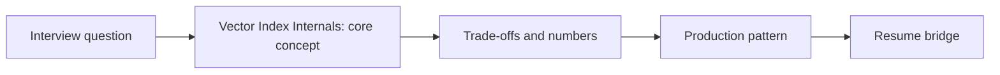

# Session 05: Vector Index Internals: HNSW, IVF-PQ, Quantization & Filtered Search

> **Status: SKELETON** (content to be written; follow `CONTENT_GUIDELINES.md`)
> - **Phase 1: Foundational Building Blocks** | **Week 3** | **Priority:** core | **Session type:** existing (upgraded scope)
> - **Module:** Module 2: RAG, Search & Multimodal
> - **Resume anchor:** Deloitte Asset Discovery Chatbot (ChromaDB)

---

## Part 1: Quick Summary

> TODO (3-4 bullets): what this is in plain English, why interviewers care, the 10-second mental model.

## Part 2: Topics to Cover (Study Checklist)

- [ ] HNSW (M, efConstruction, efSearch) memory + recall math
- [ ] IVF / IVF-PQ and when to prefer disk-based indexes
- [ ] Scalar / product / binary quantization and recall impact
- [ ] Filtered (metadata) search: pre- vs post-filter and its recall traps
- [ ] Sharding and replication of 100M+ vectors; hot/cold tiers
- [ ] Vendor-neutral map: pgvector, Qdrant, Milvus, Pinecone, Vespa, Elasticsearch, Vertex Vector Search

## Part 3: First Principles & Analogies

TODO: one everyday analogy per concept above, plus a concrete failure scenario.

## Part 4: Concept Blueprint

TODO: replace with the real architecture / decision-tree diagram.

## Part 5: Trade-Off Decision Matrix

| Option / Pattern | Latency | Cost | Complexity | When to Pick / Watch Out For |
| :--- | :--- | :--- | :--- | :--- |
| TODO option A | TODO | TODO | TODO | TODO |
| TODO option B | TODO | TODO | TODO | TODO |
| TODO option C | TODO | TODO | TODO | TODO |

## Part 6: Deep-Dive Mechanics & Numbers

TODO: the math, edge cases and "tricks" that separate a senior answer from a mid-level one.

## Part 7: Production AI & Resume Tie-In

TODO: how this applies to production AI systems and to **Deloitte Asset Discovery Chatbot (ChromaDB)**; include a short annotated code or design snippet.

## Part 8: Interview Questions (Answered Simply)

TODO: 4-6 questions, each with **What they are really testing** and **How to answer simply** (spoken-English blockquote).

## Canonical Problems Unlocked

- [enterprise-rag](/problems?id=enterprise-rag)
- [llm-search-recsys](/problems?id=llm-search-recsys)

## Deliverable (Do This Before Moving On)

- [ ] Sizing sheet: RAM/disk/cost for 100M x 1536-d with and without quantization.

## Socratic Study Prompt

> *"Explain HNSW vs. IVF indexing and Product Quantization (PQ) in simple terms. Help me calculate the RAM required to store 50 million embeddings (1536 dimensions) and explain when I must migrate away from single-node ChromaDB to Vertex AI Vector Search or Qdrant."*
