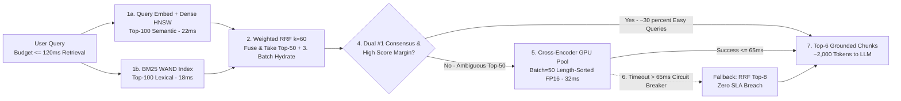

# Session 06: Hybrid Retrieval & Two-Stage Reranking — BM25 + Dense, RRF & Cross-Encoders

> **Prerequisites & Plain-English Summary**
>
> - **Prerequisites:**
>   - **Bi-Encoder Embeddings (`session-24`):** Compressing a whole passage into one vector captures broad synonyms (`"automobile"` ≈ `"car"`), but blurs exact alphanumeric strings (`"ERR_SSL_9042"`, `"RELIANCE.NS"`).
>   - **Vector Index Internals (`session-05`):** An `ANN` index retrieves `100–200` rough semantic candidates from `100M` chunks in `<10 ms`.
>   - **Context Window & Prefill Economics (`session-21`):** Feeding `100` noisy chunks to an LLM explodes `TTFT` and dilutes reasoning—you want only the `5–10` sharpest chunks in the final prompt.
> - **Plain-English Core:** Production search combines a fast keyword hunter and a fast meaning hunter in parallel to cast a wide net of ~100 candidates, merges their rankings fairly without fragile math, and runs a focused deep-reader model over just those 100 candidates to hand the LLM the top 5–8 exact answers inside 100 milliseconds.

---

## 1. Build It From Zero (Basics + Socratic Walkthrough)

### What Are We Actually Building, and Why Is It Hard?
Suppose you launch a pure vector-search RAG assistant for financial analysts and engineers. On broad conceptual questions (*"How does inflation affect bank net interest margins?"*), users love it. Ten minutes later, an analyst types:
> *"Show SEBI LODR Regulation 30 penalty order for ticker `TATAMOTORS.NS` clause `4(b)`."*

Vector search returns five generic essays about *"Indian stock exchange governance regulations"* and completely misses the exact document sitting right in your database! Meanwhile, if you switch back to old-fashioned keyword search, it nails `TATAMOTORS.NS`, **but** returns zero results when a user asks *"EV maker compliance fine"* because the document wrote *"electric vehicle manufacturer regulatory penalty"*!

### The Socratic Ladder: Discovering Two-Stage Hybrid Retrieval

**🤔 Question 1: Keyword search catches exact IDs (`TATAMOTORS.NS`), while vector search catches synonyms (`EV maker` ↔ `electric vehicle`). Why choose one—why not run BOTH at the exact same millisecond?**
Both take `<15 ms`! Run keyword search (top `100`) and vector search (top `100`) concurrently in parallel. Now any document matching either the exact ticker *or* the conceptual paraphrase lands in your `~150–200` candidate pool!

**🤔 Question 2: Wait—how do you combine their scores? Keyword search gave Document A a score of `38.4` (unbounded `0..∞`), while vector cosine similarity gave Document B `0.83` (`-1..+1`). If you add `38.4 + 0.83`, keyword scores crush vector scores every single time!**
What if you try scaling both to `0..1` using `(score - min) / (max - min)`? Then one freak exact-match document scoring `95.0` squashes every other keyword result down near `0.1`! Instead of trusting raw scores from incompatible rulers, trust **ordinal ranks** (`#1, #2, #3...`): give `#1` on either list `1 / (60 + 1)` points, `#2` `1 / (60 + 2)` points, and sum points for any document appearing on **both** lists!
→ Zero score calibration needed, outlier-proof, and documents endorsed by *both* keyword and vector search naturally float to the top!

**🤔 Question 3: Now we have a fused list of `100` candidates, and the right answer is in there `96%` of the time (`Recall@100 = 96%`)—say at position `#14` and `#27`. Why not just stuff all `100` chunks (`40,000 tokens`) into the LLM?**
At `40,000` input tokens per query, your LLM cost jumps **`10×`**, prefill `TTFT` stretches past **`2.5 seconds`**, and LLMs suffer **"Lost in the Middle"**—distracted by `92` plausible-sounding wrong chunks! We need to promote `#14` and `#27` into `#1` and `#2` so we only send the **top `5–8` chunks (`~2,500 tokens`)** to the LLM.

**🤔 Question 4: Why couldn't the vector embedder rank `#14` at `#1` in the first place—and what stronger model *can* do it fast enough for just `50–100` candidates?**
Because the vector embedder compressed the `250-word` document into one single `768`-number summary **months ago without ever seeing today's question**! Now that we only have `50` candidates left (not `100,000,000`!), we can afford to paste `[Question + Candidate Chunk]` side-by-side into a compact `300M`-parameter transformer so **every word of the question compares directly against every word of the chunk** in one `30 ms` GPU batch!

**🤔 Question 5: What if a user types a super-obvious exact query where Candidate #1 won *both* `#1` in keyword search AND `#1` in vector search (`0.94` cosine, `0.25` ahead of `#2`)? Should we still burn `35 ms` of GPU reranking?**
No! When rank-1 agreement and score margin are overwhelming, skip the reranker (`early exit`) and jump straight to generation—saving GPU compute on `25–40%` of easy traffic!

### Naming What You Just Invented
1. Running lexical inverted-index **`BM25`** + **`Dense ANN`** in parallel is **Stage-1 Hybrid Retrieval**.
2. Merging ranked lists via `Σ 1 / (k + rank_i(d))` (`k = 60`) is **Reciprocal Rank Fusion (`RRF`)**.
3. Scoring `[CLS] query [SEP] doc [SEP]` jointly across top-`50..100` candidates is **Stage-2 Cross-Encoder Reranking**.
4. Measuring Stage 1 by **`Recall@100`** and Stage 2 by **`nDCG@10` / `MRR@5`** under a strict millisecond waterfall is **Two-Stage Retrieval Engineering**.

### Explain It in Layers
- **One Line (Explain to a 12-Year-Old):** Use both an exact word-finder and an idea-finder to grab 100 promising pages in a blink, combine their top votes fairly, then have a fast speed-reader inspect just those 100 pages to hand the AI the 5 best ones.
- **One Paragraph (Explain to a Non-Backend Engineer):** Vector search understands synonyms ("layoff" = "workforce reduction") while BM25 keyword search nails exact part numbers, tickers, and names (`RELIANCE.NS`). Running both in parallel and merging their rankings with Reciprocal Rank Fusion (`RRF`) guarantees high recall across all query types without messy score normalization. Because feeding 100 chunks to an LLM is slow and noisy, a second stage feeds the top 50 candidates paired with the question into a compact Cross-Encoder reranker on a GPU (~30ms), promoting the truly relevant 5–8 chunks to the top.
- **Engineer Version:** Production retrieval separates **Stage-1 Candidate Generation** (optimizing `Recall@100` in `O(log N)` via parallel **BM25 WAND/Block-Max inverted lists** + **Dense HNSW**, fused parameter-free via **weighted Reciprocal Rank Fusion** `RRF_k=60`) from **Stage-2 Precision Reranking** (optimizing `nDCG@10` / `MRR` in `O(K)` via a distilled **Cross-Encoder** like `bge-reranker-v2-m3` or late-interaction `ColBERT` batched on GPU in `25–45 ms`), governed by explicit latency budgets, micro-batching, score-margin early exits, and circuit-breaker fallback to raw `RRF` order on reranker overload.

---

## 2. First Principles, Analogies, Interview Framing & Capacity Math

> **Why Interviewers Care & The 10-Second Mental Model**
>
> - **Why Interviewers Care:** Two-stage hybrid retrieval is the single highest-ROI pattern in enterprise RAG—almost every interviewer asks *"Why not dense vectors alone?"*, *"How do you fuse BM25 and Cosine?"*, and *"How can you afford a Cross-Encoder under a 1.5s latency budget?"*
> - **The 10-Second Mental Model:** **"Stage 1 optimizes `Recall@100` (`BM25` for exact tokens + `Dense` for semantics, fused via calibration-free `RRF` `1/(60+rank)`). Stage 2 optimizes `nDCG@10` (batch `top-50` through a distilled `Cross-Encoder` in `~30ms` down to `top-5..8` for the LLM). If the reranker times out, degrade gracefully to `RRF top-8`."**

### 1. BM25 Internals vs. Dense vs. Learned Sparse — "Serial-Number Scanner vs. Sketch Artist"
- **Why `BM25` Beats Naive `TF-IDF`:** Classic `TF-IDF` grows linearly if a word repeats `50` times in a spammy footer. **Okapi BM25** adds two crucial fixes over query terms `q_i`:
  1. **Inverse Document Frequency (`IDF`):** Rare tokens (`"RELIANCE.NS"`, `"CVE-2026-1184"`) get `10×` the weight of common words (`"report"`, `"system"`).
  2. **Term-Frequency Saturation (`k_1 ≈ 1.2`) & Document Length Normalization (`b ≈ 0.75`):** Seeing `"refund"` `3` times helps much more than `1` time, but `30` times saturates asymptotically (`tf / (tf + k_1 · (1 - b + b · dl/avgdl))`), and short focused chunks aren't penalized against 2,000-word essays!
  3. **Sub-10ms Speed (`Block-Max WAND`):** Inverted postings store upper-bound block scores so Lucene/Tantivy skips `95%+` of postings lists without even scoring them!
- **Where `SPLADE` / `BGE-M3 Sparse` Fits:** Learned sparse models predict BM25-like integer weights over the vocabulary *including synonyms not literally written in the chunk* (`"heart attack" -> myocardial: 1.8, infarction: 1.6`), running inside the exact same WAND inverted index at slightly higher ingest/query encode cost (`~4ms`).

### 2. Reciprocal Rank Fusion (`RRF`) — "Olympic Decathlon Rank Points"
- **The Formula:**
  $$\text{RRF}(d) = \sum_{m \in \{\text{BM25}, \text{Dense}\}} \frac{w_m}{k + \text{rank}_m(d)} \quad (\text{standard } k = 60, \; w_m = 1.0)$$
- **Concrete Numerical Walkthrough (`k = 60`):**
  - **Chunk X** ranks `#2` in BM25 (`1 / 62 = 0.01613`) and `#3` in Dense (`1 / 63 = 0.01587`) → **`RRF = 0.03200` (Winner — consensus!)**.
  - **Chunk Y** ranks `#1` in BM25 (`1 / 61 = 0.01639`) and misses Dense completely (`0`) → **`RRF = 0.01639`**.
  - **Why `k = 60`?** If `k = 0`, rank `#1` (`1.0`) gets **`10×`** the score of rank `#10` (`0.1`), letting a single noisy rank-1 outlier override strong `#3 + #3` consensus (`0.33 + 0.33 = 0.66 < 1.0`)! Smoothing with `k = 60` dampens top-rank spikes so dual-retriever agreement wins reliably, while optionally tuning `w_bm25 = 1.2, w_dense = 1.0` for code/ticker-heavy corpora.

### 3. Cross-Encoder vs. LLM Rerankers & Distillation Math
- **Cross-Encoder (`bge-reranker-v2-m3`, `Cohere Rerank 3.5`, `Jina-Reranker-v2`):**
  - Input: `50` pairs of `(query [30 tok] + chunk [250 tok]) = 50 × 280 tokens`.
  - On **1 NVIDIA `L4` (`24 GB`) GPU in `FP16` TensorRT/ONNX**, all `50` pairs fit in **one single forward pass (`batch = 50`, zero autoregressive decode!)**, completing in **`~22–38 ms`**!
  - Capacity: `1 L4 GPU` handles `~25–35` `50-candidate` rerank queries/sec (`~1,500 pairs/sec`) for **`~$0.60/hr` (`~$430/mo`)**!
- **Listwise LLM Rerankers (`RankGPT` / `Flash` sliding window `[1..20]`):**
  - Strong zero-shot reasoning on complex instruction queries (*"Find studies excluding pediatric patients conducted after 2022"*), **but** adds **`350–900 ms`** and **`15,000` tokens** per query!
  - **Production Pattern — Distill Listwise LLM into a Cross-Encoder:** Run a frontier LLM (`Gemini Pro` / `GPT-4o`) offline over `50,000` domain `(query, 20 candidates)` sets to generate soft KL-divergence teacher rankings, and distill into a `110M–300M` Cross-Encoder—getting `95%+` of LLM reranker quality inside `28 ms`!

### 4. Retrieval Metrics (`Recall@K`, `MRR`, `nDCG@K`) & Building a Golden Set
- **`Recall@K` (Stage-1 Metric, `K = 50..100`):** `|Relevant ∩ TopK| / |Relevant|`. *"Did the needle make it into the haystack shortlist at all?"* If `Recall@100` is `78%`, **no reranker on Earth can push system accuracy past `78%`**—fix chunking (`S23`), embeddings (`S24`), or query rewriting (`S25`)!
- **`MRR@K` (Mean Reciprocal Rank):** Average of `1 / rank_of_first_relevant_doc`. Best when **1 single answer fact** suffices (*"What is our VPN port?"*).
- **`nDCG@K` (Normalized Discounted Cumulative Gain, Stage-2 Metric, `K = 5..10`):** Supports **graded relevance (`0 = irrelevant, 1 = partial, 2 = exact answer, 3 = authoritative primary source`)** and discounts lower ranks logarithmically (`(2^{rel_i} - 1) / log_2(i + 1)`). **Gold standard for tuning rerankers!**
- **How to Bootstrap a `300-Query` Labelled Retrieval Set in 1 Afternoon:**
  1. Sample `150` real anonymized user logs + synthesize `150` adversarial queries (exact tickers, acronyms, multi-clause questions) from random chunks.
  2. Pool top-`20` results from `BM25`, `Dense`, and `Hybrid` (`~35` unique chunks/query) and grade each `(query, chunk)` `0..3` with a strong LLM judge + `20%` human spot-audit (`Cohen's κ > 0.80`).

### Timestamped Story ("Alice & Bob"): How `1.5 Seconds` Vanished Before Token #1
- `11:02:00.000 AM` — **Alice** asks a `100M`-document enterprise answer engine a technical question under a strict **`1,500 ms` `P95 TTFT` budget**.
- `11:02:00.005 AM` — **Naive Sequential Pipeline (Bob's v1):** Embed query via external HTTP (`65 ms`) → Dense search (`40 ms`) → BM25 search *sequentially after* (`35 ms`) → Fetch `200` unbatched chunks from Postgres one-by-one (`180 ms`) → Call an LLM listwise reranker on `100` chunks (`1,420 ms`!) → **Already at `1,740 ms` before synthesis even starts** (`total TTFT = 2,650 ms` — SLA breached!).
- **Optimized Two-Stage Waterfall (`840 ms` P95 TTFT — Well Under `1,500 ms`!):**
  - `0–18 ms` (`18 ms`): AuthZ + Query Embed (in-VPC L4 GPU `5 ms`) + BM25 tokenization.
  - `18–58 ms` (`40 ms`): **Parallel `asyncio.gather`** (`BM25 top-100` + `Dense INT8 HNSW top-100`) + `RRF(k=60)` merge (`<0.5 ms`) + single pipelined `MGET` of top-`50` chunk texts (`4 ms`).
  - `58–96 ms` (`38 ms`): **TensorRT FP16 Cross-Encoder** scores `batch = 50` on L4 GPU (with `60 ms` hard timeout circuit breaker!).
  - `96–840 ms` (`744 ms`): Top-`6` chunks (`2,100` tokens, down from `15,000`!) enter LLM prefill with prefix-cached system instructions → **First Token streams at `840 ms`!**

### Functional & Non-Functional Requirements + Per-Stage Latency & Cost Budget (`100M` Corpus, `200` Peak QPS)
- **End-to-End `P95 TTFT` Target:** **`<= 1,200 ms`** (`Retrieval + Rerank budget <= 120 ms`, leaving `~1,000 ms` for LLM prefill + network).
- **Cluster Sizing & Cost at `200` Peak QPS (`~7M` queries/day):**
  - **BM25 (`OpenSearch` / `Tantivy`):** `100M` chunks (`~120 GB` inverted index) across `4` shards × `2` replicas (`8 × 32GB` CPU nodes) ≈ **`$1,100/mo`** (`P95 = 18 ms`).
  - **Dense `INT8` HNSW (`768d`):** `~150 GB` RAM/copy × `2` replicas ≈ **`$1,400/mo`** (`P95 = 22 ms` in parallel with BM25!).
  - **Cross-Encoder Reranker (`bge-reranker-v2-m3` FP16 on `L4` GPUs):** `200 QPS ÷ 28 QPS/GPU × 1.3 headroom = 10 L4 GPUs` (dropped to **`7 L4 GPUs ≈ $3,000/mo`** once `30%` score-margin early exit + query caching kick in!).
  - **Net LLM Savings Pay for the Reranker `5×` Over:** Trimming prompt context from `top-25` (`~8,000` tokens) down to reranked `top-6` (`~2,000` tokens) saves `6,000 input tokens × 7M queries/day = 42 Billion tokens/day` → at `$0.50/1M` tokens, that saves **`~$21,000/day` (`~$630,000/mo`)** in LLM prefill bills while *raising* answer accuracy!

---

## 3. Visual Architecture Blueprint

Follow `1 → 7` below to see the complete **Two-Stage Hybrid Retrieval + Reranking Waterfall** with score-margin early exit and timeout fallback:

1. **Step 1 (Parallel Fan-Out):** Query enters both **Query Embedder + Filtered HNSW** (`top-100` semantic) and **BM25 Analyzer + WAND Inverted Index** (`top-100` exact lexical) simultaneously via `asyncio.gather`.
2. **Step 2 (Weighted `RRF` Fusion):** Combines both ranked lists (`k = 60`), deduplicates `chunk_id`s (`~130–170` unique candidates), and takes the **top `50`** (`Recall@50 ≈ 95%+`).
3. **Step 3 (Pipelined Text Hydration):** Fetches chunk texts in a single batched `MGET` / SSD array read (`<5 ms`).
4. **Step 4 (Confidence Margin Early Exit):** If Rank `#1` appeared in top-2 of *both* BM25 and Dense AND `RRF(#1) - RRF(#2)` exceeds calibrated high-confidence threshold, bypass GPU reranking (`saves ~35ms` on easy queries!).
5. **Step 5 (Micro-Batched Cross-Encoder Rerank):** Scores `50` `[query, chunk]` pairs in one FP16 GPU pass (`~32 ms`, sequence-length sorted to minimize padding!).
6. **Step 6 (Timeout Circuit Breaker):** Hard `65 ms` deadline on Step 5—if GPU queue spikes, immediately fall back to `RRF top-8` so user `TTFT` never stalls.
7. **Step 7 (Parent/Context Assembly):** Passes reranked **top `6` chunks** (above minimum relevance score floor so irrelevant noise is dropped!) to the LLM Context Builder (`Session 26`).



---

## 4. Side-by-Side Comparison & Trade-Off Table

| Retrieval / Rerank Component | Latency (`P95`) | Strengths | Blind Spots | When to Pick / Winner | Watch Out For (The Trap) |
| :--- | :--- | :--- | :--- | :--- | :--- |
| **BM25 Lexical Only** | `5–18 ms` | Exact tickers, SKUs, error codes, zero GPU cost, zero OOD drift | Fails `100%` on zero-overlap synonyms (`"car" != "automobile"`) | Logs, exact SKU lookup, or Stage-1 half of Hybrid. | Aggressive stemming (`"operating" -> "oper"`) can conflate domain terms; keep an unstemmed exact boost field! |
| **Dense Bi-Encoder Only** | `10–30 ms` | Cross-lingual + paraphrase recall | Smooths over negations (`"not covered"`), numbers, rare acronyms | Conceptual similarity, clustering, recommendation recall. | Never trust raw cosine `< 0.75` as calibrated probability—anisotropic encoders cluster unrelated text at `0.68–0.74`! |
| **Hybrid (`BM25 + Dense`) + `RRF`** | `20–30 ms` *(parallel)* | **Best Stage-1 `Recall@100`** across both exact & semantic queries | Top-5 ordering still imperfect without cross-attention | **Mandatory Stage-1 baseline for virtually all production RAG.** | Summing raw `BM25 + Cosine` instead of `RRF` lets unbounded BM25 scores (`42.0`) drown out Dense (`0.84`). |
| **Distilled Cross-Encoder (`110M–560M`)** | `25–45 ms` (`top-50` on GPU) | Full token-by-token query-doc interaction (`+8–15% nDCG@10`), catches negations | Linear `O(K)` GPU cost per candidate | **Default Stage-2 precision winner (`top-50 -> top-6`).** | Padding all `50` pairs to `512` tokens when `45` pairs are `180` tokens wastes `2.5×` GPU compute—sort pairs by length! |
| **ColBERT Late Interaction Rerank** | `10–20 ms` | Precomputed token vectors = `3×` faster than Cross-Encoder at `K=200` | Storing/fetching multi-vectors for candidates | **Stage-1.5 / ultra-low-latency (`<50ms` total) search.** | Higher storage overhead if persisted across all `100M` chunks rather than computed/cached selectively. |
| **LLM Listwise Reranker** | `350–900 ms` | Complex temporal/logical constraint reasoning | Too slow & expensive for high-QPS live hot paths | **Offline teacher labeler to distill your Cross-Encoder**, or low-QPS deep research agents. | Prompt-injection inside a candidate chunk can hijack an unhardened LLM reranker into ranking itself `#1`! |

---

## 5. Deep-Dive Mechanics & Production Failure Analysis

### Under-the-Hood Tricks (What Separates Junior from Senior Answers)

1. **Sequence-Length Sorting Inside the `50`-Pair Cross-Encoder Call Cuts GPU Latency by `40–55%`:**
   - Inside a single query's `50` candidate chunks, lengths vary from `60` tokens (a short FAQ bullet) to `480` tokens (a dense legal clause). If you run `1` single `[50, 480]` tensor batch, all `49` shorter chunks get zero-padded to `480`! Sorting the `50` candidates by token length and splitting into **`2` micro-batches (`[35 × 192]` + `[15 × 480]`)** cuts self-attention FLOPs more than `2×` on the exact same GPU!
2. **Apply a Calibrated Cross-Encoder Relevance Floor (Dynamic `K`, Not Fixed `K = 8`!):**
   - If only `2` chunks actually answer the user's question (`logit > +1.5`, sigmoid `> 0.82`) and chunks `#3..#8` score `-4.2` (irrelevant noise), blindly passing fixed `top_k = 8` forces the LLM to wade through `6` distractors! Pass **`1 <= k <= 8` chunks exceeding your calibrated relevance threshold** (and if **`0` chunks** clear a lower floor `-2.0`, trigger corrective query rewrite or clean `"I couldn't find verified internal sources"` abstention!).
3. **Stop-Word & Query-Term Explosion Guard in BM25:**
   - Conversational RAG users paste `120-word` error stack traces or paragraphs into the search box. Standard OR-mode BM25 over `120` query terms scans massive postings lists (`P99` spikes from `12ms` to `450ms`!). Use **`minimum_should_match` (`e.g., 60%` of high-IDF terms)** + Block-Max WAND pruning + stripping low-IDF conversational boilerplate (`"Can you please tell me..."`) before hitting BM25.

### Failure Modes in Production

#### Failure Mode 1: Unbounded Cross-Encoder Queue Saturation Cascades Into Full Outage
- **How It Happens at 2 AM:**
  1. Marketing sends an all-hands announcement, spiking search traffic `4×` from `150 QPS` to `600 QPS`.
  2. BM25 and HNSW absorb `600 QPS` easily (`18 ms`), **but** the `6`-GPU Cross-Encoder pool maxes out at `200 QPS`. Without bounded queues and circuit breakers, reranker queue wait climbs to `4s -> 12s -> client timeout`, failing `100%` of chat requests even though Stage-1 search already found good answers!
- **How to Detect It in Metrics:**
  - `reranker_queue_wait_ms` and `triton_pending_request_count` climbing vertically while `stage1_hybrid_latency_ms` stays flat at `20 ms`.
- **Exact Mitigation:**
  1. **Fail-Open Degradation to `RRF`:** Wrap the Cross-Encoder call in a strict **`65 ms` timeout + concurrency bulkhead**. Any shed or timed-out request immediately returns `RRF top-6` (`nDCG@6` drops slightly from `0.89` to `0.81`, while availability stays **`100%`** and latency stays **`<90 ms`**!).
  2. Autoscale reranker GPU pods on **in-flight queue depth**, not GPU memory (`weights are static!`).

#### Failure Mode 2: Cross-Encoder Tokenizer Truncation (`512` Limit) Clips Long Parent Chunks
- **How It Happens at 2 AM:**
  1. Team pairs Parent-Child retrieval (`1,200-token` parents) with a `512`-max-token Cross-Encoder (`MiniLM-L-6` / older `bge-reranker-base`) and passes `[query (80 tok) + full_parent (1,200 tok)]` into the reranker!
  2. HuggingFace silently truncates at `512` tokens—so if the matching sentence came from `child_chunk #4` at token `950` of the parent, **the Cross-Encoder never even sees the matching sentence**, scores the parent `-6.1`, and demotes the exact right answer to `#50`!
- **How to Detect It in Metrics:**
  - Offline eval shows `Stage-2 Recall@10 < Stage-1 Recall@10` (**reranker actively hurting recall!**) on long documents, paired with `reranker_input_truncated_ratio > 0`.
- **Exact Mitigation:**
  1. **Rerank the matched `Child` chunks (`<= 256` tokens) FIRST** (or max-pool sliding `256`-token windows per parent), deduplicate `parent_id`s using `max(child_rerank_score)`, and **hydrate the full `1,200-token` `Parent` text *after* reranking** right before building the LLM prompt! (Or use an `8,192`-context reranker like `bge-reranker-v2-m3`.)

---

## 6. Production AI & Resume Tie-In

### 1. Network18 Sales Intelligence RAG & Financial News Pipeline (Tickers + Semantic Fusion)
- **The Challenge:** Media sales teams and financial analysts queried a mixed corpus of scraped market news and quarterly advertiser PDFs where queries routinely combined **exact non-negotiable lexical anchors** (`RELIANCE.NS`, `SEBI LODR Reg 30`, `Q3FY25`, `BARC Week 42`) with **semantic intent** (*"headwinds in rural FMCG ad spend"*). Pure dense embeddings blurred tickers across sector peers.
- **How You Engineered It:**
  1. **Parallel Hybrid + `RRF (k=60)`:** Executed `BM25` (with unstemmed exact-match field boost on ticker/entity tags extracted by your `86.4% F1` Transformer NER!) alongside `Dense` vector retrieval, fused via `RRF` with zero brittle score-weight tuning.
  2. **Batched Cross-Encoder Precision:** Reranked `top-50` fused candidates through `bge-reranker-v2-m3` (`FP16` on L4 GPU in `~30–35 ms`) down to the `top-5` grounded passages—preventing sibling-company hallucinations while keeping total retrieval + rerank latency comfortably inside `80 ms`.

### Production Code: Async Parallel Hybrid Retriever, Weighted RRF, Early Exit & Fallback Reranker (Python)

A complete, runnable production orchestrator implementing parallel `BM25 + Dense` execution, weighted `RRF`, high-margin early exit, length-sorted Cross-Encoder batching, relevance floor filtering, and `65 ms` fail-open circuit breaking:

```python
import asyncio, math
from dataclasses import dataclass

@dataclass
class ScoredChunk:
    chunk_id: str
    text: str
    score: float
    source: str

def reciprocal_rank_fusion(
    bm25_ids: list[str], dense_ids: list[str], k: int = 60, w_bm25: float = 1.0, w_dense: float = 1.0
) -> list[tuple[str, float]]:
    """Calibration-free rank fusion over incompatible BM25 (0..inf) and Cosine (-1..1) scales."""
    fused: dict[str, float] = {}
    for rank, cid in enumerate(bm25_ids, start=1):
        fused[cid] = fused.get(cid, 0.0) + w_bm25 / (k + rank)
    for rank, cid in enumerate(dense_ids, start=1):
        fused[cid] = fused.get(cid, 0.0) + w_dense / (k + rank)
    return sorted(fused.items(), key=lambda kv: kv[1], reverse=True)

async def two_stage_hybrid_retrieve(
    query: str, acl_groups: list[str], bm25_client, vector_client, chunk_store, cross_encoder,
    stage1_k: int = 100, rerank_pool: int = 50, final_k: int = 6, rerank_timeout_s: float = 0.065,
    min_ce_prob: float = 0.15,
) -> list[ScoredChunk]:
    # 1. Stage-1 Recall: run BM25 and Dense ANN concurrently so latency = max(t_bm25, t_dense), not sum!
    bm25_hits, dense_hits = await asyncio.gather(
        bm25_client.search(query, acl_groups=acl_groups, top_k=stage1_k),
        vector_client.search(query, acl_groups=acl_groups, top_k=stage1_k),
    )
    fused = reciprocal_rank_fusion(
        [h.id for h in bm25_hits], [h.id for h in dense_hits], k=60, w_bm25=1.1, w_dense=1.0
    )[:rerank_pool]
    if not fused:
        return []

    cand_ids = [cid for cid, _ in fused]
    texts_map: dict[str, str] = await chunk_store.mget_texts(cand_ids)  # Single batched MGET (<5ms)

    # 2. Early-Exit Optimization: if #1 tops BOTH BM25 and Dense with strong RRF margin, skip GPU rerank!
    both_rank1 = bool(bm25_hits and dense_hits and bm25_hits[0].id == dense_hits[0].id == fused[0][0])
    margin = fused[0][1] - (fused[1][1] if len(fused) > 1 else 0.0)
    if both_rank1 and margin >= 0.004:
        return [ScoredChunk(cid, texts_map[cid], sc, "rrf_early_exit") for cid, sc in fused[:final_k]]

    # 3. Stage-2 Precision: sort pairs by length to cut padding FLOPs, enforce 65ms fail-open timeout!
    ordered_ids = sorted(cand_ids, key=lambda cid: len(texts_map.get(cid, "")))
    pairs = [(query, texts_map[cid]) for cid in ordered_ids]
    try:
        # Micro-batch into 2 length buckets (short 35 + long 15) concurrently on TensorRT/ONNX GPU
        split = max(1, int(len(pairs) * 0.7))
        logits_short, logits_long = await asyncio.wait_for(
            asyncio.gather(cross_encoder.score_batch(pairs[:split]), cross_encoder.score_batch(pairs[split:])),
            timeout=rerank_timeout_s,
        )
        all_logits = list(logits_short) + list(logits_long)
        reranked = []
        for cid, logit in zip(ordered_ids, all_logits):
            prob = 1.0 / (1.0 + math.exp(-logit))
            if prob >= min_ce_prob:  # Drop irrelevant tail chunks instead of stuffing fixed K noise!
                reranked.append(ScoredChunk(cid, texts_map[cid], prob, "cross_encoder"))
        reranked.sort(key=lambda x: x.score, reverse=True)
        return reranked[:final_k]
    except asyncio.TimeoutError:
        # 4. Graceful Degradation: never fail the user turn when GPU reranker saturates—serve RRF top-K!
        return [ScoredChunk(cid, texts_map[cid], sc, "rrf_fallback") for cid, sc in fused[:final_k]]
```

---

## 7. Common Interview Questions, Follow-Up Probes & Quick Recall

### Q1: "Design a retrieval + reranking pipeline for 100M documents under a 1.5s TTFT budget. Walk through your exact millisecond and GPU budget."
- **What the interviewer is testing:** Ability to decompose an end-to-end latency budget across network, Stage-1 parallel search, hydration, batched GPU reranking, and LLM prefill.
- **How to answer simply:**
  > "With a 1,500ms P95 TTFT budget, LLM prefill on ~2,500 tokens plus gateway overhead already consumes ~850–1,000ms, so **total retrieval + reranking must finish inside ~100–120ms**.
  > Here's my waterfall: `0–15ms` for auth + in-VPC query embedding; `15–45ms` (`30ms` wall-clock) running **BM25 WAND (`top-100`) and INT8 Filtered HNSW (`top-100`) in parallel**, followed by `RRF(k=60)` fusion and a single batched `MGET` (`5ms`) for the top-50 candidate texts.
  > Next, `50–85ms` (`35ms`) runs a `300M`-parameter FP16 ONNX Cross-Encoder (`bge-reranker-v2-m3`) over those 50 pairs on an L4 GPU—sorted into two length buckets so short chunks aren't padded to 512 tokens, and wrapped in a hard `65ms` timeout that fails open to `RRF top-6`. Finally, we pass only the top 5–6 chunks clearing our relevance threshold (`~2,000 tokens`) into LLM prefill—hitting first token around `900ms` P95."
- **Likely Follow-Up Probe ("The Double-Click"):**
  - *Interviewer:* "Why rerank top-50 instead of reranking top-500 for even better recall?"
  - *Your Answer:* "Cross-Encoder cost and latency scale linearly `O(K)`: `top-500` takes `10×` the GPU fleet and ~250ms latency, whereas in empirical `Recall@K` curves `Hybrid RRF` already captures ~95% of reachable positives inside `top-50–75`. If `Recall@50` is weak, fixing Stage-1 query rewriting or chunk headers beats brute-forcing `K=500` on the reranker."

### Q2: "Why use Reciprocal Rank Fusion (`RRF`) instead of a weighted linear combination `α · dense_score + (1 - α) · bm25_score`?"
- **What the interviewer is testing:** Practical experience with score distribution pathologies across heterogeneous retrievers.
- **How to answer simply:**
  > "BM25 scores are unbounded `[0, ∞)` and shift wildly with query length—a 2-word query peaks around `9.0` while a 9-word query peaks at `48.0`! Meanwhile, bi-encoder cosine scores cluster tightly inside `[0.68, 0.88]`. Even if you min-max normalize per query, a single exact-match boilerplate title scoring `60.0` crushes valid runner-up BM25 hits down to `0.15`.
  > `RRF` (`Σ 1 / (60 + rank)`) converts both lists to bounded, outlier-immune ordinal evidence with **zero per-corpus score calibration**, and naturally boosts consensus hits appearing near the top of both lists. Once we have a labelled domain golden set, we can tune retrieval weights `(w_bm25, w_dense)` inside RRF safely without distribution explosions."
- **Likely Follow-Up Probe ("The Double-Click"):**
  - *Interviewer:* "Is there *any* situation where `RRF` loses information that raw scores had?"
  - *Your Answer:* "Yes—`RRF` discards *confidence gaps*: whether Rank #1 beat Rank #2 by `0.95 vs 0.62` (huge certainty) or `0.741 vs 0.740` (a coin flip), `RRF` assigns the exact same `1/61` vs `1/62` gap! That's why our Stage-2 Cross-Encoder re-reads the actual text and outputs calibrated logits before we decide how many chunks to pass to the LLM."

### Q3: "Why can't a Cross-Encoder just replace the Vector DB directly—and how do you shrink Cross-Encoder cost 5× at 2,000 QPS?"
- **What the interviewer is testing:** Architectural clarity on bi-encoder factorizability (`E(q) · E(d)`) vs. joint cross-attention (`CE(q, d)`), plus production cost levers.
- **How to answer simply:**
  > "A Bi-Encoder computes `E(d)` offline without knowing the query, reducing search to `O(log N)` dot products. A Cross-Encoder runs full self-attention jointly across `[query + doc]` at every transformer layer—you cannot precompute `d` independently of `q`, so running it across 100M chunks per query would require 100 million forward passes (~20 GPU-hours per single search!).
  > At 2,000 QPS, I cut Cross-Encoder GPU spend 5× with four levers: (1) distill a `560M` reranker down to a `6-layer 110M` INT8/FP16 TensorRT model; (2) sequence-length bucket the 50 pairs (`2×` speedup); (3) **score-margin early exit** skipping rerank on the ~30% of unambiguous exact queries; and (4) cache `(normalized_query_hash, acl_scope) -> reranked_ids` in Redis for 5 minutes."
- **Likely Follow-Up Probe ("The Double-Click"):**
  - *Interviewer:* "After deploying your Cross-Encoder, answers on long legal sections actually got *worse*. What bug do you check first?"
  - *Your Answer:* "Tokenizer truncation! If we passed 1,200-token parent chunks into a 512-token Cross-Encoder, anything past token 450 was silently sliced off. Always rerank the matched `<=256`-token child spans (or max-pool sliding windows) first, and expand to parent chunks *after* reranking."

### Q4: "How do you measure Stage 1 separately from Stage 2 so your team stops arguing over whether embeddings or the reranker broke?"
- **What the interviewer is testing:** Clean diagnostic separation of retrieval funnel metrics.
- **How to answer simply:**
  > "Every stage owns one metric on our 300-query graded golden set:
  > - **Stage 1 (`BM25`, `Dense`, `Fused RRF`) owns `Recall@50`:** Is the gold answer chunk present anywhere inside the 50 candidates handed to Stage 2? If `Recall@50` is `79%`, tuning the reranker is pointless—we fix chunk headers, query rewriting, or embeddings.
  > - **Stage 2 (`Cross-Encoder`) owns `nDCG@6` and `Recall@6 ÷ Recall@50` (Promotion Efficiency):** Given that the gold chunk *was* inside the top-50, how reliably did the reranker promote it into the top-6 fed to the LLM?"
- **Likely Follow-Up Probe ("The Double-Click"):**
  - *Interviewer:* "What if `nDCG@6` is `0.93` and the gold paragraph is at Rank #1, yet the chatbot still gives a wrong answer?"
  - *Your Answer:* "Then retrieval is innocent—it's a **Context Engineering or Generation failure** (`Session 26`): lost-in-the-middle ordering, missing table headers, prompt instruction conflict, or weak synthesis model!"

### 60-Second Rapid Fire (Self-Check)
- **Q: Write the Reciprocal Rank Fusion formula and standard constant `k`.**
  - **A:** `RRF(d) = Σ 1 / (k + rank_i(d))` with **`k = 60`**.
- **Q: Which metric governs Stage-1 Candidate Generation vs. Stage-2 Reranking?**
  - **A:** Stage 1 owns **`Recall@50..100`**; Stage 2 owns **`nDCG@5..10` / `MRR@5`**.
- **Q: Roughly how fast does `1` NVIDIA `L4` GPU rerank `50` chunks in FP16 ONNX/TensorRT?**
  - **A:** **`~25–38 ms`** for a `50`-pair batch (`~25–35 QPS` per L4 GPU).
- **Q: What happens when your GPU reranker hits its `65 ms` timeout during a traffic spike?**
  - **A:** **Fail open to `RRF top-K`**—slight precision dip, zero outage, zero `TTFT` breach!

### Deliverable & Canonical Problems Unlocked
- **Deliverable:** Draw the Two-Stage Hybrid + Rerank waterfall with exact `ms` budgets (`18ms -> 40ms -> 38ms -> 750ms`) and cost/GPU math at `200` peak QPS.
- **Canonical Problems Unlocked:** [Design an Enterprise Knowledge Assistant (RAG)](/problems?id=enterprise-rag) · [Design a Web Answer Engine](/problems?id=answer-engine) · [Design an LLM-Powered Search & Recommendation System](/problems?id=llm-search-recsys)
