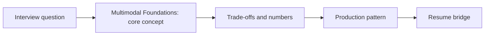

# Session 07: Multimodal Foundations: VLMs, Image/Video Embeddings, ASR/TTS & Streaming Media

> **Status: SKELETON** (content to be written; follow `CONTENT_GUIDELINES.md`)
> - **Phase 1: Foundational Building Blocks** | **Week 4** | **Priority:** core | **Session type:** existing (upgraded scope)
> - **Module:** Module 2: RAG, Search & Multimodal
> - **Resume anchor:** Deloitte Slide-to-Image RAG Pipeline

---

## Part 1: Quick Summary

> TODO (3-4 bullets): what this is in plain English, why interviewers care, the 10-second mental model.

## Part 2: Topics to Cover (Study Checklist)

- [ ] Vision-language models: cost per image/frame, resolution and token count
- [ ] Image / video / audio embeddings and cross-modal retrieval (CLIP-style)
- [ ] Video understanding pipeline: shot detection, frame sampling, transcript + visual fusion
- [ ] ASR and TTS: streaming vs batch, latency, word timestamps, diarization
- [ ] Cascaded (ASR->LLM->TTS) vs native speech-to-speech models
- [ ] Streaming transport: WebSocket vs WebRTC, jitter buffers, turn-taking/barge-in basics
- [ ] Incremental multimodal indexing at scale (carry-over from slide-to-image RAG)

## Part 3: First Principles & Analogies

TODO: one everyday analogy per concept above, plus a concrete failure scenario.

## Part 4: Concept Blueprint

TODO: replace with the real architecture / decision-tree diagram.

## Part 5: Trade-Off Decision Matrix

| Option / Pattern | Latency | Cost | Complexity | When to Pick / Watch Out For |
| :--- | :--- | :--- | :--- | :--- |
| TODO option A | TODO | TODO | TODO | TODO |
| TODO option B | TODO | TODO | TODO | TODO |
| TODO option C | TODO | TODO | TODO | TODO |

## Part 6: Deep-Dive Mechanics & Numbers

TODO: the math, edge cases and "tricks" that separate a senior answer from a mid-level one.

## Part 7: Production AI & Resume Tie-In

TODO: how this applies to production AI systems and to **Deloitte Slide-to-Image RAG Pipeline**; include a short annotated code or design snippet.

## Part 8: Interview Questions (Answered Simply)

TODO: 4-6 questions, each with **What they are really testing** and **How to answer simply** (spoken-English blockquote).

## Canonical Problems Unlocked

- [voice-agent](/problems?id=voice-agent)
- [multimodal-pipeline](/problems?id=multimodal-pipeline)

## Deliverable (Do This Before Moving On)

- [ ] Cascaded vs speech-to-speech comparison table with latency budget.

## Socratic Study Prompt

> *"Teach me the multimodal building blocks: vision-language models, image and video embeddings, ASR/TTS and speech-to-speech models, and streaming transport (WebSocket/WebRTC). Then ask me to design the ingestion for a 1-hour video and a real-time voice turn."*
