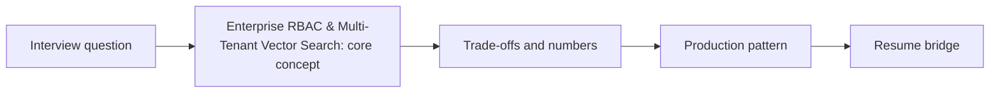

# Session 08: Enterprise RBAC & Multi-Tenant Vector Search

> **Status: SKELETON** (content to be written; follow `CONTENT_GUIDELINES.md`)
> - **Phase 1: Foundational Building Blocks** | **Week 3** | **Priority:** solid | **Session type:** existing (upgraded scope)
> - **Module:** Module 2: RAG, Search & Multimodal
> - **Resume anchor:** Deloitte Internal Asset Discovery Chatbot

---

## Part 1: Quick Summary

> TODO (3-4 bullets): what this is in plain English, why interviewers care, the 10-second mental model.

## Part 2: Topics to Cover (Study Checklist)

- [ ] Document-level ACLs: capture at ingest, enforce at query time
- [ ] Index-per-tenant vs shared index with filters: cost vs isolation
- [ ] Permission sync lag and revocation guarantees
- [ ] Row/column-level security for text-to-SQL and tool access
- [ ] Audit trails and data residency
- [ ] Noisy-neighbour and per-tenant quotas in retrieval

## Part 3: First Principles & Analogies

TODO: one everyday analogy per concept above, plus a concrete failure scenario.

## Part 4: Concept Blueprint

TODO: replace with the real architecture / decision-tree diagram.

## Part 5: Trade-Off Decision Matrix

| Option / Pattern | Latency | Cost | Complexity | When to Pick / Watch Out For |
| :--- | :--- | :--- | :--- | :--- |
| TODO option A | TODO | TODO | TODO | TODO |
| TODO option B | TODO | TODO | TODO | TODO |
| TODO option C | TODO | TODO | TODO | TODO |

## Part 6: Deep-Dive Mechanics & Numbers

TODO: the math, edge cases and "tricks" that separate a senior answer from a mid-level one.

## Part 7: Production AI & Resume Tie-In

TODO: how this applies to production AI systems and to **Deloitte Internal Asset Discovery Chatbot**; include a short annotated code or design snippet.

## Part 8: Interview Questions (Answered Simply)

TODO: 4-6 questions, each with **What they are really testing** and **How to answer simply** (spoken-English blockquote).

## Canonical Problems Unlocked

- [enterprise-rag](/problems?id=enterprise-rag)
- [text-to-sql](/problems?id=text-to-sql)

## Deliverable (Do This Before Moving On)

- [ ] Tenancy decision table (shared vs per-tenant vs per-ACL-group index).

## Socratic Study Prompt

> *"Explain how to implement Role-Based Access Control (RBAC) and document-level security in a RAG pipeline (Pre-filtering vs. Post-filtering metadata in Vector DBs). Grill me on how to ensure a junior analyst can't retrieve confidential partner slides in my Deloitte chatbot."*
