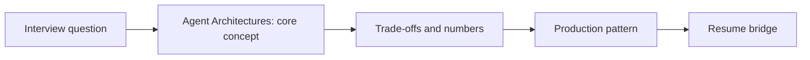

# Session 09: Agent Architectures: Planning Patterns, Tool Use, MCP & A2A

> **Status: SKELETON** (content to be written; follow `CONTENT_GUIDELINES.md`)
> - **Phase 1: Foundational Building Blocks** | **Week 4** | **Priority:** core | **Session type:** existing (upgraded scope)
> - **Module:** Module 3: Agents, Memory & Latency
> - **Resume anchor:** Deloitte Multi-Agent Customer Support

---

## Part 1: Quick Summary

> TODO (3-4 bullets): what this is in plain English, why interviewers care, the 10-second mental model.

## Part 2: Topics to Cover (Study Checklist)

- [ ] Workflow vs agent: when a deterministic graph beats an autonomous loop
- [ ] ReAct, plan-and-execute, reflection / critic loops, self-consistency
- [ ] Topologies: supervisor, hierarchical, swarm/handoff, parallel fan-out
- [ ] Tool design: granularity, schemas, idempotency, error messages the model can act on
- [ ] MCP (tools/resources) and A2A (agent-to-agent): what each standardises and their security surface
- [ ] Human-in-the-loop checkpoints and approval UX
- [ ] Cost/latency of agent loops: step budgets and early termination

## Part 3: First Principles & Analogies

TODO: one everyday analogy per concept above, plus a concrete failure scenario.

## Part 4: Concept Blueprint

TODO: replace with the real architecture / decision-tree diagram.

## Part 5: Trade-Off Decision Matrix

| Option / Pattern | Latency | Cost | Complexity | When to Pick / Watch Out For |
| :--- | :--- | :--- | :--- | :--- |
| TODO option A | TODO | TODO | TODO | TODO |
| TODO option B | TODO | TODO | TODO | TODO |
| TODO option C | TODO | TODO | TODO | TODO |

## Part 6: Deep-Dive Mechanics & Numbers

TODO: the math, edge cases and "tricks" that separate a senior answer from a mid-level one.

## Part 7: Production AI & Resume Tie-In

TODO: how this applies to production AI systems and to **Deloitte Multi-Agent Customer Support**; include a short annotated code or design snippet.

## Part 8: Interview Questions (Answered Simply)

TODO: 4-6 questions, each with **What they are really testing** and **How to answer simply** (spoken-English blockquote).

## Canonical Problems Unlocked

- [support-agent](/problems?id=support-agent)
- [coding-agent](/problems?id=coding-agent)
- [deep-research](/problems?id=deep-research)

## Deliverable (Do This Before Moving On)

- [ ] Agent pattern chooser: task type -> pattern -> failure mode -> guardrail.

## Socratic Study Prompt

> *"Teach me agent architectures: ReAct, plan-and-execute, reflection, supervisor vs swarm, tool design, and the MCP and A2A protocols. Then grill me on when NOT to use an agent, and on why my Deloitte system used a deterministic supervisor DAG."*
