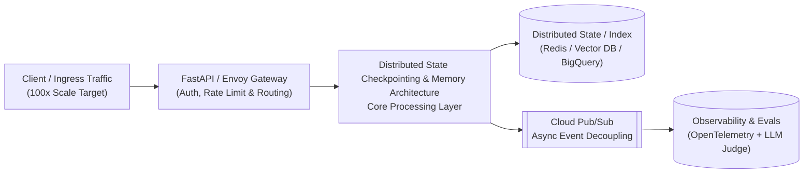

# Session 10: Distributed State Checkpointing & Memory Architecture

> **100x Scale Defense Callout — Ready for Socratic Deep-Dive**
> - **Resume Anchor:** Deloitte FastAPI Orchestrator on GKE
> - **Module Focus:** Deep-diving into Google ADK, LangGraph, distributed state, and sub-2s latency.
> - **Workflow Tip:** Click **"Copy Socratic Prompt"** above, run your interactive study session in chat, and then type `/compile-session` to replace this blueprint with your full study notes, custom diagrams, and flashcards.

---

## Section A — Executive Summary & Crisp Mental Model

This session focuses on **Distributed State Checkpointing & Memory Architecture** within **Module 3: Multi-Agent Orchestration & State**.

### Core Socratic Study Prompt
> *"My FastAPI orchestrator runs on multiple stateless GKE pods. Explain how agent state checkpointing works under the hood (using Redis/Postgres), and how to architect short-term session memory vs. long-term customer memory."*

### Key Production Pillars to Defend
1. **First-Principles Bottleneck Analysis:** Understand what breaks first when traffic scales 100x (CPU, Memory, Network I/O, Token Quota, or Tail Latency).
2. **GCP & Python Stack Alignment:** Anchor every design decision in **FastAPI, Google ADK, LangGraph, Vertex AI, GKE, Cloud Run, Pub/Sub, Redis, ChromaDB, and BigQuery**.
3. **Deterministic Reliability:** Pair probabilistic LLM calls with deterministic state checkpointing, idempotency keys, circuit breakers, and automated RAG Triad evaluations.

---

## Section B — 100x Scale Architecture Diagram

---

## Section C — Trade-off Decision Matrix

| Option / Pattern | Latency Impact | Cost Profile | Operational Complexity | When to Choose at 100x Scale |
| :--- | :--- | :--- | :--- | :--- |
| **Baseline / Single-Node** | Low at <10 QPS; degrades at spike | Lowest initial OpEx | Minimal | MVP & local PoC validation |
| **Managed Serverless (GCP)** | P95 sensitive to cold starts | Pay-per-use (spiky workloads) | Low | Bursty editorial / internal enterprise tools |
| **Distributed Cluster / Hybrid** | Sub-50ms P99 with warm pools | Best unit economics at high QPS | High (K8s / Sharding) | 24/7 mission-critical production traffic |

---

## Section D — Resume Project Defense ("How I Used This / How It Breaks at 100x")

- **Target Project Tie-In:** **Deloitte FastAPI Orchestrator on GKE**
- **Production Context:** Connects directly to Lakshya Soni's production systems at **Deloitte** ($1.3M+ annual savings, <2s multi-agent TTFT, Multimodal Slide RAG) and **Network18** (600+ daily articles Multilingual NER at 80–90% F1, 85% effort reduction in AI Video Repurposing).
- **Next Step:** Run `/compile-session` after discussing this topic in chat to populate exact latency math, failure recovery steps, and hostile Q&A for Session 10.
