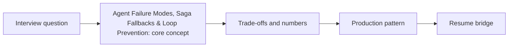

# Session 12: Agent Failure Modes, Saga Fallbacks & Loop Prevention

> **Status: SKELETON** (content to be written; follow `CONTENT_GUIDELINES.md`)
> - **Phase 2: Production Optimization** | **Week 6** | **Priority:** solid | **Session type:** existing (upgraded scope)
> - **Module:** Module 3: Agents, Memory & Latency
> - **Resume anchor:** Deloitte Multi-Agent Customer Support

---

## Part 1: Quick Summary

> TODO (3-4 bullets): what this is in plain English, why interviewers care, the 10-second mental model.

## Part 2: Topics to Cover (Study Checklist)

- [ ] Failure taxonomy: bad plan, bad tool call, tool outage, hallucinated args, loops
- [ ] Step/token/time budgets and loop detection
- [ ] Saga / compensation for side-effecting tool calls; idempotency keys
- [ ] Graceful degradation ladder and human handoff
- [ ] Trajectory logging for debugging and evals

## Part 3: First Principles & Analogies

TODO: one everyday analogy per concept above, plus a concrete failure scenario.

## Part 4: Concept Blueprint

TODO: replace with the real architecture / decision-tree diagram.

## Part 5: Trade-Off Decision Matrix

| Option / Pattern | Latency | Cost | Complexity | When to Pick / Watch Out For |
| :--- | :--- | :--- | :--- | :--- |
| TODO option A | TODO | TODO | TODO | TODO |
| TODO option B | TODO | TODO | TODO | TODO |
| TODO option C | TODO | TODO | TODO | TODO |

## Part 6: Deep-Dive Mechanics & Numbers

TODO: the math, edge cases and "tricks" that separate a senior answer from a mid-level one.

## Part 7: Production AI & Resume Tie-In

TODO: how this applies to production AI systems and to **Deloitte Multi-Agent Customer Support**; include a short annotated code or design snippet.

## Part 8: Interview Questions (Answered Simply)

TODO: 4-6 questions, each with **What they are really testing** and **How to answer simply** (spoken-English blockquote).

## Canonical Problems Unlocked

- [support-agent](/problems?id=support-agent)
- [coding-agent](/problems?id=coding-agent)
- [deep-research](/problems?id=deep-research)

## Deliverable (Do This Before Moving On)

- [ ] Failure-mode table for a refund-issuing agent: detection, mitigation, compensation.

## Socratic Study Prompt

> *"What happens when a sub-agent's tool API fails halfway through a 4-step workflow, or two agents get stuck in an infinite loop? Teach me deterministic fallbacks, saga patterns/compensating transactions for agents, and token budget circuit breakers."*
