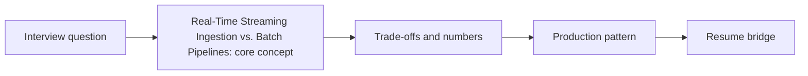

# Session 13: Real-Time Streaming Ingestion vs. Batch Pipelines

> **Status: SKELETON** (content to be written; follow `CONTENT_GUIDELINES.md`)
> - **Phase 4: Resume Defense & Mocks** | **Week 9** | **Priority:** skim | **Session type:** existing (upgraded scope)
> - **Module:** Module 4: Models & Serving
> - **Resume anchor:** Network18 Financial News Pipeline

---

## Part 1: Quick Summary

> TODO (3-4 bullets): what this is in plain English, why interviewers care, the 10-second mental model.

## Part 2: Topics to Cover (Study Checklist)

- [ ] Streaming vs batch ingestion trade-offs (Kappa vs Lambda)
- [ ] Exactly-once pipelines and late data
- [ ] Financial news pipeline at 100x; Kafka/Flink mapping

## Part 3: First Principles & Analogies

TODO: one everyday analogy per concept above, plus a concrete failure scenario.

## Part 4: Concept Blueprint

TODO: replace with the real architecture / decision-tree diagram.

## Part 5: Trade-Off Decision Matrix

| Option / Pattern | Latency | Cost | Complexity | When to Pick / Watch Out For |
| :--- | :--- | :--- | :--- | :--- |
| TODO option A | TODO | TODO | TODO | TODO |
| TODO option B | TODO | TODO | TODO | TODO |
| TODO option C | TODO | TODO | TODO | TODO |

## Part 6: Deep-Dive Mechanics & Numbers

TODO: the math, edge cases and "tricks" that separate a senior answer from a mid-level one.

## Part 7: Production AI & Resume Tie-In

TODO: how this applies to production AI systems and to **Network18 Financial News Pipeline**; include a short annotated code or design snippet.

## Part 8: Interview Questions (Answered Simply)

TODO: 4-6 questions, each with **What they are really testing** and **How to answer simply** (spoken-English blockquote).

## Canonical Problems Unlocked

- [workflow-automation](/problems?id=workflow-automation)

## Deliverable (Do This Before Moving On)

- [ ] One-page defense of the Network18 news pipeline.

## Socratic Study Prompt

> *"My Network18 pipeline ingested 600+ articles/day from 12+ sources hourly using Vertex AI Scheduler and BeautifulSoup. Grill me on how to re-architect this to ingest 100,000 articles per minute in real-time using distributed crawlers, Pub/Sub, and Dataflow/PySpark Streaming."*
