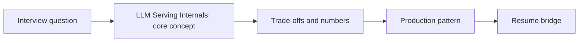

# Session 15: LLM Serving Internals: KV Cache, PagedAttention, Continuous Batching & Prefix Caching

> **Status: SKELETON** (content to be written; follow `CONTENT_GUIDELINES.md`)
> - **Phase 2: Production Optimization** | **Week 5** | **Priority:** core | **Session type:** existing (upgraded scope)
> - **Module:** Module 4: Models & Serving
> - **Resume anchor:** Self-Hosted GKE Models vs. Vertex Gemini API

---

## Part 1: Quick Summary

> TODO (3-4 bullets): what this is in plain English, why interviewers care, the 10-second mental model.

## Part 2: Topics to Cover (Study Checklist)

- [ ] KV cache memory formula and what limits concurrency
- [ ] PagedAttention and fragmentation; block tables
- [ ] Continuous (in-flight) batching vs static batching
- [ ] Prefix caching / RadixAttention and prompt layout implications
- [ ] GQA/MQA and KV-cache-friendly architectures; KV quantization and offload
- [ ] Engines compared: vLLM, SGLang, TensorRT-LLM, TGI
- [ ] Throughput vs latency curve and choosing the operating point

## Part 3: First Principles & Analogies

TODO: one everyday analogy per concept above, plus a concrete failure scenario.

## Part 4: Concept Blueprint

TODO: replace with the real architecture / decision-tree diagram.

## Part 5: Trade-Off Decision Matrix

| Option / Pattern | Latency | Cost | Complexity | When to Pick / Watch Out For |
| :--- | :--- | :--- | :--- | :--- |
| TODO option A | TODO | TODO | TODO | TODO |
| TODO option B | TODO | TODO | TODO | TODO |
| TODO option C | TODO | TODO | TODO | TODO |

## Part 6: Deep-Dive Mechanics & Numbers

TODO: the math, edge cases and "tricks" that separate a senior answer from a mid-level one.

## Part 7: Production AI & Resume Tie-In

TODO: how this applies to production AI systems and to **Self-Hosted GKE Models vs. Vertex Gemini API**; include a short annotated code or design snippet.

## Part 8: Interview Questions (Answered Simply)

TODO: 4-6 questions, each with **What they are really testing** and **How to answer simply** (spoken-English blockquote).

## Canonical Problems Unlocked

- [inference-serving](/problems?id=inference-serving)
- [chat-assistant](/problems?id=chat-assistant)
- [code-assistant](/problems?id=code-assistant)

## Deliverable (Do This Before Moving On)

- [ ] Worked example: concurrent users per H100 for a 70B model at 8k context.

## Socratic Study Prompt

> *"Explain how LLM serving works under the hood in simple terms: KV Cache, PagedAttention (vLLM), Continuous Batching, and Time-To-First-Token (TTFT) vs. Inter-Token Latency (ITL). Why does this matter when choosing between self-hosting open-weights models on GKE vs. using Vertex Gemini API?"*
