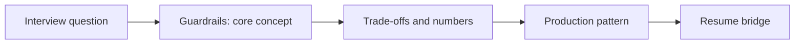

# Session 18: Guardrails: Layered Classifiers, PII, Schema Validation & Latency-Aware Placement

> **Status: SKELETON** (content to be written; follow `CONTENT_GUIDELINES.md`)
> - **Phase 2: Production Optimization** | **Week 7** | **Priority:** core | **Session type:** existing (upgraded scope)
> - **Module:** Module 5: LLMOps, Evals, Security & Mocks
> - **Resume anchor:** Deloitte Customer Support System

---

## Part 1: Quick Summary

> TODO (3-4 bullets): what this is in plain English, why interviewers care, the 10-second mental model.

## Part 2: Topics to Cover (Study Checklist)

- [ ] Input/output guardrail layers and where each runs (sync vs async)
- [ ] PII detection/redaction and data-leak prevention
- [ ] Topical / policy rails and jailbreak classifiers
- [ ] Schema and business-rule validation of model outputs
- [ ] Latency budget: fast classifier first, LLM judge only when uncertain
- [ ] Measuring guardrail precision/recall and false-refusal rate

## Part 3: First Principles & Analogies

TODO: one everyday analogy per concept above, plus a concrete failure scenario.

## Part 4: Concept Blueprint

TODO: replace with the real architecture / decision-tree diagram.

## Part 5: Trade-Off Decision Matrix

| Option / Pattern | Latency | Cost | Complexity | When to Pick / Watch Out For |
| :--- | :--- | :--- | :--- | :--- |
| TODO option A | TODO | TODO | TODO | TODO |
| TODO option B | TODO | TODO | TODO | TODO |
| TODO option C | TODO | TODO | TODO | TODO |

## Part 6: Deep-Dive Mechanics & Numbers

TODO: the math, edge cases and "tricks" that separate a senior answer from a mid-level one.

## Part 7: Production AI & Resume Tie-In

TODO: how this applies to production AI systems and to **Deloitte Customer Support System**; include a short annotated code or design snippet.

## Part 8: Interview Questions (Answered Simply)

TODO: 4-6 questions, each with **What they are really testing** and **How to answer simply** (spoken-English blockquote).

## Canonical Problems Unlocked

- [content-moderation](/problems?id=content-moderation)
- [support-agent](/problems?id=support-agent)
- [chat-assistant](/problems?id=chat-assistant)

## Deliverable (Do This Before Moving On)

- [ ] Guardrail pipeline with latency budget and precision/recall targets.

## Socratic Study Prompt

> *"How do I prevent prompt injection, PII leakage, and unauthorized tool execution in my customer support multi-agent system without adding 2 seconds of latency? Explain lightweight guardrail models, PII token vaulting, and scoped IAM permissions for agents."*
