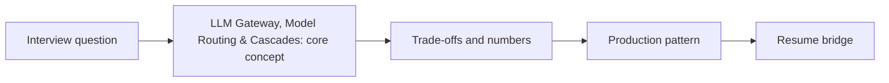

# Session 19: LLM Gateway, Model Routing & Cascades: Fallbacks, Quotas & Cost per Task

> **Status: SKELETON** (content to be written; follow `CONTENT_GUIDELINES.md`)
> - **Phase 2: Production Optimization** | **Week 6** | **Priority:** core | **Session type:** existing (upgraded scope)
> - **Module:** Module 5: LLMOps, Evals, Security & Mocks
> - **Resume anchor:** Cross-Platform AI Architecture ($1.3M+ Savings)

---

## Part 1: Quick Summary

> TODO (3-4 bullets): what this is in plain English, why interviewers care, the 10-second mental model.

## Part 2: Topics to Cover (Study Checklist)

- [ ] Router designs: rules, classifier, LLM-as-router, learned routers (and their eval)
- [ ] Cascades: cheap model first, escalate on low confidence / failed validation
- [ ] Multi-provider fallback, retries with jitter, hedged requests, circuit breakers
- [ ] Per-tenant/team quotas (TPM/RPM), budgets and chargeback
- [ ] Gateway features: auth, PII filters, caching, logging, prompt versioning
- [ ] Measuring routing quality: cost per resolved task vs quality delta

## Part 3: First Principles & Analogies

TODO: one everyday analogy per concept above, plus a concrete failure scenario.

## Part 4: Concept Blueprint

TODO: replace with the real architecture / decision-tree diagram.

## Part 5: Trade-Off Decision Matrix

| Option / Pattern | Latency | Cost | Complexity | When to Pick / Watch Out For |
| :--- | :--- | :--- | :--- | :--- |
| TODO option A | TODO | TODO | TODO | TODO |
| TODO option B | TODO | TODO | TODO | TODO |
| TODO option C | TODO | TODO | TODO | TODO |

## Part 6: Deep-Dive Mechanics & Numbers

TODO: the math, edge cases and "tricks" that separate a senior answer from a mid-level one.

## Part 7: Production AI & Resume Tie-In

TODO: how this applies to production AI systems and to **Cross-Platform AI Architecture ($1.3M+ Savings)**; include a short annotated code or design snippet.

## Part 8: Interview Questions (Answered Simply)

TODO: 4-6 questions, each with **What they are really testing** and **How to answer simply** (spoken-English blockquote).

## Canonical Problems Unlocked

- [llm-gateway](/problems?id=llm-gateway)
- [chat-assistant](/problems?id=chat-assistant)
- [inference-serving](/problems?id=inference-serving)

## Deliverable (Do This Before Moving On)

- [ ] Routing policy doc: tiers, escalation triggers, fallback order, expected savings.

## Socratic Study Prompt

> *"Teach me LLM gateway design: routing by task and complexity, cascades with confidence-based escalation, multi-provider fallback, per-tenant quotas, caching, observability. Then ask me to defend the routing policy that produced my cost savings."*
