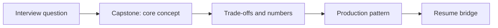

# Session 20: Capstone: Six Timed 45-Minute Mock Interviews

> **Status: SKELETON** (content to be written; follow `CONTENT_GUIDELINES.md`)
> - **Phase 4: Resume Defense & Mocks** | **Week 10** | **Priority:** core | **Session type:** existing (upgraded scope)
> - **Module:** Module 5: LLMOps, Evals, Security & Mocks
> - **Resume anchor:** All 4 Core Resume Projects

---

## Part 1: Quick Summary

> TODO (3-4 bullets): what this is in plain English, why interviewers care, the 10-second mental model.

## Part 2: Topics to Cover (Study Checklist)

- [ ] Mock 1-2: must-know problems (cold prompts)
- [ ] Mock 3-4: high-frequency problems
- [ ] Mock 5: differentiator problem
- [ ] Mock 6: resume deep-dive at 100x scale
- [ ] Post-mock review with the interview rubric
- [ ] Bridge drills: 3-minute 'closest project and what breaks at 100x' per problem

## Part 3: First Principles & Analogies

TODO: one everyday analogy per concept above, plus a concrete failure scenario.

## Part 4: Concept Blueprint

TODO: replace with the real architecture / decision-tree diagram.

## Part 5: Trade-Off Decision Matrix

| Option / Pattern | Latency | Cost | Complexity | When to Pick / Watch Out For |
| :--- | :--- | :--- | :--- | :--- |
| TODO option A | TODO | TODO | TODO | TODO |
| TODO option B | TODO | TODO | TODO | TODO |
| TODO option C | TODO | TODO | TODO | TODO |

## Part 6: Deep-Dive Mechanics & Numbers

TODO: the math, edge cases and "tricks" that separate a senior answer from a mid-level one.

## Part 7: Production AI & Resume Tie-In

TODO: how this applies to production AI systems and to **All 4 Core Resume Projects**; include a short annotated code or design snippet.

## Part 8: Interview Questions (Answered Simply)

TODO: 4-6 questions, each with **What they are really testing** and **How to answer simply** (spoken-English blockquote).

## Canonical Problems Unlocked

- [chat-assistant](/problems?id=chat-assistant)
- [enterprise-rag](/problems?id=enterprise-rag)
- [support-agent](/problems?id=support-agent)
- [answer-engine](/problems?id=answer-engine)
- [voice-agent](/problems?id=voice-agent)
- [inference-serving](/problems?id=inference-serving)

## Deliverable (Do This Before Moving On)

- [ ] Six scored mocks and a list of the 5 weakest areas for a final revision pass.

## Socratic Study Prompt

> *"Act as a Hiring Manager for a Senior AI Engineer role. Pick one of my resume projects or a scaled-up version of it, and run a realistic system design interview. Ask me to gather requirements, estimate capacity, define the API/data model, draw the high-level architecture, and then drill me on bottlenecks."*
