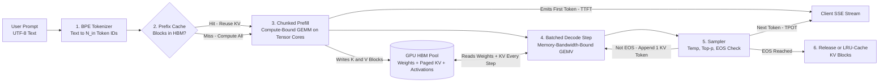

# Session 21: LLM Inference Fundamentals — Tokens, Prefill vs. Decode & Memory-Bound Math

> **Prerequisites & Plain-English Summary**
>
> - **Prerequisites:**
>   - **Throughput vs. Latency (`fund-07`):** Latency is how long one user waits for an answer; throughput is how many answers (or word-pieces) a machine finishes per second across everyone.
>   - **Processor vs. Memory Speed (`fund-07`):** A modern AI chip can do arithmetic much faster than it can carry gigabytes of numbers from its memory chips to its math cores.
>   - **Percentiles (`fund-08`):** Users judge responsiveness by the slowest `1%–5%` of waits (`P95`/`P99`), not the daily average.
> - **Plain-English Core:** An AI language model actually runs two completely different jobs on every message—first reading your whole prompt in one fast parallel sweep, then writing its answer one tiny word-piece at a time while hauling its entire multi-gigabyte brain across memory wires on every single step.

---

## 1. Build It From Zero (Basics + Socratic Walkthrough)

### What Are We Actually Building, and Why Is It Hard?
Imagine you launch a customer chat feature powered by a 70-billion-number AI model. In testing with one user on a top-shelf `$30,000` server chip, answers stream smoothly at 35 words per second. On launch morning, two surprises hit within ten minutes:
1. Users pasting 20-page contracts wait **9 seconds** before the very first word appears, even though their final answer is just *"Yes, Clause 4 allows termination."*
2. Users in Hindi and Japanese pay **3× higher API bills** and stream **3× slower** for sentences with the exact same meaning as English ones.

Why does reading 5,000 words take less time than writing 200 words—and why does adding more users make the chip *more* efficient right up until it crashes out of memory?

### The Socratic Ladder: Discovering LLM Inference Mechanics

**🤔 Question 1: Why doesn't the model read whole English or Hindi words directly?**
Human text has millions of possible words, typos, code variable names, and emojis. If the model kept a dictionary entry for every possible word on Earth, the dictionary alone would be gigantic, and any new product name would be an unknown blank. Instead, a pre-step chops text into common reusable chunks of characters—common English words stay one piece, while rare words or non-Latin scripts get split into 2–4 smaller pieces.
→ Every piece costs one step of work and one unit on your bill, which explains why Hindi or dense JSON code costs more per sentence than plain English.

**🤔 Question 2: When a user sends a 4,000-piece prompt, why doesn't the model have to read it one piece at a time?**
Because all 4,000 pieces of your prompt are *already sitting there* when you hit Send! The chip can run math on all 4,000 pieces side by side in one giant parallel wave, saturating its math engines.
→ Reading the prompt is limited by **how fast the chip can do multiplication**, and finishes right before the very first output piece appears.

**🤔 Question 3: Then why does writing a 400-piece answer take *longer* than reading a 4,000-piece prompt?**
Because piece #2 of the answer does not exist until piece #1 has been chosen, and piece #3 depends on piece #2. On **every single output piece**, the chip must carry all `140 GB` of the model's stored numbers from memory into the math cores just to do a tiny sliver of math for that one piece, then repeat `400` times in a strict chain.
→ Writing the answer is limited not by math speed, but by **memory wire speed**—the chip's calculators sit `>95%` idle waiting on data delivery!

**🤔 Question 4: If you have to haul all 140 GB of model numbers from memory anyway, how do you stop wasting 95% of that trip?**
If `32` different users are all waiting for their next word-piece at the same millisecond, haul the `140 GB` of model numbers **once** and compute the next piece for all `32` users together on the same trip! Now one memory trip produces `32` pieces instead of `1`.
→ Grouping active requests step by step multiplies total output per second nearly for free—until the chip's math cores finally fill up.

**🤔 Question 5: What stops you from grouping 5,000 users onto one chip?**
To avoid re-reading every user's entire conversation history from scratch on every new word, the chip saves each active user's "working notes" in chip memory. Those notes grow with every piece read or written. Long before the math cores max out, `5,000` sets of working notes overflow the chip's `80 GB` memory ceiling.
→ Concurrency is capped by **leftover chip memory** after the model itself is loaded.

### Naming What You Just Invented
1. Those character chunks are **Tokens** (produced by **Byte-Pair Encoding / BPE**), and non-English splitting is the **Tokenizer Fertility / Multilingual Penalty**.
2. The parallel prompt-reading wave is **Prefill** (**compute-bound**, governs **TTFT — Time to First Token**).
3. The one-token-at-a-time generation loop is **Autoregressive Decode** (**memory-bandwidth-bound**, governs **TPOT — Time Per Output Token** / **ITL — Inter-Token Latency**).
4. Reusing one weight-read across `B` active requests is **Batching** (and its hardware sweet spot comes from the **Roofline Arithmetic Intensity** ratio).
5. Each request's saved per-token attention history in GPU HBM is the **KV Cache**, competing with **Model Weights** and **Activations** for the GPU memory budget.

### Explain It in Layers
- **One Line (Explain to a 12-Year-Old):** An AI reads your whole question in one big gulp, but has to write its reply one syllable at a time while carrying a giant encyclopedia across the room for every single syllable.
- **One Paragraph (Explain to a Non-Backend Engineer):** LLMs chop text into small pieces called tokens (`~0.75` English words each). When you send a prompt, the GPU processes all input tokens in parallel ("prefill"), which sets how long until the first word shows up. After that, it generates one output token at a time ("decode"), loading the entire multi-gigabyte model from GPU memory on each step. Serving many users together amortizes that memory read, so total speed rises until each user's saved conversation context (the KV cache) fills up the GPU's memory.
- **Engineer Version:** Autoregressive Transformer inference splits into two hardware regimes: **Prefill** executes dense matrix-matrix multiplications (`GEMM`) over `[seq_len, d_model]`, making it **compute-bound** on Tensor Core `FLOP/s` and determining **TTFT**; **Decode** executes skinny matrix-vector/tall-skinny `GEMV` operations over `[batch_size, d_model]` per step, yielding arithmetic intensity `≈ batch_size` `FLOPs/byte` (well below an H100's `~295 FLOPs/byte` ridge point at small batches), making it **HBM-bandwidth-bound** and determining **TPOT**. Fleet capacity is bounded by `max(compute/bandwidth_gpus, hbm_capacity_gpus)` under target **goodput** SLOs (`TTFT` and `TPOT` simultaneously met).

---

## 2. First Principles, Analogies, Interview Framing & Capacity Math

> **Why Interviewers Care & The 10-Second Mental Model**
>
> - **Why Interviewers Care:** Almost every GenAI system design question eventually hits a latency wall (`"Why is TTFT 4 seconds?"`), a GPU sizing question (`"How many H100s for 70B?"`), or a cost surprise (`"Why did Hindi or JSON double our bill?"`). Candidates who confuse prefill bottlenecks with decode bottlenecks propose optimizations that do zero good—like adding speculative decoding to fix a slow 30K-token RAG prefill.
> - **The 10-Second Mental Model:** **"Prefill reads in parallel and is compute-bound (fixes TTFT: shorter prompts, prefix caching, chunked prefill). Decode writes sequentially and is memory-bandwidth-bound (fixes TPOT: quantization, batching up to the roofline ridge, speculative decoding, smaller active parameters). HBM holds Weights + KV Cache + Activations."**

### 1. Tokenization & Token Economics — "Shipping Pallet Packing"
- **The Analogy:** Think of a BPE tokenizer (`tiktoken` `o200k_base`, SentencePiece) as a warehouse packing system with `100,000–256,000` standard pallet molds built from historical shipping volume. Common English words (`"customer"`, `" account"`) have dedicated custom molds and fit on **1 pallet**. Rare medical terms, UUIDs, minified code, or Devanagari/Kanji characters lack whole-word molds and get broken into UTF-8 byte fragments across **2 to 5 pallets**.
- **Concrete Numbers:**
  - **English prose:** `1 token ≈ 4 characters ≈ 0.75 words` (`100 words ≈ 133 tokens`).
  - **Python / JSON / SQL:** punctuation, braces, and indentation push density to `1 token ≈ 2.8–3.5 characters`; minified UUIDs (`550e8400-e29b...`) cost `~10–14 tokens` for 36 chars!
  - **Multilingual fertility penalty:** Hindi, Tamil, Arabic, or Thai scripts on English-heavy tokenizers often consume **`2.0×–4.5×` more tokens** for the identical semantic sentence (modern large-vocab tokenizers like `200k–256k` vocab in GPT-4o / Gemini / Gemma cut this penalty to `~1.3×–1.8×`, which is a major model-selection criterion for global apps).
  - **Why `1` extra token hurts three ways:** higher input/output `$`, quadratically/linearly slower prefill, and **more decode steps** (`3×` tokens = `3×` wall-clock generation time at the same `TPOT`!).

### 2. Prefill vs. Decode & Roofline Math — "Grading a Scanned Exam vs. Courtroom Transcription"
- **The Analogy:** **Prefill** is feeding a 100-question bubble sheet into an optical scanner—every question is graded simultaneously in one flash. **Decode** is a courtroom stenographer who can only type the *next* word after the judge speaks it, and must flip through a `140-pound` legal code book on the desk between every single word.
- **The Roofline Arithmetic Intensity Proof (Memorize This!):**
  - Take **NVIDIA H100 SXM (`80 GB` HBM3):** peak FP16 Tensor Core compute `≈ 989 TFLOP/s`; HBM3 memory bandwidth `≈ 3.35 TB/s`.
  - **Hardware Ridge Point:** `989 TFLOP/s ÷ 3.35 TB/s ≈ 295 FLOPs per byte` moved from HBM! Any operation doing fewer than `295` math ops per byte fetched is **memory-bandwidth-bound**; above `295` is **compute-bound**.
  - **Single-Stream Decode (`batch = 1`) on a `70B` FP16 model:**
    - Weights to read per token = `70 × 10^9 × 2 bytes = 140 GB`.
    - Math per token = `2 × 70 × 10^9 = 140 GFLOPs` (`1` multiply + `1` add per parameter).
    - **Arithmetic Intensity** = `140 GFLOPs ÷ 140 GB = 1 FLOP/byte`! You are at `1 / 295` (`0.3%`!) of the GPU's compute potential.
    - **Minimum Theoretical Single-Stream TPOT** = `140 GB ÷ 3,350 GB/s ≈ 41.8 ms/token` (`~24 tokens/sec` ceiling on 1 H100 if it somehow fit, or `~21 ms/token` across `2 × H100` tensor-parallel!).
  - **Batched Decode (`batch = B`):** reading `140 GB` once for `B` tokens does `2 × B × 70B FLOPs` → arithmetic intensity `≈ B FLOPs/byte` (in FP16, `2 bytes/weight`, `2B / 2 = B`). Throughput scales almost linearly with `B` with minimal TPOT penalty until `B` approaches `~150–295` (or KV-cache bandwidth takes over at long contexts!).

### 3. Latency Vocabulary: TTFT, TPOT, E2E & Goodput
- **`TTFT` (Time to First Token):** `queue_wait + prefill_time + network_rtt`. Interactive chat target: `P95 < 0.8s`, `P99 < 1.5–2.0s`; voice agent target: `< 300–500ms`.
- **`TPOT` (Time Per Output Token) / `ITL` (Inter-Token Latency):** `(E2E − TTFT) ÷ (output_tokens − 1)`. Human reading speed is `~250–300 words/min ≈ 5–7 tokens/sec`, so **`TPOT <= 40–50 ms` (`>= 20–25 tok/s`)** feels instantaneous.
- **`E2E Latency`:** `TTFT + TPOT × (output_tokens − 1)`.
- **`Goodput` (The Senior Metric):** requests/sec that satisfy **both** `TTFT <= SLO_1` *and* `TPOT <= SLO_2`. Cranking batch size from `64` to `512` raises raw server `tokens/sec` by `40%`, but pushes `TPOT` from `35ms` to `110ms`, collapsing **goodput** to `0%`!

### 4. GPU Memory Budget — "The Workshop Floor Plan"
Every GPU's High-Bandwidth Memory (`HBM`) divides into four slices (`HBM_total = Weights + KV_Cache + Activations + ~2–4 GB CUDA/Framework Overhead`):
1. **Model Weights (Static):** `N_params × bytes_per_param` (`FP16/BF16 = 2 B`, `FP8/INT8 = 1 B`, `INT4/AWQ = 0.5 B`; rule of thumb with small quantization scale overhead: `~0.55–0.6 B` for 4-bit).
2. **KV Cache (Dynamic per active token across all concurrent streams):**
   - Formula: `KV_bytes_per_token = 2 (K & V) × n_layers × n_kv_heads × d_head × bytes_per_kv`
   - Notice **`n_kv_heads`**! Old Multi-Head Attention (**MHA**) had `n_kv_heads = n_heads` (`64`), bloating KV cache `8×`. Modern models (**Llama-3, Qwen, Gemma, Mistral**) use **Grouped-Query Attention (GQA)** with `n_kv_heads = 8`:
     - **8B GQA (`32` layers, `8` KV heads, `128` dim, FP16):** `2 × 32 × 8 × 128 × 2 = 131,072 B ≈ 128 KB/token` (`1 GB` per `8K` context).
     - **70B GQA (`80` layers, `8` KV heads, `128` dim, FP16):** `2 × 80 × 8 × 128 × 2 = 327,680 B ≈ 320 KB/token` (`2.56 GB` per `8K` context).
3. **Activations & Workspace (`~5–10%` of HBM):** temporary buffers during prefill (`chunked prefill` caps max prefill token batch to `2,048–4,096` so activations never spike OOM on a `128K` prompt).

### 5. Dense vs. Mixture-of-Experts (MoE) & Sampling Non-Determinism
- **Dense vs. MoE ("Generalist Floor vs. On-Call Specialists"):**
  - An MoE model like **Mixtral-8x7B** (`46.7B` total params, `12.9B` active per token) or **DeepSeek-V3** (`671B` total, `37B` active) replaces each dense FFN layer with `E` expert networks and routes each token to top-`k` (`e.g., 2`) experts.
  - **The Serving Consequence:**
    - **VRAM Capacity** scales with **TOTAL parameters** (`46.7B × 2 B ≈ 94 GB` FP16 — all experts must sit in HBM!).
    - **Single-Stream Latency (`batch = 1`)** scales with **ACTIVE parameters** (`12.9B × 2 B ≈ 26 GB` read per token — `3.6×` faster decode than a dense `47B`!).
    - **High-Batch Trap:** When `batch = 64` tokens run simultaneously, tokens scatter across almost *all* `8` (or `64`) experts! Now the GPU has to read **nearly 100% of total expert weights** per step anyway, so MoE shines most when total compute FLOPs per token matter (large batches `B >> num_experts` or prefill) and demands high-bandwidth **Expert Parallelism (`EP`)** across NVLink/InfiniBand.
- **Sampling & Why `temperature = 0` Is Still Not 100% Deterministic:**
  - `temperature` divides logits (`z_i / T`) before softmax; `top_k` keeps the `k` highest-probability tokens; `top_p` (nucleus) keeps the smallest set summing to probability `p`.
  - Even at greedy `temperature = 0` and fixed `seed`, **floating-point addition is non-associative**: `(a + b) + c != a + (b + c)`. Under continuous batching, a request batched with `7` peers invokes a different Tensor Core tile reduction order than when batched with `23` peers, flipping a `1e-5` tie between two top logits (`"Hello"` vs `"Hi"`), which then cascades into a completely different continuation!

### Timestamped Story ("Alice & Bob"): The 64K Prompt That Froze Everybody
- `10:14:00.000 AM` — **Alice** (interactive chat user) sends a `300-token` question to a `70B` FP8 model served on `2 × H100 (160 GB HBM)` running naive unchunked continuous batching alongside `24` active streams (`TPOT = 28ms`).
- `10:14:00.040 AM` — **Bob**'s background compliance script submits a `64,000-token` PDF prompt to the exact same serving pool.
- `10:14:00.045 AM` — Because prefill and decode share the same GPU SMs, Bob's monolithic `64K` prefill monopolizes `100%` of Tensor Cores for **`1,850 ms`** AND grabs `64,000 × 320 KB ≈ 20.5 GB` of KV cache in one bite.
- `10:14:00.900 AM` — Alice's live chat stream stalls mid-sentence for **`1.85 seconds`** (a visible freeze!), and two other users' KV blocks get preempted/evicted because HBM crossed `96%`.
- `10:14:02.000 AM` — **The Fix Applied Later:** Enabling **Chunked Prefill (`max_num_batched_tokens = 2048`)** slices Bob's `64K` prompt into `32` small `2K`-token chunks piggybacked onto normal decode steps (`TPOT` barely moves from `28ms` to `36ms`), and routing batch scripts to an isolated pool keeps Alice's `P99` smooth.

### Functional & Non-Functional Requirements + Back-of-the-Envelope Capacity Math
Suppose we must size a self-hosted `70B` model (FP8 weights + FP16 KV cache) for an enterprise assistant:
- **Workload:** `100,000` DAU × `10` turns/day = `1M` turns/day (`avg ≈ 11.6 QPS`, **`peak 3× ≈ 35 QPS`**).
- **Prompt / Output Shape:** `4,000` input tokens (`60%` prefix-cached system/RAG header → `1,600` uncached prefill tokens/req), `300` output tokens.
- **SLOs:** `P95 TTFT <= 1.2s`, `P95 TPOT <= 40ms` (`>= 25 tok/s/stream`), availability `99.9%`.
- **Step 1 — Hardware Baseline (`2 × H100 80GB` node slice via `TP = 2`):**
  - Total HBM = `160 GB`.
  - `70B` FP8 weights (`1 B/param`) = `70 GB`. Activations + runtime overhead = `~14 GB`.
  - **Available KV Cache HBM per `2×H100` replica** = `160 − 84 = 76 GB`.
- **Step 2 — Memory Constraint (Little's Law):**
  - Stream duration = `0.6s TTFT + 300 × 0.035s TPOT ≈ 11.1 seconds`.
  - Peak concurrent streams = `35 QPS × 11.1s ≈ 389 streams`.
  - KV per stream (`4,300` tokens × `320 KB/tok`, minus shared system prefix) `≈ 1.1 GB/stream`.
  - Total KV HBM required = `389 × 1.1 GB ≈ 428 GB` → `428 ÷ 76 ≈ 5.63` → **`6` replicas (`12 H100s`)** (or enable **FP8 KV Cache**, halving KV to `214 GB` → **`3` replicas (`6 H100s`)**!).
- **Step 3 — Compute / Bandwidth Constraint:**
  - Output token demand = `35 QPS × 300 tok = 10,500 decode tok/s`; uncached prefill = `35 × 1,600 = 56,000 prefill tok/s`.
  - One `2×H100` FP8 replica under `TPOT <= 40ms` delivers `~1,800 decode tok/s` while absorbing `~10,000 prefill tok/s` via chunked prefill.
  - `10,500 ÷ 1,800 = 5.83` replicas → **Compute/Bandwidth is now the binding constraint at `6` replicas (`12 H100s`)**, × `1.3` headroom = **`8` replicas (`16 H100s`)** (`~$35k–$45k/month` reserved).

---

## 3. Visual Architecture Blueprint

Follow the numbered lifecycle (`1 → 6`) of a single prompt entering an LLM serving engine to see exactly where tokens, prefill, KV cache, and decode interact:

1. **Step 1 (BPE Tokenizer):** Converts UTF-8 string into integer token IDs (`[128000, 791, ...]`). Multilingual or JSON text expands token count (`N_in`).
2. **Step 2 (Prefix Cache Lookup):** Checks if leading blocks (`[0..K]`, e.g., system prompt + tool schemas) already exist in GPU HBM block tables—skipping redundant prefill FLOPs.
3. **Step 3 (Chunked Prefill — Compute-Bound):** Uncached input tokens run parallel `Q, K, V` projections and FlashAttention on Tensor Cores, writing new `K, V` tensors into paged HBM blocks and emitting **Token #1** (`TTFT` clock stops here!).
4. **Step 4 (Continuous Decode Loop — Memory-Bandwidth-Bound):** Scheduler groups `B` active sequences; streams model weights + each sequence's KV blocks from HBM3 once per step (`TPOT` per iteration).
5. **Step 5 (Logit Sampling):** Applies `temperature`, `top_p`/`top_k` (and optional grammar mask) to pick the next token ID, appends its new `K, V` vector to HBM, and streams the decoded UTF-8 piece over SSE.
6. **Step 6 (EOS / Reclamation):** When `<eos>` or `max_tokens` hits, KV blocks return to the free pool (or stay warm in LRU prefix cache).



---

## 4. Side-by-Side Comparison & Trade-Off Table

### Table A: Model Size, Precision & Hardware Footprint Cheat Sheet

| Model Class | Precision | Weights HBM | KV Cache / Token (FP16 GQA) | Min GPUs (`80GB` H100) | Typical Interactive Speed (`TP` Slice) | When to Pick / Winner | Watch Out For (The Trap) |
| :--- | :--- | :--- | :--- | :--- | :--- | :--- | :--- |
| **7B–8B Dense** *(Llama-3-8B, Qwen-7B)* | `FP16` / `FP8` | `16 GB` / `8 GB` | `~128 KB` (`~64 KB` in FP8) | `1 × L4 (24GB)` in FP8 or `1 × A100/H100` | `80–160 tok/s` stream; `3,000+ tok/s` batched | **Winner for routers, guardrails, extraction, query rewrite.** | Weak on complex multi-hop synthesis or subtle coding edge cases. |
| **70B Dense** *(Llama-3.3-70B, Qwen-72B)* | `FP16` / `FP8` | `140 GB` / `70 GB` | `~320 KB` (`~160 KB` in FP8) | `2 × H100` (`FP8` strongly preferred) | `25–55 tok/s` stream; `1,500–2,200 tok/s` batched | **Winner for self-hosted enterprise RAG & tool-calling synthesis.** | Running `FP16` on `2 × 80GB` leaves only `~10–15 GB` for KV cache (`<6` long chats!). Always use `FP8`. |
| **MoE Mid/Large** *(Mixtral-8x22B / DeepSeek-class)* | `FP8` | `~141 GB` to `~670 GB` | `~64–256 KB` (MLA cuts KV `5–10×`!) | `2 × H100` (`8x22B`) or `8 × H100` node (`671B` FP8) | Fast `TPOT` at low-medium batch (`35–70 tok/s`) | **Winner for frontier quality per FLOP at high cluster scale.** | High VRAM floor even at `1 QPS`; at large batch sizes all experts activate, demanding fast NVLink/RDMA. |

### Table B: Prefill Bottleneck vs. Decode Bottleneck Diagnostic Matrix

| Dimension | Prefill Phase (Input Processing) | Decode Phase (Token Generation) | When to Optimize This Phase / Winner | Watch Out For (The Trap) |
| :--- | :--- | :--- | :--- | :--- |
| **Hardware Bottleneck** | **Compute-bound** (`Tensor Core TFLOP/s`) | **Memory-bandwidth-bound** (`HBM TB/s`) | Inspect trace: slow `TTFT` = Prefill/Queue; jerky streaming (`TPOT > 60ms`) = Decode. | Buying higher-FLOP GPUs with the *same* memory bandwidth barely speeds up low-batch decode! |
| **Scaling with Prompt Length (`L`)** | Attention scales `O(L^2)` compute, linear projections `O(L)` | KV cache read per step grows `O(L)` bytes + HBM capacity | **Prefill fixes** win on RAG (`4K–32K` input, `200` output): Prefix Caching, Rerank to top-5, Prompt Compression. | Stuffing `50` unreranked chunks kills `TTFT` *and* bloats KV bandwidth during decode. |
| **Best Optimizations** | Prefix caching, chunked prefill, smaller context, tensor parallelism | Weight quantization (`FP8`/`AWQ`), continuous batching, speculative decoding, GQA/MLA | **Decode fixes** win on code/report generation (`500` input, `2,000` output) and voice latency. | Speculative decoding *hurts* when GPU compute is already saturated at high batch sizes (`B > 32–64`). |

---

## 5. Deep-Dive Mechanics & Production Failure Analysis

### Under-the-Hood Tricks (What Separates Junior from Senior Answers)

1. **Why Weight Quantization (`FP16 -> FP8/INT4`) Speeds Up Decode Nearly `2×` Even Without Faster Math:**
   - Juniors say quantization "only saves memory." Seniors point to the Roofline: at `batch <= 32`, decode time is `bytes_read ÷ HBM_bandwidth`. Cutting a `70B` model from `FP16` (`140 GB`) to `FP8` (`70 GB`) or `AWQ INT4` (`~38 GB`) cuts the bytes hauled across HBM wires per token in half (or `3.5×`), directly dropping `TPOT` from `~42ms` to `~22ms` *and* freeing `70 GB` of HBM for `3–4×` larger continuous batches!
2. **At Long Contexts (`32K–128K`), KV Cache Bandwidth Overcomes Weight Bandwidth:**
   - On `Llama-3-70B` (`70 GB` FP8 weights), a batch of `32` users each at `32,000` context length holds `32 × 32,000 × 320 KB ≈ 327 GB` of FP16 KV cache! On *every single decode token*, the GPU must read both the `70 GB` weights AND all `327 GB` of KV cache—KV reads are now **`4.6×` heavier** than the model weights themselves. That is why **FP8 KV Cache quantization** and **Multi-Head Latent Attention (MLA)** are mandatory at `32K+` context.
3. **Why Non-Determinism Breaks Caching & Reproducible Evals (And How to Mitigate):**
   - Because Tensor Core reductions vary with dynamic batch composition, `temperature = 0` on GPU APIs still flips ~`1–3%` of greedy outputs on long completions. Never assert exact string equality (`assert output == expected`) in LLM unit tests—assert parsed schema fields, SQL execution equivalence, or semantic rubric scores, and log `system_fingerprint` + token logprobs when debugging.
4. **Input vs. Output API Pricing Reflects Hardware Physics (`3×–8×` Ratio):**
   - Frontier APIs charge `$1.25/1M` input tokens vs. `$5–$10/1M` output tokens (`4×–8×` gap) for a physical reason: `1,000` input tokens run in one parallel `~30ms` prefill burst, whereas `1,000` output tokens occupy a KV-cache slot across `1,000` sequential memory-bandwidth-bound decode iterations (`~15–25 seconds` of GPU occupancy).

### Failure Modes in Production

#### Failure Mode 1: Prefill Interference Spikes Live P99 Inter-Token Latency ("The Freeze Mid-Sentence")
- **How It Happens at 2 AM:**
  1. Your shared vLLM cluster serves both interactive chat (`500` input tokens) and an automated "Summarize Whole Thread" button (`40,000` input tokens).
  2. Without prefill chunking or pool disaggregation, scheduling three `40K`-token prefills back-to-back blocks decode iterations for `2–4 seconds` at a time.
  3. Users watching live SSE streams see text pause mid-word for `3 seconds`, trigger client timeouts, and hit retry—doubling prefill load into a cascading stall.
- **How to Detect It in Metrics:**
  - `P50 TPOT` stays healthy (`30ms`), while `P99 ITL` (max single inter-token pause) spikes to `1,500–3,000ms` in lockstep with `prompt_tokens_per_sec` bursts.
- **Exact Mitigation:**
  1. Enable **Chunked Prefill** (`--enable-chunked-prefill --max-num-batched-tokens 2048` in vLLM) so long prompts are sliced into bounded compute chunks interleaved with decode tokens.
  2. At higher scale (`>50 QPS` mixed workloads), use **Prefill/Decode Disaggregation**—separate prefill GPU pods compute the initial KV cache and ship KV blocks over RDMA/NVLink to dedicated decode GPU pods whose `TPOT` is never interrupted.

#### Failure Mode 2: Multilingual & JSON Token Explosion Blows Up Both TPM Quota and Latency SLA
- **How It Happens at 2 AM:**
  1. A pipeline sized in English (`800 words ≈ 1,050 tokens`, `TTFT = 450ms`) rolls out to regional Indic-language feeds and starts passing pretty-printed `4-space` indented JSON tool payloads.
  2. Tokenizer fertility jumps `3.1×` on regional text, and JSON whitespace/repeated keys add another `1.8×`—average request swells from `1,050` to `4,800` input tokens and `3×` output tokens.
  3. Regional Vertex AI `TPM` quota (`2M TPM`) saturates at `35%` of expected QPS, returning HTTP `429 Resource Exhausted`, while output generation takes `3×` longer and breaches the `4s` E2E SLA.
- **How to Detect It in Metrics:**
  - Track **Tokenizer Fertility Ratio** (`gen_ai.usage.input_tokens ÷ char_count`) sliced by `language` and `route`, plus `429` error rate vs. `RPM` (low `RPM` + maxed `TPM` = token bloat).
- **Exact Mitigation:**
  1. Choose `200K+`-vocab models (Gemini / GPT-4o / Qwen2.5) benchmarked specifically on target-script fertility, strip pretty-print JSON whitespace (`json.dumps(separators=(",", ":"))` saves `15–30%` tool tokens immediately), and return compact IDs instead of verbose descriptions during intermediate tool hops.
  2. Budget `max_output_tokens` and `TPM` capacity per language tier using measured `tokens/character` from production samples rather than the `4 chars/token` English rule of thumb.

---

## 6. Production AI & Resume Tie-In

### 1. Deloitte Multi-Agent Customer Support (`<1.8s` TTFT via Flash Routing + Prefix Caching)
- **The Architectural Fit:** In the **Google ADK + FastAPI** customer support platform on **GKE**, hitting `<1.8s P95 TTFT` across intent classification, tool calls, and final response synthesis came directly from prefill-vs-decode physics:
  1. **Router & Tool Extraction = Output-Tiny, Latency-Critical:** The Supervisor Router only needs to emit `~15` structured tokens (`{"route": "billing_agent", "confidence": 0.94}`). Routing this to **Gemini Flash** (small active parameter count → ultra-fast prefill + decode in `~220ms`) instead of **Gemini Pro** saved `~450ms` per turn while cutting token cost by `>10×` on `76%` of turns.
  2. **Stable Prefix Layout:** Keeping the `3,500-token` enterprise policy + MCP tool schema byte-identical at token index `0` let provider **Context/Prefix Caching** bypass prefill compute on `>85%` of turns (`75%` input token discount + lower `TTFT`).

### 2. Network18 AI Video Repurposing Engine & Multilingual News (Token Economics in Multimodal & Indic Text)
- **The Architectural Fit:**
  - In the **Cloud Run Video Repurposing Engine**, uploading a raw `4K 60fps` broadcast adds zero semantic accuracy because Gemini tokenizes video at **`1 FPS` (`~258 tokens/second` of video + audio tokens ≈ `~300 tokens/sec` → `~1.08M` input tokens per hour of video)**. Pre-generating a `360p 1-FPS` proxy stream aligned network upload bytes with the model's true visual token rate (`$0.18/hour` of video on Flash).
  - In the **Financial News Intelligence Pipeline**, processing English + Indic regional feeds at high volume meant a `270M`-parameter encoder (`XLM-RoBERTa` / `IndicBERT`, single parallel forward pass—**prefill-only, zero autoregressive decode!**) beat autoregressive LLM extraction by `~1,000×` in cost and `10×` in latency (`3.8ms` vs `400ms+`).

### Production Code: Roofline-Aware LLM GPU & Token Economics Sizer (Python)

A complete, self-contained capacity calculator you can trace in interviews—computing exact GQA `KV` bytes/token, Roofline ridge batch size, dual-constraint (`HBM` vs. `Throughput`) GPU counts, and multilingual token multiplier impact:

```python
import math
from dataclasses import dataclass

@dataclass(frozen=True)
class ModelSpec:
    name: str
    total_params_b: float     # Total params in billions (determines HBM weight storage)
    active_params_b: float    # Active params per token (equals total_params_b for Dense; smaller for MoE)
    n_layers: int
    n_kv_heads: int           # Grouped-Query Attention (GQA) KV heads (e.g., 8 vs 64 MHA heads)
    head_dim: int = 128
    weight_bytes: float = 1.0 # 1.0 = FP8, 2.0 = FP16
    kv_bytes: float = 1.0     # 1.0 = FP8 KV cache, 2.0 = FP16 KV cache

@dataclass(frozen=True)
class GPUSpec:
    name: str = "H100-80GB-SXM"
    hbm_gb: float = 80.0
    tflops_fp8: float = 1979.0
    bandwidth_gb_s: float = 3350.0  # 3.35 TB/s HBM3

def size_inference_fleet(
    model: ModelSpec,
    gpu: GPUSpec,
    tp_degree: int,
    peak_qps: float,
    prompt_tokens: int,
    output_tokens: int,
    ttft_slo_s: float = 0.8,
    tpot_slo_s: float = 0.035,
    lang_fertility_mult: float = 1.0,  # e.g., 1.0 English, 2.4 unoptimized Indic/JSON
):
    eff_in = int(prompt_tokens * lang_fertility_mult)
    eff_out = int(output_tokens * lang_fertility_mult)

    # 1. Roofline physics: FLOPs/byte ridge point & theoretical min single-stream TPOT
    ridge_flops_per_byte = (gpu.tflops_fp8 * 1e12) / (gpu.bandwidth_gb_s * 1e9)
    active_weight_gb = model.active_params_b * model.weight_bytes
    min_tpot_ms = (active_weight_gb / (gpu.bandwidth_gb_s * tp_degree)) * 1000.0

    # 2. Exact KV cache bytes per token: 2 (K,V) * layers * kv_heads * head_dim * bytes
    kv_bytes_per_tok = 2 * model.n_layers * model.n_kv_heads * model.head_dim * model.kv_bytes
    replica_hbm_gb = gpu.hbm_gb * tp_degree
    weights_total_gb = model.total_params_b * model.weight_bytes
    usable_kv_gb = replica_hbm_gb * 0.90 - weights_total_gb  # Reserve 10% for activations & CUDA
    if usable_kv_gb <= 0:
        raise ValueError(f"{model.name} weights ({weights_total_gb}GB) exceed TP={tp_degree} HBM!")

    # 3. Memory constraint via Little's Law: concurrent_streams = QPS * stream_duration
    stream_s = ttft_slo_s + eff_out * tpot_slo_s
    concurrent_streams = peak_qps * stream_s
    kv_gb_per_stream = ((eff_in + eff_out) * kv_bytes_per_tok) / 1e9
    replicas_mem = (concurrent_streams * kv_gb_per_stream) / usable_kv_gb

    # 4. Bandwidth/compute constraint at target TPOT (practical ~45% effective HBM efficiency at SLO batch)
    max_batch_at_slo = max(1, int((tpot_slo_s * 1000.0 / min_tpot_ms) * 18))
    replica_decode_tok_s = min(max_batch_at_slo / tpot_slo_s, ridge_flops_per_byte * 12)
    replicas_bw = (peak_qps * eff_out) / replica_decode_tok_s

    replicas = math.ceil(max(replicas_mem, replicas_bw) * 1.3)  # 30% N+1 & spike headroom
    return {
        "effective_tokens": (eff_in, eff_out),
        "min_single_stream_tpot_ms": round(min_tpot_ms, 1),
        "kv_kb_per_token": round(kv_bytes_per_tok / 1024, 1),
        "concurrent_streams": round(concurrent_streams),
        "binding_constraint": "kv_memory" if replicas_mem >= replicas_bw else "decode_bandwidth",
        "total_gpus": replicas * tp_degree,
    }

if __name__ == "__main__":
    llama70b_fp8 = ModelSpec("Llama-3-70B-FP8", 70.0, 70.0, n_layers=80, n_kv_heads=8)
    print("English:", size_inference_fleet(llama70b_fp8, GPUSpec(), tp_degree=2, peak_qps=35, prompt_tokens=4000, output_tokens=300))
    print("Indic 2.2x:", size_inference_fleet(llama70b_fp8, GPUSpec(), tp_degree=2, peak_qps=35, prompt_tokens=4000, output_tokens=300, lang_fertility_mult=2.2))
```

---

## 7. Common Interview Questions, Follow-Up Probes & Quick Recall

### Q1: "Why is LLM decode memory-bandwidth-bound while prefill is compute-bound—and what does that change in your architecture?"
- **What the interviewer is testing:** First-principles hardware literacy (Roofline model) and whether you pick the right optimization for `TTFT` vs. `TPOT`.
- **How to answer simply:**
  > "During prefill, all prompt tokens are already available, so the GPU runs matrix-matrix multiplications across thousands of tokens in parallel and saturates its Tensor Cores—that makes prefill compute-bound and determines Time to First Token.
  > During decode, each token depends on the previous one, so for a single user we have to stream the entire model's weights—say 70 gigabytes in FP8—out of HBM just to do 70 billion multiply-adds, which is roughly 1 to 2 FLOPs per byte against an H100's ridge point near 300. The math units sit idle waiting on HBM wires. That means to cut TTFT I attack prefill compute with prefix caching, reranking to smaller prompts, and chunked prefill; to cut TPOT and cost per output token I attack HBM bytes with FP8/INT4 quantization, continuous batching, GQA, or smaller active-parameter models."
- **Likely Follow-Up Probe ("The Double-Click"):**
  - *Interviewer:* "If batching makes decode compute-efficient, why not just batch 500 requests per GPU?"
  - *Your Answer:* "Two walls hit first: HBM capacity fills up with 500 KV caches and triggers request preemption, and past the roofline knee each extra batched stream stretches per-step latency, pushing TPOT past the 40–50ms human reading threshold and collapsing goodput."

### Q2: "How many 80GB H100 GPUs do you need to serve a 70B model for 30 peak QPS with 4K input and 300 output tokens?"
- **What the interviewer is testing:** Dual-constraint capacity math (Weights + GQA KV Cache via Little's Law vs. SLO-constrained decode throughput).
- **How to answer simply:**
  > "First, precision: I'd serve 70B in FP8 rather than FP16, so weights take 70 GB instead of 140 GB. Across a 2-H100 tensor-parallel replica—160 GB total HBM—subtracting 70 GB weights and ~14 GB activations/overhead leaves about 76 GB for KV cache.
  > Second, memory constraint: with 300 output tokens at ~35ms TPOT plus 0.6s TTFT, each stream lives ~11 seconds. By Little's Law, 30 QPS times 11 seconds is 330 concurrent streams. With 8 KV heads in FP8, KV cache is ~160 KB per token, so 4,300 tokens needs ~0.7 GB per stream—about 230 GB total, or 3 replicas (6 H100s).
  > Third, decode throughput: 30 QPS times 300 output tokens is 9,000 tokens/sec. At a 2×H100 SLO-safe rate of ~1,800 decode tokens/sec, that needs 5 replicas (10 H100s). Taking the max of 10 GPUs and adding 30% headroom gives 7 two-GPU replicas, or 14 H100s."
- **Likely Follow-Up Probe ("The Double-Click"):**
  - *Interviewer:* "What happens to your math if context jumps from 4K to 64K for document Q&A?"
  - *Your Answer:* "KV cache jumps 16× to ~11 GB per stream, immediately flipping the system from bandwidth-bound to severely HBM-capacity-bound AND KV-read-bandwidth-bound. I'd enforce FP8 KV quantization, prefix caching on shared documents, or route only reranked chunks unless whole-doc reasoning is strictly needed."

### Q3: "We picked a Mixture-of-Experts model with 13B active parameters out of 47B total, expecting 13B-level GPU costs. Why is our GPU bill much higher than expected?"
- **What the interviewer is testing:** Practical understanding of total vs. active parameter trade-offs in MoE serving across low vs. high batch regimes.
- **How to answer simply:**
  > "Because active parameters govern per-token FLOPs and single-stream speed, while total parameters govern HBM storage—and at larger batch sizes, HBM bandwidth too. Every expert's weights must stay resident in HBM, so a 47B MoE needs ~3.5× the VRAM of a 13B dense model before serving a single user, leaving less room for KV cache on the same GPUs.
  > Even more subtly, at batch size 1 only 2 of 8 experts are read from HBM, giving great single-user TPOT; once 32 or 64 tokens decode together, almost every expert gets selected by at least one token in the batch, so the GPU ends up streaming nearly all 47B parameters per step until batch size grows much larger."
- **Likely Follow-Up Probe ("The Double-Click"):**
  - *Interviewer:* "So when is an MoE genuinely cheaper than a dense model of similar quality?"
  - *Your Answer:* "At high multi-node scale—when comparing a 671B/37B-active MoE against a hypothetical 200B+ dense model for frontier quality, where prefill FLOPs cut 5× and Expert Parallelism spreads expert HBM across 8–64 GPUs at high aggregate QPS."

### Q4: "We set `temperature = 0` and a fixed `seed`, yet our production JSON extractor occasionally changes output between identical runs. Why?"
- **What the interviewer is testing:** Awareness of GPU floating-point reduction non-associativity under continuous batching and production defense patterns.
- **How to answer simply:**
  > "Temperature zero disables random sampling, so it always picks `argmax`, but the logits feeding `argmax` come from parallel GPU matrix reductions whose grouping order changes whenever continuous batching pairs your request with 5 requests versus 29 requests. Because floating-point addition isn't associative, tiny `1e-5` rounding shifts can flip two nearly tied tokens, and in an autoregressive model one flipped token changes every token after it.
  > In production, I never rely on `temperature = 0` alone for structural safety—I pair it with constrained decoding (JSON Schema grammar masking) for 100% valid syntax, exact-match caching if strict repeatability is required, and semantic/execution assertions in CI evals."
- **Likely Follow-Up Probe ("The Double-Click"):**
  - *Interviewer:* "Why did your Hindi and Japanese users hit rate limits twice as fast as US users at the exact same QPS?"
  - *Your Answer:* "Tokenizer fertility: BPE vocabularies trained mostly on English pack 4 English characters per token, whereas non-Latin scripts split into 2–3× more subword tokens for the same sentence—burning 2–3× the TPM quota and taking 2–3× more decode steps."

### 60-Second Rapid Fire (Self-Check)
- **Q: What hardware resource bounds Prefill vs. Decode?**
  - **A:** Prefill is **compute-bound** (`Tensor Core TFLOP/s`, drives `TTFT`); Decode is **memory-bandwidth-bound** (`HBM TB/s`, drives `TPOT`).
- **Q: What is the exact KV cache per-token formula, and what is the 8B vs. 70B FP16 GQA anchor?**
  - **A:** `2 × n_layers × n_kv_heads × head_dim × bytes` → `~128 KB/tok` (`8B`) and `~320 KB/tok` (`70B`) in FP16 (`÷2` in FP8).
- **Q: Why is `Goodput` better than raw `tokens/sec` for autoscaling and benchmarking?**
  - **A:** `Goodput` counts only requests meeting **both** `TTFT` and `TPOT` SLOs; maxing raw `tokens/sec` via huge batches starves per-stream `TPOT`.
- **Q: For a 1-hour video or non-Latin script, why do naive `word × 1.3` estimates fail?**
  - **A:** Video bills by frame/audio sampling (`~258–300 tok/s ≈ 1M tok/hr`), and non-Latin/JSON text suffers `1.5×–3.5×` BPE fertility expansion.

### Deliverable & Canonical Problems Unlocked
- **Deliverable:** Build your one-page cheat sheet mapping `Users -> QPS -> Tokens/sec -> HBM + Bandwidth GPUs -> $/month` across an `8B` dense, `70B` dense (`FP8`), and `MoE` model.
- **Canonical Problems Unlocked:** [Design a ChatGPT-style Conversational Assistant](/problems?id=chat-assistant) · [Design a High-Throughput Model Serving Platform](/problems?id=inference-serving)
