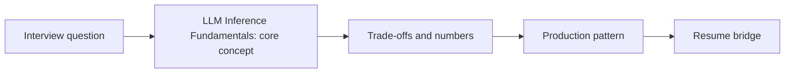

# Session 21: LLM Inference Fundamentals: Tokens, Prefill vs Decode & Memory-Bound Math

> **Status: SKELETON** (content to be written; follow `CONTENT_GUIDELINES.md`)
> - **Phase 1: Foundational Building Blocks** | **Week 2** | **Priority:** core | **Session type:** NEW
> - **Module:** Module 4: Models & Serving
> - **Resume anchor:** Gemini API usage across every project (cost + latency reasoning)

---

## Part 1: Quick Summary

> TODO (3-4 bullets): what this is in plain English, why interviewers care, the 10-second mental model.

## Part 2: Topics to Cover (Study Checklist)

- [ ] Tokenization & token economics (why 1 word != 1 token, multilingual penalty)
- [ ] Prefill (compute-bound) vs decode (memory-bound) and what that implies for batching
- [ ] Latency vocabulary: TTFT, TPOT/ITL, E2E latency, throughput, goodput under SLO
- [ ] GPU memory budget: weights + KV cache + activations; model size to GPU count table
- [ ] Sampling parameters (temperature, top-p/top-k) and why outputs are not fully deterministic
- [ ] Dense vs MoE models: params vs active params and the serving consequences

## Part 3: First Principles & Analogies

TODO: one everyday analogy per concept above, plus a concrete failure scenario.

## Part 4: Concept Blueprint

TODO: replace with the real architecture / decision-tree diagram.

## Part 5: Trade-Off Decision Matrix

| Option / Pattern | Latency | Cost | Complexity | When to Pick / Watch Out For |
| :--- | :--- | :--- | :--- | :--- |
| TODO option A | TODO | TODO | TODO | TODO |
| TODO option B | TODO | TODO | TODO | TODO |
| TODO option C | TODO | TODO | TODO | TODO |

## Part 6: Deep-Dive Mechanics & Numbers

TODO: the math, edge cases and "tricks" that separate a senior answer from a mid-level one.

## Part 7: Production AI & Resume Tie-In

TODO: how this applies to production AI systems and to **Gemini API usage across every project (cost + latency reasoning)**; include a short annotated code or design snippet.

## Part 8: Interview Questions (Answered Simply)

TODO: 4-6 questions, each with **What they are really testing** and **How to answer simply** (spoken-English blockquote).

## Canonical Problems Unlocked

- [chat-assistant](/problems?id=chat-assistant)
- [inference-serving](/problems?id=inference-serving)

## Deliverable (Do This Before Moving On)

- [ ] One-page cheat sheet: tokens -> GPUs -> dollars for a 7B, 70B and MoE model.

## Socratic Study Prompt

> *"Teach me LLM inference from first principles: tokenization, prefill vs decode, why decode is memory-bandwidth bound, TTFT/TPOT/goodput, and how to estimate GPUs and cost from tokens/sec. Then quiz me with 5 back-of-envelope questions."*
