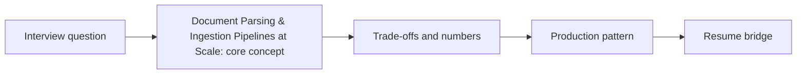

# Session 22: Document Parsing & Ingestion Pipelines at Scale

> **Status: SKELETON** (content to be written; follow `CONTENT_GUIDELINES.md`)
> - **Phase 1: Foundational Building Blocks** | **Week 2** | **Priority:** core | **Session type:** NEW
> - **Module:** Module 2: RAG, Search & Multimodal
> - **Resume anchor:** Deloitte Slide-to-Image RAG + Network18 Sales RAG (PDF ingestion)

---

## Part 1: Quick Summary

> TODO (3-4 bullets): what this is in plain English, why interviewers care, the 10-second mental model.

## Part 2: Topics to Cover (Study Checklist)

- [ ] Parsing strategies: text-layer extraction vs OCR vs layout models vs VLM-based parsing
- [ ] Tables, charts, images and slides: what to extract and how to represent them
- [ ] Near-duplicate detection (MinHash/SimHash) and versioned documents
- [ ] PII / secret scrubbing and ACL capture at ingest time
- [ ] Incremental indexing: change detection, tombstones/deletes, backfills, re-index cost
- [ ] Pipeline architecture: queue-driven workers, idempotency, poison documents, DLQ
- [ ] Ingestion quality metrics and sampling-based QA

## Part 3: First Principles & Analogies

TODO: one everyday analogy per concept above, plus a concrete failure scenario.

## Part 4: Concept Blueprint

TODO: replace with the real architecture / decision-tree diagram.

## Part 5: Trade-Off Decision Matrix

| Option / Pattern | Latency | Cost | Complexity | When to Pick / Watch Out For |
| :--- | :--- | :--- | :--- | :--- |
| TODO option A | TODO | TODO | TODO | TODO |
| TODO option B | TODO | TODO | TODO | TODO |
| TODO option C | TODO | TODO | TODO | TODO |

## Part 6: Deep-Dive Mechanics & Numbers

TODO: the math, edge cases and "tricks" that separate a senior answer from a mid-level one.

## Part 7: Production AI & Resume Tie-In

TODO: how this applies to production AI systems and to **Deloitte Slide-to-Image RAG + Network18 Sales RAG (PDF ingestion)**; include a short annotated code or design snippet.

## Part 8: Interview Questions (Answered Simply)

TODO: 4-6 questions, each with **What they are really testing** and **How to answer simply** (spoken-English blockquote).

## Canonical Problems Unlocked

- [enterprise-rag](/problems?id=enterprise-rag)
- [answer-engine](/problems?id=answer-engine)
- [multimodal-pipeline](/problems?id=multimodal-pipeline)

## Deliverable (Do This Before Moving On)

- [ ] Ingestion pipeline diagram for 100M docs with throughput + cost estimate.

## Socratic Study Prompt

> *"Walk me through designing an ingestion pipeline for 100M mixed documents (PDF, slides, HTML, scans): parsing, OCR vs VLM parsing, dedup, PII scrubbing, incremental updates and deletes. Then grill me on failure modes."*
