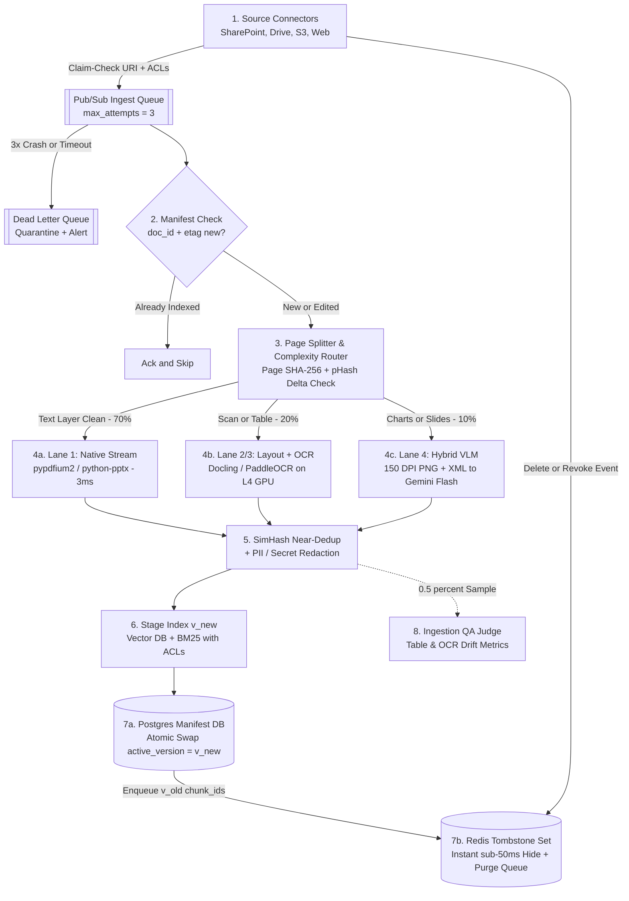

# Session 22: Document Parsing & Ingestion Pipelines at Scale

> **Prerequisites & Plain-English Summary**
>
> - **Prerequisites:**
>   - **Queues, Idempotency & Dead Letter Queues (`fund-04`):** Decouple slow background workers with a message queue, attach unique content keys so retries never duplicate records, and quarantine toxic files after bounded retries.
>   - **Object Storage & Claim-Check (`fund-03`, `fund-04`):** Store multi-megabyte PDFs and slide images in cheap object storage (`GCS`/`S3`) and pass only lightweight URI pointers on the queue.
>   - **Tokens & Multimodal Vision Cost (`session-21`):** Calling a Vision LLM on a rendered page costs `~50–200×` more than reading embedded digital text, so routing every page blindly to a VLM bankrupts large backfills.
> - **Plain-English Core:** Before an AI search system can answer a single question over 100 million company files, an ingestion factory must turn messy PDFs, scanned contracts, spreadsheets, and slide decks into clean, deduplicated, permission-tagged text—and keep that index fresh when files are edited or deleted without re-paying for unchanged pages.

---

## 1. Build It From Zero (Basics + Socratic Walkthrough)

### What Are We Actually Building, and Why Is It Hard?
Imagine an enterprise customer says: *"Point your AI assistant at our SharePoint, Google Drive, and Confluence—50 million PDFs, PowerPoint pitch decks, scanned vendor invoices, and HTML wikis, with 500,000 edits and deletions every day."*

In a weekend prototype, you run `pypdf` in a Python `for` loop on 20 PDFs and dump the text into a vector database. It works in 12 seconds! Then you point that script at real enterprise folders: scanned contracts return empty strings `""`, multi-column financial tables turn into scrambled number soup, 65% of consulting slides are identical legal disclaimers repeated across 40,000 decks, a single corrupt 900-MB ZIP-inside-a-PDF crashes your worker in an infinite retry loop, and a deleted HR layoff memo keeps showing up in AI answers three days later.

### The Socratic Ladder: Discovering Scalable Ingestion Architecture

**🤔 Question 1: Why not just send every single page of all 50 million documents as an image to a Vision LLM so charts, scans, and tables all come out clean?**
Let's check the bill! `50M docs × 10 pages = 500M pages`. Even at a cheap `$0.30 per 1,000 pages` on a fast Vision model, a single full pass costs **`$150,000`** and takes days of GPU/API quota—even though `75%` of those pages are plain digital paragraphs that a free CPU library extracts in `3 milliseconds`!
→ Inspect each page cheaply first, and **route pages by visual complexity**: digital text extractor for simple prose, OCR/layout model for scans/tables, and Vision LLM *only* for dense charts, slides, and diagrams.

**🤔 Question 2: Great—cost dropped 5×! Next, a consultant fixes one typo on Slide 4 of a 120-slide deck, or Reuters syndicates almost the exact same news story across 9 portals. How do you avoid re-processing and double-indexing?**
Whole-file checksums fail both cases: editing 1 character changes the whole file's SHA-256, and adding a publisher byline changes a syndicated article's hash. You need two levels of fingerprinting: **per-page/per-slide exact hashes** (so only Slide 4 re-runs!) plus **fuzzy content fingerprints** (that stay nearly identical when 92% of the words or pixels match).
→ Delta-hash sub-document units (`page`/`slide`) for incremental updates, and run **near-duplicate detection** (`MinHash` / `SimHash` / perceptual `pHash`) before embedding.

**🤔 Question 3: What happens if a worker updates 15 chunks of `contract_v2`, crashes on page 9, or a user deletes a confidential file completely?**
If you overwrite chunks in place without versioning, a mid-document crash leaves `contract_v1` paragraphs mixed with `contract_v2` paragraphs—a silent Frankenstein document! And if you forget to track which chunk IDs belonged to `contract_v1`, deleted clauses stay orphaned in your vector index forever ("zombie chunks").
→ Maintain a **Document Manifest Table** (`doc_id -> active_version, chunk_ids[], acl_groups[]`): write `v2` chunks under versioned IDs first, atomically flip `active_version = v2`, and **tombstone/purge** `v1` chunks.

**🤔 Question 4: At 2 AM, someone uploads a password-locked PDF and a 4,000-DPI blueprint scan that OOM-kills a 4-GB worker container. When the container dies, the queue hands that exact message to another worker, killing your entire fleet one by one. How do you survive?**
Never pass raw bytes inside queue messages, isolate memory-hungry rendering in bounded subprocesses with page timeouts, and cap retries on the queue (`max_delivery_attempts = 3`) so any file that crashes three workers automatically drops into a quarantine queue for inspection.
→ Combine the **Claim-Check Pattern**, **sandboxed per-page timeouts**, and a **Dead Letter Queue (DLQ)** for poison documents.

**🤔 Question 5: Your pipeline ingested 10 million files with zero crashes (`0%` error rate!). Why are RAG answers on financial tables still wrong?**
Because a parser can return HTTP `200 OK` while silently mangling two-column PDFs (reading across columns instead of down) or dropping minus signs (`(4.2M)` → `4.2M`). Infrastructure uptime tells you nothing about **extraction fidelity**.
→ Track **ingestion quality metrics** (empty-page rate, gibberish/OCR confidence score, table structure retention) and run **automated stratified sampling QA** against a Vision/human oracle.

### Naming What You Just Invented
1. Routing pages across `pypdf/pdfium` → `OCR + Layout Detection` → `Vision LLM` is **Tiered Complexity-Routed Parsing**.
2. Catching syndicated text and boilerplate slides is **Exact (`SHA-256`) + Near-Duplicate (`MinHash LSH` / `SimHash` / `pHash`) Deduplication**.
3. Atomic version pointer swaps + deleting obsolete vector IDs is **Manifest-Driven Incremental Indexing & Tombstone Propagation**.
4. Stripping secrets/SSN and attaching SharePoint/Drive group IDs during parse is **Ingest-Time PII Scrubbing & ACL Capture**.
5. Surviving toxic files across thousands of async workers is **Queue-Driven Idempotent Processing with Claim-Check & DLQs**.

### Explain It in Layers
- **One Line (Explain to a 12-Year-Old):** Before filing millions of messy school handouts into a smart search binder, sort easy typed pages onto a fast scanner, send tricky charts to an art reader, throw out duplicate copies, and shred old pages whenever a teacher hands out a revised sheet.
- **One Paragraph (Explain to a Non-Backend Engineer):** Real company documents aren't clean text—they're PDFs with two-column layouts, scanned signatures, Excel tables, and PowerPoint diagrams. A production ingestion pipeline stores raw files in cloud storage, puts lightweight job pointers onto a queue, and routes each page to the cheapest parser that won't lose meaning (plain text extraction for normal pages, OCR/layout models for scans and tables, Vision LLMs for charts and slides). It fingerprints pages to skip duplicates and unchanged slides, scrubs sensitive personal data, records who is allowed to read each file, and cleanly deletes old vector entries when documents change.
- **Engineer Version:** At `10M–100M` document scale, ingestion is an **event-driven, idempotent DAG** backed by object storage (Claim-Check), partitioned queues (`Pub/Sub`/`Kafka`) with `DLQ` isolation, and a transactional **Document State/Manifest Store** (`Postgres`/`DynamoDB`). Pages are routed dynamically across **native PDF/XML stream parsers**, **layout-aware OCR (`Docling`/`PaddleOCR`/`Unstructured`)**, and **VLM structured Markdown/HTML serialization**, deduplicated via **MinHash LSH / SimHash / pHash**, scrubbed for **PII/secrets**, tagged with source **ACL principals**, and committed via **blue-green document version pointers** with asynchronous **tombstone garbage collection**.

---

## 2. First Principles, Analogies, Interview Framing & Capacity Math

> **Why Interviewers Care & The 10-Second Mental Model**
>
> - **Why Interviewers Care:** "Garbage in, garbage out" is the #1 root cause of enterprise RAG failures in production. Any candidate can draw `Docs -> Chunk -> Vector DB`; senior candidates win the interview in the first five minutes by asking about **tables/charts**, **incremental updates & deletes (tombstones)**, **deduplication**, **ACL capture**, and **backfill vs. steady-state cost**.
> - **The 10-Second Mental Model:** **"Route parsing by page complexity (don't VLM plain text; don't `pypdf` charts). Deduplicate at page/shingle granularity before embedding. Track `(doc_id, version_hash -> chunk_ids)` in a manifest DB so updates swap atomically and deletes tombstone cleanly."**

### 1. The 4 Parsing Tiers — "Airport Customs Lanes"
- **The Analogy:** Not every traveler needs a 20-minute physical bag search. **Lane 1 (Digital Passport Gate = Native Text Layer):** `pdfium` / `PyMuPDF` / `python-pptx` reads embedded UTF-8 streams in `<3ms/page` at `~$0`, but fails completely on scanned images and scrambles multi-column coordinates or visual charts. **Lane 2 (X-Ray OCR = Classical/Neural OCR):** `PaddleOCR` / `Tesseract` / Cloud Vision reads pixel text on scans (`~40–90ms/page` on GPU) but outputs flat lines without knowing what is a header vs. table cell. **Lane 3 (Baggage Scanner = Layout + Table Structure Models):** `Docling` / `LayoutLM` / `TableTransformer` detects bounding boxes (`Title`, `Column 1`, `Table`, `Figure`) in reading order and reconstructs HTML/Markdown tables (`~120–250ms/page`). **Lane 4 (Specialist Inspector = Vision LLM):** `Gemini Flash Vision` / `Qwen-VL` / `ColPali` interprets `2×2` consulting matrices, flowcharts, and stacked bar charts into structured Markdown + JSON (`~600–1,500ms/page`).
- **How to Represent Non-Prose Elements:**
  - **Tables:** Serialize to **Markdown or compact HTML `<table>`** (preserving row/column header alignment!) *plus* a 2-sentence natural-language summary for dense embedding recall, keeping the raw structured table attached in metadata for exact LLM reading.
  - **Charts, Diagrams & Slides:** Render at `150 DPI` (`~1,200–1,600 px` long edge—sharp enough for axis numbers without wasting 4K vision tokens), extract a **structured VLM Markdown description** (`chart_type`, `axes`, `exact_series_values`, `takeaway`), and store a signed `GCS` image URI so the UI renders the original visual alongside the answer!

### 2. Exact & Near-Duplicate Detection — "DNA Barcodes vs. Full Sequencing"
- **Exact Dedup (`SHA-256`):** Hash normalized bytes at two levels: `file_sha256` (skip identical re-uploads in `O(1)`) and `page_or_slide_sha256` (inside `.pptx` XML or PDF page streams so editing 1 page of a 200-page manual only re-parses 1 page).
- **Text Near-Dedup (`MinHash + LSH` or `SimHash`):**
  - Break text into `k`-shingles (e.g., overlapping `5-word` windows). **MinHash** computes `128` hash permutations to estimate **Jaccard Similarity** `|A ∩ B| / |A ∪ B|`, grouped into **Locality-Sensitive Hashing (LSH)** bands so candidate pairs above `>= 0.85` similarity are found in `O(1)` bucket lookups instead of `O(N^2)` comparisons across `100M` docs!
  - **SimHash (`64-bit` or `128-bit`):** Projects weighted token hashes into a compact bit signature where two syndicated Reuters stories differing only by a headline/footer have **Hamming distance `<= 3` bits**.
- **Visual Boilerplate Dedup (`pHash` / `dHash`):** Compute a `64-bit` Discrete Cosine Transform perceptual hash on rendered slide thumbnails—instantly catching `60–70%` of recurring corporate cover slides, agenda dividers, and legal disclaimers even if JPEG compression or resolution changed slightly.

### 3. PII / Secret Scrubbing & ACL Capture at Ingest Time — "Mailroom Redaction & Security Stamp"
- **PII & Secrets Before Indexing:** Once an API key (`AKIA...`), Aadhaar/SSN, or patient phone number enters an embedding vector or chunk payload, deleting it across backups, caches, and fine-tune logs is painful. Run fast deterministic regex/checksum scanners (`TruffleHog`/`Gitleaks` patterns for secrets + Luhn/checksum validators) paired with a lightweight NER pass (`Presidio` / `IndicBERT`) to mask (`[REDACTED_SSN]`) or tokenize via a **PII Vault** *before* chunking and embedding.
- **Capture Source ACLs Atomically:** Every connector (`SharePoint`, `Google Drive`, `Confluence`, `Slack`) must fetch both `(content_stream, acl_principals + inherit_chain + source_updated_at)` in the same connector sync event. Never index a document with `"acl": "pending"`—default-deny (`acl_groups = []` matches nobody!) until permissions are confirmed.

### 4. Incremental Indexing, Versioned Manifests & Tombstones — "Git Commit Pointers for Search"
- **Change Detection:** Combine **webhook/CDC push events** (Drive Changes API, SharePoint delta tokens, S3 `OBJECT_FINALIZE` for `<30s` freshness) with a **periodic reconciliation crawl** (daily metadata tree walk to catch dropped webhooks or silent permission-inheritance edits!).
- **Blue-Green Document Commits & Tombstones:**
  - Store `documents(doc_id, source_etag, active_version, chunk_ids, acl_hash, status)` in Postgres.
  - On edit (`etag_v7 -> etag_v8`): write new chunks with IDs `doc_42:v8:c0..c14` (or filterable `doc_version = 8`). Only after all `v8` embeddings commit to Vector + BM25 stores do you update `active_version = 8` in Postgres and enqueue `doc_42:v7:*` chunk IDs for deletion (**tombstone sweep**).
  - On delete (`404` / `FILE_TRASHED` event): immediately mark `doc_id` tombstoned in a low-latency Redis/Postgres deny-set (`<50ms` immediate hide!) while background batch deletes purge vectors from HNSW segments.

### Timestamped Story ("Alice & Bob"): The Zombie Layoff Memo & Poison PDF Outage
- `01:55:00 AM` — **Alice** in HR uploads `draft_reorg_2026.pdf` to a shared folder by mistake, then deletes it `90 seconds` later at `01:56:30 AM`.
- `01:55:04 AM` — The create webhook already fired, and Worker #12 indexed `38` chunks into Qdrant without recording a `doc_id -> chunk_ids` manifest or subscribing to `FILE_DELETED` events.
- `02:10:00 AM` — Separately, an engineering team uploads a `650-MB` CAD-embedded PDF (`factory_layout.pdf`). Worker #4 tries to rasterize Page 1 at `600 DPI` in RAM (`9.4 GB` bitmap), hits `OOMKilled (Exit 137)`, never acks the Pub/Sub message, and Pub/Sub redelivers it infinitely—crashing all `40` ingestion pods in `8 minutes` while queue backlog balloons to `180,000` files!
- `09:05:00 AM` — **Bob** asks the company chatbot *"Which teams are restructuring?"* and retrieves Alice's deleted HR memo verbatim while morning sales PDFs haven't indexed at all.
- **How Production Architecture Prevents Both:** (1) `FILE_DELETED` immediately writes `doc_id` to a query-time tombstone set (`0ms` hide) and looks up all `38` chunk IDs from the Postgres manifest for hard vector deletion; (2) `max_delivery_attempts = 3` + subprocess memory/DPI caps (`150 DPI` max, `30s/page` timeout) quarantines `factory_layout.pdf` into the `DLQ` after `3` attempts, leaving the other `39` workers healthy.

### Functional & Non-Functional Requirements + Back-of-the-Envelope Capacity Math
Let's size an ingestion pipeline for **`100M` enterprise documents** (`70%` digital PDFs/HTML, `20%` scanned PDFs/tables, `10%` slides/visual-heavy PDFs; avg `10 pages/doc = 1B pages` total):
- **SLOs:** Incremental update/delete freshness `P95 < 2 minutes`; initial `100M`-doc backfill completed within `7 days`; poison-doc isolation `100%` (zero fleet-wide stalls); page extraction QA accuracy `>= 95%`.
- **Steady-State Daily Churn (`1%` modified/new/day = `1M docs/day = 10M pages/day`):**
  - Average page rate = `10M ÷ 86,400 ≈ 116 pages/sec`; **`peak 3× ≈ 350 pages/sec`**.
  - After page-level `SHA-256` delta + `SimHash`/`pHash` dedup (`~60%` unchanged pages inside edited docs + boilerplate skipped!), **net parsed pages = `~140 pages/sec` at peak**:
    - `70%` Lane 1 (`pdfium` CPU, `200 pages/s/core`): `98 pages/s` → **`1` single 4-vCPU pod!**
    - `20%` Lane 2/3 (`Docling`/OCR on L4 GPU, `~12 pages/s/GPU`): `28 pages/s` → **`3–4` L4 GPUs**.
    - `10%` Lane 4 (`Gemini Flash Vision`, `~300 tokens/page`): `14 pages/s` (`~4,200 tok/s` input) → Batch/Standard API costs `1.2M VLM pages/day × ~450 total tok × ~$0.20/1M ≈` **`~$110/day`**.
- **7-Day `100M`-Doc (`1B` Pages) Backfill Math:**
  - `1B pages ÷ (7 × 86,400s) ≈ 1,653 pages/sec` sustained.
  - Dedup drops `~35%` duplicate/boilerplate pages → **`~1,075 pages/sec` net**:
    - Lane 1 (`750 p/s`): `~8` vCPUs (`~$15` total Spot CPU!).
    - Lane 2/3 (`215 p/s` @ `12 p/s` per L4 GPU): **`~20` Spot L4 GPUs** (`20 × $0.35/hr × 168h ≈ $1,176`).
    - Lane 4 (`110M` VLM pages via **50%-discounted Batch API**): `110M × 450 tok × $0.10/1M ≈` **`~$4,950`** (vs. **`~$100,000+`** if we ran every page through a VLM!).
  - **Raw + Parsed Storage:** `100M × 1.5 MB = 150 TB` raw in GCS (`~$3,000/mo` Standard or Archive tiering) + `1B pages × 3 KB Markdown ≈ 3 TB` parsed text.

---

## 3. Visual Architecture Blueprint

Walk through the `1 → 8` pipeline flow below to see how raw connectors become clean, versioned, ACL-safe documents without letting poison files or partial updates corrupt search:

1. **Step 1 (Connectors & CDC):** Webhooks + scheduled delta crawlers push metadata + `gcs_raw_uri` (Claim-Check) + source `acl_groups` onto partitioned `Pub/Sub` / `Kafka` (`ingest-raw` topic); deletes take an express lane straight to Tombstones.
2. **Step 2 (Idempotency & File-Level Dedup):** Worker checks `(doc_id, source_etag)` in the Manifest DB; skips already-indexed versions and links exact `file_sha256` clones.
3. **Step 3 (Sub-Document Splitter & Complexity Router):** Splits into pages/slides in a memory-capped sandbox, checks per-page `SHA-256` + `pHash`/`SimHash` dedup, and inspects text density, image area ratio, and vector drawing ops to pick Lane 1, 2/3, or 4.
4. **Step 4 (Tiered Extraction):** Runs native text stream (`<3ms`), Layout+OCR (`Docling`/GPU), or Hybrid VLM (`150 DPI` PNG + XML hints → structured Markdown). Toxic/corrupt files exceeding timeouts fail to the **DLQ** after `3` attempts.
5. **Step 5 (Near-Dedup & PII/Secret Scrubbing):** Drops near-duplicate boilerplate (`MinHash LSH` / `SimHash`), redacts secrets/PII, and normalizes Unicode (`NFKC`).
6. **Step 6 (Stage-Write New Version):** Chunks and embeds under `version = v_new`, writing vectors + BM25 docs tagged with `(doc_id, version, acl_groups)`.
7. **Step 7 (Atomic Manifest Commit & Tombstone Sweep):** Flips `active_version = v_new` in Postgres and enqueues `v_old` chunk IDs (or deleted `doc_id`s) for immediate Redis tombstone masking + async vector purge.
8. **Step 8 (Stratified QA Sampler):** Samples `0.5%` of parsed pages against a high-tier VLM judge to monitor table fidelity, OCR empty-page anomalies, and parser drift.



---

## 4. Side-by-Side Comparison & Trade-Off Table

| Parsing / Ingestion Approach | Speed & Cost (`per 1k pages`) | Layout, Tables & Charts | When to Pick / Winner | Watch Out For (The Trap) |
| :--- | :--- | :--- | :--- | :--- |
| **Native Text Stream** *(`pypdfium2`, `PyMuPDF`, `python-pptx`)* | `~1–3s` CPU total · **`~$0.001`** | Loses charts; scrambles multi-column PDFs & merged cells | **Winner for clean born-digital single-column prose & code/HTML.** | Returns `""` on scanned PDFs (`0` characters without throwing an error!) and destroys `2×2` slide layouts. |
| **Classical + Layout OCR** *(`Docling`, `Marker`, `PaddleOCR`)* | `~60–120s` GPU · **`~$0.02–$0.05`** | Good reading-order boxes & standard bordered tables | **Winner for scanned contracts, invoices, academic two-column PDFs.** | Cannot interpret *meaning* of arrows in architecture diagrams, Harvey balls, or unlabeled chart series. |
| **Hybrid VLM Structured Parse** *(`Gemini Flash Vision`, `Qwen-VL`)* | `~3–8 min` API/GPU · **`~$0.10–$0.40`** *(Batch API)* | Preserves `2×2` matrices, charts, flowcharts & borderless tables | **Winner for slide decks & visually dense pages routed selectively (`~10%`).** | VLMs can hallucinate single digits in dense `30-row` number tables unless paired with deterministic XML/OCR text! |
| **Visual Patch Retrieval** *(`ColPali` / `ColQwen2`)* | No OCR/chunking at ingest · `~128–1024` vectors **per page** | End-to-end visual layout recall without parsing pipelines | **Niche winner for smaller visual-heavy corpora (`<1M` pages).** | Multi-vector late interaction explodes vector RAM **`20×–50×`** at `1B` pages and still needs a VLM at query time to read answers. |

---

## 5. Deep-Dive Mechanics & Production Failure Analysis

### Under-the-Hood Tricks (What Separates Junior from Senior Answers)

1. **Deterministic Page Complexity Heuristics (How the Router Decides in `<2ms`):**
   - Inspect each PDF page's object tree before rendering pixels:
     - If `extracted_char_count < 40` AND `embedded_image_area_ratio > 0.50` → **Scanned Page** → route to OCR/Layout (Lane 2/3).
     - If `vector_draw_ops > 150` (lines/curves/rectangles indicating charts or borderless tables) OR file is `.pptx` with grouped shapes → **Visual Diagram/Table** → route to Hybrid VLM (Lane 4).
     - Check multi-column layout via horizontal X-coordinate histogram of text bounding boxes (a bimodal X-start distribution means 2 columns—never concatenate raw stream order; sort boxes per column first!).
2. **Preventing VLM Number Hallucination via Dual-Input Grounding:**
   - When parsing financial charts or consulting slides with a VLM, pass **both** the `150 DPI` PNG image *and* the raw deterministic strings extracted from the PDF/PPTX XML stream in the prompt: *"Use the image to understand spatial structure, columns, and arrows, but copy exact numbers and entity spellings strictly from the verified text tokens below."* This eliminates decimal/digit transcription drift.
3. **MinHash LSH Band Math (`b` bands × `r` rows = `128` hashes):**
   - Two documents with Jaccard similarity `s` collide in at least one LSH band with probability `P = 1 − (1 − s^r)^b`, creating a sharp S-curve threshold at `t ≈ (1 / b)^(1 / r)`. With `b = 16, r = 8` (`128` hashes), docs with `s = 0.85` match `>96%` of the time while docs with `s = 0.40` match `<1%`—giving sub-millisecond near-duplicate lookup in Redis/Postgres without scanning existing documents!
4. **Separate Fast-Lane Queue vs. Bulk-Backfill Queue:**
   - Never dump a `5M`-document SharePoint onboarding backfill into the same FIFO queue as live user uploads! Maintain two priority queues (`ingest-realtime` for single-file edits with `<2 min` freshness SLA, and `ingest-backfill` consuming spare worker & Batch API quota).

### Failure Modes in Production

#### Failure Mode 1: Silent "Blank Scan" & Mojibake Encoding Corruption (`0%` Error Rate, `0%` Recall)
- **How It Happens at 2 AM:**
  1. Legal onboards `200,000` signed Master Service Agreements that were printed, wet-signed, and scanned back to PDF, alongside older PDFs with broken custom `ToUnicode` font maps (which extract as `"\ufffd\x00\x12..."` mojibake).
  2. Naive text extraction (`pypdf`) succeeds with zero exceptions, emits `0` chunks (or embeds garbage `\ufffd` vectors), marks all `200,000` files `status = INDEXED` in Postgres, and alerts stay silent.
  3. Months later, Legal discovers `40%` of signed contracts are completely invisible to search.
- **How to Detect It in Metrics:**
  - Emit per-page telemetry: `chars_per_page`, `alphanumeric_ratio` (`valid_letters_digits ÷ total_chars`), `ocr_fallback_rate`, and `chunks_per_document == 0` counter. Flag any page with `<30` chars (when page file size `>25 KB`) or `alphanumeric_ratio < 0.65`.
- **Exact Mitigation:**
  1. Auto-escalate low-character or low-alphanumeric-ratio pages from Lane 1 to Lane 2/3 OCR/VLM instead of marking them indexed.
  2. Quarantine `0-chunk` non-empty documents into a `needs_inspection` state and run a nightly `0.5%` stratified VLM audit comparing raw page renders against stored chunks.

#### Failure Mode 2: Orphaned "Zombie Chunks" on Document Edit & Re-Chunking
- **How It Happens at 2 AM:**
  1. Version 1 of `Pricing_Sheet.pdf` had `24` pages (`chunk_01`..`chunk_24`), deterministic ID `hash(doc_id + chunk_index)`.
  2. Sales deletes `6` discontinued product pages, so Version 2 only has `18` pages (`chunk_01`..`chunk_18`). The ingestion worker upserts `chunk_01`..`chunk_18` in place—overwriting the first `18`, while **`chunk_19`..`chunk_24` remain untouched in the vector index forever**!
  3. Customers ask about discontinued products and the chatbot quotes Version 1 prices from `chunk_21`.
- **How to Detect It in Metrics:**
  - Reconciliation job comparing `SUM(cardinality(chunk_ids))` in the Postgres `documents` manifest against total live point count in Qdrant/Vector Search; track `stale_version_hits` blocked at query time.
- **Exact Mitigation:**
  1. **Never overwrite by `doc_id + index` alone without tracking the old set!** Include `version` in chunk IDs (`doc_id:v2:0..17`), store the exact `chunk_ids[]` array per version in Postgres, atomically flip `active_version = 2` (or filter by `active_version`), and explicitly execute `delete(points=v1_chunk_ids)` after commit.

---

## 6. Production AI & Resume Tie-In

### 1. Deloitte Internal Asset Discovery Chatbot (Slide-to-Image Delta + Hybrid VLM Ingestion)
- **The Challenge:** Consulting `.pptx` and `.pdf` deliverables carry `~70%` of their meaning in spatial `2×2` matrices, system architecture diagrams, and comparison tables where plain `python-pptx` text extraction scrambles XML shape order (`57%` Recall@5). Yet running Gemini Vision on every slide of every re-uploaded 120-slide deck would waste `80%` of budget on unchanged slides and corporate boilerplate.
- **Your Production Architecture:**
  1. **ZIP XML Delta Hashing:** Unzipped `.pptx` (`ppt/slides/slideN.xml` + linked media hashes) to compute per-slide `SHA-256`—re-rendering (`LibreOffice Headless` at `150 DPI`) and calling **Gemini Flash Vision** *only* on modified slides.
  2. **Perceptual Dedup + Hybrid Grounding:** Applied `64-bit pHash` on rendered PNGs to skip `68%` of recurring title/disclaimer slides globally, and passed *both* deterministic XML strings and the slide PNG into Gemini Vision—pushing **Recall@5 to `91.4%`** and visual table accuracy to **`94.0%`** at **`$0.42 / 1,000 slides`**.

### 2. Network18 Financial News & Sales Intelligence RAG (Syndication SimHash + PDF Ingestion)
- **The Challenge:** Across `12+` news feeds (`600+` daily articles, `100×` target `5,000/sec`) and Sales Intelligence PDF reports, wire agencies syndicate near-identical stories with minor header/footer edits, while financial PDFs mix dense narrative text with quarterly balance tables.
- **Your Production Architecture:** Combined an `O(1)` canonical URL Bloom filter with **shingle-based `SimHash` (`Hamming distance <= 3`)** to collapse syndicated wire copies under a single `canonical_story_id` (`99.3%` dedup accuracy) before running downstream Transformer NER or vector indexing.

### Production Code: Complexity-Routed, SimHash-Deduplicated & Tombstone-Safe Ingestion Worker (Python)

A complete, placeholder-free ingestion core showing complexity routing, `64-bit SimHash` near-duplicate detection, PII scrubbing, and atomic blue-green manifest commit with zombie-chunk cleanup:

```python
import hashlib, re
from dataclasses import dataclass

PII_PATTERNS = [
    (re.compile(r"\b\d{3}-\d{2}-\d{4}\b"), "[REDACTED_SSN]"),
    (re.compile(r"\b(?:AKIA|ASIA)[0-9A-Z]{16}\b"), "[REDACTED_AWS_KEY]"),
]

@dataclass
class PageInput:
    page_num: int
    raw_text: str             # Extracted via fast pdfium / python-pptx XML stream
    image_area_ratio: float   # 0.0..1.0 share of page covered by raster images
    vector_draw_ops: int      # Line/curve/rect count hinting charts or borderless tables
    png_uri: str              # Claim-check URI in GCS if visual rendering is needed

def simhash_64(text: str, shingle_size: int = 4) -> int:
    """Computes a 64-bit Charikar SimHash over word shingles for near-duplicate detection."""
    words = re.findall(r"\w+", text.lower())
    shingles = [" ".join(words[i : i + shingle_size]) for i in range(max(1, len(words) - shingle_size + 1))]
    weights = [0] * 64
    for sh in shingles:
        h = int.from_bytes(hashlib.blake2b(sh.encode("utf-8"), digest_size=8).digest(), "big")
        for bit in range(64):
            weights[bit] += 1 if (h >> bit) & 1 else -1
    fingerprint = 0
    for bit, w in enumerate(weights):
        if w > 0:
            fingerprint |= 1 << bit
    return fingerprint

def is_near_duplicate(sig_a: int, existing_sigs: list[int], max_hamming: int = 3) -> bool:
    return any((sig_a ^ sig_b).bit_count() <= max_hamming for sig_b in existing_sigs)

def choose_parse_lane(p: PageInput) -> str:
    alnum = sum(ch.isalnum() for ch in p.raw_text)
    ratio = alnum / max(len(p.raw_text), 1)
    if len(p.raw_text.strip()) < 40 and p.image_area_ratio > 0.5:
        return "lane2_ocr_layout"          # Scanned contract/invoice -> Docling / OCR
    if p.vector_draw_ops > 150 or ratio < 0.60:
        return "lane4_hybrid_vlm"          # Chart, 2x2 slide, or broken font -> VLM + XML text
    return "lane1_native_text"             # Clean digital prose -> free <3ms path

async def ingest_document_version(doc_id: str, new_ver: int, acl_groups: list[str],
                                  pages: list[PageInput], parsers: dict, vector_db, manifest_db):
    old_record = await manifest_db.get_doc(doc_id)  # {"version": int, "chunk_ids": list[str], "page_hashes": dict}
    prev_hashes = (old_record or {}).get("page_hashes", {})
    seen_simhashes, new_chunk_ids, new_page_hashes, staged_points = [], [], {}, []

    for p in pages:
        page_sha = hashlib.sha256(f"{p.raw_text}|{p.png_uri}".encode()).hexdigest()
        new_page_hashes[str(p.page_num)] = page_sha
        # Reuse previously parsed Markdown if this exact page/slide hash is unchanged
        md = await manifest_db.get_cached_page_md(page_sha)
        if md is None:
            lane = choose_parse_lane(p)
            md = p.raw_text if lane == "lane1_native_text" else await parsers[lane](p)
            await manifest_db.save_cached_page_md(page_sha, md)

        for regex, token in PII_PATTERNS:
            md = regex.sub(token, md)
        sig = simhash_64(md)
        if is_near_duplicate(sig, seen_simhashes):  # Drop boilerplate/duplicate pages before embedding!
            continue
        seen_simhashes.append(sig)

        cid = f"{doc_id}:v{new_ver}:p{p.page_num}"
        new_chunk_ids.append(cid)
        staged_points.append({"id": cid, "text": md, "doc_id": doc_id, "version": new_ver, "acl": acl_groups})

    # 1. Stage-write all v_new vectors BEFORE flipping manifest pointer (crash-safe!)
    if staged_points:
        await vector_db.upsert_chunks(staged_points)
    # 2. Atomically flip active_version in Postgres, then purge orphaned v_old chunks (zero zombies!)
    await manifest_db.atomic_swap_version(doc_id, new_ver, new_chunk_ids, new_page_hashes, acl_groups)
    if old_record and old_record.get("chunk_ids"):
        await vector_db.delete_ids(old_record["chunk_ids"])
```

---

## 7. Common Interview Questions, Follow-Up Probes & Quick Recall

### Q1: "Design an ingestion pipeline for 100 million mixed enterprise documents (PDFs, slides, scans, HTML). How do you parse accurately without spending $500,000?"
- **What the interviewer is testing:** Tiered complexity-based routing, cost math, and separating bulk backfill from live incremental updates.
- **How to answer simply:**
  > "The biggest mistake is treating all 1 billion pages identically—running `pypdf` on everything destroys tables and charts, while running a Vision LLM on everything costs six figures. Instead, I put a fast page-level complexity router in front of three lanes:
  > Lane 1 handles the ~70% of clean digital prose pages using native PDF/HTML stream extraction in 2 milliseconds on CPU for pennies. Lane 2 routes the ~20% of scanned contracts and standard tables—detected when text character count is near zero over a high image ratio—to a GPU layout-OCR model like Docling. Lane 3 routes only the ~10% of slides, flowcharts, and complex matrices—detected via high vector-drawing counts or `.pptx` layouts—to a Vision LLM at 150 DPI via a 50%-discounted Batch API, grounded with raw XML text so numbers don't hallucinate. Combined with page-level SHA-256 and perceptual `pHash` deduplication skipping ~35–65% boilerplate, a 100M-document backfill drops under $10,000."
- **Likely Follow-Up Probe ("The Double-Click"):**
  - *Interviewer:* "How do you stop a 10M-document onboarding backfill from delaying a CEO's single-deck upload for 6 hours?"
  - *Your Answer:* "Two separate priority queues and worker pools: `ingest-realtime` uses on-demand API quota with a `<2 minute` SLO for single edits, while `ingest-backfill` runs on Spot workers and asynchronous Batch APIs with elastic autoscaling."

### Q2: "A user edits 2 paragraphs in a 100-page document, or deletes a confidential file altogether. Walk me through what happens in your storage and vector index."
- **What the interviewer is testing:** Incremental delta indexing, orphan/zombie chunk prevention, and immediate delete/tombstone consistency.
- **How to answer simply:**
  > "I maintain a relational Document Manifest table keyed by `doc_id` that tracks `active_version`, per-page SHA-256 hashes, `acl_groups`, and the exact list of `chunk_ids` currently in the vector and BM25 indexes.
  > On an edit, we compare per-page hashes so we only re-parse and re-embed the changed pages, stage the new version's chunk set under `doc_id:v_new:*`, atomically flip `active_version = v_new` in Postgres, and then delete `v_old`'s chunk IDs—which guarantees neither half-indexed crashes nor orphaned zombie chunks when a document shrinks.
  > On a delete event, because HNSW segment compaction in vector DBs is asynchronous, we immediately write `doc_id` into a fast Redis tombstone set checked at query time—giving sub-second deletion compliance—while a background worker purges the underlying vector and BM25 records."
- **Likely Follow-Up Probe ("The Double-Click"):**
  - *Interviewer:* "What if SharePoint drops a delete webhook during a network blip?"
  - *Your Answer:* "Webhooks are an optimization for freshness, never the sole source of truth. We pair webhooks with a daily cursor-based reconciliation sweep that diffs surviving source document IDs and `etag`s against our Manifest DB and tombstones any missing IDs."

### Q3: "At 3 AM your Pub/Sub ingestion backlog explodes to 500,000 documents and every worker pod keeps restarting with Exit Code 137. What broke and how do you harden it?"
- **What the interviewer is testing:** Operational resilience against poison-pill documents, OOM kills, and unbounded message redelivery.
- **How to answer simply:**
  > "Exit Code 137 is an OS `OOM-Kill`—a handful of 'poison documents', like a 4,000-DPI blueprint PDF or deeply nested archive, blew past container RAM before acknowledging the Pub/Sub message. Because unacknowledged messages redeliver automatically, those few toxic files rotated across and killed the entire worker fleet.
  > I fix this at three layers: first, Claim-Check so raw PDFs stay in GCS and workers stream one page at a time at a capped 150 DPI inside a memory-limited subprocess (`maxtasksperchild`) with a 30-second page timeout; second, `concurrency = 1` per heavy parsing worker so two large PDFs never contend for RAM; third, `max_delivery_attempts = 3` on the Pub/Sub subscription wired to a Dead Letter Queue so any poison file is quarantined after 3 crashes instead of stalling 500,000 healthy docs."
- **Likely Follow-Up Probe ("The Double-Click"):**
  - *Interviewer:* "What if a worker isn't crashing—it's just legitimately taking 4 minutes on a 600-page annual report and Pub/Sub's 60-second ack deadline expires?"
  - *Your Answer:* "Two things: run a background lease-heartbeater that extends the Pub/Sub ack deadline every 30 seconds while the subprocess makes forward page progress, AND split huge documents (>50 pages) into page-range sub-tasks so no single message takes more than 30 seconds."

### Q4: "How do you know your ingestion pipeline isn't silently mangling tables or OCRing garbage across 100M documents?"
- **What the interviewer is testing:** Observability beyond `5xx` errors—measuring semantic extraction quality at scale.
- **How to answer simply:**
  > "Infrastructure error rates miss silent parsing bugs like blank scans or scrambled two-column text. First, I emit deterministic per-page health signals at ingest: characters per page, alphanumeric-to-garbage character ratio, detected table row/column consistency, and zero-chunk document alerts.
  > Second, I run an asynchronous stratified QA pipeline on ~0.2%–0.5% of ingested pages—rendering the original page image and asking a strong Vision judge to score completeness, reading order, and exact numerical fidelity of our stored Markdown on a 1–5 rubric, alerting if any connector or file type drops below 95%."
- **Likely Follow-Up Probe ("The Double-Click"):**
  - *Interviewer:* "How do you represent a 40-column, 200-row Excel sheet during ingestion?"
  - *Your Answer:* "Never dump 200 raw CSV rows into prose chunks—dense embeddings fail on raw grids. Instead, store the typed table in DuckDB/Parquet/Postgres for structured SQL/tool lookup, and index a natural-language schema + summary card (sheet title, column names, date range, sample values) into the vector index so the router finds the table and queries it accurately."

### 60-Second Rapid Fire (Self-Check)
- **Q: Why must you never rely on whole-file `SHA-256` alone for enterprise slides and syndicated news?**
  - **A:** Whole-file hashes miss 1-slide edits (`use per-slide XML SHA-256`) and minor wire/template edits (`use 64-bit SimHash / MinHash LSH / visual pHash`).
- **Q: How do you guarantee a deleted confidential PDF vanishes from RAG answers in `<1 second` even though HNSW segment merges are slow?**
  - **A:** Check a strongly-consistent Redis/Postgres **tombstone deny-set** (`deleted_doc_ids`) at query time while async background jobs purge vectors.
- **Q: What happens if you overwrite `doc_id + chunk_idx` when a 20-page doc shrinks to 14 pages?**
  - **A:** Chunks `15..20` stay alive as **zombie chunks**; prevent via versioned manifest (`doc_id -> active_version, chunk_ids[]`) + explicit old-ID deletion.
- **Q: Why pass *both* extracted XML text and a `150 DPI` PNG to a Vision LLM for slide/chart parsing?**
  - **A:** The PNG preserves `2×2` spatial relationships and arrows, while deterministic XML strings prevent the VLM from hallucinating digits in dense numbers.

### Deliverable & Canonical Problems Unlocked
- **Deliverable:** Draw the 100M-document tiered ingestion pipeline from memory with per-lane QPS, GPU/API cost math, manifest schema, and tombstone delete path.
- **Canonical Problems Unlocked:** [Design an Enterprise Knowledge Assistant (RAG)](/problems?id=enterprise-rag) · [Design a Web Answer Engine](/problems?id=answer-engine) · [Design a Multimodal Processing Pipeline](/problems?id=multimodal-pipeline)
