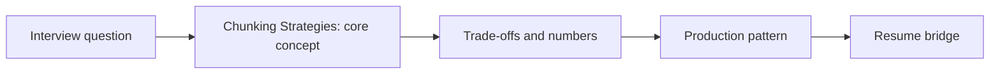

# Session 23: Chunking Strategies: Fixed, Recursive, Semantic & Structure-Aware

> **Status: SKELETON** (content to be written; follow `CONTENT_GUIDELINES.md`)
> - **Phase 1: Foundational Building Blocks** | **Week 2** | **Priority:** core | **Session type:** NEW
> - **Module:** Module 2: RAG, Search & Multimodal
> - **Resume anchor:** Deloitte Asset Discovery chatbot (per-slide descriptions) + Network18 PDF chat

---

## Part 1: Quick Summary

> TODO (3-4 bullets): what this is in plain English, why interviewers care, the 10-second mental model.

## Part 2: Topics to Cover (Study Checklist)

- [ ] Fixed-size, recursive, sentence/semantic, and document-structure-aware chunking
- [ ] Parent-child / small-to-big retrieval and sentence-window retrieval
- [ ] Contextual chunk headers / contextual retrieval and late chunking
- [ ] Chunk size vs recall vs precision vs context cost: how to run the experiment
- [ ] Chunking special content: tables, code, transcripts, slides, chat logs
- [ ] Metadata attached to chunks (source, section path, ACL, timestamp)
- [ ] Re-chunking migrations without downtime

## Part 3: First Principles & Analogies

TODO: one everyday analogy per concept above, plus a concrete failure scenario.

## Part 4: Concept Blueprint

TODO: replace with the real architecture / decision-tree diagram.

## Part 5: Trade-Off Decision Matrix

| Option / Pattern | Latency | Cost | Complexity | When to Pick / Watch Out For |
| :--- | :--- | :--- | :--- | :--- |
| TODO option A | TODO | TODO | TODO | TODO |
| TODO option B | TODO | TODO | TODO | TODO |
| TODO option C | TODO | TODO | TODO | TODO |

## Part 6: Deep-Dive Mechanics & Numbers

TODO: the math, edge cases and "tricks" that separate a senior answer from a mid-level one.

## Part 7: Production AI & Resume Tie-In

TODO: how this applies to production AI systems and to **Deloitte Asset Discovery chatbot (per-slide descriptions) + Network18 PDF chat**; include a short annotated code or design snippet.

## Part 8: Interview Questions (Answered Simply)

TODO: 4-6 questions, each with **What they are really testing** and **How to answer simply** (spoken-English blockquote).

## Canonical Problems Unlocked

- [enterprise-rag](/problems?id=enterprise-rag)
- [answer-engine](/problems?id=answer-engine)
- [code-assistant](/problems?id=code-assistant)

## Deliverable (Do This Before Moving On)

- [ ] Chunking decision table by content type + an evaluation plan (recall@k vs chunk size).

## Socratic Study Prompt

> *"Explain every major chunking strategy with its failure mode, then give me a decision framework for choosing chunk size/overlap for (a) legal contracts, (b) code, (c) slide decks, (d) support tickets. Grill me on how I would prove my choice with an experiment."*
