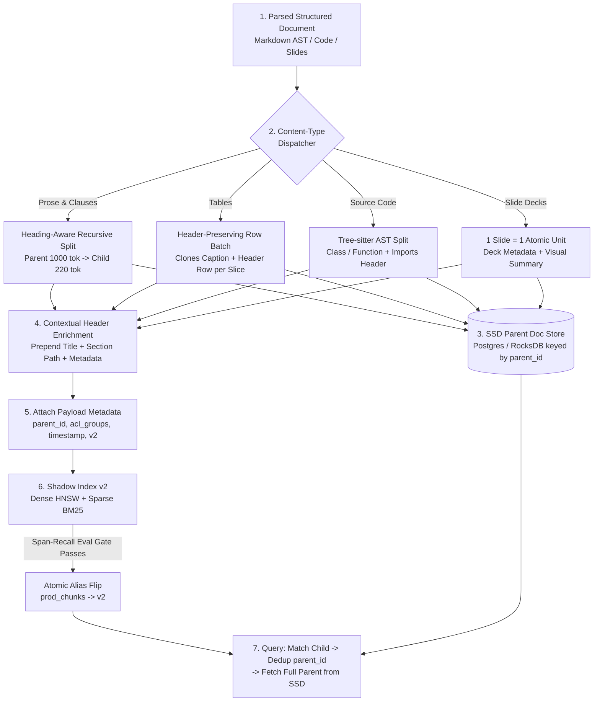

# Session 23: Chunking Strategies — Fixed, Recursive, Semantic & Structure-Aware

> **Prerequisites & Plain-English Summary**
>
> - **Prerequisites:**
>   - **Tokens & Context Cost (`session-21`):** Every chunk you send to an LLM burns input tokens and prefill time, while "Lost in the Middle" degrades reasoning when too much noisy text surrounds the real answer.
>   - **Document Parsing (`session-22`):** Clean Markdown, HTML tables, AST trees, and slide descriptions give you structural boundaries (`## Heading`, `<table>`, `def func()`) that raw character streams lack.
>   - **Vector Similarity Basics:** Turning a passage into one fixed-size vector averages all ideas inside that passage—stuffing `10` unrelated topics into one vector blurs every single one of them.
> - **Plain-English Core:** Chunking is the art of slicing long documents into bite-sized pieces so each piece is focused enough to match a specific search question, yet complete enough that the AI doesn't read a half-cut sentence or a table row missing its column headers.

---

## 1. Build It From Zero (Basics + Socratic Walkthrough)

### What Are We Actually Building, and Why Is It Hard?
Suppose your parsing pipeline from Session 22 just handed you clean Markdown for `50,000` legal contracts, Python repositories, and quarterly financial filings. A user asks: *"What is Acme Corp's liability cap under the 2025 Master Services Agreement?"*

Inside the 45-page Acme PDF, Page 19 says:
> *"4.2 Limitation of Liability. Except for gross negligence, **its aggregate cap shall not exceed $2,000,000** in any 12-month period."*

Look closely at that sentence: it never mentions **"Acme Corp"** or **"2025 Master Services Agreement"**! And if your code naively chops text every `500` characters, it might slice right between *"aggregate cap shall"* and *"not exceed $2,000,000"*—ruining retrieval *and* flipping the legal meaning if only one half is retrieved!

### The Socratic Ladder: Discovering Production Chunking

**🤔 Question 1: What happens if we don't chunk at all—just turn each entire 45-page PDF (`30,000 tokens`) into one vector, or stuff whole PDFs into the LLM?**
Two things break immediately. First, most embedding models either cap out at `512–8,192` tokens or compress all 45 pages into **one single average vector**—a single sentence about a `$2M` liability cap gets drowned out by 44 pages of boilerplate definitions! Second, stuffing ten 45-page PDFs (`300,000 tokens`) into every user query costs `~$0.40+` *per question* and pushes `TTFT` past `10 seconds`.
→ We must slice documents into smaller units.

**🤔 Question 2: Okay, slice every `500` tokens! Wait—what breaks when a cut lands mid-sentence, mid-Python-function, or between row #15 of a table and row #1 (the column headers)?**
Row #15 (`"| Q3 | 14.2 | 8.9 | -1.4 |"`) without Row #1 (`"| Quarter | India Rev ($M) | US Rev ($M) | Net Margin (%) |"`) is meaningless numbers! And slicing a Python function in half separates the `if` condition from its `return` statement.
→ Instead of cutting blindly by character count, split along **natural structural boundaries first** (`## Section` → `\n\n` paragraph → `\n` line → sentence, or `class`/`def` AST nodes for code), keep `10–15%` overlap on prose, and **repeat column headers on every split slice of an oversized table**.

**🤔 Question 3: Now we face a tug-of-war: tiny chunks (`128 tokens`) give razor-sharp search matches, while big chunks (`1,024 tokens`) give the LLM enough surrounding context to answer accurately. How can we get BOTH at once?**
Why force the unit you *search against* to be identical to the unit you *hand to the LLM*? Index tiny `128–200 token` child chunks in the vector DB so similarity matching stays laser-sharp, and store a pointer `parent_id` on each child. When child #4 matches, fetch its `800–1,200 token` parent section from a fast key-value/document store and feed the *parent* to the LLM!
→ Decouple **index granularity** from **generation context**!

**🤔 Question 4: Wait—even a clean `150-token` child chunk (`"Its aggregate cap shall not exceed $2,000,000."`) STILL lacks the words `"Acme Corp"` and `"2025 MSA"`! How will search ever distinguish Acme's `$2M` cap from Globex's `$5M` cap?**
Before computing the embedding (and BM25 tokens!) for any chunk, prepend a compact breadcrumb header summarizing *where* this chunk lives in the document:
`"[Document: Acme Corp 2025 MSA | Section 4 > 4.2 Limitation of Liability] Its aggregate cap shall not exceed $2,000,000."`
→ Enrich every chunk with **document + section hierarchy context** (or use an LLM/long-context encoder to inject situate-in-document context) *before* indexing.

**🤔 Question 5: Six months later, an experiment proves `256-token` parent-child chunks beat your current `600-token` chunks by `+9% Recall@10`. How do you re-chunk 100 million chunks in production without taking search offline?**
You cannot mutate chunk boundaries in place because `1` old chunk becomes `2.4` new chunks with totally different IDs. You stand up a **parallel shadow index (`chunks_v2`)**, backfill from your saved parsed Markdown in object storage while dual-writing live edits to both `v1` and `v2`, validate on offline + shadow traffic, and atomically flip an index alias in `<1ms`.

### Naming What You Just Invented
1. Respecting `\n\n -> \n -> sentence` hierarchy is **Recursive Character/Token Chunking**; parsing Markdown DOM, HTML, or Tree-sitter code trees is **Structure-Aware / AST Chunking**; splitting where consecutive sentence embeddings diverge is **Semantic Chunking**.
2. Embedding small `128–200` token units while returning their `800–1,200` token enclosing section (or `±3` neighboring sentences) is **Parent-Child (Small-to-Big)** and **Sentence-Window Retrieval**.
3. Prepending `[Doc | Section Path]` breadcrumbs or brief LLM-generated situational context before embedding + BM25 is **Contextual Chunk Headers / Contextual Retrieval** (and pooling token embeddings *after* running a long-context bi-encoder over the full doc is **Late Chunking**).
4. Swapping `index_v1 -> index_v2` via alias pointer is a **Blue-Green Re-Chunking Migration**.

### Explain It in Layers
- **One Line (Explain to a 12-Year-Old):** Cut a textbook along real paragraphs instead of slicing words in half with scissors, label every flashcard with its book title and chapter name, and hand the student the whole page once the right flashcard matches.
- **One Paragraph (Explain to a Non-Backend Engineer):** If chunks are too large, vector search gets blurry and LLM prompts get expensive; if chunks are too small, pronouns like "it" and table numbers lose their meaning. Production RAG solves this with three habits: split along natural document structure (headings, code functions, slides, and header-preserved tables), attach a short breadcrumb header (document title + section path + metadata) before indexing so orphaned sentences become self-contained, and optionally index small child chunks for sharp search while retrieving their larger parent section for the LLM.
- **Engineer Version:** Chunking optimizes the Pareto frontier across **Stage-1 `Recall@K`**, **Stage-2 `Context Precision`**, and **prompt token budget**. Production pipelines dispatch by MIME/content type (AST/symbol boundaries for code, atomic slide units for decks, header-replicated row batches for tables, recursive structure-aware splitting for prose), enrich chunks pre-embedding via **deterministic hierarchical headers or Contextual Retrieval** (cutting top-20 retrieval failure rates by `~35–49%` when paired with BM25), decouple retrieval unit from synthesis unit via **Parent-Child (`Small-to-Big`) mapping**, and treat `chunking_config_version` as an immutable schema migrated via **blue-green alias cutovers**.

---

## 2. First Principles, Analogies, Interview Framing & Capacity Math

> **Why Interviewers Care & The 10-Second Mental Model**
>
> - **Why Interviewers Care:** When an interviewer asks *"What chunk size and strategy do you pick?"*, saying *"512 tokens with 50 overlap because LangChain defaults to it"* is an instant mid-level signal. A senior engineer answers **by content modality**, explains **how orphaned context/tables break**, and describes **the exact offline experiment (`Recall@K` + `Faithfulness` vs. `token cost`)** used to prove the number.
> - **The 10-Second Mental Model:** **"Never split blindly across structural boundaries. Match strategy to content type (AST for code, 1-slide-per-chunk for decks, header-repeated rows for tables). Embed small + contextualized for recall; feed larger parent sections for synthesis; prove chunk size on a golden eval grid."**

### 1. The 4 Core Splitting Mechanics — "Editing Film Reels"
- **Fixed-Size Token Splitting ("The Guillotine Timer"):** Slices strictly every `N` tokens (`e.g., 512`) with `O` overlap (`e.g., 50`). Zero compute overhead, predictable batch tensor shapes, but slices mid-clause, mid-JSON, and mid-table. Only acceptable for unstructured uniform logs or raw transcripts lacking punctuation.
- **Recursive Separators ("Paragraph → Line → Sentence → Word"):** Attempts `["\n## ", "\n### ", "\n\n", "\n", ". ", " "]` recursively until chunks fit `<= target_tokens`. Fast (`<0.2ms/page` CPU), preserves prose paragraphs `90%+` of the time, and serves as the rock-solid baseline for general prose.
- **Semantic Chunking ("Topic-Shift Detector"):** Embeds individual sentences (`s_1..s_n`), computes cosine similarity between sliding windows `(s_i, s_{i+1})`, and cuts wherever similarity drops below a percentile threshold (e.g., `P10` valley = topic changed!). Sounds clever in blogs, **rarely wins cost/benefit in production at 100M docs** because it requires `10×` sentence-embedding calls at ingest and still loses to clean Markdown/HTML heading structure on formatted enterprise docs. Use primarily on unpunctuated/unheaded 2-hour meeting transcripts or chat streams.
- **Structure-Aware / AST Chunking ("Blueprint-Aware Cutter"):**
  - **Markdown / Legal Contracts:** Split on `H1/H2/H3` / numbered clauses (`Section 4.2`), keeping definition references intact.
  - **Source Code (`Tree-sitter` AST):** Parse syntax tree into complete `class`, `function`/`method`, and module import header blocks—never slicing inside a loop body—and prepend file path + enclosing class signature!
  - **Tables:** Keep tables `< 800 tokens` as a single chunk; if a table has `150` rows (`4,000` tokens), split every `25` rows **and prepend the Markdown `| Header |` + `|---|` separator rows + table caption onto every single sub-chunk**!
  - **Slide Decks & Support Tickets:** **1 slide = 1 natural parent chunk** (enriched with deck title, client industry, date); short tickets (`<600 tokens`) stay whole, while long multi-day threads split by chronological resolution episodes.

### 2. Decoupling Search Unit from LLM Context — "Map Pin vs. Neighborhood View"
- **Parent-Child (`Small-to-Big`):**
  - Store `Parent` chunks (`800–1,500 tokens`, e.g., whole `## Section` or full function/file excerpt) in cheap KV/Doc storage (`Postgres`, `Redis`, `MongoDB`, `DynamoDB` — **zero vector RAM cost!**).
  - Split each `Parent` into `4–6` `Child` chunks (`150–256 tokens`) and index **only the children** in HNSW.
  - At query time: retrieve top-`K` children, deduplicate by `parent_id` (if 3 children hit the same parent section, merge into 1 parent fetch!), and pass top-`5` parents to the LLM.
- **Sentence-Window Retrieval:** Index individual sentences + `±3` neighbor sentence IDs; expand window on hit. Great for pinpoint factual QA, slightly higher vector count (`3–5×` vectors!).

### 3. Fixing Orphaned Pronouns: Contextual Headers vs. Contextual Retrieval vs. Late Chunking
- **The Analogy:** Imagine tearing a single sticky note (`"Expires after 30 days."`) off a folder and tossing it into a bin of 50 million sticky notes. Which policy expires? Look at the three ways to keep the folder label attached:
  1. **Deterministic Breadcrumb Header (`$0` LLM cost — Do This First!):** Prepend `[Title: Employee Expense Policy | Path: Travel > International Per Diem | Effective: 2026-01]` directly to the chunk string before both dense embedding and BM25 indexing. Fixes `~70%` of entity/section orphan bugs for **zero extra API cost**!
  2. **Anthropic-Style Contextual Retrieval (LLM Situational Prefix):** Prompt a cheap fast model (`Gemini Flash` / `Haiku`) with the full document (**prefix-cached across all chunks of that doc!**) + the target chunk: *"Write 40–60 tokens situating this chunk within the overall document."* Prepend that summary before dense + BM25 indexing. Costs **`~$1.00 per 1M document tokens` one-time at ingest** when using prompt caching, and cuts difficult implicit-reference retrieval misses dramatically.
  3. **Late Chunking (`Jina-Embeddings-v3` / Long-Context Bi-Encoder):** Run an `8,192-token` bi-encoder transformer over the *entire* document first so every token's hidden state attends to `"Acme Corp"` on Page 1, **then** mean-pool token vectors inside each `[start_tok:end_tok]` chunk span! Zero LLM generation cost, preserves anaphoric (`"it"`, `"the company"`) semantics inside the vector, though it does *not* add explicit lexical keywords for BM25 unless paired with deterministic breadcrumb headers.

### 4. How to Run the Chunk-Size Experiment (The Interview Differentiator!)
Never guess `chunk_size`—describe this exact `30-minute` offline sweep on a `200-question` Golden Evaluation Set:
1. Build a grid: `chunk_size ∈ {128, 256, 512, 1024}` × `strategy ∈ {recursive, recursive+headers, parent_child_200_to_1000}` under a **fixed prompt token budget** (e.g., max `4,000` retrieved tokens fed to the LLM: `16 × 256` vs `8 × 512` vs `4 × 1024`—comparing equal `top_k = 5` across `128` vs `1024` is an unfair confounding bug!).
2. Measure **Span/Character-Level Context Recall** (did the retrieved text cover the ground-truth answer span? Note: chunk IDs change across runs, so evaluate on **character-span overlap / IoU** or **RAG Triad Context Recall + Faithfulness**, *never* hardcoded `chunk_id`s!).
3. Plot the curve against **Vector RAM (`N_chunks`)** and **End-to-End Answer Accuracy**; pick the knee of the curve.

### Timestamped Story ("Alice & Bob"): The Decapitated Financial Table
- `03:10:00 PM` — **Alice** builds a Sales RAG assistant over `10-K` filings using `RecursiveCharacterTextSplitter(chunk_size=500, chunk_overlap=50)`.
- `03:10:02 PM` — A `42-row` regional segment revenue table on Page 64 splits into `4` chunks: `Chunk_A` gets the table title, `(in $ millions)`, and column headers (`| Segment | FY23 | FY24 | FY25 |`); `Chunk_D` gets rows `32–42`, containing `| APAC Cloud | 112.4 | 168.9 | 241.0 |`.
- `03:15:00 PM` — **Bob** (VP of Sales) asks before a client call: *"What was APAC Cloud's FY25 revenue, and is it in thousands or millions?"*
- `03:15:01 PM` — Retrieval pulls `Chunk_D` (because it contains `"APAC Cloud"`), leaving `Chunk_A` behind. Seeing three bare numbers `112.4 | 168.9 | 241.0` with no column headers or units, the LLM guesses `168.9` is FY25 and hallucinates `"$168.9 thousand"`—off by `$240.8 million`!
- **The Structure-Aware Fix:** Detecting `<table>` / pipe-table blocks in the Markdown AST, carrying the caption + unit line + header row (`| Segment | FY23 | FY24 | FY25 |`) onto *every* row-batch chunk, and attaching `[Doc: FY25 10-K | Sec: Item 7 Segment Results]` makes `Chunk_D` 100% self-contained.

### Functional & Non-Functional Requirements + Back-of-the-Envelope Capacity Math
Watch how chunking directly multiplies **Vector Index RAM** (`Session 05` bridge!):
- **Corpus:** `20M` documents × `10` pages × `600 tokens/page = 120B` total corpus tokens.
- **Option A — Naive Small Chunks (`128` tokens, `20%` overlap → net step `~102` tokens):**
  - Total vectors `N = 120B ÷ 102 ≈ 1.18 Billion` vectors!
  - At `768-d` `INT8` (`1 byte × 1.5` HNSW overhead ≈ `1.15 KB/vec`): **`~1,357 GB` (`1.36 TB`) of HNSW RAM**!
- **Option B — Structure-Aware `512`-Token Chunks (`10%` overlap → net step `~460` tokens + `40`-token Breadcrumb Header):**
  - Total vectors `N = 120B ÷ 460 ≈ 261 Million` vectors (**`4.5×` smaller HNSW RAM = `~300 GB`!**).
- **Option C — Parent-Child (`256`-token children in HNSW → `1,024`-token parents in SSD Postgres/RocksDB):**
  - Children `N ≈ 500M` vectors (`~575 GB` INT8 HNSW RAM, or `~144 GB` with Binary/PQ quantization); `125M` Parents × `4 KB` compressed text = `500 GB` on cheap `$50/mo` NVMe SSD!
- **Contextual Retrieval Ingest Cost (if enabled on high-value subset of `2M` legal/financial docs = `12B` tokens):**
  - With **Provider Prefix Caching** (`90%/75%` cache read discount on the repeated document prefix across its `~25` chunks) + `50` output tokens/chunk on a Flash-tier model (`~$0.15/1M` in, `$0.04/1M` cached, `$0.60/1M` out): total one-time enrichment cost is **`~$2,800`** for `2M` mission-critical documents.

---

## 3. Visual Architecture Blueprint

Follow `1 → 7` below to see how a multi-modal enterprise document flows through content-aware chunking, contextual enrichment, Parent-Child storage, and zero-downtime alias migration:

1. **Step 1 (Format & AST Dispatcher):** Inspects parsed document block types (`Prose Section`, `Markdown/HTML Table`, `Source Code`, `Slide Deck`) instead of flattening to one string.
2. **Step 2 (Modality-Specific Slicing):** Prose uses heading-aware recursive splitting; Code uses `Tree-sitter` AST nodes; Tables split every `K` rows **while cloning caption + column headers**; Slides stay `1 slide = 1 parent`.
3. **Step 3 (Parent-Child Split):** Writes `800–1,200` token `Parent` blocks (`parent_id`) to SSD Doc Store; slices prose parents into `200–256` token `Child` search units.
4. **Step 4 (Contextual Header Injection):** Prepends `[Doc Title | Path: H1 > H2 | Date | Entities]` (plus optional prefix-cached LLM situational snippet for legal/financial docs) to every child chunk.
5. **Step 5 (Rich Metadata Attachment):** Attaches `doc_id`, `parent_id`, `section_path`, `acl_groups`, `effective_date`, and `chunker_version = v2` for filtering and citations.
6. **Step 6 (Dual Index Build & Alias Cutover):** Writes children to `vector_index_v2` + `bm25_index_v2`; once offline span-recall eval passes, atomically flips read alias `prod_chunks -> v2`.
7. **Step 7 (Query-Time Small-to-Big Expansion):** Hybrid search hits sharp `Child` chunks → deduplicates `parent_id`s → fetches complete `Parent` sections from SSD Doc Store for grounded synthesis.



---

## 4. Side-by-Side Comparison & Trade-Off Table

| Strategy | Ingest Cost & Vector Count | Recall vs. Context Quality | When to Pick / Winner | Watch Out For (The Trap) |
| :--- | :--- | :--- | :--- | :--- |
| **Fixed Token (`512` + `50` overlap)** | Lowest (`1×` vectors, `0` parser cost) | Mediocre; breaks tables, code & mid-sentence logic | Raw unstructured logs or quick day-1 smoke tests only. | Splits `"shall NOT"` / `"exceed $2M"` and decapitates table headers. |
| **Structure-Aware Recursive + Breadcrumb Headers** | Low (`1×` vectors, `$0` LLM cost, `<1ms` CPU) | Strong lexical + dense recall; clean boundaries | **Default production winner for 80% of Markdown, wikis & docs.** | Depends on upstream parser preserving `H1/H2/table` tags cleanly (`Session 22`). |
| **Parent-Child (`200` Child → `1,000` Parent)** | `~3–4×` vector count; cheap SSD for parents | **Sharpest vector similarity + full paragraph synthesis** | **Winner for long technical manuals, legal contracts & policy RAG.** | Must deduplicate multiple children hitting the same `parent_id` or you waste 3× prompt budget repeating the same parent! |
| **Tree-sitter AST + Symbol Header** | `1×` per symbol/window, fast CPU parse | Preserves syntactic completeness & scope | **Mandatory winner for code assistants & repo search.** | Giant `600-line` God-functions exceed `max_tokens`—add a recursive statement-block fallback inside oversized AST nodes. |
| **Contextual Retrieval (Prefix-Cached LLM Summary)** | `+$1–$3 / 1M` corpus tokens at ingest | Highest recall on implicit/pronoun-heavy clauses (`"the Company"`) | **Winner for high-stakes legal, M&A, medical & regulatory corpora.** | Overkill for ephemeral daily logs or `100M` low-value scraped pages where deterministic headers get `80%` of the gain for `$0`. |
| **Semantic Chunking (Sentence Embedding Valleys)** | High (`5–10×` embedding calls at ingest) | Smooth topic cuts on raw transcripts | **Unstructured 2-hour call/video transcripts with zero headings.** | Unpredictable chunk sizes (`30` to `3,000` tokens unless clamped) and rarely beats heading-aware recursive on structured docs. |

---

## 5. Deep-Dive Mechanics & Production Failure Analysis

### Under-the-Hood Tricks (What Separates Junior from Senior Answers)

1. **Always Count Tokens with the Target Embedding Model's Exact Tokenizer—Never `len(text)`!**
   - A `2,000-character` chunk is `~500` tokens in English prose, **but `~950` tokens in minified JSON/SQL or `~1,100` tokens in Hindi**. If your embedding model (`e.g., 512-token` BERT/BGE bi-encoder) silently truncates everything past `512` tokens (`truncation=True` default in Hugging Face!), the bottom half of every code/table/multilingual chunk is **silently thrown away and never embedded**!
2. **Why `chunk_id` Must Be Evaluated by Character Span (`start_char..end_char`), Not Chunk ID:**
   - Juniors label their Golden Dataset as `"Query X -> expected chunk_492"`. The moment you test `chunk_size = 256` instead of `512`, `chunk_492` no longer exists and your entire eval dataset breaks! Store ground truth as **`(doc_id, exact_quote_substring)`** or **`(doc_id, start_char_offset, end_char_offset)`** so any chunking configuration is scored automatically by character-span recall (`|retrieved_spans ∩ gold_span| / |gold_span|`).
3. **Adjacent Chunk Stitching ("Window Merging" at Query Time):**
   - If `doc_9:chunk_14` and `doc_9:chunk_16` both land in your top-10 reranked results, fetching missing bridge `doc_9:chunk_15` from the Doc Store and merging `14 + 15 + 16` (stripping duplicate overlap text!) gives the LLM one seamless 3-paragraph narrative for minimal extra tokens.
4. **Metadata Payload Hygiene (Filterable vs. Embedded vs. Display-Only):**
   - Put human-meaningful context (`Document Title`, `Section Path`, `Client/Product Name`) **into the embedded text header** so semantic + BM25 search matches them; put exact machine filters (`tenant_id`, `acl_groups`, `unix_timestamp`, `doc_type`) **into indexed metadata fields**; keep bulky UI data (`signed_png_url`, `highlight_bboxes_json`) **out of HNSW RAM** inside the external Parent Doc Store!

### Failure Modes in Production

#### Failure Mode 1: Silent Embedding Truncation Drops the Bottom Half of Large Chunks
- **How It Happens at 2 AM:**
  1. A developer configures a character splitter at `chunk_size = 3000` characters assuming `3000 ÷ 4 = 750 tokens < 512`—Wait: `750 > 512`, OR they switch from an `8,192-token` API embedder to a fast self-hosted `512-token` bi-encoder (`e5-large` / `bge-base`) whose tokenizer sets `truncation=True, max_length=512` by default.
  2. Every chunk runs without throwing a single warning, silently discarding tokens `513..900` during embedding while still storing all `900` tokens in the payload.
  3. Any fact appearing in the second half of a chunk becomes **100% unretrievable by dense vector search**, creating bizarre intermittent blind spots.
- **How to Detect It in Metrics:**
  - Track `chunk_token_length_p99` using the **exact embedding tokenizer** at ingest, and assert `max_chunk_tokens <= model.max_seq_length - prefix_header_tokens` in CI + runtime counters (`truncated_chunks_total == 0`).
- **Exact Mitigation:**
  1. Size splitters directly in **tokenizer token units** (`tiktoken` / HuggingFace `AutoTokenizer`), reserving `60–80` tokens explicitly for the prepended contextual breadcrumb header.
  2. Set `truncation=False` (or explicit alert-and-resplit) in the embedding client so oversized inputs fail loud in staging instead of truncating silently.

#### Failure Mode 2: Parent-Child Duplicate Explosion Blows Out the Prompt Token Budget
- **How It Happens at 2 AM:**
  1. You adopt Parent-Child chunking (`150-token` children pointing to `1,500-token` parents) and retrieve `top_k = 12` children.
  2. On focused queries, `8` of those `12` children all come from the **exact same `1,500-token` parent section**! A naive context builder maps `[fetch_parent(c.parent_id) for c in top_children]`, stuffing the identical `1,500-token` section **`8` times (`12,000` duplicate tokens)** into the prompt and pushing genuine #2 and #3 documents out of the context window!
- **How to Detect It in Metrics:**
  - Monitor `unique_parents_per_query ÷ retrieved_children_per_query` and `duplicate_token_ratio` in the context builder span.
- **Exact Mitigation:**
  1. Deduplicate by `parent_id` **preserving the max child rerank score** (`parent_score = max(child.score for child in group)`), and over-fetch children (`top_k = 30–50`) so after collapsing by `parent_id` you still have `5–8` distinct high-ranking parent sections to rerank and feed the LLM.

---

## 6. Production AI & Resume Tie-In

### 1. Deloitte Internal Asset Discovery Chatbot (Slide-Level Atomic Chunks + Deck Breadcrumb Enrichment)
- **The Architectural Fit:** In consulting decks (`Deloitte Slide RAG`), arbitrary `500-token` splitting across slide boundaries merges two unrelated client case studies, while splitting *inside* one slide separates a chart's title from its takeaway bullets.
- **How You Engineered It:**
  1. Treated **1 Slide = 1 Atomic Parent Unit**, pairing Gemini Flash Vision's structured Markdown (`slide_title`, `visual_layout`, `table_markdown`, `key_metrics`) with a prepended **Deck-Level Contextual Header**: `"[Practice: Financial Services | Client Sector: Retail Banking | Deck: Core Banking Modernization 2025 | Slide 14/42]"`.
  2. Even if Slide 14 alone only wrote *"Cut batch settlement window by 62%"* without naming the industry, the contextual header allowed a consultant searching *"retail banking settlement latency benchmarks"* to hit Slide 14 (`91.4% Recall@5`).

### 2. Network18 Sales Intelligence RAG Platform (Header-Preserving PDF Tables + Parent-Child Sections)
- **The Architectural Fit:** Pre-call advertiser research combined scraped web news with multi-page media-kit and quarterly financial PDFs on **Cloud Run**. Splitting Markdown sections hierarchically while keeping financial rate-card and audience tables header-intact prevented unit/year mix-ups and kept retrieved context compact enough for sub-second Gemini synthesis.

### Production Code: Structure-Aware Chunker with Header-Replicated Tables & Parent-Child Mapping (Python)

A complete, runnable chunker that parses Markdown headings into `Parent` sections, keeps Markdown pipe-tables atomic (cloning headers onto every split slice when oversized!), prepends breadcrumb headers, and emits `Parent` + `Child` records:

```python
import hashlib, re
from dataclasses import dataclass

@dataclass
class ParentChunk:
    parent_id: str
    doc_id: str
    section_path: str
    text: str

@dataclass
class ChildChunk:
    child_id: str
    parent_id: str
    doc_id: str
    embedded_text: str  # Breadcrumb header + child body (fed to Dense Embedder + BM25)
    token_estimate: int

HEADING_RE = re.compile(r"^(#{1,3})\s+(.+)$")
TABLE_SEP_RE = re.compile(r"^\s*\|?[\s:-]+\|[\s|:-]*$")

def est_tokens(text: str) -> int:
    # Conservative tokenizer proxy (~3.5 chars/tok handles code/tables safely; swap tiktoken in prod)
    return max(1, int(len(text) / 3.5))

def split_markdown_table_preserving_header(table_lines: list[str], max_body_tokens: int) -> list[str]:
    """Splits a large Markdown pipe-table into row batches while cloning header + separator on every chunk."""
    if len(table_lines) <= 2 or est_tokens("\n".join(table_lines)) <= max_body_tokens:
        return ["\n".join(table_lines)]
    header_block = table_lines[:2]  # Row 0 = column names, Row 1 = |---|---| alignment bar
    header_str = "\n".join(header_block)
    header_toks = est_tokens(header_str)
    slices, cur_rows, cur_toks = [], [], header_toks
    for row in table_lines[2:]:
        rt = est_tokens(row)
        if cur_rows and cur_toks + rt > max_body_tokens:
            slices.append(header_str + "\n" + "\n".join(cur_rows))
            cur_rows, cur_toks = [row], header_toks + rt
        else:
            cur_rows.append(row)
            cur_toks += rt
    if cur_rows:
        slices.append(header_str + "\n" + "\n".join(cur_rows))
    return slices

def chunk_structured_markdown(
    doc_id: str, doc_title: str, markdown: str, child_max_tokens: int = 220, overlap_sentences: int = 1
) -> tuple[list[ParentChunk], list[ChildChunk]]:
    sections: list[tuple[str, list[str]]] = [(doc_title, [])]
    path_stack: list[tuple[int, str]] = []
    for line in markdown.splitlines():
        m = HEADING_RE.match(line)
        if m:
            lvl, heading = len(m.group(1)), m.group(2).strip()
            while path_stack and path_stack[-1][0] >= lvl:
                path_stack.pop()
            path_stack.append((lvl, heading))
            sections.append((" > ".join(h for _, h in path_stack), [line]))
        else:
            sections[-1][1].append(line)

    parents, children = [], []
    for sec_idx, (sec_path, lines) in enumerate(sections):
        body = "\n".join(lines).strip()
        if not body:
            continue
        pid = hashlib.sha1(f"{doc_id}:p:{sec_idx}:{sec_path}".encode()).hexdigest()[:16]
        parents.append(ParentChunk(pid, doc_id, sec_path, body))
        breadcrumb = f"[Doc: {doc_title} | Section: {sec_path}]\n"
        budget = max(64, child_max_tokens - est_tokens(breadcrumb))

        # Separate contiguous pipe-tables from prose blocks inside this section
        i, units = 0, []
        while i < len(lines):
            if i + 1 < len(lines) and "|" in lines[i] and TABLE_SEP_RE.match(lines[i + 1]):
                t_end = i + 2
                while t_end < len(lines) and "|" in lines[t_end]:
                    t_end += 1
                units.extend(split_markdown_table_preserving_header(lines[i:t_end], budget))
                i = t_end
            else:
                p_end = i + 1
                while p_end < len(lines) and not (
                    p_end + 1 < len(lines) and "|" in lines[p_end] and TABLE_SEP_RE.match(lines[p_end + 1])
                ):
                    p_end += 1
                prose = "\n".join(lines[i:p_end]).strip()
                if prose:
                    sents = [s.strip() for s in re.split(r"(?<=[.!?])\s+", prose) if s.strip()]
                    buf: list[str] = []
                    for s in sents:
                        if buf and est_tokens(" ".join(buf + [s])) > budget:
                            units.append(" ".join(buf))
                            buf = buf[-overlap_sentences:] + [s]
                        else:
                            buf.append(s)
                    if buf:
                        units.append(" ".join(buf))
                i = p_end

        for c_idx, unit in enumerate(units):
            full_child = breadcrumb + unit
            cid = f"{pid}:c{c_idx}"
            children.append(ChildChunk(cid, pid, doc_id, full_child, est_tokens(full_child)))
    return parents, children
```

---

## 7. Common Interview Questions, Follow-Up Probes & Quick Recall

### Q1: "How would you choose chunking strategies for (a) legal contracts, (b) a Python codebase, (c) consulting slide decks, and (d) support tickets—and how would you prove your choice?"
- **What the interviewer is testing:** Modality-specific engineering judgment rather than one-size-fits-all `512`-token defaults, plus experimental rigor.
- **How to answer simply:**
  > "I dispatch by content structure rather than using one global splitter:
  > For **legal contracts**, I split along numbered clause/section headers using **Parent-Child (`~200-token` children pointing to `~1,000-token` parent clauses)** plus **contextual headers** (`[Party | Agreement | Section 4.2]`) so cross-references and pronouns like 'the Company' never lose identity.
  > For **Python code**, I parse with **Tree-sitter AST** along `class` and `def` boundaries, prepending the file path, module imports, and enclosing class signature.
  > For **consulting slide decks**, **one slide is one natural semantic parent**—splitting mid-slide breaks visual coherence, so we index the structured VLM slide summary enriched with deck-level metadata.
  > For **support tickets**, short tickets (`<500 tokens`) stay whole, while long multi-day threads are segmented into `(issue_summary + resolution_turn)` pairs so resolved answers aren't buried under early troubleshooting chatter.
  > To prove any parameter choice, I run an offline grid over a 200-query golden set holding total prompt token budget constant (`e.g., 4,000 tokens`), measuring character-span Context Recall and final Answer Faithfulness against vector RAM cost."
- **Likely Follow-Up Probe ("The Double-Click"):**
  - *Interviewer:* "Why hold total prompt token budget constant (`16 × 256` vs `4 × 1024`) instead of holding `top_k = 5` constant?"
  - *Your Answer:* "If you hold `top_k = 5` constant, `5 × 1024` gives the LLM `5,120` tokens of evidence while `5 × 256` only gives `1,280` tokens—so `1024` wins Recall unfairly just by reading 4× more text! Fixing the total token budget isolates whether fine-grained selection genuinely beats coarse blocks at the exact same inference cost."

### Q2: "Users ask 'What is Acme's Q4 churn rate?' and your RAG retrieves Globex's Q4 churn rate because the chunk only says 'Q4 churn dropped to 2.1%.' How do you fix this?"
- **What the interviewer is testing:** Solving the orphaned-context / anaphora problem at ingest time (Contextual Headers, Contextual Retrieval, Late Chunking).
- **How to answer simply:**
  > "That's the classic de-contextualized chunk failure—once sliced out of Page 12, the sentence loses the subject 'Acme' that appeared in the document title or H1 header.
  > My first, zero-cost fix is **Deterministic Contextual Headers**: prepend `[Document: Acme Q4 Board Pack | Section: Retention Metrics]` directly into the text string before computing both the dense embedding and the BM25 sparse terms. That immediately puts 'Acme' into both lexical and vector space.
  > For complex legal or financial documents where implicit context isn't in headings alone, I add **Anthropic-style Contextual Retrieval**—passing the prefix-cached full document plus the chunk to a cheap Flash model at ingest time to generate a 50-token situating prefix—which eliminates cross-entity confusion for roughly $1–$2 per million corpus tokens."
- **Likely Follow-Up Probe ("The Double-Click"):**
  - *Interviewer:* "How does Late Chunking compare to Contextual Retrieval?"
  - *Your Answer:* "Late Chunking runs a long-context (`8K`) embedding model over the whole document first so token vectors absorb 'Acme' via self-attention before mean-pooling per chunk—saving the LLM generation call—but unlike Contextual Retrieval, it doesn't add the literal word `'Acme'` into the chunk text for BM25 keyword search."

### Q3: "How do you re-chunk a 100-million-chunk production index to a new chunking strategy with zero downtime?"
- **What the interviewer is testing:** Production data-migration discipline (immutable index versions, dual-write, alias cutover, rollback).
- **How to answer simply:**
  > "Changing chunk boundaries changes chunk counts and IDs, so in-place mutation causes torn reads and orphan chunks. I treat `chunker_version` as an immutable index version and run a 4-step blue-green migration:
  > 1. Spin up `chunks_v2` alongside live `chunks_v1` and backfill `v2` from our cached parsed Markdown in object storage (so we don't re-pay OCR/VLM parsing costs!).
  > 2. Enable **dual-writing** on the live ingestion queue so any document edited during the 24-hour backfill updates both `v1` and `v2`.
  > 3. Run offline span-recall gates plus 5% shadow query comparison (`v2` vs `v1` reranker & faithfulness scores).
  > 4. Atomically flip the read alias `chunks_prod -> chunks_v2` in `<1ms`, keep `v1` warm for 48 hours for instant rollback, then drop `v1`."
- **Likely Follow-Up Probe ("The Double-Click"):**
  - *Interviewer:* "What happens to cached semantic/RAG answers during the alias flip?"
  - *Your Answer:* "Include `index_alias_version` in your response/retrieval cache key namespace (or let short TTLs expire naturally) so cited chunk IDs returned from cache never point to deleted `v1` chunk records."

### Q4: "When does Semantic Chunking (splitting by sentence-embedding similarity drops) lose in production?"
- **What the interviewer is testing:** Ability to see past hype and weigh ingest compute/variance against structural signals.
- **How to answer simply:**
  > "Semantic chunking embeds every single sentence window at ingest time—adding 5–10× embedding compute—and produces highly uneven chunk lengths unless heavily clamped. On 90% of enterprise HTML, Markdown, code, and PDFs where authors already organized ideas with headings, lists, and paragraphs, structure-aware recursive splitting + breadcrumb headers matches or beats semantic chunking at near-zero CPU cost. Semantic chunking only earns its keep on long, unformatted monologue/dialogue streams like 2-hour ASR call transcripts that have zero headings or paragraph breaks."
- **Likely Follow-Up Probe ("The Double-Click"):**
  - *Interviewer:* "How do you chunk a 3-hour multi-speaker customer call transcript?"
  - *Your Answer:* "Group speaker-diarized turns (`[00:14:22 Agent]: ...`) into ~250-token conversational windows with 1–2 turn overlap, use semantic valley cuts only to separate major topic shifts, and prepend call metadata (`customer_tier`, `product`, `date`) to every window."

### 60-Second Rapid Fire (Self-Check)
- **Q: How do you chunk a 200-row Markdown financial table without losing column names and units?**
  - **A:** Split every `~20–30` rows **and clone the table caption + header row + `|---|` separator onto every single sub-chunk**.
- **Q: What bug hits Parent-Child retrieval if `top_k = 10` children all match the same section?**
  - **A:** Duplicate parent expansion floods the prompt with `10` copies of the same section—always over-fetch children and **deduplicate by `parent_id`** (`max(child_score)`).
- **Q: Why must offline chunk-size experiments hold *total prompt tokens* constant rather than `top_k`?**
  - **A:** At fixed `top_k = 5`, `1024-token` chunks feed `4×` more text than `256-token` chunks, confounding chunk quality with raw context volume.
- **Q: What causes silent half-chunk blindness when switching embedding models?**
  - **A:** Tokenizer mismatch + `truncation=True` silently dropping tokens past `max_seq_length` (`e.g., 512`).

### Deliverable & Canonical Problems Unlocked
- **Deliverable:** Write your 1-page Chunking Decision Table (`Legal`, `Code`, `Slides`, `Tables`, `Tickets`, `Transcripts`) + offline character-span `Recall@Budget` evaluation plan.
- **Canonical Problems Unlocked:** [Design an Enterprise Knowledge Assistant (RAG)](/problems?id=enterprise-rag) · [Design a Web Answer Engine](/problems?id=answer-engine) · [Design a Copilot-style Code Assistant](/problems?id=code-assistant)
