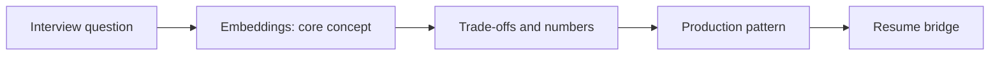

# Session 24: Embeddings: Model Selection, Matryoshka, Fine-Tuning & Re-Embedding Migrations

> **Status: SKELETON** (content to be written; follow `CONTENT_GUIDELINES.md`)
> - **Phase 1: Foundational Building Blocks** | **Week 2** | **Priority:** solid | **Session type:** NEW
> - **Module:** Module 2: RAG, Search & Multimodal
> - **Resume anchor:** ChromaDB indexing across Deloitte and Network18 RAG apps

---

## Part 1: Quick Summary

> TODO (3-4 bullets): what this is in plain English, why interviewers care, the 10-second mental model.

## Part 2: Topics to Cover (Study Checklist)

- [ ] Choosing a model: domain eval beats leaderboard (MTEB) rank; multilingual and long-context needs
- [ ] Dimension, quantization and Matryoshka truncation: recall vs RAM vs latency
- [ ] Bi-encoder vs cross-encoder vs late-interaction (ColBERT) vs sparse (SPLADE)
- [ ] Fine-tuning embeddings: synthetic queries, hard negatives, contrastive loss basics
- [ ] Query vs document embeddings (asymmetric models, instruction prefixes)
- [ ] Re-embedding migrations: dual-write, shadow index, cutover, rollback
- [ ] Embedding drift and versioning

## Part 3: First Principles & Analogies

TODO: one everyday analogy per concept above, plus a concrete failure scenario.

## Part 4: Concept Blueprint

TODO: replace with the real architecture / decision-tree diagram.

## Part 5: Trade-Off Decision Matrix

| Option / Pattern | Latency | Cost | Complexity | When to Pick / Watch Out For |
| :--- | :--- | :--- | :--- | :--- |
| TODO option A | TODO | TODO | TODO | TODO |
| TODO option B | TODO | TODO | TODO | TODO |
| TODO option C | TODO | TODO | TODO | TODO |

## Part 6: Deep-Dive Mechanics & Numbers

TODO: the math, edge cases and "tricks" that separate a senior answer from a mid-level one.

## Part 7: Production AI & Resume Tie-In

TODO: how this applies to production AI systems and to **ChromaDB indexing across Deloitte and Network18 RAG apps**; include a short annotated code or design snippet.

## Part 8: Interview Questions (Answered Simply)

TODO: 4-6 questions, each with **What they are really testing** and **How to answer simply** (spoken-English blockquote).

## Canonical Problems Unlocked

- [enterprise-rag](/problems?id=enterprise-rag)
- [llm-search-recsys](/problems?id=llm-search-recsys)

## Deliverable (Do This Before Moving On)

- [ ] Runbook: migrate 100M vectors to a new embedding model with zero downtime.

## Socratic Study Prompt

> *"Teach me how to choose and operate an embedding model in production: dimension vs cost, Matryoshka truncation, domain fine-tuning with hard negatives, multilingual, and how to migrate 100M vectors to a new model with zero downtime."*
