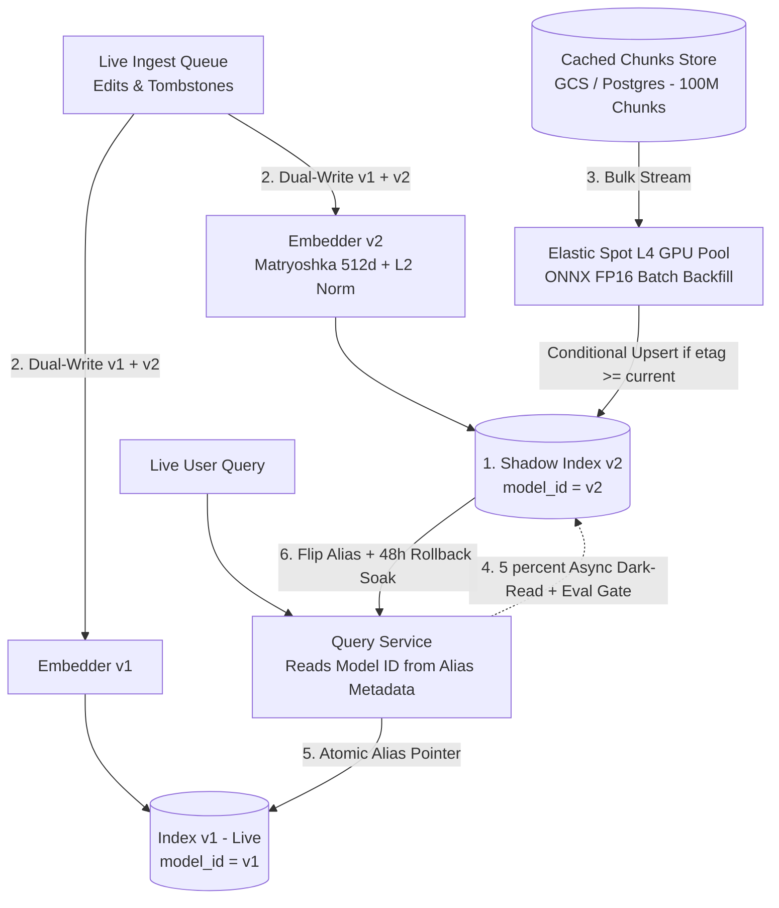

# Session 24: Embeddings — Model Selection, Matryoshka, Fine-Tuning & Re-Embedding Migrations

> **Prerequisites & Plain-English Summary**
>
> - **Prerequisites:**
>   - **Chunking & Context Enrichment (`session-23`):** An embedding model can only represent the text inside a chunk—clean structural cuts and breadcrumb headers come before vector math.
>   - **Vector RAM Formula (`fund-07`):** `RAM ≈ N × D × bytes_per_dim × 1.5` — doubling embedding dimensions `D` from `768` to `1536` literally doubles your cluster memory bill!
>   - **Zero-Downtime Alias Cutovers (`session-23`):** Two different embedding models place the exact same sentence at completely unrelated coordinates, so they can never share one vector index.
> - **Plain-English Core:** An embedding model turns text into a list of numbers (a map coordinate) so sentences with similar meanings land near each other—and operating embeddings in production means picking a model tested on *your* jargon rather than public leaderboards, shrinking vector dimensions cleanly to save RAM, teaching the model domain-specific distinctions when needed, and upgrading 100 million vectors without taking search down.

---

## 1. Build It From Zero (Basics + Socratic Walkthrough)

### What Are We Actually Building, and Why Is It Hard?
Suppose you pick the #1 model on the public Hugging Face MTEB leaderboard (`3,072` dimensions, `float32`) to power search across `100 million` internal chunks in English, Hindi, and financial legalese. Three headaches strike in week one:
1. `100M × 3,072 × 4 bytes × 1.5 ≈ 1.84 Terabytes` of HNSW RAM—costing **`$12,000+/month`** before serving a single query!
2. Despite its #1 public score, when a trader searches *"SEBI margin hair-cut circular"*, the model ranks generic lifestyle or broad banking pages above the exact regulatory filing because it never learned your firm's domain jargon.
3. Six months later, a much better model (`v2`) comes out. A teammate updates the query server to `v2` on Friday afternoon while background workers gradually re-embed the `100M` stored chunks over the weekend—and **for 48 hours, search returns complete random garbage for every user!**

### The Socratic Ladder: Discovering Production Embedding Engineering

**🤔 Question 1: Why did updating the query server to `model_v2` while the database still held `model_v1` vectors break search completely?**
Think of `model_v1` as assigning `"refund policy"` to latitude/longitude `(12.9° N, 77.6° E)` on its own private map, while `model_v2` was trained from scratch with rotated axes and puts `"refund policy"` at `(-34.1° S, 151.2° E)`. Comparing a `v2` query coordinate against `v1` document coordinates measures distance between two incompatible maps!
→ Query and document vectors **must come from the exact same model version**, and upgrades require a **shadow index + atomic alias cutover**.

**🤔 Question 2: Can we just chop the last `2,560` numbers off a normal `3,072`-number vector (keeping the first `512`) to cut RAM `6×`?**
On a standard embedding model, information is smeared evenly across all `3,072` slots—chopping `83%` of the numbers off is like ripping `5` out of `6` pages out of a phone number and destroys accuracy. *Unless* during training, you forced the model to pack the coarsest, most important meaning into the first `128–256` numbers, medium detail into `512`, and fine nuance into `1536–3072`!
→ Training with nested multi-scale losses creates **truncatable ("nesting-doll") embeddings** that let you dial RAM vs. accuracy at deploy time—or search fast at `256` dims and rescore at `1536`!

**🤔 Question 3: Notice a user query is tiny (`"Q4 churn?"`, 3 words), while a document chunk is a dense `250-word` paragraph. Should the model embed both identically?**
No—"question-shaped" text and "answer-shaped" text look very different! Modern models use **asymmetric task prefixes** (`"search_query: Q4 churn?"` vs. `"search_document: [Doc: ...] Churn fell to 2.1%..."` or API `task_type="RETRIEVAL_QUERY"` vs `"RETRIEVAL_DOCUMENT"`) to project short questions onto the exact spot where their long answers live. Forgetting that prefix silently drops recall by `3–8%`!

**🤔 Question 4: What if public models still confuse your domain jargon—say, treating `"Form 10-K"` and `"Form 10-Q"` or `" Gross Margin"` and `"Contribution Margin"` as interchangeable?**
You fine-tune the embedding model! You generate realistic domain questions from your own chunks, pair each `(question, true_chunk)` with **tricky wrong chunks that look dangerously similar** (like `10-Q` when the question asked for `10-K`!), and nudge the model weights so the true chunk pulls closer while the tricky decoys push farther away.

**🤔 Question 5: Wait—if one vector per chunk still blurs fine token details, why not store one vector *per word* in every chunk?**
Storing `200` vectors per chunk improves token-level precision dramatically, **but multiplies vector count `200×`** (`100M` chunks → `20 Billion` vectors!). So you understand the full spectrum—from single-vector dense (`Bi-Encoder`) to learned sparse (`SPLADE`), multi-vector (`ColBERT`), and full pair-scoring (`Cross-Encoder`)—and place each at the right stage of the funnel.

### Naming What You Just Invented
1. Never mixing `v1` and `v2` coordinate spaces is **Embedding Space Invariance & Shadow-Index Re-Embedding Migration**.
2. Prefix-truncatable nested dimensions (`1536 -> 512 -> 256` + L2 renormalization) is **Matryoshka Representation Learning (MRL)**.
3. Distinct query vs. passage projections (`RETRIEVAL_QUERY` vs. `RETRIEVAL_DOCUMENT`) is **Asymmetric Embedding**.
4. Training on `(query, positive, hard_negatives)` with **InfoNCE Contrastive Loss** is **Domain Embedding Fine-Tuning**.
5. The representation family spans **Dense Bi-Encoders**, **Learned Sparse (`SPLADE` / `BGE-M3`)**, **Late Interaction (`ColBERT`)**, and **Cross-Encoders**.

### Explain It in Layers
- **One Line (Explain to a 12-Year-Old):** An embedding turns every paragraph into a GPS pin on a meaning map—and if you ever switch mapmakers, you have to re-pin the whole map in the background before switching users over.
- **One Paragraph (Explain to a Non-Backend Engineer):** Embeddings compress text into fixed-length arrays of numbers (like `768` floats) where cosine similarity measures shared meaning. Public benchmarks often mislead on private company jargon, so teams pick models using a small domain test set, use "Matryoshka" models that can shrink from `1536` to `256–512` numbers to cut memory costs `3–6×`, fine-tune on tricky near-miss examples when domain accuracy lags, and migrate model versions using a parallel shadow index so incompatible vectors never mix.
- **Engineer Version:** Production embedding systems select asymmetric **bi-encoders** via domain-specific `nDCG@10` / `Recall@50` benchmarks (accounting for context length, multilingual fertility, and licensing/latency), optimize the memory-recall Pareto curve with **Matryoshka (`MRL`) dimension slicing + L2 renormalization + INT8/binary quantization** (`two-stage oversample & rescore`), adapt weights via **InfoNCE contrastive fine-tuning with mined hard negatives and false-negative margin filtering**, and enforce strict `embedding_model_id` coupling across blue-green shadow re-indexing pipelines.

---

## 2. First Principles, Analogies, Interview Framing & Capacity Math

> **Why Interviewers Care & The 10-Second Mental Model**
>
> - **Why Interviewers Care:** Embedding choices lock in your **Vector DB RAM bill**, **multilingual coverage**, and **Stage-1 recall ceiling** (a cross-encoder reranker can never rescue a document that missed Stage-1 top-100!). Interviewers regularly ask: *"How do you pick an embedding model?"*, *"When would you fine-tune embeddings?"*, and *"How do you upgrade embeddings across 100M vectors with zero downtime?"*
> - **The 10-Second Mental Model:** **"Domain eval beats MTEB rank. Matryoshka (`256–512d` INT8/binary shortlist → full-dim rescore) slashes HNSW RAM `8–32×`. Fine-tune with hard negatives when domain jargon fails. Never mix `v1` and `v2` vectors—dual-write to a shadow index and flip an alias."**

### 1. Choosing an Embedding Model — Why Domain Eval Beats MTEB Rank
- **Why MTEB Lies in Practice:** MTEB averages `56` heterogeneous public datasets (tweets, Reddit clustering, ArXiv titles), several of which have leaked into recent training sets, and rewards huge `4,096-d` decoder-based `7B` embedders (`e.g., NV-Embed / E5-Mistral-7B`) that take `40ms` and `14 GB` VRAM—when a `300M`-param encoder (`BGE-M3`, `Snowflake-Arctic-Embed`, `GTE`, or `text-embedding-004` / `text-embedding-3-large`) runs **`10×` faster and `5×` smaller** while often tying or winning on *your* corpus!
- **The 5 Selection Axes to Vocalize in Interviews:**
  1. **Domain `Recall@50` / `nDCG@10`** on `200` real internal queries (takes `20 minutes` to run!).
  2. **Multilingual & Cross-Lingual Alignment:** Can a Hindi query retrieve an English policy PDF (`BGE-M3` / `multilingual-e5-large` / `Gemini Embedding`)?
  3. **Max Sequence Length (`512` vs `8,192`):** Avoid silent truncation (`Session 23`).
  4. **Matryoshka (`MRL`) Support & Native Dimension:** `768–1024d` is usually the sweet spot; `3072d` unquantized is almost always wasted RAM unless sliced via MRL.
  5. **Self-Hosted GPU vs. Managed API:** Data residency + high steady-state ingest volume (`1B` chunks on `4 × L4` GPUs costs `~$400` self-hosted vs. `$10,000+` on some external APIs!).

### 2. Matryoshka Representation Learning (MRL) — "Progressive JPEG / Nesting Dolls"
- **The Analogy:** A **Progressive JPEG** transmits a blurry full-frame image in the first `10%` of bytes and sharpens edges as the remaining `90%` arrive—unlike a top-to-bottom bitmap where the first `10%` only shows the sky! **Matryoshka training** computes InfoNCE loss simultaneously on `v[:64]`, `v[:128]`, `v[:256]`, `v[:512]`, `v[:768]`, and `v[:1536]` on every gradient step, forcing early coordinates to carry principal semantic axes.
- **Two Critical Implementation Rules:**
  1. **Always L2-Renormalize After Slicing!** If `||v[:1536]||_2 = 1.0`, the truncated prefix `v[:256]` has norm `< 1.0`. Dot-product / cosine indexes (`IP`) produce wrong rankings unless you compute `v_short = v[:256] / ||v[:256]||_2`!
  2. **Funnel Trick (Matryoshka + Binary/INT8):** Keep **only `256-d` binary or `INT8` vectors in HNSW RAM** (`256 bytes` or `32 bytes` per vector!) to retrieve `top-200` candidates in `3ms`, then fetch the full `1536-d FP16` vectors from cheap NVMe SSD for just those `200` candidates (`200 × 3 KB = 600 KB` SSD read ≈ `0.3ms`!) to rescore down to `top-50` with **`>99%` of full `1536-d` FP32 recall at `<1/12th` the RAM**!

### 3. Representation Spectrum — "Shoe Size vs. Multi-Point Foot Scan vs. Trying Every Pair On"
- **Bi-Encoder (Single Dense Vector):** Encodes query `q` and doc `d` independently (`cos(E(q), E(d))`). Precomputable offline; `O(log N)` HNSW lookup; loses fine-grained rare token exactness.
- **Learned Sparse (`SPLADE` / `BGE-M3` Sparse):** Uses an MLM head to output weighted vocabulary expansion terms (`"car" -> {"car": 2.4, "vehicle": 1.1, "automobile": 0.9}`) stored in an inverted index. Combines exact lexical matching with learned synonym expansion!
- **Late Interaction (`ColBERT` / `ColPali`):** Stores *every token's* compressed (`128-d` 2-bit) vector for `d` (`E_tok(d) ∈ R^{L_d × 128}`) and computes `Σ_{i ∈ q} max_{j ∈ d} (q_i · d_j)` (**MaxSim**). Near-cross-encoder accuracy while still precomputing docs, at `10×–30×` higher storage footprint.
- **Cross-Encoder Reranker:** Feeds `[CLS] q [SEP] d [SEP]` jointly—cannot index offline (`O(K)` GPU forward passes at query time; `Session 06`).

### 4. Domain Fine-Tuning Embeddings — "Counterfeit Training with Near-Identical Fakes"
- **Data Generation Pipeline (`5,000–25,000` triplets is plenty!):**
  1. Sample domain chunks `d^+` and prompt an LLM to generate realistic user queries `q` of varying styles (short keyword, vague question, acronym-heavy).
  2. **Mine Hard Negatives (`d^-`):** Retrieve top-30 chunks for `q` using existing BM25/Dense. Chunks ranked `#3..#25` that are *not* `d^+` look lexically similar—**BUT watch out for False Negatives!** In a real corpus, chunk `#4` might actually *also* answer `q`!
  3. **Denoise False Negatives (`Margin / Teacher Filtering`):** Discard any candidate negative `d^-` whose similarity score `sim(q, d^-)` exceeds `0.95 × sim(q, d^+)` (or cross-encoder teacher score `> 0.7`), so you don't punish the model for retrieving valid alternative chunks!
  4. Train with **InfoNCE / MultipleNegativesRankingLoss** (`temperature τ ≈ 0.02–0.05`) using LoRA or full encoder tuning (`1–3` epochs on `1–2` A100s takes `<2 hours`!).

### Timestamped Story ("Alice & Bob"): The Friday Afternoon Model Swap Disaster
- `Fri 04:00 PM` — **Alice** switches the query microservice config from `EMBED_MODEL = "text-embedding-004"` to `"bge-m3-finetuned-v2"` (both happen to output `768` dimensions, so Qdrant accepts the `768-float` query array with **zero dimension-mismatch error**!).
- `Fri 04:01 PM` — She kicks off a background script to overwrite all `50M` vectors in `prod_collection` in place (`~18 hours` runtime).
- `Fri 04:05 PM` — **Bob** in Customer Support searches *"international wire transfer fee"*. His `v2` query vector lands at cosine similarity `0.04` against the `99.7%` un-migrated `v1` chunks and randomly matches *"cafeteria vegetarian menu"* at `0.19`!
- `Fri 04:12 PM` — Even worse, rolling back the query service to `v1` now breaks the `300,000` chunks the background script already overwrote in place with `v2`!
- **The Zero-Downtime Runbook:** (1) Store `embedding_model_id` in collection metadata and reject mismatched query clients at startup; (2) build `prod_collection_v2` in shadow while `prod_alias -> prod_collection_v1` serves `100%` of live traffic cleanly; (3) dual-write live document edits to both `v1` and `v2`; (4) verify shadow recall, then flip `prod_alias -> prod_collection_v2` atomically.

### Functional & Non-Functional Requirements + Back-of-the-Envelope Capacity Math
Let's size **re-embedding `100M` chunks** (`avg 250 tokens/chunk = 25B tokens` total) with zero downtime:
- **Self-Hosted GPU Throughput (`335M`-param `BGE-large` / `Arctic-Embed-L` in `FP16` ONNX/TensorRT on NVIDIA `L4` GPU):**
  - Throughput per L4 (`250-tok` chunks, dynamic batch `64` + length bucketing) `≈ 850 chunks/sec` (`~212,500 tokens/sec`).
  - To finish `100M` chunks inside **`12 hours` (`43,200 seconds`)**: `100,000,000 ÷ 43,200 ≈ 2,315 chunks/sec` → `2,315 ÷ 850 = 2.72` → **`4` Spot L4 GPUs**!
  - **Total Compute Bill:** `4 GPUs × 12 hours × $0.35/hr =` **`~$16.80`**! (Compare to managed API at `$0.02–$0.10 / 1M tokens × 25,000M = $500–$2,500`).
- **Temporary Dual-Index Storage Peak (During Shadow Cutover + 48h Rollback Window):**
  - During cutover, **both `index_v1` and `index_v2` coexist** → cluster HBM/RAM must have **`2×` temporary capacity** (elastic cloud nodes spun up for `48 hours` then terminated once `v1` drops!).
  - With **Matryoshka `1536d -> 512d` + `INT8`** (`100M × 512 × 1 B × 1.5 ≈ 76.8 GB` vs `921.6 GB` raw `1536d FP32`), even the `2×` shadow peak is just **`~154 GB` RAM** instead of `1.84 TB`!

---

## 3. Visual Architecture Blueprint

Follow `1 → 6` below to trace the **Zero-Downtime 100M-Vector Re-Embedding Migration Runbook**:

1. **Step 1 (Provision Shadow Index `v2`):** Create `chunks_v2` pinned to `model_id = embed-v2-512d` while `chunks_alias` continues pointing `100%` of live queries to `chunks_v1` (`embed-v1-768d`).
2. **Step 2 (Enable Dual-Write on Live Ingest):** Live document edits/deletes from `Pub/Sub` embed with *both* `v1` and `v2` (storing `source_etag` / `updated_at` timestamp so backfill never overwrites a newer live edit!).
3. **Step 3 (Elastic GPU Backfill):** Spot GPU workers stream cached chunks from Object/Parent Store (`2,500+ chunks/sec`), compute `v2` Matryoshka embeddings, and bulk-insert into `chunks_v2` using `insert_if_version_ge` conditional upserts (with HNSW indexing deferred or throttled until bulk load completes for `3×` faster ingestion!).
4. **Step 4 (Offline Eval + Shadow Dark-Read):** Replay `5%` of live queries asynchronously against `chunks_v2` (`dark read`), verifying `Recall@10`, latency `P99`, and chunk-count parity with `v1`.
5. **Step 5 (Atomic Alias + Query Model Cutover):** Deploy query pods reading `(alias_target, required_model_id)` atomically from config/collection metadata so query encoder and target collection switch in lockstep.
6. **Step 6 (48h Soak & Decommission):** Keep dual-writing to `v1` for `48 hours` so instant `<1s` rollback remains possible; then stop `v1` writes and drop `chunks_v1` to reclaim RAM.



---

## 4. Side-by-Side Comparison & Trade-Off Table

| Vector Representation / Model Choice | Index Size (`per 100M chunks`) | Query Latency | Strengths | When to Pick / Winner | Watch Out For (The Trap) |
| :--- | :--- | :--- | :--- | :--- | :--- |
| **Managed API Bi-Encoder** *(`text-embedding-004`, `text-embedding-3-large`)* | `768d INT8`: `~115 GB` (`512d` MRL: `~77 GB`) | `20–45 ms` HTTP call + `8 ms` ANN | Zero GPU ops, strong multilingual + native MRL support | **Winner for `<20M` chunks, low-ops startups & variable traffic.** | Network RTT adds `25ms+` to every query; API rate limits throttle `100M`-chunk backfills unless batched carefully. |
| **Self-Hosted Encoder (`300M` params)** *(`BGE-M3`, `Arctic-Embed`, `E5`)* | `768–1024d INT8`: `~115–154 GB` | `3–6 ms` in-VPC L4 GPU + `8 ms` ANN | `10×` cheaper bulk backfill (`~$17/100M`), full data residency, fine-tunable | **Winner for `50M+` chunks, strict privacy & high QPS (`>200 QPS`).** | `512`-token context models truncate long chunks; prefer `8K`-context encoders (`BGE-M3`, `GTE-Qwen`). |
| **LLM-Backbone Embedder (`7B`)** *(`NV-Embed-v2`, `GTE-Qwen2-7B`)* | `3584–4096d` (`~600 GB` INT8 unless MRL-sliced!) | `30–70 ms` on A100/H100 | Top MTEB reasoning & instruction-following retrieval | **Offline batch linking, dedup, or small ultra-hard corpora (`<2M`).** | `15×` heavier query GPU cost and massive vector dims for often `<2%` gain after a Cross-Encoder reranker! |
| **Learned Sparse (`SPLADE` / `BGE-M3` Sparse)** | Inverted postings (`~25–50 GB` disk/RAM) | `5–15 ms` WAND/BMP pruning | Exact rare entities + learned synonym expansion in one sparse index | **Winner when upgrading lexical BM25 on domain synonyms.** | Needs sparse-vector engine support (`Qdrant`, `Vespa`, `Milvus`, `OpenSearch` neural sparse). |
| **Multi-Vector (`ColBERTv2` / `ColPali`)** | `~1.5–4.0 TB` even with 2-bit residual compression! | `20–60 ms` PLAID MaxSim | Token-level alignment beats single-vector bi-encoders on fine details | **High-precision legal/patent/visual page retrieval (`<5M` docs) or Stage-1.5 reranking.** | `20×` storage multiplier makes `100M+` chunks prohibitively expensive as a primary index. |

---

## 5. Deep-Dive Mechanics & Production Failure Analysis

### Under-the-Hood Tricks (What Separates Junior from Senior Answers)

1. **Cosine vs. Dot Product (`IP`) vs. Euclidean (`L2`) Equivalence on Unit-Norm Vectors:**
   - For unit-normalized vectors (`||u||_2 = ||v||_2 = 1`), `||u − v||_2^2 = ||u||^2 + ||v||^2 − 2(u · v) = 2 − 2 cos(u, v)`. That means **Dot Product (`IP`), Cosine Similarity, and Euclidean `L2` produce the exact same ranking**—and `IP` skips two square-root norms per comparison on SIMD AVX-512! **Trap:** After Matryoshka slicing `v[:d]`, `||v[:d]||_2 != 1`, so skipping renormalization breaks `IP` rankings!
2. **Defer HNSW Graph Construction During Bulk Re-Embedding Backfills:**
   - Inserting `100M` vectors one batch at a time into an active HNSW graph triggers continuous `O(M · efConstruction · log N)` graph rewiring (`5–8×` slower write throughput and heavy CPU saturation). Set `m = 0` (or high indexing threshold in Qdrant/Milvus/pgvector) during bulk upload so vectors land sequentially on disk/RAM first, then build HNSW segments in parallel once `100%` of points are loaded!
3. **Asymmetric Instruction/Task Prefixes Must Be Locked in Shared Library Code:**
   - Models like `E5` (`"query: "` vs `"passage: "`), `Nomic` (`"search_query: "` vs `"search_document: "`), `Snowflake` (`"Represent this sentence for searching relevant passages: "` on queries, *none* on docs!), and Vertex `text-embedding-004` (`task_type="RETRIEVAL_QUERY"` vs `"RETRIEVAL_DOCUMENT"`) fail silently if ingest uses one convention and query uses another. Wrap both behind one typed `EmbeddingCodec` class versioned alongside the index.
4. **Detecting Embedding Drift & Out-of-Distribution (`OOD`) Queries:**
   - Track the **rolling `P10`/`P50` top-1 cosine similarity distribution** of production queries. When a new product line (`"Project Orion"`) launches whose terminology wasn't in the fine-tuned encoder, top-1 similarity shifts downward (`e.g., 0.81 -> 0.66`) and query-vector centroid distance (`Maximum Mean Discrepancy` / cosine distance from golden query centroids) spikes—signaling time for hard-negative refresh or hybrid BM25 reliance.

### Failure Modes in Production

#### Failure Mode 1: Backfill Race Overwrites Fresh Live Edits with Stale Historical Snapshots
- **How It Happens at 2 AM:**
  1. At `01:00 AM`, your 12-hour re-embedding backfill reads `doc_88` (`version = 4`) from a snapshot, sits in a GPU batch queue for `3 minutes`, and prepares to write `v2` embeddings to `chunks_v2`.
  2. At `01:01 AM`, a user edits `doc_88` (`version = 5`), and the fast live dual-write worker immediately writes `version = 5` into `chunks_v2`.
  3. At `01:03 AM`, the slow backfill batch finishes and blindly runs `upsert(doc_88, version = 4)`—**clobbering the user's fresh edit with stale data**!
- **How to Detect It in Metrics:**
  - Reconciliation audit comparing `(doc_id, active_version)` in Postgres Manifest DB against `payload.version` in `chunks_v2` before flipping the alias (`stale_version_mismatch_count > 0` blocks cutover!).
- **Exact Mitigation:**
  1. Version-stamped chunk IDs (`doc_88:v5:c0`) + conditional check against the Manifest DB (`if backfill_ver < manifest.active_version: skip`), followed by a brief **delta catch-up pass** (`WHERE updated_at >= backfill_started_at`) right before flipping the alias.

#### Failure Mode 2: Naively Mined "Hard Negatives" Are Actually Unlabeled Positives (Recall Collapse After Fine-Tuning!)
- **How It Happens at 2 AM:**
  1. A team fine-tunes `BGE-base` on `20,000` internal chunks by treating `chunk_i` as the sole positive for synthetic `query_i` and pulling top-5 dense matches (`chunk_j != chunk_i`) as hard negatives.
  2. Because corporate wikis repeat policies across FAQs, decks, and manuals, `70%` of those "top-5 negatives" are **actually valid answers to `query_i`**!
  3. Contrastive loss violently pushes identical meanings apart in vector space, causing embedding isotropy/recall on real queries to **drop `12%` below the untuned base model**!
- **How to Detect It in Metrics:**
  - Always evaluate fine-tuned checkpoints on a **held-out human/LLM-verified multi-positive golden set** (`Recall@10`, `nDCG@10`) before touching staging; watch training loss stalling with high gradient norm on near-duplicate pairs.
- **Exact Mitigation:**
  1. Apply **Relative Margin Denoising** (developed in NV-Retriever / Arctic-Embed): score `(q, d^+)` and `(q, d^-)` with a strong frozen teacher/cross-encoder, and **discard any negative where `score(q, d^-) > 0.95 × score(q, d^+)`**, sampling hard negatives from ranks `15..60` below that margin.

---

## 6. Production AI & Resume Tie-In

### 1. Deloitte Internal Asset Discovery & Network18 RAG (`text-embedding-004` Asymmetric + Matryoshka Sizing)
- **The Architectural Fit:** Across both **Deloitte's Slide-to-Image RAG (`ChromaDB -> Vertex AI Vector Search`)** and **Network18's Sales Intelligence RAG**, embedding governance prevented silent recall loss and controlled scaling RAM:
  1. **Asymmetric Task Types:** Explicitly separated `task_type="RETRIEVAL_DOCUMENT"` (with `title` populated from deck/report title) at ingest from `task_type="RETRIEVAL_QUERY"` at search time in Vertex `text-embedding-004`.
  2. **Matryoshka + Quantization Path to 50M Vectors:** Moving from single-node `768d/1536d FP32` ChromaDB prototypes to `768d INT8` (or `512d` MRL-truncated + `INT8` rescoring) kept `50M`-vector index memory near `~58–115 GB` instead of `460+ GB` while maintaining `91.4% Recall@5` behind a Cross-Encoder reranker.

### Production Code: Matryoshka Truncation, False-Negative Filtered InfoNCE & Version-Safe Router (Python)

A complete PyTorch + NumPy implementation demonstrating (1) L2-renormalized Matryoshka slicing, (2) denoised hard-negative InfoNCE contrastive loss, and (3) startup-verified model-to-index version binding:

```python
import numpy as np
import torch
import torch.nn.functional as F

def matryoshka_slice_and_norm(vectors: np.ndarray, target_dim: int) -> np.ndarray:
    """Slices MRL embeddings to `target_dim` and re-normalizes L2 norm so IP == Cosine."""
    sliced = vectors[:, :target_dim].astype(np.float32)
    norms = np.linalg.norm(sliced, axis=-1, keepdims=True)
    return sliced / np.maximum(norms, 1e-12)

def denoised_infonce_loss(
    q_emb: torch.Tensor,          # [B, D] L2-normalized query embeddings
    pos_emb: torch.Tensor,        # [B, D] L2-normalized positive chunk embeddings
    hard_neg_emb: torch.Tensor,   # [B, K, D] K mined hard-negative candidates per query
    teacher_pos_scores: torch.Tensor,      # [B] frozen cross-encoder score(q, pos)
    teacher_neg_scores: torch.Tensor,      # [B, K] frozen cross-encoder score(q, neg_k)
    margin_ratio: float = 0.95,
    temperature: float = 0.03,
) -> torch.Tensor:
    """Computes MRL-ready InfoNCE loss while masking out unlabeled false-negative chunks."""
    pos_logits = (q_emb * pos_emb).sum(dim=-1, keepdim=True) / temperature           # [B, 1]
    in_batch_logits = (q_emb @ pos_emb.T) / temperature                              # [B, B]
    # Mask diagonal (true positive) AND mask any in-batch chunk suspiciously close to pos
    eye_mask = torch.eye(q_emb.size(0), dtype=torch.bool, device=q_emb.device)
    in_batch_logits = in_batch_logits.masked_fill(eye_mask, float("-inf"))

    hard_logits = torch.einsum("bd,bkd->bk", q_emb, hard_neg_emb) / temperature      # [B, K]
    # FALSE-NEGATIVE FILTER: drop mined negatives scoring >= 95% of positive under teacher!
    false_neg_mask = teacher_neg_scores >= (margin_ratio * teacher_pos_scores.unsqueeze(-1))
    hard_logits = hard_logits.masked_fill(false_neg_mask, float("-inf"))

    all_logits = torch.cat([pos_logits, in_batch_logits, hard_logits], dim=-1)       # [B, 1+B+K]
    labels = torch.zeros(q_emb.size(0), dtype=torch.long, device=q_emb.device)       # col 0 is pos
    return F.cross_entropy(all_logits, labels)

class VersionLockedVectorRouter:
    """Guarantees query embeddings NEVER hit an index built with a different model/dim."""
    def __init__(self, alias_metadata: dict, encoders: dict):
        # alias_metadata fetched from control plane: {"collection": "chunks_v2", "model_id": "mrl-v2", "dim": 512}
        self.collection = alias_metadata["collection"]
        self.model_id = alias_metadata["model_id"]
        self.dim = alias_metadata["dim"]
        if self.model_id not in encoders:
            raise RuntimeError(f"Query pod missing encoder '{self.model_id}' required by {self.collection}!")
        self.encoder = encoders[self.model_id]

    def encode_query(self, query_text: str) -> tuple[str, np.ndarray]:
        raw = self.encoder.encode([f"search_query: {query_text}"])  # Asymmetric query prefix locked here
        return self.collection, matryoshka_slice_and_norm(raw, self.dim)[0]
```

---

## 7. Common Interview Questions, Follow-Up Probes & Quick Recall

### Q1: "How do you select an embedding model for an enterprise RAG product across 3 languages—why not just pick #1 on the MTEB leaderboard?"
- **What the interviewer is testing:** Practical eval-driven model selection vs. leaderboard cargo-culting, plus awareness of latency, context window, and multilingual constraints.
- **How to answer simply:**
  > "MTEB averages dozens of generic public tasks—like tweet clustering—and its top spots are dominated by 7-billion-parameter decoder models outputting 4,096 dimensions that cost 10× more latency and 5× more vector RAM than compact encoders.
  > Instead, I shortlist 3–4 candidates that meet our hard constraints—8K token window so chunks never truncate, strong cross-lingual alignment across our 3 languages (e.g., `BGE-M3`, `Gemini Embedding` / `text-embedding-004`), and Matryoshka dimension support—and benchmark them on a 250-query domain golden set measuring `Recall@50` (including Hindi-query-to-English-doc pairs!), P99 query encoding latency, and total HNSW RAM at `512–768` INT8 dimensions."
- **Likely Follow-Up Probe ("The Double-Click"):**
  - *Interviewer:* "When would you self-host the embedding model on GPUs versus calling an API?"
  - *Your Answer:* "Under ~10–20M chunks and moderate QPS, a managed API wins on zero operational overhead. At 100M+ chunks, strict data-residency rules, or >200 search QPS where shaving 25ms of external HTTP RTT matters, 2–4 self-hosted L4 GPUs running ONNX FP16 cut backfill costs from thousands of dollars to under $25 and run in ~4ms in-VPC."

### Q2: "Walk me through migrating 100 million vectors to a new embedding model in production with zero downtime and instant rollback."
- **What the interviewer is testing:** Production operational runbook (shadow index, dual-write race handling, bulk HNSW tuning, atomic cutover).
- **How to answer simply:**
  > "Because `model_v1` and `model_v2` live in incompatible vector spaces, we never overwrite in place. First, we create a shadow collection `chunks_v2` stamped with `model_id = v2` in metadata while `chunks_prod` alias stays pointed at `chunks_v1`.
  > Second, we enable **dual-writes** on our live ingestion queue so ongoing edits and deletes write to both `v1` and `v2`.
  > Third, an elastic Spot GPU pool streams all 100M cached chunks from object storage, embeds them in `v2` (skipping any `doc_id` whose `version` in `chunks_v2` is already newer from a live dual-write!), and builds HNSW segments once bulk upload finishes.
  > Fourth, we run offline recall gates plus 5% async dark-read traffic on `v2`. When green, we atomically flip the alias so query pods read `(chunks_v2, model_id=v2)` together, keep dual-writing to `v1` for 48 hours for `<1s` rollback, and then drop `v1`."
- **Likely Follow-Up Probe ("The Double-Click"):**
  - *Interviewer:* "How much extra memory do you need during that migration, and how do you afford it?"
  - *Your Answer:* "During the shadow build and 48-hour soak, `v1` and `v2` coexist, requiring ~2× cluster memory temporarily. We spin up temporary cloud worker nodes for those two days—and if `v2` uses Matryoshka `512d` + INT8 quantization, `v2` often takes only 25% of an old `1536d` index's RAM anyway!"

### Q3: "Explain Matryoshka embeddings—how do they work, and how can you cut RAM by 12× with <1% recall loss?"
- **What the interviewer is testing:** Deep understanding of MRL training, renormalization math, and two-stage quantized oversampling.
- **How to answer simply:**
  > "Standard embeddings distribute signal across all dimensions equally, so slicing `1536` down to `256` ruins cosine angles. Matryoshka Representation Learning applies contrastive loss simultaneously to nested prefixes—first 64, 128, 256, 512, up to 1536 dimensions—forcing coarse semantic structure into the earliest dimensions, just like a progressive JPEG.
  > In production, I combine Matryoshka truncation with **oversample-and-rescore**: keep only L2-renormalized `256-d INT8` (or `512-d binary`) vectors in HNSW RAM (`~12–32×` smaller!) to pull `top-200` candidates in `3ms`, then read the full `1536-d FP16` vectors from cheap NVMe SSD for just those 200 candidates (`<0.5ms` disk read) to rescore accurately before reranking."
- **Likely Follow-Up Probe ("The Double-Click"):**
  - *Interviewer:* "What tiny math bug breaks Matryoshka truncation if an engineer just slices `vec[:256]` and inserts into an inner-product index?"
  - *Your Answer:* "Skipping L2 renormalization! Even if the full `1536-d` vector had unit norm `1.0`, `vec[:256]` has varying norm `< 1.0`, which biases inner-product ranking toward vectors that happened to concentrate magnitude in early coordinates rather than true cosine angle."

### Q4: "When is fine-tuning an embedding model worth it vs. just adding BM25 + a Cross-Encoder reranker?"
- **What the interviewer is testing:** Pragmatic ROI sequencing and awareness of hard-negative / false-negative training pitfalls.
- **How to answer simply:**
  > "I always deploy **Hybrid BM25 + Dense + Cross-Encoder Reranking** *before* fine-tuning embeddings, because BM25 immediately fixes exact tickers/codes and the reranker fixes top-50 ordering with zero model-maintenance burden.
  > Fine-tuning the embedding model only becomes worth it when **Stage-1 `Recall@100` itself is failing** on domain-specific vocabulary mappings where query words and document words share zero lexical tokens—for instance, internal shorthand mapping to formal regulatory clauses, or proprietary medical/financial taxonomy. When we do fine-tune, we synthesize domain `(query, chunk)` pairs, mine hard negatives, filter out false negatives using a cross-encoder teacher margin (`<0.95 × pos_score`), and train with InfoNCE."
- **Likely Follow-Up Probe ("The Double-Click"):**
  - *Interviewer:* "If you fine-tune your embedding model, what operational tax did you just take on?"
  - *Your Answer:* "Two taxes: you now own serving that custom encoder checkpoint at query and ingest time, AND every time you retrain `v2 -> v3` you must execute a full 100M-vector re-embedding migration!"

### 60-Second Rapid Fire (Self-Check)
- **Q: Why does updating query embeddings to `v2` before re-indexing `v1` documents return random junk even if both are `768-d`?**
  - **A:** Separate trainings produce orthogonal/rotated coordinate spaces—cosine similarity across two models is meaningless noise.
- **Q: What must you always compute right after slicing a Matryoshka vector `v[:256]`?**
  - **A:** **L2 renormalization** (`v[:256] / ||v[:256]||_2`) so inner product equals cosine similarity.
- **Q: How fast and cheap is re-embedding `100M` (`250-tok`) chunks on self-hosted `L4` GPUs?**
  - **A:** `~850 chunks/s` per L4 in FP16 ONNX → **`4` Spot L4 GPUs finish in `~12 hours` for `<$20`**.
- **Q: What ruins naive hard-negative contrastive fine-tuning on real enterprise corpora?**
  - **A:** **False negatives** (unlabeled duplicate/valid answers ranked in top-10)—filter them out using a cross-encoder teacher margin (`score < 0.95 × pos_score`).

### Deliverable & Canonical Problems Unlocked
- **Deliverable:** Write your 1-page Zero-Downtime 100M-Vector Re-Embedding Runbook (pre-checks, Spot GPU sizing, dual-write race protection, dark-read gate, alias flip, 48h rollback).
- **Canonical Problems Unlocked:** [Design an Enterprise Knowledge Assistant (RAG)](/problems?id=enterprise-rag) · [Design an LLM-Powered Search & Recommendation System](/problems?id=llm-search-recsys)
