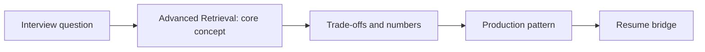

# Session 25: Advanced Retrieval: Query Rewriting, HyDE, Multi-Hop, Agentic RAG & GraphRAG

> **Status: SKELETON** (content to be written; follow `CONTENT_GUIDELINES.md`)
> - **Phase 1: Foundational Building Blocks** | **Week 3** | **Priority:** core | **Session type:** NEW
> - **Module:** Module 2: RAG, Search & Multimodal
> - **Resume anchor:** Network18 Sales Intelligence RAG (multi-source questions)

---

## Part 1: Quick Summary

> TODO (3-4 bullets): what this is in plain English, why interviewers care, the 10-second mental model.

## Part 2: Topics to Cover (Study Checklist)

- [ ] Query understanding: rewrite, expand, decompose, route to the right index
- [ ] HyDE and multi-query retrieval; fusion of multiple retrievals
- [ ] Multi-hop and iterative / agentic RAG (retrieve -> reason -> retrieve) and its latency/cost
- [ ] GraphRAG and knowledge graphs: when relationships matter more than similarity
- [ ] Long-context stuffing vs RAG: cost, quality (lost in the middle), freshness
- [ ] Self-RAG / corrective RAG: retrieval grading and fallbacks
- [ ] Diagnosing bad RAG: retrieval failure vs generation failure decision tree

## Part 3: First Principles & Analogies

TODO: one everyday analogy per concept above, plus a concrete failure scenario.

## Part 4: Concept Blueprint

TODO: replace with the real architecture / decision-tree diagram.

## Part 5: Trade-Off Decision Matrix

| Option / Pattern | Latency | Cost | Complexity | When to Pick / Watch Out For |
| :--- | :--- | :--- | :--- | :--- |
| TODO option A | TODO | TODO | TODO | TODO |
| TODO option B | TODO | TODO | TODO | TODO |
| TODO option C | TODO | TODO | TODO | TODO |

## Part 6: Deep-Dive Mechanics & Numbers

TODO: the math, edge cases and "tricks" that separate a senior answer from a mid-level one.

## Part 7: Production AI & Resume Tie-In

TODO: how this applies to production AI systems and to **Network18 Sales Intelligence RAG (multi-source questions)**; include a short annotated code or design snippet.

## Part 8: Interview Questions (Answered Simply)

TODO: 4-6 questions, each with **What they are really testing** and **How to answer simply** (spoken-English blockquote).

## Canonical Problems Unlocked

- [answer-engine](/problems?id=answer-engine)
- [deep-research](/problems?id=deep-research)
- [text-to-sql](/problems?id=text-to-sql)
- [enterprise-rag](/problems?id=enterprise-rag)

## Deliverable (Do This Before Moving On)

- [ ] RAG failure-diagnosis flowchart + latency budget for a 3-hop agentic RAG.

## Socratic Study Prompt

> *"Teach me advanced RAG patterns: query rewriting, HyDE, decomposition, multi-hop and agentic retrieval, GraphRAG, and long-context vs RAG. For each, tell me when it helps, when it hurts, and its latency cost. Then give me a failing RAG scenario to diagnose."*
