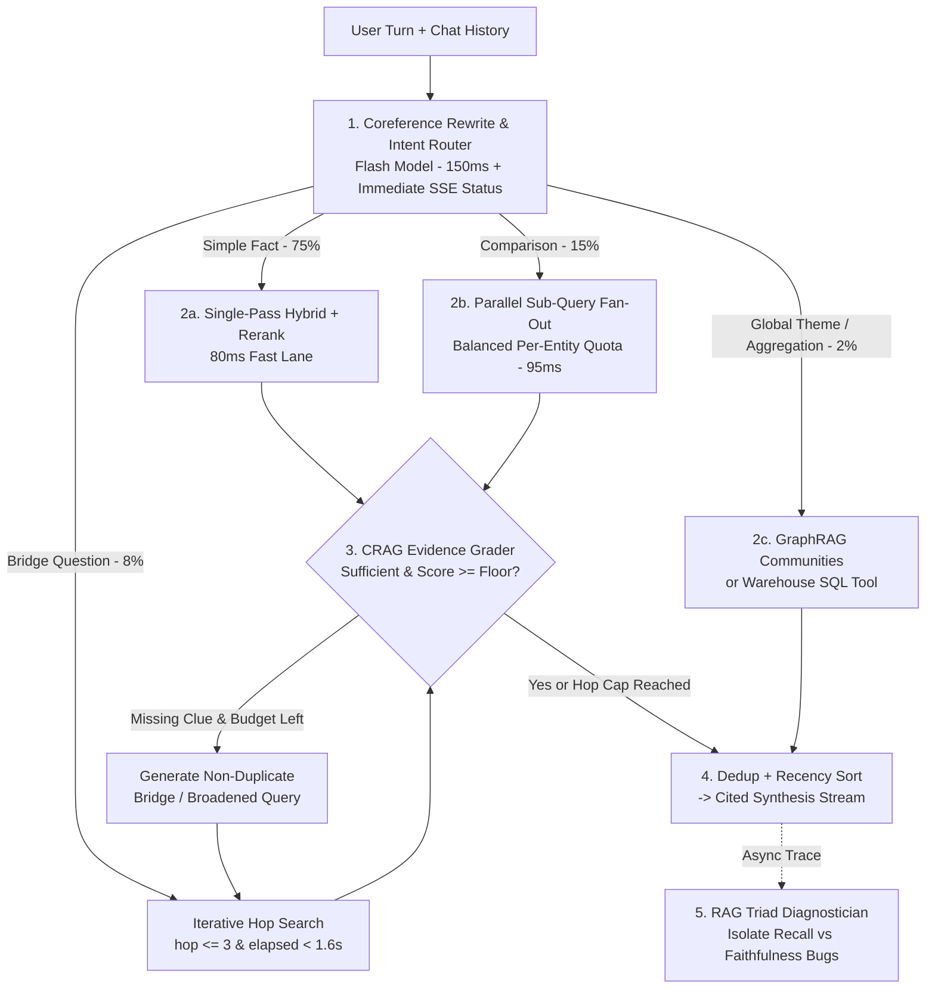

# Session 25: Advanced Retrieval — Query Rewriting, HyDE, Multi-Hop, Agentic RAG & GraphRAG

> **Prerequisites & Plain-English Summary**
>
> - **Prerequisites:**
>   - **Two-Stage Hybrid Retrieval (`session-06`):** `BM25 + Dense + RRF + Cross-Encoder` works brilliantly when **one search query** can locate all required evidence in **one hop**.
>   - **Latency & Tail Amplification (`fund-08`, `session-21`):** Every sequential LLM call on the user's hot path adds `250–800 ms`—chaining `4` blind LLM steps destroys interactive `<2s` SLAs.
>   - **Token Economics (`session-21`):** Stuffing `1,000,000` tokens into a long-context window costs `$1.25–$3.00` *per single question* and waits seconds in prefill.
> - **Plain-English Core:** Real users rarely ask clean, self-contained one-step search queries—they use vague pronouns ("What about last quarter?"), compare multiple things at once, ask bridge questions where Clue #2 is hidden inside Clue #1, or ask big-picture themes across thousands of files—so advanced retrieval transforms, decomposes, iterates, or traverses a knowledge graph selectively *only* when the query complexity justifies the latency tax.

---

## 1. Build It From Zero (Basics + Socratic Walkthrough)

### What Are We Actually Building, and Why Is It Hard?
Your two-stage hybrid RAG (`Session 06`) just launched with `93%` accuracy on single-fact benchmark questions. Then real executives open the chat window and type four questions that **all fail miserably**:
1. **Follow-up pronoun:** Turn 1: *"Show Q3 cloud revenue for Infosys."* → Turn 2: *"How did **they** guide for **next quarter**, and why?"* (Searching `"How did they guide for next quarter"` retrieves random chunks containing the words `"next quarter"`!)
2. **Comparison:** *"Compare customer churn and CAC payback between Stripe's 2024 S-1 draft and Adyen's H2 report."* (Top-6 slots all fill up with Adyen chunks because `"CAC payback"` appeared 9 times in Adyen's PDF, leaving `0` chunks for Stripe!)
3. **Hidden bridge (`Multi-Hop`):** *"Did the supplier of our failed `Pump-X9` valve pass its most recent ISO environmental audit?"* (Your query doesn't even know the supplier's name is *Vortex GmbH* until it reads `Pump-X9`'s spec sheet first!)
4. **Global corpus sensemaking:** *"What are the top 5 recurring root causes across all 4,000 production postmortems from 2025?"* (Retrieving `top-8` chunks out of `4,000` files can never count themes across `4,000` files!)

### The Socratic Ladder: Discovering Query Intelligence & Multi-Paradigm RAG

**🤔 Question 1: Why did Turn 2 (*"How did they guide for next quarter?"*) fail—and what tiny `150 ms` step fixes both pronouns and multi-part comparisons?**
The search index has no idea who `"they"` is—only the chat history knows `"they" = Infosys` and `"next quarter" = Q4 FY25`! And a comparison needs **fair quota per entity**, not one mixed top-6 pool. Before touching the database, run a tiny fast LLM (`Flash` / fine-tuned `8B`) over `[last 4 chat turns + user message]` to emit standalone sub-queries: `["Infosys Q4 FY25 revenue guidance", "Infosys Q4 FY25 guidance drivers"]` (or 1 sub-query for Stripe + 1 for Adyen in parallel, taking top-4 from each!).

**🤔 Question 2: What if a user asks a super short, novice question (*"laptop screen flickers on dock"*) while your KB only contains formal hardware engineering bulletins written in totally different technical vocabulary?**
Short novice questions don't look like technical answers! Ask a fast model to **draft a hypothetical 1-paragraph KB article** answering the question—even if the exact part number is a guess, its *engineering vocabulary and sentence shape* land right in the vector neighborhood of real KB bulletins! (**Trap check:** What if the user asked about a brand-new internal codename `"Project Kestrel"` the LLM has never heard of? Then a hallucinated paragraph drags the vector into totally wrong territory!)

**🤔 Question 3: How do you solve *"Did the supplier of `Pump-X9` pass its ISO audit?"* when one parallel fan-out STILL doesn't know the supplier's name?**
You let the retriever work like a detective in **bounded hops**:
- **Hop 1:** Search `"Pump-X9 valve supplier"` → reads chunk: *"Pump-X9 is manufactured by Vortex GmbH."*
- **Hop 2:** Formulate new search `"Vortex GmbH ISO environmental audit 2025"` → finds audit certificate → synthesize!
And if Hop 1 retrieved junk (`low relevance grade`), rewrite/broaden the query or fall back to web/SQL tools before generating!

**🤔 Question 4: Why did *even* multi-hop search fail on *"What are the top 5 recurring root causes across all 4,000 postmortems?"*?**
Because vector similarity only finds **local needles** (`top-K` chunks), never **global map summaries**! And stuffing `4,000 × 2,000 = 8,000,000` tokens into an LLM context window is impossible/bankrupting. Instead, at *ingest time*, extract `(Service) -> [CAUSED_BY] -> (Failure Pattern)` entities into a **Knowledge Graph**, cluster tightly connected communities, and **pre-summarize every cluster hierarchically** so global questions read `20` pre-built community summaries!

**🤔 Question 5: Wait—if we run Query Rewrite + HyDE + 3-Hop Agentic Loop + GraphRAG on *every* user message, `TTFT` hits `9 seconds` and cost jumps `12×`! How do we keep simple questions `<1 second`?**
Put a **150 ms Complexity & Intent Router** at the front door: `75%` of straightforward lookups take the fast single-pass hybrid highway (`Session 06`), `15%` decompose in parallel, `8%` enter a `max_hops = 3` iterative loop (streaming status updates over SSE), and `2%` hit Graph/SQL!

### Naming What You Just Invented
1. Resolving chat pronouns + splitting comparisons + picking indexes is **Query Rewriting, Decomposition & Routing**.
2. Embedding a model-drafted answer to bridge query-doc style gaps is **HyDE (`Hypothetical Document Embeddings`)**; generating `3–4` phrasings fused via `RRF` is **Multi-Query / RAG-Fusion**.
3. `Retrieve -> Grade Evidence -> Rewrite/Fallback -> Generate` is **Corrective RAG (`CRAG`) / Self-RAG**, and multi-step bridge reasoning (`Hop 1 -> Hop 2`) is **Iterative / Multi-Hop / Agentic RAG**.
4. Entity-relationship graphs + hierarchical Leiden community summaries is **GraphRAG**.

### Explain It in Layers
- **One Line (Explain to a 12-Year-Old):** Turn messy follow-up questions into clear standalone searches, split two-part questions in half, follow clues step-by-step like a detective when one clue unlocks the next, and keep chapter summaries ready when someone asks what the whole library is about.
- **One Paragraph (Explain to a Non-Backend Engineer):** Single-shot search fails when users say "what about them?" (missing chat context), compare two companies (one company hogs all top results), ask multi-step questions where Step 2 depends on reading Step 1, or ask broad themes across thousands of documents. Production systems add a lightweight query router up front: rewrite pronouns into standalone queries, run sub-queries in parallel for comparisons, allow 2–3 bounded search hops with relevance grading for complex research, and use GraphRAG or SQL aggregations for global/relational questions.
- **Engineer Version:** Advanced retrieval layers **query transformation (`coreference rewrite`, `sub-query decomposition`, `multi-query RRF`, `HyDE`)**, **adaptive control loops (`CRAG` relevance grading, `Agentic multi-hop` bounded by `max_hops` and wall-clock token budgets)**, and **structural corpora representations (`Property Graphs` / `Leiden-clustered GraphRAG` vs. `Long-Context KV-cached stuffing`)** behind a fast **Query Intent Classifier**—paired with a systematic **Retrieval-vs-Generation Failure Diagnostic Tree** driven by RAG Triad telemetry.

---

## 2. First Principles, Analogies, Interview Framing & Capacity Math

> **Why Interviewers Care & The 10-Second Mental Model**
>
> - **Why Interviewers Care:** Senior/Staff interviews move quickly past vanilla RAG: *"What happens on multi-hop questions?"*, *"Why not just use a 1M-token context window instead of RAG?"*, *"Should we use GraphRAG?"*, and *"Users say RAG answers are bad—walk me through how you debug why."* Knowing **when each advanced pattern hurts** is just as important as knowing how it works!
> - **The 10-Second Mental Model:** **"Route by query shape first: conversational rewrite (`+150ms`) on every multi-turn chat; parallel sub-query decomposition (`+200ms`) for comparisons; bounded `<=3`-hop CRAG/Agentic loop for bridge questions; SQL/GraphRAG *only* for relational hops or global corpus synthesis (`5–20×` ingest cost!). Never pay multi-hop latency on simple lookups."**

### 1. Query Understanding: Rewrite, Decompose, Multi-Query & HyDE — "Translating Symptom Talk into Lab Orders"
- **Conversational Coreference Rewrite (`Mandatory` for Multi-Turn Chat):** Rewrites `"What about EU?"` after `"US GDPR fine limits"` into `"EU GDPR fine limits"` in `~120–180 ms` on a Flash/8B model. **Pro tip:** Run *both* the rewritten query and raw user keywords if the user typed an exact error code so the LLM rewriter never accidentally paraphrases away `"ERR_4091"`!
- **Parallel Sub-Query Decomposition (Comparisons & Multi-Part):** `"Compare AWS EKS vs GKE Autopilot SLA and pricing"` → `4` parallel sub-queries (`EKS SLA`, `EKS pricing`, `GKE Autopilot SLA`, `GKE Autopilot pricing`), fetching `top-3` reranked chunks **per sub-query** (`guaranteed balanced coverage!`). Latency penalty is just `+180 ms` (one Flash rewrite call) because all `4` retrievals execute via `asyncio.gather`!
- **`HyDE` (Hypothetical Document Embeddings) — When It Wins vs. When It Wrecks Recall:**
  - *Helps:* Large lexical/structural gap between short vague queries and long technical/code documents (*"python async cancel child tasks cleanly"* → drafts a realistic `asyncio.TaskGroup` snippet whose embedding lands right next to real docs!).
  - *Hurts Badly:* **Proprietary entities, post-cutoff news, tickers, internal acronyms!** Asking HyDE *"What did Project Cobalt change in Q3?"* makes the LLM invent a fictional chemistry project, embedding `"cobalt mining battery cathode"` and **pulling retrieval `180°` away from your software project**! Never run unguarded HyDE on entity-specific enterprise search; if used, fuse `[original_query_vec, hyde_vec]` rather than replacing the original query!

### 2. Corrective RAG (`CRAG`) & Multi-Hop Agentic RAG — "The Investigative Journalist"
- **`CRAG` (Single-Turn Self-Healing):** After Stage-1/Stage-2 retrieval returns `top-6` chunks, check a fast **Retrieval Grader** (either your calibrated Cross-Encoder max probability `< 0.35` in **`0 ms` extra latency**, or a `120 ms` Flash batch rubric `Relevant / Ambiguous / Irrelevant`!):
  - If `Relevant`: synthesize immediately.
  - If `Irrelevant / Low-Confidence`: strip over-restrictive metadata filters, broaden/rewrite the query once, or trigger approved external fallback (`Web Search API` / `SQL Tool` / abstention) **instead of letting the LLM hallucinate over garbage chunks**!
- **Iterative / Agentic Multi-Hop (`Retrieve -> Reason -> Retrieve`):**
  - Needed strictly for **sequential dependency** (`Entity B` is unknown until `Doc A` is read).
  - Give the agent discrete tools (`search_kb(query, filters)`, `lookup_sql_metric(metric, entity)`, `read_neighbor_section(doc_id, sec_id)`) governed by **`max_hops = 3`**, **visited-query dedup** (block repeating near-identical searches!), and **SSE intermediate progress events** (`"Found supplier Vortex GmbH in spec sheet -> checking 2025 ISO audit..."`) so a `3.2s` multi-hop turn still feels alive inside `250 ms`!

### 3. GraphRAG vs. Vector RAG vs. Long-Context Stuffing (`1M` Window)
- **Why Long-Context Stuffing (`128K–2M` tokens) Does NOT Kill RAG:**
  1. **Corpus Scale:** `100M` docs × `5,000` tokens = **`500 Billion` tokens**—`500,000×` larger than a `1M` window! You still need retrieval to narrow `500B -> 50K`.
  2. **Cost & Latency Physics (`Session 21`):** Even on a small `500-page` (`300K-token`) manual, sending `300K` uncached tokens on every question costs **`~$0.35–$0.90/query`** (vs. **`$0.004`** for `3K`-token RAG = **`100×` cost gap**) and adds **`4–12 seconds` of TTFT**!
  3. **When Long-Context *Does* Win:** Single-session "Upload 3 PDFs (`80K` tokens) and ask 15 questions about them" **with Provider Context Caching enabled**—zero chunk-boundary loss, `75–90%` cached input discount after Turn 1!
- **When `GraphRAG` Earns Its `5–20×` Ingest Tax:**
  - **Microsoft-style GraphRAG** runs an LLM over *every single chunk* at ingest time (`~$5–$15 per 1M corpus tokens` — **`10–20×` pricier than vector indexing!**) to extract `(Entity, Relation, Entity)` triples, clusters the graph via **Leiden community detection**, and generates bottom-up **Community Summaries**.
  - **Pick GraphRAG when:** Queries ask **global thematic questions** (*"Summarize emerging regulatory themes across 10,000 filings"*) or **3–5 hop entity-network traversal** (*"Which portfolio companies share tier-2 suppliers with sanctioned entities?"* — `Hybrid Vector + Property Graph` in Neo4j/Spanner/BigQuery Graph).
  - **Skip GraphRAG when:** `95%` of queries are specific document/policy/code QA where `Hybrid + Rerank + Query Decomposition` solves it at `1/15th` the cost and `<2-minute` incremental freshness (updating global Leiden community summaries incrementally is expensive!).

### 4. Diagnosing Bad RAG: Retrieval Failure vs. Generation Failure Decision Tree
When a stakeholder says *"The RAG bot gave a wrong answer!"*, walk this exact **RAG Triad Decision Tree** (`Session 17` preview):
1. **Check `Context Recall` (Is the ground-truth fact anywhere inside the `top-K` chunks sent to the LLM?):**
   - **NO → Retrieval Failure! Drill down:**
     - Was the fact missing from the parsed Markdown (`Session 22` OCR/table bug)?
     - Was it inside `top-100` (`Recall@100` good) **but dropped before `top-6`** → **Reranker / Truncation bug (`Session 06`)**!
     - Missed `top-100` completely → Was the query vague/multi-hop/conversational (`Query Rewrite / Decomposition` missing), or orphaned pronoun (`Contextual Chunk Header` missing, `Session 23`), or rare ticker (`BM25` missing)?
   - **YES (The exact answer IS right there in chunk #4!) → Generation / Context Failure! Drill down:**
     - Did the LLM invent unsupported claims (`Low Faithfulness / Groundedness`) → Tighten citation-per-claim prompt, lower temperature, filter irrelevant distractor chunks!
     - Did it miss chunk #4 buried among `25` chunks → **Lost in the Middle / Context Overload (`Session 26`)**!
     - Did two chunks conflict (`2023 Policy` vs `2026 Policy`) → Add **recency decay / `effective_date` metadata sorting** + conflict-resolution prompt rules!

### Timestamped Story ("Alice & Bob"): The Runaway `9-Hop` Agent vs. Bounded `3-Hop` Waterfall
- `02:20:00.000 PM` — **Alice** (Enterprise Account Exec) asks before a pitch: *"Compare FY25 digital ad growth of Competitor A vs Competitor B and link any CEO commentary on CTV margins."*
- `02:20:00.100 PM` — **Unbounded ReAct Loop (v1):** Agent searches `"Competitor A B CTV"`, gets weak hits, searches `"Competitor A CTV"`, then `"Competitor A CEO"`, repeats almost the same query `3` times, hits `9` sequential LLM + retrieval hops, burns `62,000` cumulative input tokens, and finally responds after **`19.4 seconds`**!
- **Bounded 3-Hop Agentic RAG Waterfall (`2,350 ms` Total to Stream Start, SSE Status at `200 ms`):**
  - `0–160 ms`: **Intent & Decomposer (`Flash`)** classifies `multi_entity_comparison` → emits SSE `"Comparing Competitor A & B filings..."` + `3` parallel sub-queries.
  - `160–245 ms` (`85 ms`): **Hop 1 (`3×` Parallel Two-Stage Hybrid + Rerank)** pulls top-3 chunks per sub-query (`9` chunks total).
  - `245–420 ms` (`175 ms`): **Evidence Grader (`Flash`)** sees Competitor A + B growth numbers are present, **but** Competitor B used the term `"Connected TV ("StreamPlus" division)"` for CTV → emits `1` targeted bridge query `"Competitor B StreamPlus division margin commentary"`.
  - `420–500 ms` (`80 ms`): **Hop 2 (Targeted Bridge Search + Rerank)** grabs the exact CEO earnings-call quote.
  - `500–1,250 ms` (`750 ms`): **Synthesis Prefill (`Pro`)** starts streaming the cited comparison table at **`1.25 seconds`** (hard-capped at `max_hops = 3`, `budget <= 2.5s`)!

---

## 3. Visual Architecture Blueprint

Follow `1 → 7` below to trace **Adaptive Query Routing + Bounded Corrective/Multi-Hop RAG** alongside the **Failure-Diagnosis Loop**:

1. **Step 1 (Fast Intent & Complexity Router + Coreference Rewrite — `150 ms`):** Resolves chat-history pronouns into a standalone query and classifies query shape: `Simple Fact` (`75%`), `Multi-Part Comparison` (`15%`), `Multi-Hop Research` (`8%`), or `Global/Structured Aggregation` (`2%`).
2. **Step 2a (Fast Path):** Simple queries go straight to single-pass Two-Stage Hybrid + Rerank (`80 ms`, `Session 06`).
3. **Step 2b (Parallel Decomposer):** Comparisons split into `2–4` independent sub-queries executed via `asyncio.gather` with balanced per-subquery `top-k` quotas.
4. **Step 2c (Graph / Warehouse Path):** Global thematic or numerical aggregation queries route to **GraphRAG Community Summaries** or **Text-to-SQL** (`BigQuery`).
5. **Step 3 (CRAG Evidence Grader & Hop Controller):** Checks Cross-Encoder confidence + missing sub-answers; if incomplete and `hop < max_hops (3)` and `elapsed < 1,600 ms`, issues a non-duplicate bridge query (or web fallback).
6. **Step 4 (Deduplicated Context Assembly & Cited Synthesis):** Merges unique chunks ordered by relevance + timestamp and streams grounded citations.
7. **Step 5 (RAG Triad Telemetry):** Logs `(Context Recall proxy, Groundedness, Hop Count)` to separate retrieval vs. generation regressions automatically.



---

## 4. Side-by-Side Comparison & Trade-Off Table

| Advanced Pattern | Added Latency (`P95`) | Token / Ingest Cost Impact | When to Pick / Winner | Watch Out For (The Trap) |
| :--- | :--- | :--- | :--- | :--- |
| **Conversational Rewrite** | `+120–180 ms` | `+300` Flash tokens/query | **Mandatory on all multi-turn chat RAG** (`"what about their Q4?"`). | Rewriter paraphrasing away exact error codes/SKUs—preserve literal quoted/code tokens alongside the rewrite! |
| **Parallel Sub-Query Decomposition** | `+180–220 ms` *(parallel search!)* | `2–4×` Stage-1 queries, same final prompt size | **Winner for `"Compare X vs Y"` and multi-part questions.** | Merging all sub-queries into one global pool lets verbose Entity X crowd out Entity Y—enforce **per-subquery `top-k` slots**! |
| **Multi-Query (`RAG-Fusion`)** | `+180 ms` | `3×` Stage-1 queries fused via `RRF` | Ambiguous user phrasing over heterogeneous terminology. | Diminishing returns if you already run strong `BM25 + Dense + Cross-Encoder`; skip on low-latency tiers. |
| **`HyDE` (Hypothetical Answer)** | `+250–450 ms` *(generates ~120 out tokens!)* | `+150` output tokens/query | **Code search & zero-overlap novice-to-expert phrasing gaps.** | **Actively harms recall on proprietary names, tickers & post-cutoff facts** via hallucinated drift—always fuse with raw query! |
| **Corrective / Agentic Multi-Hop (`<=3` hops)** | `+400–1,800 ms` | `2–4×` LLM + search calls on that `8%` slice | **Winner for sequential bridge queries & self-healing empty searches.** | Infinite query loops (`query A -> query A'`) and blowing latency SLAs without `max_hops = 3` + wall-clock deadline! |
| **`GraphRAG` (Entity + Community Summaries)** | `+150–600 ms` | **`5–20×` higher ingest LLM bill!** | **Global corpus synthesis** (*"themes across 5k docs"*) & multi-entity network audits. | Slow/expensive incremental re-clustering on high-churn feeds; overkill for standard point-fact QA. |
| **Long-Context Stuffing (`128K–1M`)** | `+2,000–10,000 ms` *(uncached)* | **`20–100×` query token cost** unless prefix-cached | **Ad-hoc chat over `1–5` user-uploaded files (`<150K` tok) with prefix caching.** | Cannot scale to `100M` docs; suffers `"Lost in the Middle"` and slow `TTFT` when cache misses. |

---

## 5. Deep-Dive Mechanics & Production Failure Analysis

### Under-the-Hood Tricks (What Separates Junior from Senior Answers)

1. **Zero-LLM-Latency `CRAG` Gate Using Cross-Encoder Logits:**
   - Papers often add a slow LLM call after reranking to grade `"Is chunk #1 relevant?"`. In production, your **Cross-Encoder (`Session 06`) already outputs calibrated relevance logits**! If `max(sigmoid(logits)) < 0.25`, you know **in `0.0 ms` of extra latency** that Stage-1 missed, triggering query broadening or web fallback immediately!
2. **Temporal & Authority Conflict Resolution (The `"Old Policy Wins"` Bug):**
   - Enterprise wikis keep `2022_Remote_Work_Policy.pdf` (`mentioned 40 times`, dense with keywords) alongside `2026_Remote_Work_Update_Memo.pdf` (`short 1-page update`). Pure similarity ranks `2022` higher! Fix at two layers: (a) apply a **time-decay / `effective_date` boost** on time-sensitive intents (`"current"`, `"latest"`, policies, pricing), and (b) inject `Published: YYYY-MM-DD | Status: Active/Superseded` into every chunk header so the synthesis model explicitly prefers newer authoritative sources.
3. **Query-Loop Cycle Detection via Cosine Deduplication (`cos > 0.92`):**
   - Multi-hop agents frequently get stuck reformulating `"Acme Q4 churn"` → `"Q4 churn rate for Acme"` → `"Acme fourth quarter churn"`. Embed each candidate follow-up query and **reject any sub-query with cosine similarity `> 0.92` against an already-executed query in this turn**, forcing either a genuinely new angle or immediate synthesis/abstention!

### Failure Modes in Production

#### Failure Mode 1: `HyDE` Hallucination Poisons Proprietary Acronym Search
- **How It Happens at 2 AM:**
  1. An engineer enables `HyDE` globally across an internal pharmaceutical/fintech RAG assistant after reading a blog post showing `+6%` on public trivia benchmarks.
  2. Analysts search internal codenames like *"Side effects in Trial `AZ-994`"* or *"Settlement rules under `Circular-77B`"*. The LLM knows nothing about `AZ-994`, guesses it's an oncology drug when it's actually a cardiology device, generates `150` words of fictional oncology jargon, and embeds *only* that fictional paragraph.
  3. Dense search returns `0` cardiology chunks, collapsing recall on internal entities from `89%` to `34%`!
- **How to Detect It in Metrics:**
  - Slice `Recall@20` and user thumbs-down rate by `has_named_entity_or_code = true` vs. generic conceptual queries; compare `sim(raw_query, top_doc)` vs `sim(hyde_doc, top_doc)`.
- **Exact Mitigation:**
  1. Disable `HyDE` whenever NER/regex detects tickers, internal IDs, or exact codes; when `HyDE` *is* invoked on conceptual queries, compute a **weighted centroid `v = 0.6 · norm(v_raw_query) + 0.4 · norm(v_hyde)`** alongside raw-query `BM25` so literal terms are never lost!

#### Failure Mode 2: Unbounded Agentic RAG Fan-Out Triggers `TPM` Exhaustion & `15s` Tail Latency
- **How It Happens at 2 AM:**
  1. Team ships an "Agentic Search" upgrade without an upfront intent router—so `"What is the holiday calendar?"` enters the same multi-step ReAct loop as `"Compare 5 competitors' M&A history"`.
  2. Under peak load, `200 QPS × 3.5 LLM steps × 2.5 sub-queries` multiplies downstream vector QPS by **`9×`** and LLM `TPM` by **`5×`**, tripping regional `429` limits and pushing `P99` latency to `16 seconds`.
- **How to Detect It in Metrics:**
  - Monitor `hops_per_query` histogram (`P50` should be `1.0`, `P95 <= 2.0`!), `subqueries_per_turn`, and **value-per-hop** (how often Hop 2/3 actually added a chunk cited in the final answer!).
- **Exact Mitigation:**
  1. Gate multi-hop execution behind a fast **Intent Classifier** (`<15%` of queries qualify), enforce hard **`max_hops = 3`**, **`max_subqueries = 4`**, and a **`1,600 ms` retrieval wall-clock deadline** that hands whatever evidence was gathered so far straight to synthesis.

---

## 6. Production AI & Resume Tie-In

### 1. Network18 Sales Intelligence RAG Platform (Multi-Source Decomposition: Web + PDF + Financials)
- **The Challenge:** Before pitching major advertisers, Network18 sales managers asked compound questions (*"How did Brand X's festive ad spend shift vs Brand Y this quarter, and what new product launches did their CEO announce this week?"*) spanning **three completely different freshness/structure tiers**: live scraped web news, archived media-kit PDFs, and structured financial summaries on **Cloud Run**.
- **How You Engineered It:**
  1. **Query Decomposer + Source Router:** A fast **Gemini Flash** planner decomposed compound pre-call prompts into parallel sub-queries routed to their natural store—live news scraper/index for *"this week's launches"* and PDF hybrid RAG for *"historical quarterly benchmarks"*—allocating guaranteed context slots per brand so one verbose PDF never crowded out live news.
  2. **Self-Correcting Abstention & Recency Priority:** Attached publication dates to every scraped/PDF chunk header and triggered a broader fallback web search whenever internal PDF Cross-Encoder confidence fell below threshold—cutting pre-call research from hours to minutes.

### Production Code: Adaptive Multi-Hop & Corrective RAG (`CRAG`) Orchestrator with Cycle & Budget Guards (Python)

A complete, runnable orchestrator implementing (1) standalone rewrite + parallel sub-query decomposition with balanced per-entity quotas, (2) Cross-Encoder confidence grading (`0 ms` CRAG check), (3) cosine-deduplicated multi-hop bridge search, and (4) hard hop + wall-clock budget caps:

```python
import asyncio, time
import numpy as np
from dataclasses import dataclass

@dataclass
class EvidenceChunk:
    chunk_id: str
    text: str
    score: float
    subquery: str

def is_duplicate_query(cand_vec: np.ndarray, seen_vecs: list[np.ndarray], thresh: float = 0.92) -> bool:
    return any(float(cand_vec @ prev) >= thresh for prev in seen_vecs)

async def adaptive_agentic_rag(
    user_msg: str, chat_history: list[str], acl_groups: list[str],
    planner_llm, embedder, hybrid_retriever, fallback_web_search,
    max_hops: int = 3, wall_budget_s: float = 1.60, crag_min_score: float = 0.30,
) -> dict:
    t0 = time.perf_counter()
    # 1. Single fast Flash call (~150ms): resolve pronouns + classify + emit 1..4 parallel sub-queries
    plan = await planner_llm.plan_queries(user_msg, chat_history[-4:])
    # plan -> {"mode": "simple"|"compare"|"multihop", "subqueries": list[str]}
    pending_queries: list[str] = plan["subqueries"][:4]
    seen_q_vecs: list[np.ndarray] = []
    collected: dict[str, EvidenceChunk] = {}
    hops_used = 0

    while pending_queries and hops_used < max_hops and (time.perf_counter() - t0) < wall_budget_s:
        hops_used += 1
        # Deduplicate near-identical reformulations so the agent NEVER loops in circles!
        q_vecs = await embedder.encode_batch(pending_queries)
        novel_queries = []
        for q, qv in zip(pending_queries, q_vecs):
            if not is_duplicate_query(qv, seen_q_vecs):
                seen_q_vecs.append(qv)
                novel_queries.append(q)
        if not novel_queries:
            break

        # 2. Parallel fan-out across sub-queries with guaranteed per-subquery top-k quota!
        per_q_quota = max(2, 8 // len(novel_queries))
        batch_results = await asyncio.gather(
            *(hybrid_retriever(q, acl_groups=acl_groups, final_k=per_q_quota) for q in novel_queries)
        )
        hop_best_score = 0.0
        for q, hits in zip(novel_queries, batch_results):
            for h in hits:
                hop_best_score = max(hop_best_score, h.score)
                if h.chunk_id not in collected or h.score > collected[h.chunk_id].score:
                    collected[h.chunk_id] = EvidenceChunk(h.chunk_id, h.text, h.score, q)

        # 3. CRAG Self-Healing: if best Cross-Encoder score < 0.30, broaden or hit approved web fallback!
        if hop_best_score < crag_min_score and fallback_web_search is not None:
            web_hits = await fallback_web_search(novel_queries[0], top_k=3)
            for wh in web_hits:
                collected[wh.chunk_id] = EvidenceChunk(wh.chunk_id, wh.text, wh.score, "crag_web_fallback")
            break

        # 4. Simple & Compare modes finish in 1 parallel hop; only 'multihop' checks for missing bridge clues!
        if plan["mode"] != "multihop" or hops_used >= max_hops or (time.perf_counter() - t0) >= wall_budget_s:
            break
        follow_up = await planner_llm.next_bridge_query(user_msg, [c.text for c in collected.values()])
        pending_queries = [follow_up] if follow_up else []

    ranked_evidence = sorted(collected.values(), key=lambda c: c.score, reverse=True)[:8]
    return {"evidence": ranked_evidence, "hops_used": hops_used, "retrieval_ms": round((time.perf_counter() - t0) * 1000)}
```

---

## 7. Common Interview Questions, Follow-Up Probes & Quick Recall

### Q1: "Users say our Enterprise RAG gives bad answers on ~25% of questions. Walk me through your exact diagnostic framework before writing a single line of code."
- **What the interviewer is testing:** Structured engineering root-cause isolation (`Retrieval vs. Generation`) rather than randomly swapping models or prompts.
- **How to answer simply:**
  > "I never guess—I sample 100 failing traces and split them at the boundary between **Retrieval** and **Generation** using `Context Recall`:
  > **Branch 1 — The needed fact is NOT in the top-K chunks handed to the LLM (`Retrieval Failure`):**
  > - First I check if the fact exists in our parsed Markdown store—if not, it's an **Ingestion/Table/OCR bug (`Session 22`)** or **Tombstone/Sync lag**.
  > - If it's in the DB and inside Stage-1 `top-100` (`Recall@100` passed), **our Reranker or `512`-token truncation demoted it (`Session 06`)**.
  > - If it missed `top-100` completely, I bucket the failing queries: follow-up pronouns (`add Coreference Rewrite`), comparisons (`add Sub-Query Decomposition`), orphaned chunk pronouns (`add Contextual Headers`), or multi-hop bridge gaps (`add bounded Iterative RAG`).
  > **Branch 2 — The exact fact IS sitting in chunk #3, yet the answer is wrong (`Generation Failure`):**
  > - Either `20` noisy chunks buried #3 in the middle (`trim to top-6 + U-shaped ordering`), an outdated 2022 doc conflicted with a 2026 doc (`add effective_date metadata & recency rule`), or the prompt lacked strict per-claim citation enforcement."
- **Likely Follow-Up Probe ("The Double-Click"):**
  - *Interviewer:* "How do you automate that diagnostic check continuously in production?"
  - *Your Answer:* "Run async sampled RAG Triad evaluations (`Context Relevance`, `Groundedness`, `Answer Relevance`) on 2% of live traces sliced by query intent (`simple`, `comparison`, `multi_turn`)—a drop in `Context Relevance` pages the search/indexing pipeline, while a drop in `Groundedness` with high `Context Relevance` pages prompt/model changes."

### Q2: "Gemini and Claude now offer 1M–2M token context windows. Why build complex RAG pipelines at all instead of stuffing documents into the prompt?"
- **What the interviewer is testing:** Command of scale math, `TTFT` physics, cost economics, and attention degradation (`Lost in the Middle`).
- **How to answer simply:**
  > "Four hard numbers keep RAG mandatory at enterprise scale:
  > 1. **Scale:** Even a mid-size company's 5 million documents equal ~25 billion tokens—`25,000×` larger than a 1M window—plus RBAC requires selecting only documents the user is permitted to read.
  > 2. **Cost:** Stuffing 500K uncached tokens costs ~$0.60–$1.50 *per question*, whereas retrieving 6 reranked chunks (`2,500` tokens) costs under half a cent—a **`150×` unit-cost difference**.
  > 3. **Latency (`TTFT`):** Prefilling 500K tokens adds 5 to 15 seconds before the first word appears, breaking `<2s` interactive SLAs.
  > 4. **Signal-to-Noise:** Distractor documents degrade multi-step reasoning (`Lost in the Middle`).
  > Where long context *does* beat RAG is **session-scoped deep analysis** over 1–5 user-attached PDFs (`<150K` tokens) backed by **Provider Prefix Caching**—we actually combine both by retrieving whole `2,000-token` parent sections instead of tiny `128-token` snippets!"
- **Likely Follow-Up Probe ("The Double-Click"):**
  - *Interviewer:* "If a user uploads one 80-page PDF (`50K` tokens) to ask 10 questions about it right now, do you chunk and embed it or stuff it?"
  - *Your Answer:* "Stuff it into a **Prefix-Cached context**! Parsing + chunking + embedding takes seconds and risks boundary cuts, whereas 50K tokens fits comfortably in modern windows, Turn 1 warms the KV prefix cache in ~1.2s, and Turns 2–10 read the cached prefix at 75–90% discount in `<400ms` with 100% global visibility."

### Q3: "Your PM wants to adopt GraphRAG for your company chatbot. When do you say YES, and when do you push back?"
- **What the interviewer is testing:** Cost-benefit judgment on hyped architectures (`ingest cost`, `freshness`, `query class fit`).
- **How to answer simply:**
  > "I check what share of user queries actually fail on flat chunks. GraphRAG runs an LLM extractor over every chunk at ingest time to build entity-relation triples and hierarchical Leiden community summaries—raising indexing cost **`10–20×`** and complicating `<2-minute` incremental edits and document-level RBAC!
  > I push back if 95% of queries are specific policy, code, or troubleshooting lookups—`Hybrid + Rerank + Sub-Query Decomposition` solves those faster, cheaper, and with clean per-chunk ACLs.
  > I say **YES** in two specific cases: (1) **Global sensemaking** across thousands of documents (*'What are the top systemic failure themes across all Q3 customer escalations?'*), where community summaries shine; or (2) **Multi-hop entity-relationship traversal** (*supply-chain ownership, fraud rings, codebase call-graphs*), where deterministic graph edges (`Neo4j` / `Property Graph`) beat fuzzy vector hops."
- **Likely Follow-Up Probe ("The Double-Click"):**
  - *Interviewer:* "How does document-level RBAC break naive GraphRAG community summaries?"
  - *Your Answer:* "If a pre-computed Leiden community summary aggregates facts from 40 public docs AND 2 confidential Partner M&A docs, serving that summary leaks confidential facts! You must either restrict community summarization strictly within shared ACL security tiers or verify every underlying source edge against the user's `acl_groups` at query time."

### Q4: "How do you keep a 3-hop Agentic RAG under a 2.5-second latency budget without burning runaway tokens?"
- **What the interviewer is testing:** Systems engineering around autonomous retrieval loops (routing, parallelism, cycle guards, streaming UX).
- **How to answer simply:**
  > "Four guardrails keep multi-hop fast and bounded:
  > 1. **Gate entry (`~8%` of traffic):** A 150ms Flash router sends simple lookups down the 80ms fast path and comparisons down a 1-hop parallel fan-out, reserving multi-hop strictly for sequential bridge questions.
  > 2. **Stream immediate SSE progress (`<250ms`):** Emit explicit step events (*'Found vendor Vortex GmbH -> checking ISO audit...'*) so perceived responsiveness stays instant even when synthesis starts at `1.8s`.
  > 3. **Flash for planning, Pro only once at the end:** Intermediate hop planning and relevance grading use small Flash/8B models (`~150ms/step`), never slow reasoning models.
  > 4. **Hard caps + Cosine Cycle Detection:** Cap `max_hops = 3`, `wall_clock <= 1.6s`, and block any candidate query with `>0.92` cosine similarity to a prior query in the same turn."
- **Likely Follow-Up Probe ("The Double-Click"):**
  - *Interviewer:* "What happens when the `1.6s` retrieval timer expires after Hop 2 and Hop 3 hasn't run yet?"
  - *Your Answer:* "Graceful partial synthesis: hand the verified Hop 1 + Hop 2 evidence collected so far to the synthesis model with instructions to answer what is proven by sources and explicitly state which remaining sub-detail could not be verified in time."

### 60-Second Rapid Fire (Self-Check)
- **Q: Why does a comparison query (*"Compare Stripe vs Adyen churn"*) fail in single-query top-K retrieval, and what fixes it?**
  - **A:** One verbose entity hogs all top-K slots; decompose into **parallel per-entity sub-queries with guaranteed per-subquery `top-k` quotas**.
- **Q: When does `HyDE` actively hurt retrieval accuracy?**
  - **A:** On **proprietary names, tickers, error codes, or post-cutoff events**, where hallucinated details pull the vector away from the real target!
- **Q: How can you run a `CRAG` relevance gate in `0 ms` of extra LLM latency?**
  - **A:** Threshold directly on your **Stage-2 Cross-Encoder's max calibrated probability** (`e.g., max_prob < 0.25 -> trigger rewrite/fallback`).
- **Q: Why do GraphRAG community summaries create an enterprise security trap?**
  - **A:** Pre-summarizing across documents with different ACLs bakes confidential facts into shared summaries unless scoped by security boundary!

### Deliverable & Canonical Problems Unlocked
- **Deliverable:** Draw the **RAG Failure-Diagnosis Decision Tree** (`Recall@100 -> nDCG@6 -> Faithfulness`) and the **`2.3s` 3-Hop Agentic RAG Waterfall** from memory.
- **Canonical Problems Unlocked:** [Design a Web Answer Engine](/problems?id=answer-engine) · [Design a Long-Running Deep Research Agent](/problems?id=deep-research) · [Design a Text-to-SQL Analytics Agent](/problems?id=text-to-sql) · [Design an Enterprise Knowledge Assistant (RAG)](/problems?id=enterprise-rag)
