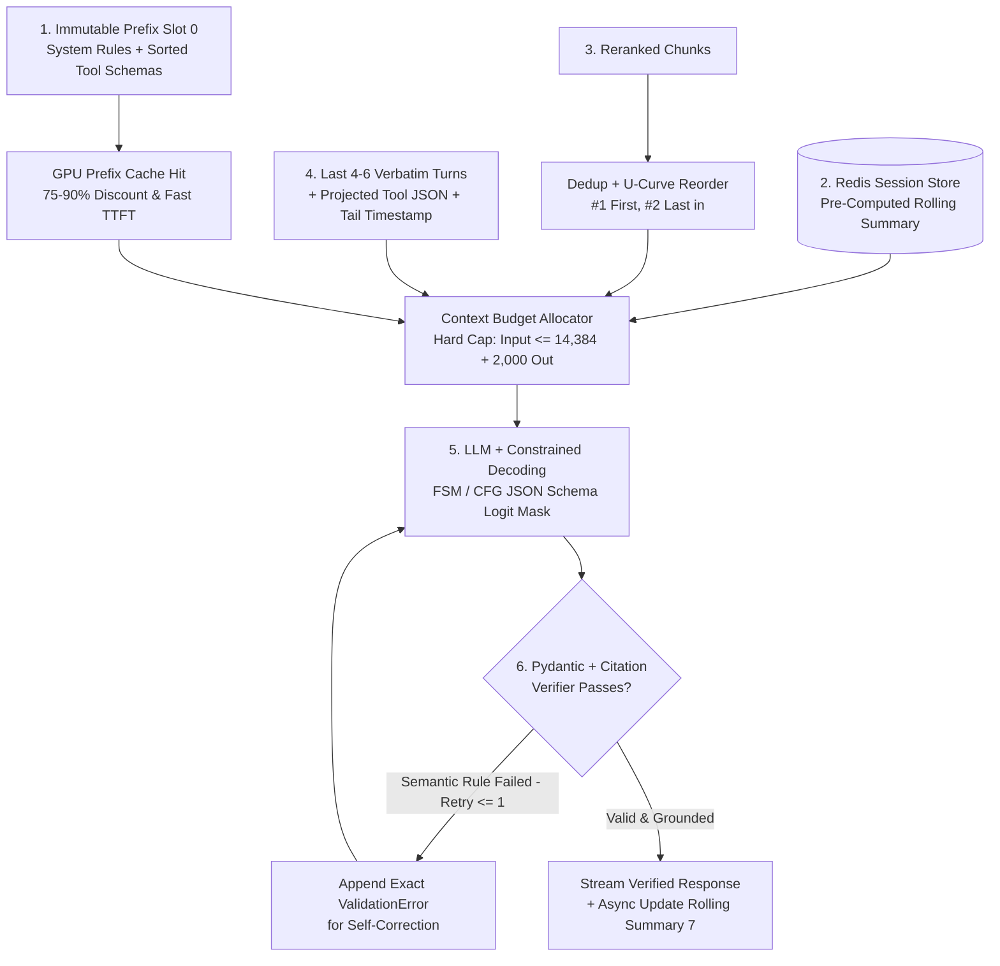

# Session 26: Context Engineering — Token Budgets, Ordering, Compression, Citations & Structured Outputs

> **Prerequisites & Plain-English Summary**
>
> - **Prerequisites:**
>   - **Prefill Physics & Prefix Caching (`session-21`):** Provider KV-cache reuse requires byte-identical tokens starting strictly from index `0`—one changing timestamp at the top invalidates the entire cache!
>   - **Reranked Retrieval (`session-06`, `session-25`):** Even when retrieval hands you `8` great chunks, *how* you arrange, trim, label, and constrain them inside the prompt determines whether the model cites accurately or hallucinates.
>   - **Goodput & Output Reserve (`fund-08`, `session-21`):** Every model enforces `input_tokens + output_tokens <= max_context_len`—overflowing input leaves zero room for the answer or throws `400 InvalidArgument`.
> - **Plain-English Core:** Context engineering treats the AI's prompt like a strict airline carry-on weight budget—placing unchanging rules and tools at the very front for 75% cache savings, putting the strongest evidence at the very start and end where attention is sharpest, enforcing inline source citations, and locking output tokens to a strict JSON grammar so downstream code never crashes on malformed text.

---

## 1. Build It From Zero (Basics + Socratic Walkthrough)

### What Are We Actually Building, and Why Is It Hard?
Imagine your multi-turn enterprise assistant is live. On Turn 14 of a debugging chat, the user uploads a log snippet, `3` MCP tools return `18,000` tokens of raw JSON API responses, retrieval pulls `12` KB chunks (`6,000` tokens), and your FastAPI server concatenates everything into one giant string:
`f"Current time: {datetime.now()}\n{system_prompt}\n{tools}\n{all_14_turns}\n{12_chunks}\n{tool_json}"`

Four production bugs explode at once:
1. **Cache hit rate is `0.0%`:** Because `datetime.now()` changes every second on Line 1, your `4,000`-token system prompt + tool definitions get re-computed and billed at full price on `100%` of calls!
2. **HTTP `400` Context Overflow:** Turn 15 crosses the route's `32K` token cap and crashes mid-conversation.
3. **"Lost in the Middle" + Fabricated Citations:** The exact answer sat in Chunk #7 (buried in the middle of `24,000` noisy tokens); the LLM overlooked it, guessed an answer from pretraining memory, and slapped `[Source 2]` onto a claim `[Source 2]` never made!
4. **Broken Downstream JSON:** Your API asked the LLM *"Return ONLY valid JSON"*, and on `2%` of requests it replied: ```` ```json\n{"action": "refund", "amount": 50,}\n``` ```` (markdown fences + trailing comma!), crashing `json.loads()` in production!

### The Socratic Ladder: Discovering Context Engineering Discipline

**🤔 Question 1: Why did putting `Current time: 10:42:01` on Line 1 wipe out `75%` prompt-cache savings—and how should every prompt be ordered from top to bottom?**
GPU prefix caching reuses saved attention math (`KV blocks`) from left to right starting at Token `0`, stopping at the **very first token that differs**! Put `100%` static bytes first (`System Instructions -> Tool Schemas -> Few-Shot Examples`), semi-stable session context next (`Rolling Conversation Summary`), and fast-changing per-turn data (`Retrieved Chunks -> Recent Verbatim Turns -> Current Timestamp + User Query`) at the very bottom!

**🤔 Question 2: How do you guarantee Turn 50 of a chat NEVER crashes with `ContextWindowExceeded` while still remembering what the user said in Turn 2?**
Treat the context window like a **fixed-size memory allocator** with priority buckets! Reserve `output_reserve` (`e.g., 2,048` tokens) + `static_prefix` (`4,000` tokens) first—those are non-negotiable. Give `verbatim_recent_turns` (`last 4–6 turns`) and `reranked_evidence` explicit token ceilings, truncate bulky raw tool JSON outputs deterministically, and fold older turns (`Turns 1..N-6`) asynchronously *in the background after each turn* into a compact `500-token` **Rolling Summary**!

**🤔 Question 3: When you place `8` retrieved chunks into the prompt, why does putting them in order `#1, #2, #3, #4, #5, #6, #7, #8` waste attention on `#2` and `#3`?**
Transformer attention over long prompts follows a **U-shaped curve** ("primacy" and "recency" bias): models attend far more strongly to tokens at the **very beginning** and **very end** of the evidence block than to tokens buried in the middle! Placing your `#1` chunk at the top, `#2` chunk at the **very bottom** right next to the user's question, and weaker `#5..#8` chunks in the middle lifts factual extraction accuracy immediately for **zero extra tokens**!

**🤔 Question 4: How do you stop the LLM from inventing facts or attaching fake `[Source 2]` citations?**
Two contracts—one before generation, one after:
1. Wrap each chunk with an explicit immutable ID + metadata (`<source id="doc42_c3" date="2026-02">...</source>`), require inline `[doc42_c3]` tags after every factual sentence, and explicitly reward **calibrated abstention** (*"If the provided `<source>` blocks do not contain the answer, output `insufficient_evidence: true`—never extrapolate"*).
2. Run a deterministic `<2 ms` post-check verifying every cited ID exists in the injected set + lightweight quote/NLI grounding verification on high-stakes routes!

**🤔 Question 5: Prompting *"Please output valid JSON"* still fails `1–3%` of the time. How do you get `100.00%` valid JSON syntax on the very first try?**
Don't *beg* the model in English—**mask its vocabulary logits during decoding**! Compile your JSON Schema (Pydantic model) into a **Finite-State Machine (`FSM`) / Context-Free Grammar (`CFG`)**. If the output so far is `{"amount": `, the grammar mask sets every non-digit/minus token's probability to `0` (`logit = -∞`) *before* sampling—making invalid JSON mathematically impossible to emit!

### Naming What You Just Invented
1. Static-first token layout (`[System + Tools] -> [Summary] -> [RAG + Recent Turns]`) is **Prefix-Cache-Aligned Prompt Architecture**.
2. Priority token caps + async rolling history compaction + extractive pruning is **Deterministic Context Budgeting & Compression**.
3. Placing top-ranked chunks at `[Start, ..., End]` is **U-Shaped ("Lost-in-the-Middle"-Aware) Ordering**.
4. `<source id>` contracts + abstention + post-hoc span verification is **Grounded Citation Engineering**.
5. Compiling Pydantic/JSON Schema into token-level logit masks (`Outlines` / `XGrammar` / `response_schema`) + business-rule repair loops is **Constrained Decoding & Reliable Tool Calling**.

### Explain It in Layers
- **One Line (Explain to a 12-Year-Old):** Pack your AI's backpack with fixed rulebooks at the bottom so security doesn't re-check them, put the two most important clues right on top where they're impossible to miss, require page numbers on every answer, and give it a fill-in-the-boxes form so it can never scribble outside the lines.
- **One Paragraph (Explain to a Non-Backend Engineer):** Even with great retrieval and a frontier LLM, sloppy prompt assembly ruins latency, cost, and accuracy. Context engineering manages the prompt as a strict token budget: keep static instructions and tool definitions byte-identical at the start to unlock 75%–90% provider prompt caching, compress old chat history asynchronously into rolling summaries, reorder retrieved chunks so the highest-ranked evidence sits at the start and end of the block (avoiding the "lost in the middle" blind spot), enforce verifiable inline citations with permission to say "I don't know," and use schema-constrained decoding so JSON and tool calls never break syntax.
- **Engineer Version:** A production **Context Builder** enforces hard invariant `Σ bucket_tokens + max_output_tokens <= model_context_limit` using exact model tokenization, aligns byte-stable prefixes (`system + sorted tool schemas + few-shots`) to KV block boundaries (`16/64/128` tokens) for **prefix cache reuse**, applies **extractive/abstractive compression** (`rolling async session summaries`, tool payload projection, sentence/token pruning), interleaves reranked passages via **alternating U-curve placement** (`[r1, r3, r5, ..., r6, r4, r2]`), enforces **provenance-verified `[source_id]` grounding**, and pairs **CFG/FSM logit-masked constrained decoding** with **semantic Pydantic validator retry loops**.

---

## 2. First Principles, Analogies, Interview Framing & Capacity Math

> **Why Interviewers Care & The 10-Second Mental Model**
>
> - **Why Interviewers Care:** Context engineering sits at the exact intersection of `ChatGPT-style Assistant`, `Enterprise RAG`, `Text-to-SQL`, and `Tool-Using Agents`. Interviewers probe: *"How do you manage 50-turn conversations?"*, *"Why did prompt caching get 0% hits?"*, *"How do you guarantee valid JSON and zero hallucinated citations?"*, and *"Why did your agent pick the wrong tool out of 40 tools?"*
> - **The 10-Second Mental Model:** **"Static bytes at token `0` (for KV prefix caching); dynamic bytes at the tail. Enforce per-bucket token caps + async rolling summaries. Order evidence in a U-curve (`#1` first, `#2` last). Mask logits with constrained decoding for `100%` valid syntax, and validate business semantics in code with error-feedback retry."**

### 1. The Context Window as a Strict Budget — "The 7-kg Carry-On Allocation"
Suppose our interactive RAG/Agent route targets a **`16,384`-token operational ceiling** (even if the model supports `128K`, capping normal turns at `16K` bounds `P99 TTFT < 1.2s` and runaway loop costs!). Here is a battle-tested **Context Budget Spec**:

| Slot Order (Top → Bottom) | Component | Token Budget (`16K` Cap) | Cacheability | Overflow / Eviction Policy (Deterministic!) |
| :--- | :--- | :--- | :--- | :--- |
| **`[0]` Byte-Identical Prefix** | System instructions + safety rules + **alphabetically sorted** tool JSON schemas + static few-shots | `3,000` (fixed) | **`100%` Prefix-Cached** (`75–90%` off!) | Version-controlled in Git; **never** interpolate timestamps, UUIDs, or `user_name` here! |
| **`[1]` User & Session Memory** | Compact user profile KV + **Async Rolling Summary** of turns `1..(T-6)` | `800` max | Semi-stable (`cached across a few turns`) | Updated asynchronously *after* every `4` turns so summarization adds **`0 ms`** to live `TTFT`! |
| **`[2]` Grounding Evidence** | Deduplicated, reranked chunks wrapped in `<source id="..." date="...">` | `5,000` max (`~6–8` chunks) | Uncached (per-query) | Drop lowest-scored chunks first; arrange remaining in **U-shaped order** (`#1` first, `#2` last). |
| **`[3]` Verbatim History + Tool Outputs** | Last `4–6` verbatim user/assistant turns + projected tool results | `5,000` max | Uncached (growing tail) | Project huge `20 KB` tool JSON down to required schema fields; drop oldest verbatim turn once summarized. |
| **`[4]` Current Turn Trigger** | Current date/locale context + raw user message | `584` max | Uncached (final bytes) | Truncate/summarize giant pasted logs via Claim-Check attachment flow if `> 4,000` tokens. |
| **`[5]` Output Reserve** | Reserved headroom for model reasoning + structured answer | **`2,000` reserved** | Decode budget | Passed explicitly as `max_tokens = 2000` so `input + output <= 16,384` **never** throws HTTP `400`! |

### 2. Ordering ("Lost in the Middle"), Deduplication & Compression
- **U-Shaped Attention ("Jury Opening & Closing Arguments"):** Liu et al. (*Lost in the Middle*) demonstrated `15–25%` accuracy drops when the sole relevant passage sits at position `#10` of `20` vs. `#1` or `#20`. Given reranked chunks `[c1, c2, c3, c4, c5, c6]` (best to 6th), interleave from outside in: **`[c1, c3, c5, c6, c4, c2]`**—putting `#1` at the very start of `<sources>` and `#2` right above the user's question!
- **Near-Duplicate Chunk Pruning (`Cosine > 0.90` / `Jaccard > 0.80`):** Before spending precious budget on `6` chunks that all paraphrase the same FAQ page, run Maximal Marginal Relevance (`MMR`) or simple pairwise token-Jaccard dedup so every slot adds *new* facts.
- **3 Practical Compression Tiers (Skip Over-Engineered Tricks First!):**
  1. **Tool Output Projection (`Biggest Win, 0 ms`):** A Salesforce `get_account` API returns `180` fields (`9,500` tokens); projecting to the `9` fields the agent actually needs shrinks it to `220` tokens (`43×` compression, `0%` loss)!
  2. **Extractive Sentence Pruning:** Score sentences inside retrieved parent chunks with your Cross-Encoder/embedder and keep top sentences + table headers when budget is tight. (Perplexity-based token droppers like `LLMLingua` save tokens on massive prompts, *but* garbled grammar can hurt exact numbers/code and breaks readability—test carefully before production!)
  3. **Async Rolling Conversation Summary:** Summarize turns `1..6` in a background worker *after* streaming Turn 6's answer, storing `{summary_up_to_turn: 6, text: "..."}` in Redis ready for Turn 7 in `<1 ms`!

### 3. Structured Outputs & Constrained Decoding — "Railroad Switch Locks on Logits"
- **How Constrained Decoding (`Outlines`, `XGrammar`, `llguidance`, OpenAI/Gemini `response_schema`) Works Under the Hood:**
  1. Compiles your JSON Schema (`{"type": "object", "properties": {"decision": {"enum": ["approve", "escalate"]}, "refund_usd": {"type": "number"}}, "required": [...]}`) into a **Pushdown Automaton / Context-Free Grammar** mapped over the BPE tokenizer vocabulary (`<5 ms`, cached per schema!).
  2. At every decode step `t`, computes a boolean bitmask over the `128,000` vocab tokens—setting every syntactically illegal continuation to `-∞` *before* softmax.
  3. **Result:** **`100.0%` valid JSON, valid enum strings, and zero markdown fences!**
- **The Critical Catch — Syntax `!=` Semantics!**
  - Constrained decoding guarantees `"refund_usd": 999999.99` is a *syntactically valid JSON float*, **not** that `$999,999.99 <= order_total ($42.00)`!
  - Always pair constrained decoding with **deterministic Pydantic `@model_validator` business checks** and at most **`1–2` error-feedback repair retries** (appending `"ValidationError: refund_usd (999999.99) cannot exceed order_total (42.00). Re-emit corrected JSON."`).

### 4. Function Calling Reliability at Scale (`5` Tools vs. `80` Tools)
- **Why Agents Degrade Past `~15–20` Tools:** Stuffing `80` verbose MCP tool schemas (`18,000` tokens!) into every prompt burns prefill budget and confuses argument selection across overlapping tools (`update_ticket` vs `patch_case` vs `modify_incident`).
- **4 Production Rules for `98%+` Tool-Call Accuracy:**
  1. **Dynamic Tool Retrieval / Sub-Agent Scoping:** Give each specialized sub-agent only **`4–8` cohesive tools** (or retrieve top-10 relevant tool schemas per turn—note: sub-agent static tool sets preserve **prefix caching**, whereas per-query dynamic tool subsets break prefix caching!).
  2. **Docstrings Written Like Senior API Specs:** State *when to use*, *when NOT to use*, parameter units (`amount_cents: int`, not `amount: float`!), and valid examples.
  3. **Flat, Strongly Typed Enums Over Free-Form Strings:** Prefer `Literal["last_7d", "last_30d", "ytd"]` over `"date_filter: str (any SQL expression)"`.
  4. **Actionable Tool Error Strings:** Never crash the loop on a `400` from a downstream API—catch and return `"ToolError: customer_id 'alice@acme.com' looks like an email; call lookup_customer_by_email first to obtain integer customer_id"` so the model self-corrects on the next step!

### Timestamped Story ("Alice & Bob"): The `UUID` on Line 2 That Cost `$14,000/Month`
- `Wed 09:00 AM` — **Alice** deploys a `4,800`-token enterprise system prompt + `12` MCP tool schemas (`150 QPS` average ≈ `13M` calls/day), expecting Gemini/Anthropic Prefix Caching (`75%` input discount) to keep monthly prefill spend at `$6,200`.
- `Wed 09:00:01 AM` — Unknown to Alice, a middleware helper injects `Request Trace ID: 9b1deb4d-...` on **Line 2** of the system prompt, and passes `tools = list(tool_registry_set)` (Python `set` iteration order changes across pod restarts!).
- `Thu 10:00 AM` — **Bob** inspects billing metrics: `cached_content_token_count == 0` across all `13M` calls (`$20,400/mo` trajectory!), AND `1.4%` of citations reference hallucinated `[Source 9]` when only `6` sources were provided!
- **The 20-Minute Fix:** (1) Move `trace_id` and `current_date` to the **final user turn block** and sort `tools` deterministically by `tool["name"]` → prefix cache hit rate jumps from **`0%` to `91%`** in 5 minutes; (2) replace integer `[Source 1..6]` with immutable hash IDs (`[s_a81f]`), constrain output schema to `citations: list[Literal[*allowed_source_ids]]` dynamically!

---

## 3. Visual Architecture Blueprint

Follow `1 → 7` below to see how a **Production Context Builder & Grounded Structured-Output Pipeline** assembles a prompt and verifies every output claim:

1. **Step 1 (Immutable Prefix Assembly — Slot `0`):** Concatenates pinned `system_prompt_v14` + deterministically sorted `tool_schemas` (`byte-identical across all users` → hits GPU KV Prefix Cache!).
2. **Step 2 (Async Memory Read — Slot `1`):** Reads pre-computed `rolling_summary` + user profile KV from Redis in `<1.5 ms` (`zero inline summarization wait`).
3. **Step 3 (Deduplicate + U-Curve Evidence Layout — Slot `2`):** Prunes near-duplicate chunks (`Jaccard > 0.80`), enforces the `5,000-token` evidence cap, and orders chunks `[#1, #3, #5, #6, #4, #2]` wrapped in `<source id="c_xx" date="...">`.
4. **Step 4 (Projected History & Tail Trigger — Slots `3–4`):** Projects verbose tool JSON outputs, trims verbatim turns to budget, appends `current_timestamp + user_query` at the very end, and verifies `total_input + 2,000 <= 16,384`.
5. **Step 5 (Grammar-Constrained Generation):** Decodes under compiled JSON Schema FSM/CFG mask (`100%` valid JSON + enum-locked `cited_source_ids`!).
6. **Step 6 (Deterministic Business & Citation Verifier):** Validates Pydantic domain rules (`refund <= order_total`, every `cited_id ∈ injected_ids`, `insufficient_evidence` abstention honored); on semantic violation, executes at most `1` targeted error-feedback repair call.
7. **Step 7 (Background Post-Turn Compaction):** Enqueues async task to fold older verbatim turns into Redis `rolling_summary` when verbatim tokens cross `3,500`.



---

## 4. Side-by-Side Comparison & Trade-Off Table

| Problem Area | Naive Approach | Production Pattern (Winner) | Why It Wins | Watch Out For (The Trap) |
| :--- | :--- | :--- | :--- | :--- |
| **Prompt Layout & Caching** | Inject `date`, `user_id`, and retrieved docs at the top above instructions | **Stable Prefix First (`System + Sorted Tools -> RAG -> Query`)** | Unlocks `75–90%` provider input discount & cuts prefill `TTFT` `2–4×` | Unsorted dict/set keys in JSON tool schemas subtly permute token order across restarts, breaking cache hits! |
| **Chunk Ordering** | Descending `[#1, #2, #3, ..., #10]` | **U-Shaped Interleaving `[#1, #3, #5, ..., #6, #4, #2]`** | Places #1 and #2 at primacy + recency attention peaks (`+5–12%` recall) | Stuffing `25` chunks when only `5` cleared relevance floor still dilutes attention even with U-ordering. |
| **Long Chat History** | Truncate oldest messages abruptly OR summarize synchronously before calling LLM | **Sliding Verbatim Window (`4–6` turns) + Async Background Rolling Summary** | Zero `TTFT` penalty while preserving early-session constraints (`budget, stack`) | Summarizer drift dropping exact IDs (`order #88412`)—keep a small structured `pinned_facts` dict alongside prose summary! |
| **JSON / Tool Extraction** | Prompt *"Output valid JSON only"* + regex strip markdown fences | **Constrained Decoding (`response_schema` / `XGrammar`) + Pydantic Semantic Retry** | `100.0%` valid JSON syntax on pass 1; business invariants enforced in Python | Deeply nested recursive `anyOf` JSON schemas bloat grammar compilation time—keep schemas flat and explicit! |
| **Citation Grounding** | Ask model to write `[1], [2]` in free text without verification | **XML `<source id="x">` + Schema-Constrained `citations[]` + Quote/Span Check** | Eliminates out-of-bounds `[Source 11]` hallucinations & enables clickable UI cards | Model citing a valid `source_id` that talks about a *different* metric—verify key numbers/spans against cited chunk text! |

---

## 5. Deep-Dive Mechanics & Production Failure Analysis

### Under-the-Hood Tricks (What Separates Junior from Senior Answers)

1. **Why Reasoning / CoT Field Order Inside Structured JSON Schema Matters (`rationale` BEFORE `decision`!):**
   - Autoregressive models generate JSON keys strictly left-to-right! If your Pydantic schema defines `{"decision": Literal["approve", "deny"], "rationale": str}`, the model commits to `"approve"` on **Token #4** *before* doing a single token of reasoning, and then rationalizes its premature guess! Always order schema fields **`{"evidence_quotes": list[str], "step_by_step_reasoning": str, "decision": Literal[...], "cited_ids": list[str]}`** (or use native reasoning tokens before constrained output) so reasoning conditions the final classification!
2. **Dynamic Enum Locking on Citations (`Literal[*injected_chunk_ids]`):**
   - If retrieval injected chunks `["doc12_c4", "doc99_c1", "doc07_c8"]`, dynamically build this turn's `response_schema` with `"cited_sources": {"type": "array", "items": {"enum": ["doc12_c4", "doc99_c1", "doc07_c8"]}}`. Now constrained decoding makes it **physically impossible** for the LLM to invent a non-existent document ID!
3. **Sub-Agent Static Tool Sets Beat Dynamic Per-Turn Tool Retrieval for Latency & Cost:**
   - Dynamically retrieving `top-8` tools out of `100` on every turn changes Slot `[0]` on every single message—destroying your `3,500`-token prefix cache! Grouping `100` tools into `5` domain sub-agents (`Billing = 7 fixed tools`, `Logistics = 6 fixed tools`) keeps each sub-agent's prefix `100%` static and cached!

### Failure Modes in Production

#### Failure Mode 1: Raw Tool Payload Explosion Triggers Mid-Loop Context Overflow (`HTTP 400`)
- **How It Happens at 2 AM:**
  1. An enterprise support agent calls `list_user_transactions(user_id=901)` for a power corporate account that has `1,400` transactions (`78,000` JSON tokens!).
  2. The orchestrator appends the raw JSON string directly into `messages` and invokes Step 2 of the agent loop, immediately crashing with `400 maximum context length exceeded` and dropping the customer's chat.
- **How to Detect It in Metrics:**
  - Track `tool_response_tokens_p99` per tool name and `context_overflow_truncations_total` / `400_invalid_argument_rate`.
- **Exact Mitigation:**
  1. Enforce a **Tool Output Gateway Guard (`max_tool_tokens = 1,500`)**: paginate tool schemas by default (`limit: int = Field(default=10, le=25)`), project away unused columns, and if an output still exceeds `1,500` tokens, persist the full blob to Redis/GCS and return a compact summary + schema preview (`"Returned 1,400 rows ($412k total); showing most recent 10. Filter by date_range or status to inspect further."`).

#### Failure Mode 2: Sycophantic Guessing When Evidence Is Missing ("Confident Hallucination Under Empty Context")
- **How It Happens at 2 AM:**
  1. User asks *"Does our Platinum plan cover ransomware negotiation fees?"*. Retrieval finds `5` Platinum plan chunks about cloud backups and uptime SLAs (`none` mention ransomware!).
  2. Standard helpfulness RLHF biases the LLM to please the user rather than refuse—so it extrapolates *"Yes, as part of comprehensive Platinum security support..."* and cites the generic SLA chunk!
- **How to Detect It in Metrics:**
  - Sampled **Faithfulness / NLI Entailment Judge** (`premise = cited_chunk_text`, `hypothesis = sentence_claim`) catching `entailment_score < 0.5`, plus synthetic **"Unanswerable Golden Set"** (`50` domain questions whose answer is deliberately absent from the KB, targeting **`>= 98%` abstention rate**!).
- **Exact Mitigation:**
  1. Provide a first-class **`status: Literal["answered", "insufficient_evidence", "needs_clarification"]`** escape hatch in the output schema (models abstain far more reliably when abstention is an explicit enum option rather than free-form apology prose!), and verify numeric figures (`$`, `%`, dates) in the generated answer appear verbatim or mathematically derived from the cited `<source>` text.

---

## 6. Production AI & Resume Tie-In

### 1. Deloitte Multi-Agent Customer Support (`96.2%` Groundedness + `75%` Prefix-Cache Savings)
- **The Architectural Fit:** In the **Deloitte Google ADK + FastAPI** customer support system on **GKE**, the **Response-Synthesis & Billing Sub-Agents** achieved **`96.2%` CI-gated Groundedness** and **`$2.85 / 1k` multi-turn session cost** through four explicit context-engineering rules:
  1. **Prefix-Cache-Locked Sub-Agent Prompts:** Pinned static policy rules + sorted **MCP tool schemas** at token `0`, pushing dynamic customer profile KV, Redis rolling chat summaries, and turn timestamps to the tail.
  2. **U-Shaped Evidence + Enum-Constrained Citations:** Ordered reranked policy chunks `[#1, #3, #5, #4, #2]` inside `<source id="...">` tags and used structured output schemas (`evidence_quotes -> reasoning -> answer -> cited_source_ids` + explicit `escalate_insufficient_evidence` enum) verified before streaming to the customer.

### Production Code: Deterministic Token-Budgeted, Prefix-Aligned & U-Ordered Context Builder + Citation Verifier (Python)

A complete, runnable production Context Builder implementing (1) static-first prefix-cache alignment, (2) U-curve chunk interleaving, (3) deterministic per-bucket token budgeting, and (4) post-generation citation + numeric grounding verification:

```python
import json, re
from dataclasses import dataclass

@dataclass
class SourceChunk:
    source_id: str
    published_date: str
    text: str
    score: float

def count_tokens(text: str) -> int:
    return max(1, int(len(text) / 3.6))  # Swap exact tiktoken / Vertex count_tokens codec in prod

def u_curve_reorder(chunks: list[SourceChunk]) -> list[SourceChunk]:
    """Places highest-ranked chunks at the edges (#1 first, #2 last) to defeat Lost-in-the-Middle!"""
    ordered_desc = sorted(chunks, key=lambda c: c.score, reverse=True)
    left, right = [], []
    for idx, ch in enumerate(ordered_desc):
        (left if idx % 2 == 0 else right).append(ch)
    return left + list(reversed(right))

def build_budgeted_prompt(
    static_system_rules: str,
    tool_schemas: list[dict],
    rolling_summary: str,
    chunks: list[SourceChunk],
    recent_turns: list[str],
    user_query: str,
    current_iso_date: str,
    max_context_tokens: int = 16_384,
    output_reserve_tokens: int = 2_000,
) -> tuple[list[dict], set[str]]:
    # 1. SLOT 0 (100% Static Prefix): sort tool schemas deterministically so KV cache NEVER misses!
    sorted_tools_json = json.dumps(sorted(tool_schemas, key=lambda t: t["name"]), sort_keys=True, separators=(",", ":"))
    immutable_prefix = f"{static_system_rules.strip()}\n\n<tools>{sorted_tools_json}</tools>"

    input_cap = max_context_tokens - output_reserve_tokens
    query_tail = f"<turn_meta date=\"{current_iso_date}\"/>\nUser: {user_query.strip()}"
    remaining = input_cap - count_tokens(immutable_prefix) - count_tokens(query_tail) - 64
    if remaining <= 0:
        raise ValueError("Static prefix + user query exceed context cap!")

    # 2. SLOT 1 (Rolling Summary <= 800 tok) & SLOT 2 (Evidence <= 55% of remaining, U-curve ordered!)
    summary_block = f"<conversation_summary>\n{rolling_summary[:2800]}\n</conversation_summary>" if rolling_summary else ""
    remaining -= count_tokens(summary_block)

    ev_budget = int(remaining * 0.55)
    selected_chunks, used_ev = [], 0
    for ch in sorted(chunks, key=lambda c: c.score, reverse=True):
        cost = count_tokens(ch.text) + 20
        if used_ev + cost <= ev_budget:
            selected_chunks.append(ch)
            used_ev += cost
    u_chunks = u_curve_reorder(selected_chunks)
    sources_xml = "<sources>\n" + "\n".join(
        f'<source id="{c.source_id}" date="{c.published_date}">{c.text}</source>' for c in u_chunks
    ) + "\n</sources>"
    remaining -= count_tokens(sources_xml)

    # 3. SLOT 3 (Recent Verbatim Turns from newest backward until remaining budget fills)
    kept_turns: list[str] = []
    for turn in reversed(recent_turns):
        t_cost = count_tokens(turn)
        if t_cost <= remaining:
            kept_turns.append(turn)
            remaining -= t_cost
        else:
            break
    history_block = "\n".join(reversed(kept_turns))

    dynamic_user_payload = "\n\n".join(b for b in [summary_block, sources_xml, history_block, query_tail] if b)
    messages = [
        {"role": "system", "content": immutable_prefix},   # Byte-identical across EVERY call!
        {"role": "user", "content": dynamic_user_payload}, # All dynamic bytes isolated at the tail!
    ]
    return messages, {c.source_id for c in u_chunks}

def verify_citations_and_numbers(answer_text: str, cited_ids: list[str], chunks_by_id: dict[str, str]) -> list[str]:
    """Deterministic <1ms post-check catching phantom source IDs and ungrounded numeric claims."""
    errors = [f"Hallucinated source_id '{cid}'" for cid in cited_ids if cid not in chunks_by_id]
    evidence_corpus = " ".join(chunks_by_id[cid] for cid in cited_ids if cid in chunks_by_id)
    for num in re.findall(r"\b\d+(?:\.\d+)?%?\b", answer_text):
        if len(num) >= 2 and num not in evidence_corpus:
            errors.append(f"Numeric claim '{num}' not found verbatim in cited sources")
    return errors
```

---

## 7. Common Interview Questions, Follow-Up Probes & Quick Recall

### Q1: "Design the Context Builder for a ChatGPT-style enterprise assistant supporting 50-turn chats, file RAG, and 20 tools under a strict token budget."
- **What the interviewer is testing:** End-to-end memory/budget allocation, zero-latency rolling compaction, and prefix-cache-aware layout.
- **How to answer simply:**
  > "I treat the context window as a deterministic 6-slot allocator where `sum(inputs) + output_reserve <= route_cap` (say `16,384` tokens):
  > - **Slot 0 (`~3,000` fixed):** Immutable system instructions + deterministically sorted tool schemas at token `0` so provider KV prefix caching hits `>85%` of turns.
  > - **Slot 1 (`<=800`):** Structured `pinned_facts` (user IDs, active constraints) + a **Rolling Summary** of older turns updated **asynchronously in a background worker** after every 4 turns (`0ms` live latency).
  > - **Slot 2 (`<=5,000`):** Deduplicated, reranked RAG chunks arranged in **U-shaped order** (`#1` first, `#2` last) inside `<source id>` tags.
  > - **Slot 3 (`<=5,000`):** Newest verbatim turns + **field-projected tool JSON** (capping any single tool response at `1,500` tokens with pagination pointers).
  > - **Slot 4 (`<=584`):** Current date/metadata + raw user message at the very tail, leaving **Slot 5 (`2,000` tokens)** explicitly reserved for `max_tokens` output."
- **Likely Follow-Up Probe ("The Double-Click"):**
  - *Interviewer:* "Why keep `pinned_facts` separate from the prose rolling summary?"
  - *Your Answer:* "Abstractive LLM summaries undergo 'telephone-game' compression loss over 40 turns—dropping exact UUIDs, ticket numbers, or negative constraints (*'never touch prod DB'*). Extracting exact entities/constraints into a tiny deterministic JSON dictionary alongside the narrative summary prevents drift."

### Q2: "You enabled Provider Prompt Caching on a 5,000-token system + tools prompt, yet your cache hit rate in production is 0%. What are the top 3 bugs you check?"
- **What the interviewer is testing:** Real-world debugging of exact token-0 prefix matching rules.
- **How to answer simply:**
  > "Provider KV prefix caching requires byte-for-byte identical tokens from index `0` past the minimum threshold (`typically 1,024 tokens`). The top three culprits are:
  > 1. **Dynamic header injection:** Interpolating `current_timestamp`, `request_id`, `user_name`, or per-user A/B flags near the top of the system prompt—move all dynamic variables to the final user message!
  > 2. **Non-deterministic JSON serialization of tools:** Iterating over a Python `set` or unsorted dictionary keys causes tool definitions to serialize in different orders across pods—always `sort(tools, key=name)` and `json.dumps(sort_keys=True)`.
  > 3. **Dynamic per-query tool filtering:** Injecting a different subset of 5 tools on every query mutates the prefix right after system instructions—group tools into static sub-agent profiles instead."
- **Likely Follow-Up Probe ("The Double-Click"):**
  - *Interviewer:* "What if two enterprise tenants share the exact same 5,000-token system prompt—is it safe for them to share a KV prefix cache?"
  - *Your Answer:* "For `100%` tenant-agnostic static developer instructions and tool schemas, yes—provider prefix caches hash prefix content and scope safely per API account; however, **the millisecond any tenant-specific document or few-shot example enters the prefix**, cache keys/scopes must isolate strictly by `tenant_id` so timing side-channels (`fast TTFT = another user just asked about Merger X!`) cannot leak!"

### Q3: "How does Constrained Decoding work under the hood, and why did a constrained JSON agent STILL issue an invalid $50,000 refund on a $40 order?"
- **What the interviewer is testing:** Understanding FSM/CFG token logit masking AND distinguishing syntactic validity from semantic/business validity.
- **How to answer simply:**
  > "Constrained decoding compiles a JSON Schema into a Finite-State Machine or Context-Free Grammar over the tokenizer's vocabulary and masks illegal continuation tokens to `-infinity` before sampling at every decode step—guaranteeing 100% valid JSON syntax, required keys, and allowed enum values.
  > However, **grammar masks enforce syntax, not business logic**! `50000.00` is a completely legal JSON `number` token sequence. To stop invalid business values, we pair constrained decoding with two layers: (1) put `evidence_quotes` and `reasoning` fields *before* `refund_amount` in the JSON schema so the model computes before committing, and (2) validate the parsed object in Python (`assert refund_amount <= order.paid_amount`), feeding exact `ValidationError` messages back for at most 1 self-repair retry or escalating to a human above financial thresholds."
- **Likely Follow-Up Probe ("The Double-Click"):**
  - *Interviewer:* "Can constrained decoding ever *hurt* reasoning quality compared to unconstrained text?"
  - *Your Answer:* "Yes! Forcing the model to jump straight into rigid JSON keys on Token #1 suppresses chain-of-thought reasoning (`5–15%` drop on math/SQL benchmarks). Either include an initial `reasoning_steps: str` field as the very first JSON key or let native model thinking run unconstrained *before* applying the grammar mask to the final answer block."

### Q4: "How do you engineer an assistant so every factual claim has an accurate clickable citation—and so it says 'I don't know' instead of bluffing?"
- **What the interviewer is testing:** Practical grounding + abstention architecture beyond naive system-prompt begging.
- **How to answer simply:**
  > "I enforce grounding at three stages:
  > 1. **Input tagging & filtering:** Drop low-score reranker tail noise before prompt assembly, and wrap surviving passages in `<source id='doc42_c3' date='2026-01'>` tags arranged in U-curve order.
  > 2. **Schema-level abstention & enum locking:** Give the structured output schema an explicit `outcome: Literal['answered', 'insufficient_evidence']` field and dynamically lock `citations` items to `Enum[injected_source_ids]`—models abstain reliably when 'insufficient_evidence' is a first-class schema state, and enum masking prevents phantom IDs.
  > 3. **Post-generation verification:** Run a `<2ms` regex check confirming numbers/entities appear in cited chunks, plus an async (or inline on regulated medical/legal routes) NLI entailment check comparing each claim sentence against its cited `<source>` text."
- **Likely Follow-Up Probe ("The Double-Click"):**
  - *Interviewer:* "Your agent has 65 MCP tools and starts calling the wrong tool with hallucinated arguments 15% of the time. How do you fix it?"
  - *Your Answer:* "Decompose the monolith into a Supervisor + 5 domain sub-agents each holding only `8–12` sharply documented tools, replace free-form string parameters with typed `Literal` enums, strip internal implementation noise from schemas, and return descriptive self-correcting error strings whenever validation fails."

### 60-Second Rapid Fire (Self-Check)
- **Q: Given reranked chunks `[#1, #2, #3, #4, #5, #6]`, what order defeats "Lost in the Middle"?**
  - **A:** **`[#1, #3, #5, #6, #4, #2]`** — best at the very start, second-best at the very end right above the question!
- **Q: Why should `reasoning` always appear *before* `decision` in a Structured Output JSON schema?**
  - **A:** Autoregressive decoding runs left-to-right; putting `decision` first forces the model to guess before thinking!
- **Q: Why update conversation rolling summaries *asynchronously after* a turn instead of right before calling the LLM?**
  - **A:** Keeps `300–600 ms` of summarization latency **completely off the user's critical `TTFT` path**.
- **Q: What breaks Provider Prefix Caching silently in Python tool-calling apps?**
  - **A:** Dynamic timestamps/UUIDs near token `0` OR unsorted dict/set ordering in serialized tool schemas!

### Deliverable & Canonical Problems Unlocked
- **Deliverable:** Write your 1-page Context-Builder Specification (`6-slot token budget table`, `U-curve ordering rule`, `tool output 1,500-token guard`, and `JSON Schema field order + abstention contract`).
- **Canonical Problems Unlocked:** [Design a ChatGPT-style Conversational Assistant](/problems?id=chat-assistant) · [Design a Web Answer Engine](/problems?id=answer-engine) · [Design a Text-to-SQL Analytics Agent](/problems?id=text-to-sql) · [Design a Multi-Agent Customer Support System](/problems?id=support-agent)
