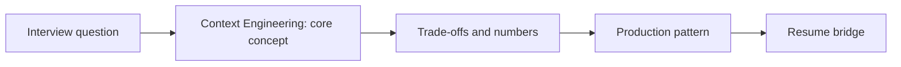

# Session 26: Context Engineering: Token Budgets, Ordering, Compression, Citations & Structured Outputs

> **Status: SKELETON** (content to be written; follow `CONTENT_GUIDELINES.md`)
> - **Phase 1: Foundational Building Blocks** | **Week 3** | **Priority:** core | **Session type:** NEW
> - **Module:** Module 2: RAG, Search & Multimodal
> - **Resume anchor:** Deloitte response-synthesis agent (grounded answers)

---

## Part 1: Quick Summary

> TODO (3-4 bullets): what this is in plain English, why interviewers care, the 10-second mental model.

## Part 2: Topics to Cover (Study Checklist)

- [ ] Context window as a budget: system prompt, history, retrieved chunks, tool results, output reserve
- [ ] Ordering and 'lost in the middle'; deduplication and reranking before stuffing
- [ ] Compression: extractive, summarization, conversation rolling summaries
- [ ] Citation and grounding patterns; refusing when evidence is missing
- [ ] Structured outputs: JSON schema, constrained decoding, retries/repair
- [ ] Function calling reliability: tool descriptions, schema design, parallel calls, error feedback
- [ ] Prompt/version management and prompt caching-friendly layout (stable prefix first)

## Part 3: First Principles & Analogies

TODO: one everyday analogy per concept above, plus a concrete failure scenario.

## Part 4: Concept Blueprint

TODO: replace with the real architecture / decision-tree diagram.

## Part 5: Trade-Off Decision Matrix

| Option / Pattern | Latency | Cost | Complexity | When to Pick / Watch Out For |
| :--- | :--- | :--- | :--- | :--- |
| TODO option A | TODO | TODO | TODO | TODO |
| TODO option B | TODO | TODO | TODO | TODO |
| TODO option C | TODO | TODO | TODO | TODO |

## Part 6: Deep-Dive Mechanics & Numbers

TODO: the math, edge cases and "tricks" that separate a senior answer from a mid-level one.

## Part 7: Production AI & Resume Tie-In

TODO: how this applies to production AI systems and to **Deloitte response-synthesis agent (grounded answers)**; include a short annotated code or design snippet.

## Part 8: Interview Questions (Answered Simply)

TODO: 4-6 questions, each with **What they are really testing** and **How to answer simply** (spoken-English blockquote).

## Canonical Problems Unlocked

- [chat-assistant](/problems?id=chat-assistant)
- [answer-engine](/problems?id=answer-engine)
- [text-to-sql](/problems?id=text-to-sql)
- [support-agent](/problems?id=support-agent)

## Deliverable (Do This Before Moving On)

- [ ] Context-builder spec: budget table + ordering rules + overflow policy.

## Socratic Study Prompt

> *"Teach me context engineering: building the prompt under a token budget, ordering and compression, citation grounding, structured outputs / constrained decoding, and function-calling reliability. Then ask me to design the context builder for a ChatGPT-style assistant."*
