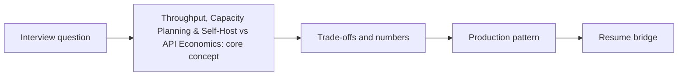

# Session 29: Throughput, Capacity Planning & Self-Host vs API Economics

> **Status: SKELETON** (content to be written; follow `CONTENT_GUIDELINES.md`)
> - **Phase 2: Production Optimization** | **Week 5** | **Priority:** core | **Session type:** NEW
> - **Module:** Module 1: Backend, Caching & Capacity Planning
> - **Resume anchor:** Cross-platform AI architecture ($1.3M+ savings story)

---

## Part 1: Quick Summary

> TODO (3-4 bullets): what this is in plain English, why interviewers care, the 10-second mental model.

## Part 2: Topics to Cover (Study Checklist)

- [ ] Users -> QPS -> concurrent streams -> tokens/sec -> GPUs -> $ (the chain)
- [ ] API vs self-host break-even (utilisation is the whole game)
- [ ] Provisioned throughput, reserved capacity, spot GPUs, and warm pools
- [ ] Batch / offline APIs and async tiers for non-interactive work (50% discounts)
- [ ] Multi-region and multi-provider capacity; failover under 429s
- [ ] Cost per resolved task / per active user as the unit metric
- [ ] Cost anomaly detection and budgets per tenant/feature

## Part 3: First Principles & Analogies

TODO: one everyday analogy per concept above, plus a concrete failure scenario.

## Part 4: Concept Blueprint

TODO: replace with the real architecture / decision-tree diagram.

## Part 5: Trade-Off Decision Matrix

| Option / Pattern | Latency | Cost | Complexity | When to Pick / Watch Out For |
| :--- | :--- | :--- | :--- | :--- |
| TODO option A | TODO | TODO | TODO | TODO |
| TODO option B | TODO | TODO | TODO | TODO |
| TODO option C | TODO | TODO | TODO | TODO |

## Part 6: Deep-Dive Mechanics & Numbers

TODO: the math, edge cases and "tricks" that separate a senior answer from a mid-level one.

## Part 7: Production AI & Resume Tie-In

TODO: how this applies to production AI systems and to **Cross-platform AI architecture ($1.3M+ savings story)**; include a short annotated code or design snippet.

## Part 8: Interview Questions (Answered Simply)

TODO: 4-6 questions, each with **What they are really testing** and **How to answer simply** (spoken-English blockquote).

## Canonical Problems Unlocked

- [chat-assistant](/problems?id=chat-assistant)
- [llm-gateway](/problems?id=llm-gateway)
- [inference-serving](/problems?id=inference-serving)

## Deliverable (Do This Before Moving On)

- [ ] Capacity + cost model spreadsheet for 10M WAU chat product, API vs self-host.

## Socratic Study Prompt

> *"Teach me LLM capacity planning: converting users to QPS to tokens/sec to GPUs to dollars, API vs self-host break-even, provisioned throughput, batch APIs for offline work, multi-region capacity. Then give me a 10M-user scenario to size."*
