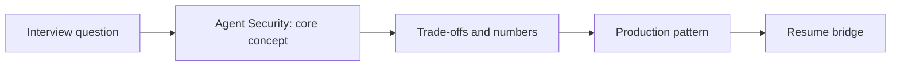

# Session 31: Agent Security: Prompt Injection, Lethal Trifecta, Tool/MCP/Memory Poisoning & Sandboxing

> **Status: SKELETON** (content to be written; follow `CONTENT_GUIDELINES.md`)
> - **Phase 2: Production Optimization** | **Week 7** | **Priority:** core | **Session type:** NEW
> - **Module:** Module 5: LLMOps, Evals, Security & Mocks
> - **Resume anchor:** Deloitte customer-support agent with CRM/ERP tool access (scoped IAM)

---

## Part 1: Quick Summary

> TODO (3-4 bullets): what this is in plain English, why interviewers care, the 10-second mental model.

## Part 2: Topics to Cover (Study Checklist)

- [ ] OWASP Top 10 for LLM applications as the checklist
- [ ] Direct vs indirect prompt injection (emails, web pages, RAG documents, tool outputs)
- [ ] The lethal trifecta: private data + untrusted content + external communication
- [ ] Excessive agency: least privilege, per-call authorisation, human approval for irreversible actions
- [ ] MCP / tool poisoning and rug-pulls; supply-chain trust of tools
- [ ] Memory poisoning: write validation, provenance, TTL, per-user isolation
- [ ] Sandboxing code execution; network egress control
- [ ] Exfiltration channels (markdown images, links) and output filtering
- [ ] Architectural patterns: dual-LLM / quarantine, capability-based tool gateways

## Part 3: First Principles & Analogies

TODO: one everyday analogy per concept above, plus a concrete failure scenario.

## Part 4: Concept Blueprint

TODO: replace with the real architecture / decision-tree diagram.

## Part 5: Trade-Off Decision Matrix

| Option / Pattern | Latency | Cost | Complexity | When to Pick / Watch Out For |
| :--- | :--- | :--- | :--- | :--- |
| TODO option A | TODO | TODO | TODO | TODO |
| TODO option B | TODO | TODO | TODO | TODO |
| TODO option C | TODO | TODO | TODO | TODO |

## Part 6: Deep-Dive Mechanics & Numbers

TODO: the math, edge cases and "tricks" that separate a senior answer from a mid-level one.

## Part 7: Production AI & Resume Tie-In

TODO: how this applies to production AI systems and to **Deloitte customer-support agent with CRM/ERP tool access (scoped IAM)**; include a short annotated code or design snippet.

## Part 8: Interview Questions (Answered Simply)

TODO: 4-6 questions, each with **What they are really testing** and **How to answer simply** (spoken-English blockquote).

## Canonical Problems Unlocked

- [support-agent](/problems?id=support-agent)
- [coding-agent](/problems?id=coding-agent)
- [ai-memory](/problems?id=ai-memory)
- [deep-research](/problems?id=deep-research)

## Deliverable (Do This Before Moving On)

- [ ] Threat model (STRIDE-style table) for a tool-using agent with mitigations.

## Socratic Study Prompt

> *"Teach me agent security: OWASP Top 10 for LLM apps, direct vs indirect prompt injection, the lethal trifecta, excessive agency, MCP tool poisoning, memory poisoning, sandboxed execution, and exfiltration channels. Then threat-model my Deloitte support agent and grill me on mitigations."*
